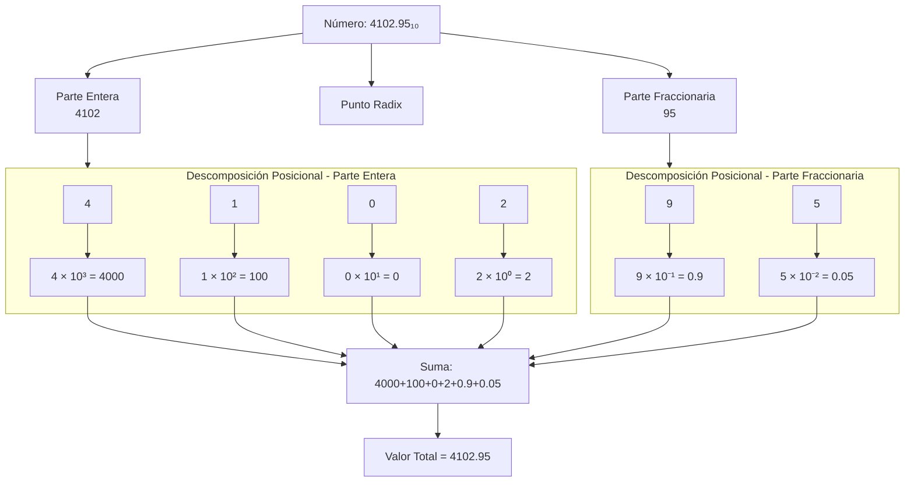

# Organización y Arquitectura de Computadoras - Representación de datos en una computadora digital

## 2.1 Sistemas numéricos posicionales.

---

### 1. Introducción

El sistema de numeración decimal (base-10) que utilizamos a diario no es el más eficiente para las computadoras digitales. Estas, en su nivel más fundamental, operan con dos estados (presencia o ausencia de voltaje, "1" o "0"), lo que hace que el sistema binario (base-2) sea su lenguaje natural. Comprender los sistemas numéricos posicionales es el primer paso fundamental para entender cómo una computadora almacena, procesa y manipula todos los datos.

### 2. Definición de un Sistema Numérico Posicional

Un sistema numérico posicional es un sistema de numeración en el que el valor de un dígito depende no sólo del dígito en sí, sino también de su **posición** dentro del número. Esto contrasta con sistemas no posicionales, como los números romanos (donde 'V' siempre significa 5, sin importar su posición).

La base o **raíz** $(r)$ de un sistema numérico define el número de dígitos únicos disponibles, incluyendo el cero. Los dígitos en un sistema de base $r$ van desde $0$ hasta $r-1.$

### 3. Fórmula General de un Número Posicional

Cualquier número $N$ en una base $r$ puede ser expresado como una suma ponderada de sus dígitos:

$$ N_r = (d_{n-1}d_{n-2}...d_1d_0.d_{-1}d_{-2}...d_{-m})_r $$

Su valor decimal equivalente se calcula con la fórmula:

$$ N_{10} = \sum_{i=-m}^{n-1} d_i \times r^{i} $$

Donde:

- $d_i:$ Es el dígito en la posición $i.$
- $r:$ Es la base del sistema numérico.
- $i:$ Es el índice de la posición (potencia a la que se eleva la base). Los índices a la izquierda del punto son positivos y a la derecha, negativos.
- $n:$ Número de dígitos a la izquierda del punto.
- $m:$ Número de dígitos a la derecha del punto.

#### Diagrama de la Estructura de un Número



### 4. Sistemas Numéricos Relevantes en Computación

#### a) Sistema Decimal (Base-10)

- **Dígitos:** 0, 1, 2, 3, 4, 5, 6, 7, 8, 9.
- **Uso:** Es el sistema humano por defecto. Las computadoras suelen convertir resultados a decimal para mostrarlos al usuario.

**Ejemplo:**
$(123.45)_{10} = 1 \times 10^2 + 2 \times 10^1 + 3 \times 10^0 + 4 \times 10^{-1} + 5 \times 10^{-2}$

#### b) Sistema Binario (Base-2)

- **Dígitos (Bits):** 0, 1.
- **Uso:** Es el lenguaje interno de todas las computadoras digitales. Todos los datos e instrucciones se representan finalmente como combinaciones de bits.

**Ejemplo:**
$(1101.101)_2 = 1 \times 2^3 + 1 \times 2^2 + 0 \times 2^1 + 1 \times 2^0 + 1 \times 2^{-1} + 0 \times 2^{-2} + 1 \times 2^{-3} = (13.625)_{10}$

#### c) Sistema Octal (Base-8)

- **Dígitos:** 0, 1, 2, 3, 4, 5, 6, 7.
- **Uso:** Fue utilizado como una notación compacta para representar números binarios. Cada dígito octal corresponde exactamente a **tres bits**.

**Ejemplo:**
$(751)_8 = 7 \times 8^2 + 5 \times 8^1 + 1 \times 8^0 = (489)_{10}$

#### d) Sistema Hexadecimal (Base-16)

- **Dígitos:** 0, 1, 2, 3, 4, 5, 6, 7, 8, 9, A(10), B(11), C(12), D(13), E(14), F(15).
- **Uso:** Es la notación compacta más común hoy en día. Es ampliamente utilizado para direcciones de memoria, valores de registro y representar datos binarios. Cada dígito hexadecimal corresponde exactamente a **cuatro bits** (un nibble).

**Ejemplo:**
$(A3F)_{16} = 10 \times 16^2 + 3 \times 16^1 + 15 \times 16^0 = (2623)_{10}$

### 5. Conversiones entre Bases

#### a) De Base-r a Decimal (Expansión Polinómica)

Se aplica directamente la fórmula general explicada en la sección 3.

**Ejercicio Resuelto:** Convertir $(1011.01)_2$ a decimal.

$$ \begin{align*} N_{10} &= 1 \times 2^3 + 0 \times 2^2 + 1 \times 2^1 + 1 \times 2^0 + 0 \times 2^{-1} + 1 \times 2^{-2} \\\ &= 1 \times 8 + 0 \times 4 + 1 \times 2 + 1 \times 1 + 0 \times 0.5 + 1 \times 0.25 \\\ &= 8 + 0 + 2 + 1 + 0 + 0.25 \\\ &= (11.25)_{10} \end{align*} $$

#### b) De Decimal a Base-r

El proceso tiene dos partes:

1.  **Parte Entera:** Se divide el número decimal sucesivamente por la base $r$ y se toman los residuos. El resultado se lee de **abajo hacia arriba**.
2.  **Parte Fraccionaria:** Se multiplica la parte fraccionaria sucesivamente por la base $r$ y se toman las partes enteras del resultado. El resultado se lee de **arriba hacia abajo**.

**Ejercicio Resuelto:** Convertir $(25.625)_{10}$ a binario.

**Parte Entera (25):**

$$ \begin{align*} 25 \div 2 &= 12 \quad \text{Residuo: } 1 \\\ 12 \div 2 &= 6 \quad \text{Residuo: } 0 \\\ 6 \div 2 &= 3 \quad \text{Residuo: } 0 \\\ 3 \div 2 &= 1 \quad \text{Residuo: } 1 \\\ 1 \div 2 &= 0 \quad \text{Residuo: } 1 \\\ \end{align*} $$

Lectura (de abajo hacia arriba): $(25)_{10} = (11001)_2$

**Parte Fraccionaria (0.625):**

$$ \begin{align*} 0.625 \times 2 &= 1.25 \quad \text{Parte Entera: } 1 \\\ 0.25 \times 2 &= 0.5 \quad \text{Parte Entera: } 0 \\\ 0.5 \times 2 &= 1.0 \quad \text{Parte Entera: } 1 \\\ \end{align*} $$

Lectura (de arriba hacia abajo): $(0.625)_{10} = (.101)_2$

**Resultado Final:** $(25.625)_{10} = (11001.101)_2$

#### c) Entre Bases Potencia de 2 (Binario $\leftrightarrow$ Octal/Hex)

Este método es muy eficiente y se basa en la agrupación de bits.

- **Binario a Hexadecimal:** Agrupa los bits de 4 en 4 (desde el punto radix hacia afuera). Completa con ceros a la izquierda o derecha si es necesario. Reemplaza cada grupo por su dígito hexadecimal equivalente.
- **Hexadecimal a Binario:** Simplemente reemplaza cada dígito hexadecimal por su equivalente de 4 bits.
- **Binario a Octal:** El mismo proceso, pero agrupando de 3 en 3 bits.

**Ejercicio Resuelto:** Convertir $(1101011110.10111)_2$ a Hexadecimal.

$$ \begin{align*} \text{Agrupar: } & \texttt{0011} \quad \texttt{0101} \quad \texttt{1110} \quad . \quad \texttt{1011} \quad \texttt{1000} \\\ \text{Equivalente: } & \texttt{3} \quad \quad \texttt{5} \quad \quad \texttt{E} \quad \quad . \quad \texttt{B} \quad \quad \texttt{8} \\\ \end{align*} $$

Resultado: $(1101011110.10111)_2 = (35E.B8)_{16}$

### 6. Ejercicios Propuestos

1.  **Conversión a Decimal:** Convierte los siguientes números a su equivalente decimal.
    - a) $(101101)_2$
    - b) $(2A.4)_{16}$
    - c) $(37.2)_8$

2.  **Conversión de Decimal:** Convierte el número $(255.6875)_{10}$ a:
    - a) Binario
    - b) Octal
    - c) Hexadecimal

3.  **Conversión Directa Binario-Hex:**
    - a) Convierte $(110011010101.111101)_2$ a hexadecimal.
    - b) Convierte $(F0C.A)_{16}$ a binario.

4.  **Rango de Representación:** ¿Cuál es el rango de números enteros sin signo que se pueden representar con 16 bits? Exprésalo en decimal, binario y hexadecimal.

5.  **Patrones de Bits:** Un registro de 8 bits almacena el valor hexadecimal `0xAF`. ¿Cuál es su valor en decimal? ¿Y su valor en octal?

### 7. Código de Ejemplo (Python)

Este pequeño programa en Python demuestra la conversión de decimal a binario, octal y hexadecimal, aprovechando las funciones built-in.

```python
# Conversiones numéricas en Python
numero_decimal = 255

# Conversiones a diferentes bases
binario = bin(numero_decimal)
octal = oct(numero_decimal)
hexadecimal = hex(numero_decimal)

print(f"Decimal: {numero_decimal}")
print(f"Binario: {binario}")      # Output: 0b11111111
print(f"Octal: {octal}")          # Output: 0o377
print(f"Hexadecimal: {hexadecimal}") # Output: 0xff

# Para quitar el prefijo (0b, 0o, 0x)
print(f"Binario sin prefijo: {binario[2:]}")
print(f"Hexadecimal sin prefijo: {hexadecimal[2:].upper()}")
```

### 8. Referencias

- **Patterson, D. A. & Hennessy, J. L. (2008).** _Computer Organization and Design: The Hardware/Software Interface_ (4th Ed.). Morgan Kaufmann. (Capítulo 3 suele tratar la representación numérica).
- **Mano, M. M. & Kime, C. R. (2007).** _Logic and Computer Design Fundamentals_ (4th Ed.). Prentice Hall. (Capítulos sobre sistemas digitales y aritmética computacional).
- **Stallings, W. (2009).** _Computer Organization and Architecture: Designing for Performance_ (8th Ed.). Prentice Hall. (Parte Uno, Capítulos sobre representación de datos).
