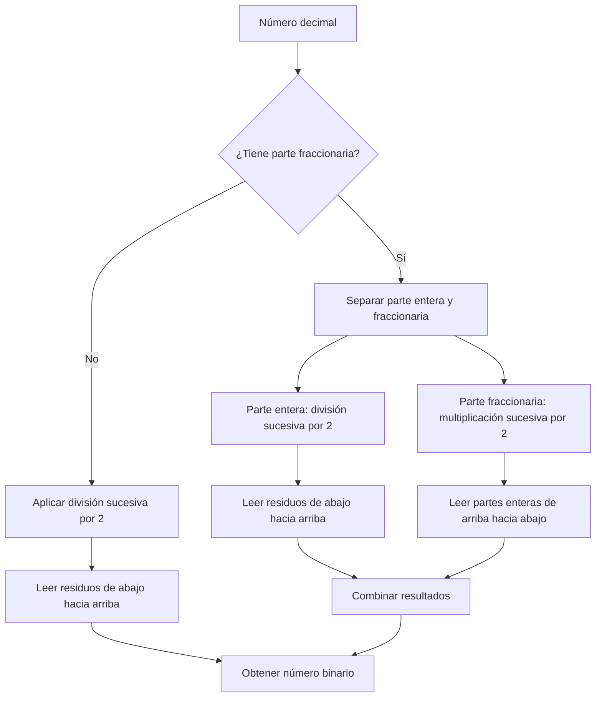

# Organización y Arquitectura de Computadoras - Representación de datos en una computadora digital

## 2.2 Sistemas numéricos bases 2, 8 y 16.

---

Los sistemas numéricos posicionales son fundamentales para comprender cómo las computadoras digitales representan y procesan la información. Mientras los humanos utilizamos principalmente el sistema decimal (base 10), las computadoras operan internamente con el sistema binario (base 2). Los sistemas octal (base 8) y hexadecimal (base 16) sirven como notaciones compactas para representar números binarios, facilitando su interpretación por parte de los programadores.

### Definición de Sistema Numérico Posicional

Un sistema numérico posicional es aquel donde el valor de un dígito depende tanto de su símbolo como de su posición dentro del número. La base o raíz $(r)$ del sistema determina la cantidad de dígitos disponibles y el valor posicional de cada dígito.

Para un número $N$ en base $r$ representado como:

$$(d_{n-1}d_{n-2}...d_1d_0.d_{-1}d_{-2}...d_{-m})_r$$

Su valor decimal equivalente se calcula mediante la fórmula:

$$N_{10} = \sum_{i=-m}^{n-1} d_i \times r^{i}$$

Donde:

- $d_i$ es el dígito en la posición $i$
- $r$ es la base del sistema numérico
- $i$ es el índice de la posición
- $n$ es el número de dígitos enteros
- $m$ es el número de dígitos fraccionarios

### Sistema Binario (Base 2)

#### Características

- Utiliza solo dos dígitos: 0 y 1
- Es el lenguaje natural de las computadoras digitales
- Cada dígito binario se denomina bit (binary digit)
- Es la base fundamental de toda la aritmética computacional

#### Representación

Un número binario se representa como una secuencia de bits:

$$ (1011.01)\_2 = 1 \times 2^3 + 0 \times 2^2 + 1 \times 2^1 + 1 \times 2^0 + 0 \times 2^{-1} + 1 \times 2^{-2} = (11.25)\_{10} $$

#### Diagrama de conversión decimal-binario



### Sistema Octal (Base 8)

#### Características

- Utiliza ocho dígitos: 0, 1, 2, 3, 4, 5, 6, 7
- Cada dígito octal corresponde exactamente a tres bits
- Fue ampliamente utilizado en sistemas computacionales antiguos

#### Representación

$$ (751)\_8 = 7 \times 8^2 + 5 \times 8^1 + 1 \times 8^0 = (489)\_{10} $$

#### Conversión Binario-Octal

Para convertir entre binario y octal:

1. Agrupar los bits de 3 en 3 desde el punto decimal hacia afuera
2. Convertir cada grupo de 3 bits a su equivalente octal

Ejemplo:

$$(101\;110\;011)_2 = (5\;6\;3)_8$$

### Sistema Hexadecimal (Base 16)

#### Características

- Utiliza 16 dígitos: 0-9 y A-F (donde A=10, B=11, ..., F=15)
- Cada dígito hexadecimal corresponde exactamente a cuatro bits
- Es la notación compacta más utilizada en computación moderna
- Se emplea para direcciones de memoria, valores de registro y representación de datos binarios

#### Representación

$$ (A3F)\_{16} = 10 \times 16^2 + 3 \times 16^1 + 15 \times 16^0 = (2623)\_{10} $$

#### Conversión Binario-Hexadecimal

Para convertir entre binario y hexadecimal:

1. Agrupar los bits de 4 en 4 desde el punto decimal hacia afuera
2. Convertir cada grupo de 4 bits a su equivalente hexadecimal

Ejemplo:

$$ (1101\;1010\;1111)\_2 = (D\;A\;F)\_{16} $$

### Tabla de equivalencias

| Decimal | Binario | Octal | Hexadecimal |
| ------- | ------- | ----- | ----------- |
| 0       | 0000    | 0     | 0           |
| 1       | 0001    | 1     | 1           |
| 2       | 0010    | 2     | 2           |
| 3       | 0011    | 3     | 3           |
| 4       | 0100    | 4     | 4           |
| 5       | 0101    | 5     | 5           |
| 6       | 0110    | 6     | 6           |
| 7       | 0111    | 7     | 7           |
| 8       | 1000    | 10    | 8           |
| 9       | 1001    | 11    | 9           |
| 10      | 1010    | 12    | A           |
| 11      | 1011    | 13    | B           |
| 12      | 1100    | 14    | C           |
| 13      | 1101    | 15    | D           |
| 14      | 1110    | 16    | E           |
| 15      | 1111    | 17    | F           |

### Ejercicios Resueltos

#### Ejemplo 1: Conversión de binario a decimal

Convertir $(11010.101)_2$ a decimal:

$$ 1 \times 2^4 + 1 \times 2^3 + 0 \times 2^2 + 1 \times 2^1 + 0 \times 2^0 + 1 \times 2^{-1} + 0 \times 2^{-2} + 1 \times 2^{-3} $$

$$ = 16 + 8 + 0 + 2 + 0 + 0.5 + 0 + 0.125 = (26.625)\_{10} $$

#### Ejemplo 2: Conversión de decimal a binario

Convertir $(37.375)_{10}$ a binario:

**Parte entera (37):**
$$ \begin{align*} 37 \div 2 &= 18 \quad \text{Residuo: } 1 \\\ 18 \div 2 &= 9 \quad \text{Residuo: } 0 \\\ 9 \div 2 &= 4 \quad \text{Residuo: } 1 \\\ 4 \div 2 &= 2 \quad \text{Residuo: } 0 \\\ 2 \div 2 &= 1 \quad \text{Residuo: } 0 \\\ 1 \div 2 &= 0 \quad \text{Residuo: } 1 \\\ \end{align*} $$

Parte entera: $(100101)_2$

**Parte fraccionaria (0.375):**

$$ \begin{align*} 0.375 \times 2 &= 0.75 \quad \text{Parte Entera: } 0 \\\ 0.75 \times 2 &= 1.5 \quad \text{Parte Entera: } 1 \\\ 0.5 \times 2 &= 1.0 \quad \text{Parte Entera: } 1 \\\ \end{align*} $$

Parte fraccionaria: $(.011)_2$

Resultado: $(100101.011)_2$

#### Ejemplo 3: Conversión entre bases potencia de 2

Convertir $(1101011110.10111)_2$ a hexadecimal:

Agrupar: $\texttt{0011}\;\texttt{0101}\;\texttt{1110}.\;\texttt{1011}\;\texttt{1000}$
Equivalente: $\texttt{3}\;\texttt{5}\;\texttt{E}.\;\texttt{B}\;\texttt{8}$
Resultado: $(35E.B8)_{16}$

### Ejercicios Propuestos

1. Convierte los siguientes números binarios a decimal:
   - a) $(10110101)_2$
   - b) $(1100.101)_2$
   - c) $(0.0101)_2$

2. Convierte los siguientes números decimales a binario (8 bits):
   - a) $(127)_{10}$
   - b) $(63)_{10}$
   - c) $(18.625)_{10}$

3. Realiza las siguientes conversiones:
   - a) $(3A7)_{16}$ a binario y octal
   - b) $(247)_8$ a binario y hexadecimal
   - c) $(1010110101.11011)_2$ a octal y hexadecimal

4. ¿Cuál es el rango de números enteros sin signo que se pueden representar con:
   - a) 8 bits
   - b) 16 bits
   - c) 32 bits
     Expresa los resultados en decimal, binario y hexadecimal.

5. Realiza las siguientes operaciones en binario:
   - a) $1101 + 1011$
   - b) $1001 - 0110$
   - c) $1010 \times 101$

### Código de Ejemplo en Python

```python
# Conversiones entre bases numéricas en Python

def decimal_a_binario(n):
    """Convierte un número decimal a binario"""
    return bin(n)[2:]

def binario_a_decimal(b):
    """Convierte un número binario a decimal"""
    return int(b, 2)

def decimal_a_hexadecimal(n):
    """Convierte un número decimal a hexadecimal"""
    return hex(n)[2:].upper()

def hexadecimal_a_decimal(h):
    """Convierte un número hexadecimal a decimal"""
    return int(h, 16)

def binario_a_hexadecimal(b):
    """Convierte un número binario a hexadecimal"""
    return hex(int(b, 2))[2:].upper()

def hexadecimal_a_binario(h):
    """Convierte un número hexadecimal a binario"""
    return bin(int(h, 16))[2:]

# Ejemplos de uso
print("Decimal 255 a binario:", decimal_a_binario(255))
print("Binario 11111111 a decimal:", binario_a_decimal('11111111'))
print("Decimal 255 a hexadecimal:", decimal_a_hexadecimal(255))
print("Hexadecimal FF a decimal:", hexadecimal_a_decimal('FF'))
print("Binario 11010111 a hexadecimal:", binario_a_hexadecimal('11010111'))
print("Hexadecimal D7 a binario:", hexadecimal_a_binario('D7'))
```

### Aplicaciones en Arquitectura de Computadoras

- Los sistemas binarios son la base del álgebra booleana y los circuitos lógicos
- Las direcciones de memoria se representan comúnmente en hexadecimal
- Los registros del procesador almacenan datos en formato binario
- Las operaciones aritméticas se realizan en binario a nivel de hardware
- La representación hexadecimal compacta es esencial para la depuración de programas

### Referencias Bibliográficas

1. Patterson, David A. y John L. Hennessy. _Computer Organization and Design: The Hardware/Software Interface_. 4a Ed. Morgan Kaufmann, 2008. (Capítulo 3: Arithmetic for Computers)

2. Mano, M. Morris y Charles Kime. _Logic and Computer Design Fundamentals_. 4a Ed. Prentice Hall, 2007. (Capítulo 1: Digital Systems and Binary Numbers)

3. Stallings, William. _Computer Organization and Architecture: Designing for Performance_. Prentice Hall - Pearson, 2009. (Capítulo 10: Computer Arithmetic)

4. Tanenbaum, Andrew S. _Structured Computer Organization_. 5a Ed. Prentice Hall, 2005. (Capítulo 2: Computer Systems)

5. Hennessy, John L. y David A. Patterson. _Computer Architecture: A Quantitative Approach_. 4a Ed. Morgan Kaufmann, 2006. (Apéndice B: Review of Memory Hierarchy)
