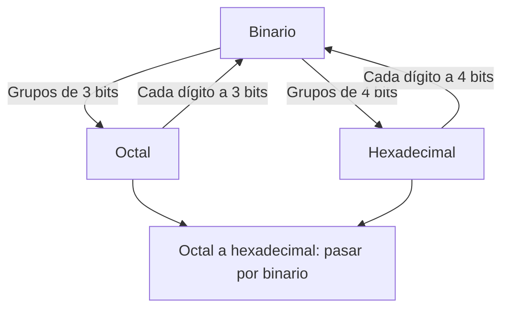

# Organización y Arquitectura de Computadoras - Representación de datos en una computadora digital

## 2.2 Sistemas numéricos bases 2, 8 y 16.

---

El **binario** es la base natural del hardware: un bit se implementa con dos niveles de voltaje, un transistor encendido o apagado, una carga magnética en un sentido u otro. Pero las cadenas de bits son largas e incómodas de leer, y por eso se usan el **octal** y, sobre todo, el **hexadecimal** como abreviaturas: como $8 = 2^3$ y $16 = 2^4,$ cada dígito octal equivale exactamente a tres bits y cada dígito hexadecimal a cuatro. Este tema demuestra esa equivalencia, presenta la aritmética binaria con sus acarreos y préstamos, y las operaciones de bits que usan los programas de bajo nivel.

### Unidades de información

| Unidad | Bits | Valores distintos |
| --- | --- | --- |
| bit | 1 | 2 |
| nibble (un dígito hexadecimal) | 4 | 16 |
| byte (dos dígitos hexadecimales) | 8 | 256 |
| palabra (según la arquitectura) | 16, 32 o 64 | $2^{16},$ $2^{32},$ $2^{64}$ |

Con $n$ bits hay $2^n$ patrones distintos; como enteros sin signo representan de $0$ a $2^n - 1.$ Los prefijos para capacidad de memoria son binarios: 1 KiB $= 2^{10} = 1024$ bytes, 1 MiB $= 2^{20},$ 1 GiB $= 2^{30};$ los fabricantes de discos usan los decimales, con 1 GB $= 10^9$ bytes, de ahí que un disco de "1 TB" muestre unos 931 GiB.

### Conversión por agrupación

**Teorema.** Para convertir de binario a base $2^k$ basta agrupar los bits de $k$ en $k$ a partir del punto (completando con ceros a la izquierda en la parte entera y a la derecha en la fraccionaria) y sustituir cada grupo por su dígito en base $2^k.$

**Demostración.** Agrupando los términos de $N = \sum_i d_i 2^i$ de $k$ en $k,$

$$ N = \sum_j \left( d_{kj + k - 1} 2^{k-1} + \cdots + d_{kj + 1} 2 + d_{kj} \right) 2^{kj} = \sum_j D_j\, (2^k)^j $$

donde cada $D_j,$ el valor del grupo $j,$ cumple $0 \leq D_j \lt 2^k:$ es exactamente un dígito en base $2^k.$ Por la unicidad de la representación (tema 2.1), los $D_j$ son los dígitos de $N$ en esa base. Lo mismo vale para los exponentes negativos de la parte fraccionaria. $\blacksquare$

| Hex | Binario | Octal | Binario |
| --- | --- | --- | --- |
| 0 | 0000 | 0 | 000 |
| 1 | 0001 | 1 | 001 |
| 2 | 0010 | 2 | 010 |
| 3 | 0011 | 3 | 011 |
| 4 | 0100 | 4 | 100 |
| 5 | 0101 | 5 | 101 |
| 6 | 0110 | 6 | 110 |
| 7 | 0111 | 7 | 111 |
| 8 | 1000 | | |
| 9 | 1001 | | |
| A | 1010 | | |
| B | 1011 | | |
| C | 1100 | | |
| D | 1101 | | |
| E | 1110 | | |
| F | 1111 | | |

**Ejemplo.** $(1010110101.11011)_2:$ en grupos de 3, $001\ 010\ 110\ 101 . 110\ 110 = (1265.66)_8;$ en grupos de 4, $0010\ 1011\ 0101 . 1101\ 1000 = (2B5.D8)_{16}.$ Entre octal y hexadecimal se pasa por binario.

### Aritmética binaria

Las tablas de operaciones son mínimas: $0 + 0 = 0,$ $0 + 1 = 1,$ $1 + 1 = 10$ (cero y se lleva 1), $1 + 1 + 1 = 11.$

**Suma.** Columna por columna desde la derecha, con acarreo. Cada columna recibe dos bits y un acarreo de entrada y produce un bit de suma y un acarreo de salida: es lo que calcula un **sumador completo** (tema 4.1).

$$ \begin{array}{r} 1101 \\ +\ 1011 \\ \hline 11000 \end{array} \qquad (13 + 11 = 24) $$

**Resta.** Con préstamo: $0 - 1 = 1$ y se pide 1 a la columna siguiente. En la práctica las computadoras restan sumando el **complemento a dos** del sustraendo (tema 2.3), con lo que basta un sumador.

**Multiplicación.** Cada bit del multiplicador es 0 o 1, así que cada producto parcial es 0 o una copia desplazada del multiplicando: multiplicar es **desplazar y sumar**. $1010 \times 101 = 1010 + 101000 = 110010,$ es decir $10 \times 5 = 50.$

**División.** Como la división larga decimal, pero en cada paso el cociente parcial es 0 o 1 según si el divisor desplazado cabe o no.

**Desplazamientos.** Desplazar $k$ posiciones a la izquierda multiplica por $2^k$ (si no se pierden bits), y a la derecha divide entre $2^k$ truncando. Los compiladores sustituyen `x * 8` por `x << 3`.

### Operaciones lógicas bit a bit

| Operación | Uso típico | Ejemplo con `x = 10110101` |
| --- | --- | --- |
| `x & m` (AND) | extraer bits con una máscara | `x & 0x0F` da el nibble bajo, `0101` |
| `x \| m` (OR) | encender bits | `x \| 0x02` enciende el bit 1 |
| `x ^ m` (XOR) | invertir bits | `x ^ 0xFF` invierte todos |
| `x >> k`, `x << k` | desplazar | `x >> 4` da el nibble alto, `1011` |

Ejemplos de uso del octal y el hexadecimal: los permisos de Unix `754` son `111 101 100`, es decir `rwxr-xr--`; un color web `#FF8000` son tres bytes, rojo 255, verde 128 y azul 0; y la dirección `0x7FFE0000` se lee mucho mejor que sus 32 bits.



### Implementación en Python

El programa implementa la conversión por agrupación y su inversa, la suma con traza de acarreos, la resta con préstamos y la multiplicación por desplazamiento y suma, y las aplica a los ejercicios; al final muestra desplazamientos, máscaras y la lectura de permisos de Unix.

```python
HEX = "0123456789ABCDEF"


def agrupar(binario, k):
    """Convierte binario a base 2^k agrupando k bits a partir del punto."""
    ent, _, frac = binario.partition(".")
    ent = ent.zfill(-(-len(ent) // k) * k)
    frac = frac.ljust(-(-len(frac) // k) * k, "0") if frac else ""
    a = "".join(HEX[int(ent[i:i + k], 2)] for i in range(0, len(ent), k)).lstrip("0") or "0"
    f = "".join(HEX[int(frac[i:i + k], 2)] for i in range(0, len(frac), k))
    return a + ("." + f if f else "")


def expandir(cadena, k):
    """De base 2^k a binario: cada dígito se sustituye por k bits."""
    ent, _, frac = cadena.partition(".")
    a = "".join(format(HEX.index(d), f"0{k}b") for d in ent).lstrip("0") or "0"
    f = "".join(format(HEX.index(d), f"0{k}b") for d in frac).rstrip("0")
    return a + ("." + f if f else "")


def valor(binario):
    ent, _, frac = binario.partition(".")
    return int(ent, 2) + sum(int(b) / 2**i for i, b in enumerate(frac, 1))


print("ejercicio 1:", [valor(x) for x in ("10110101", "1100.101", "0.0101")])
print("ejercicio 2:", format(127, "08b"), format(63, "08b"), "10010.101 =", valor("10010.101"))
print("ejercicio 3a: 3A7 ->", expandir("3A7", 4), "->", agrupar(expandir("3A7", 4), 3), "(octal)")
print("ejercicio 3b: 247_8 ->", expandir("247", 3), "->", agrupar(expandir("247", 3), 4), "(hex)")
x = "1010110101.11011"
print("ejercicio 3c:", x, "-> octal", agrupar(x, 3), "| hex", agrupar(x, 4), "| valor", valor(x))
for n in (8, 16, 32):
    print(f"ejercicio 4: {n} bits: 0 .. {2**n - 1} = 0x{2**n - 1:X}")


def suma_traza(a, b):
    n = max(len(a), len(b))
    a, b = a.zfill(n), b.zfill(n)
    acarreo, res, acarreos = 0, [], []
    for i in range(n - 1, -1, -1):
        s = int(a[i]) + int(b[i]) + acarreo
        res.append(str(s % 2))
        acarreo = s // 2
        acarreos.append(str(acarreo))
    salida = ("1" if acarreo else "") + "".join(reversed(res))
    return salida, "".join(reversed(acarreos))


def resta_traza(a, b):
    n = max(len(a), len(b))
    a, b = a.zfill(n), b.zfill(n)
    prestamo, res = 0, []
    for i in range(n - 1, -1, -1):
        d = int(a[i]) - int(b[i]) - prestamo
        prestamo = 1 if d < 0 else 0
        res.append(str(d % 2))
    return "".join(reversed(res))


def mult_traza(a, b):
    parciales = [a + "0" * i for i, bit in enumerate(reversed(b)) if bit == "1"]
    total = "0"
    for p in parciales:
        total, _ = suma_traza(total, p)
    return parciales, total


s, c = suma_traza("1101", "1011")
print(f"ejercicio 5a: 1101 + 1011 = {s} (acarreos {c}); {int('1101', 2)} + {int('1011', 2)} = {int(s, 2)}")
r = resta_traza("1001", "0110")
print(f"ejercicio 5b: 1001 - 0110 = {r}; {int('1001', 2)} - {int('0110', 2)} = {int(r, 2)}")
p, t = mult_traza("1010", "101")
print(f"ejercicio 5c: productos parciales {p}, suma {t}; 10 x 5 = {int(t, 2)}")

# Desplazamientos y máscaras
x = 0b10110101
print(f"x = {x:08b}: x << 1 = {(x << 1) & 0xFF:08b}, x >> 2 = {x >> 2:08b} ({x} // 4 = {x // 4}),"
      f" nibble alto = {x >> 4:X}, nibble bajo = {x & 0xF:X}")
print("permisos Unix 0o754:", "".join(("rwx"[i % 3] if (0o754 >> (8 - i)) & 1 else "-") for i in range(9)))
```

Salida:

```text
ejercicio 1: [181, 12.625, 0.3125]
ejercicio 2: 01111111 00111111 10010.101 = 18.625
ejercicio 3a: 3A7 -> 1110100111 -> 1647 (octal)
ejercicio 3b: 247_8 -> 10100111 -> A7 (hex)
ejercicio 3c: 1010110101.11011 -> octal 1265.66 | hex 2B5.D8 | valor 693.84375
ejercicio 4: 8 bits: 0 .. 255 = 0xFF
ejercicio 4: 16 bits: 0 .. 65535 = 0xFFFF
ejercicio 4: 32 bits: 0 .. 4294967295 = 0xFFFFFFFF
ejercicio 5a: 1101 + 1011 = 11000 (acarreos 1111); 13 + 11 = 24
ejercicio 5b: 1001 - 0110 = 0011; 9 - 6 = 3
ejercicio 5c: productos parciales ['1010', '101000'], suma 110010; 10 x 5 = 50
x = 10110101: x << 1 = 01101010, x >> 2 = 00101101 (181 // 4 = 45), nibble alto = B, nibble bajo = 5
permisos Unix 0o754: rwxr-xr--
```

### Ejercicios Propuestos

1. **A decimal.** Convierte $(10110101)_2,$ $(1100.101)_2$ y $(0.0101)_2.$

2. **A binario.** Escribe en 8 bits $127$ y $63,$ y convierte $18.625$ a binario.

3. **Conversiones.** (a) $(3A7)_{16}$ a binario y octal. (b) $(247)_8$ a binario y hexadecimal. (c) $(1010110101.11011)_2$ a octal y hexadecimal.

4. **Rangos.** ¿Qué enteros sin signo se representan con 8, 16 y 32 bits? Exprésalo en decimal y hexadecimal.

5. **Aritmética.** Calcula en binario $1101 + 1011,$ $1001 - 0110$ y $1010 \times 101.$

### Soluciones

**Ejercicio 1.** $128 + 32 + 16 + 4 + 1 = 181;$ $12 + 0.5 + 0.125 = 12.625;$ $0.25 + 0.0625 = 0.3125.$

**Ejercicio 2.** $127 = 01111111$ y $63 = 00111111;$ ambos son de la forma $2^k - 1,$ todos unos. $18 = 10010$ y $0.625 = 0.101,$ así que $18.625 = (10010.101)_2.$

**Ejercicio 3.** (a) $3A7 = 0011\ 1010\ 0111 = (1110100111)_2;$ agrupando de 3 en 3, $001\ 110\ 100\ 111 = (1647)_8.$ (b) $(247)_8 = 010\ 100\ 111 = (10100111)_2 = (A7)_{16}.$ (c) $(1265.66)_8$ y $(2B5.D8)_{16},$ que valen $693.84375.$

**Ejercicio 4.** 8 bits: de 0 a 255 $= \text{0xFF}.$ 16 bits: de 0 a 65 535 $= \text{0xFFFF}.$ 32 bits: de 0 a 4 294 967 295 $= \text{0xFFFFFFFF}.$

**Ejercicio 5.** $1101 + 1011 = 11000,$ es decir $13 + 11 = 24,$ con acarreo en todas las columnas; $1001 - 0110 = 0011,$ es decir $9 - 6 = 3;$ y $1010 \times 101 = 110010,$ es decir $10 \times 5 = 50.$

### Referencias

1. Mano, M. M., and Ciletti, M. D., _Digital Design_. Pearson, 2018. Capítulo 1.
2. Harris, D. M., and Harris, S. L., _Digital Design and Computer Architecture_. Morgan Kaufmann, 2013. Capítulo 1.
3. Patterson, D. A., and Hennessy, J. L., _Computer Organization and Design: The Hardware/Software Interface_. Morgan Kaufmann, 2020. Secciones 2.4 y 3.2.
4. Warren, H. S., _Hacker's Delight_. Addison-Wesley, 2012. Capítulo 2.
