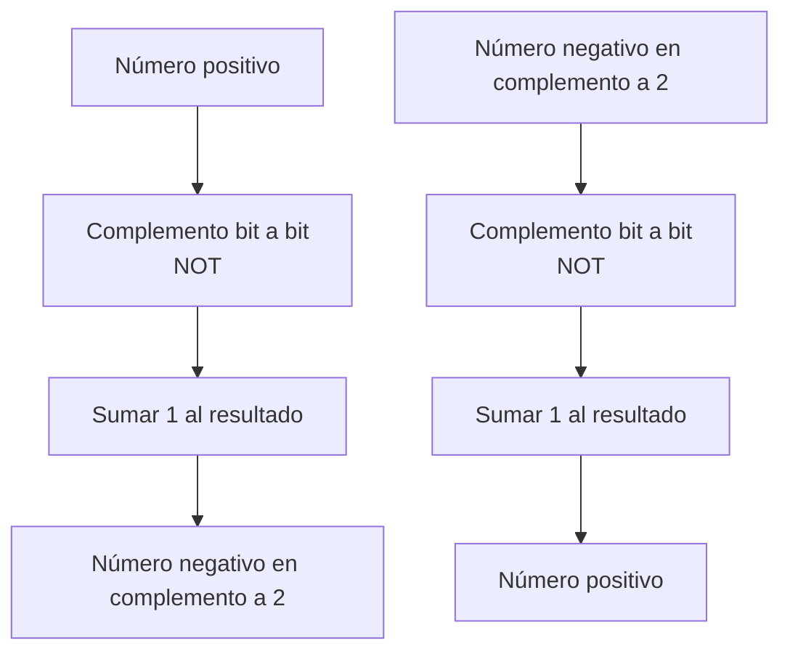

# Organización y Arquitectura de Computadoras - Representación de datos en una computadora digital

## 2.3 Representación de enteros con signo en una computadora digital

---

La representación de números enteros con signo es fundamental en arquitectura de computadoras, ya que las computadoras deben manejar tanto valores positivos como negativos. Existen varios métodos para representar números con signo, cada uno con sus ventajas y desventajas en términos de rango, complejidad de circuitos y facilidad de operación aritmética.

### Métodos de Representación

#### 1. Magnitud con Signo (Sign-Magnitude)

##### Concepto

- El bit más significativo (MSB) representa el signo: 0 para positivo, 1 para negativo
- Los bits restantes representan la magnitud del número
- Rango simétrico: $[-(2^{n-1}-1)$ a $+(2^{n-1}-1)]$ para n bits

##### Representación matemática

Para un número de n bits:

$$N = (-1)^{b_{n-1}} \times \sum_{i=0}^{n-2} b_i \times 2^i$$

##### Ejemplo (8 bits):

- $+5 = 00000101_2$
- $-5 = 10000101_2$

##### Limitaciones

- Dos representaciones para el cero: $+0$ (00000000) y $-0$ (10000000)
- Circuitos aritméticos complejos
- Dificultad en operaciones de comparación

#### 2. Complemento a 1 (Ones' Complement)

##### Concepto

- Los números positivos se representan igual que en magnitud con signo
- Los números negativos se obtienen complementando bit a bit el positivo correspondiente
- Rango simétrico: $[-(2^{n-1}-1)$ a $+(2^{n-1}-1)]$

##### Ejemplo (8 bits):

- $+5 = 00000101_2$
- $-5 = 11111010_2$ (complemento bit a bit de +5)

##### Limitaciones

- Dos representaciones para el cero: $+0$ (00000000) y $-0$ (11111111)
- Corrección necesaria en operaciones aritméticas que generan acarreo

#### 3. Complemento a 2 (Two's Complement)

##### Concepto

- Método más utilizado en computadoras modernas
- Los números positivos se representan igual que en magnitud con signo
- Los números negativos se obtienen complementando bit a bit el positivo y sumando 1
- Rango asimétrico: $[-2^{n-1}$ a $+(2^{n-1}-1)]$

##### Representación matemática

Para un número de n bits:

$$N = -b_{n-1} \times 2^{n-1} + \sum_{i=0}^{n-2} b_i \times 2^i$$

##### Algoritmo de conversión



##### Ejemplo (8 bits):

- $+5 = 00000101_2$
- $-5 = 11111011_2$ (complemento de +5 + 1)

##### Ventajas

- Una única representación del cero: 00000000
- Circuitos aritméticos más simples
- No se requiere corrección especial en operaciones
- Resta implementable como suma

#### 4. Exceso a M (Offset Binary)

##### Concepto

- Se utiliza un valor de desplazamiento (offset) M, típicamente $2^{n-1}$
- El número se representa como $N + M$
- Rango: $[-M$ a $+(2^n - M - 1)]$

##### Ejemplo (8 bits, Exceso a 128):

- $+5 = 5 + 128 = 133 = 10000101_2$
- $-5 = -5 + 128 = 123 = 01111011_2$

##### Aplicaciones

- Comparadores de magnitud
- Convertidores analógico-digitales
- Representación de exponentes en punto flotante

### Comparación de Métodos (4 bits)

| Decimal | Magnitud con Signo | Complemento a 1 | Complemento a 2 | Exceso a 8 |
| ------- | ------------------ | --------------- | --------------- | ---------- |
| +7      | 0111               | 0111            | 0111            | 1111       |
| +6      | 0110               | 0110            | 0110            | 1110       |
| +5      | 0101               | 0101            | 0101            | 1101       |
| +4      | 0100               | 0100            | 0100            | 1100       |
| +3      | 0011               | 0011            | 0011            | 1011       |
| +2      | 0010               | 0010            | 0010            | 1010       |
| +1      | 0001               | 0001            | 0001            | 1001       |
| +0      | 0000               | 0000            | 0000            | 1000       |
| -0      | 1000               | 1111            | -               | -          |
| -1      | 1001               | 1110            | 1111            | 0111       |
| -2      | 1010               | 1101            | 1110            | 0110       |
| -3      | 1011               | 1100            | 1101            | 0101       |
| -4      | 1100               | 1011            | 1100            | 0100       |
| -5      | 1101               | 1010            | 1011            | 0011       |
| -6      | 1110               | 1001            | 1010            | 0010       |
| -7      | 1111               | 1000            | 1001            | 0001       |
| -8      | -                  | -               | 1000            | 0000       |

### Detección de Desbordamiento (Overflow)

En complemento a 2, el desbordamiento ocurre cuando:

- La suma de dos positivos da un resultado negativo
- La suma de dos negativos da un resultado positivo

Condición matemática:

$$V = C_{n} \oplus C_{n-1}$$

donde $C_n$ es el acarreo hacia el bit de signo y $C_{n-1}$ es el acarreo desde el bit de signo.

### Extensión de Signo

Para convertir un número de n bits a m bits (m > n):

- En complemento a 2: copiar el bit de signo en los bits adicionales
- Ejemplo: Extender 1010 (4 bits, -6) a 8 bits: 11111010 (still -6)

### Operaciones Aritméticas

#### Suma en complemento a 2

- Se suman normalmente los bits, incluyendo el de signo
- Se ignora el acarreo final si existe
- Se verifica desbordamiento

#### Resta en complemento a 2

- $A - B = A + (-B)$
- Se calcula el complemento a 2 de B y se suma a A

### Ejercicios Resueltos

#### Ejemplo 1: Conversión a complemento a 2

Convertir -13 a complemento a 2 con 8 bits:

1. Valor positivo: $13 = 00001101_2$
2. Complemento bit a bit: $11110010_2$
3. Sumar 1: $11110011_2$
4. Resultado: $-13 = 11110011_2$

#### Ejemplo 2: Suma en complemento a 2

Realizar 7 + (-5) con 4 bits:

1. $7 = 0111_2,$ $-5 = 1011_2$ (complemento a 2 de 5)
2. Suma: $0111 + 1011 = 10010_2$
3. Descartar acarreo: $0010_2 = 2_{10}$ ✓

#### Ejemplo 3: Detección de overflow

Verificar si 6 + 5 con 4 bits produce overflow:

1. $6 = 0110_2,$ $5 = 0101_2$
2. Suma: $0110 + 0101 = 1011_2 = -5_{10}$ (incorrecto)
3. Hay overflow porque dos positivos dan negativo

### Ejercicios Propuestos

1. Represente los siguientes números decimales en complemento a 2 con 8 bits:
   a) +45
   b) -67
   c) -128
   d) +127

2. Realice las siguientes operaciones en complemento a 2 con 8 bits. Indique si hay overflow:
   a) 45 + 27
   b) -50 + 30
   c) -100 - 30
   d) 120 + 10

3. Convierta los siguientes números de complemento a 2 a decimal:
   a) 11001100
   b) 01111111
   c) 10000000
   d) 11110110

4. Explique por qué el complemento a 2 tiene un rango asimétrico (-128 a +127 para 8 bits).

5. Implemente en lenguaje C una función que detecte overflow en suma de números en complemento a 2.

### Código de Ejemplo

```c
#include <stdio.h>
#include <stdint.h>

// Función para detectar overflow en suma de enteros con signo
int detect_overflow(int8_t a, int8_t b) {
    int8_t result = a + b;

    // Overflow ocurre si:
    // 1. Suma de dos positivos da negativo
    // 2. Suma de dos negativos da positivo
    if ((a > 0 && b > 0 && result < 0) ||
        (a < 0 && b < 0 && result > 0)) {
        return 1; // Hay overflow
    }
    return 0; // No hay overflow
}

// Función para mostrar representación binaria de 8 bits
void print_binary(int8_t num) {
    for (int i = 7; i >= 0; i--) {
        printf("%d", (num >> i) & 1);
    }
}

int main() {
    int8_t a = 100;
    int8_t b = 50;

    printf("a = %d -> ", a); print_binary(a); printf("\n");
    printf("b = %d -> ", b); print_binary(b); printf("\n");

    if (detect_overflow(a, b)) {
        printf("Advertencia: Overflow detectado en a + b\n");
    } else {
        printf("No hay overflow en a + b\n");
    }

    return 0;
}
```

### Aplicaciones en Arquitectura de Computadoras

- Los procesadores modernos utilizan complemento a 2 para operaciones aritméticas con enteros
- Las banderas de estado (flags) en las ALUs incluyen bits para detectar overflow (V) y signo (N)
- La extensión de signo es crucial en operaciones con diferentes tamaños de datos
- El manejo de excepciones por overflow es importante para la robustez del sistema

### Referencias Bibliográficas

1. Patterson, David A. y John L. Hennessy. _Computer Organization and Design: The Hardware/Software Interface_. 4a Ed. Morgan Kaufmann, 2008. (Capítulo 3: Arithmetic for Computers)

2. Mano, M. Morris y Charles Kime. _Logic and Computer Design Fundamentals_. 4a Ed. Prentice Hall, 2007. (Capítulo 1: Digital Systems and Binary Numbers)

3. Stallings, William. _Computer Organization and Architecture: Designing for Performance_. Prentice Hall - Pearson, 2009. (Capítulo 10: Computer Arithmetic)

4. Hennessy, John L. y David A. Patterson. _Computer Architecture: A Quantitative Approach_. 4a Ed. Morgan Kaufmann, 2006. (Apéndice J: Computer Arithmetic)

5. Tanenbaum, Andrew S. _Structured Computer Organization_. 5a Ed. Prentice Hall, 2005. (Capítulo 2: Computer Systems)
