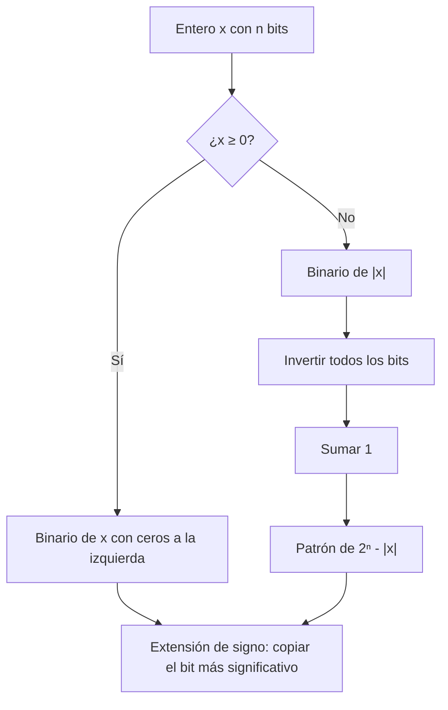

# Organización y Arquitectura de Computadoras - Representación de datos en una computadora digital

## 2.3 Representación de enteros con signo en una computadora digital

---

Un registro de $n$ bits tiene $2^n$ patrones posibles. Para enteros sin signo se usan para representar de $0$ a $2^n - 1,$ pero para incluir los negativos hay que decidir qué patrones representan qué números. Históricamente se usaron cuatro convenciones: **signo y magnitud**, **complemento a uno**, **complemento a dos** y **exceso** (o sesgo). Este tema las define, las compara y demuestra por qué el complemento a dos ganó: tiene un solo cero, usa el mismo sumador que los enteros sin signo y su aritmética es simplemente aritmética módulo $2^n.$ El tema 2.4 trata la aritmética con signo en detalle.

### Las cuatro representaciones

Sea $n$ el número de bits y $b_{n-1} \ldots b_1 b_0$ el patrón.

**Signo y magnitud.** El bit $b_{n-1}$ es el signo (0 positivo, 1 negativo) y los otros $n - 1$ bits son el valor absoluto. Es la forma en que escribimos a mano. Rango: $-(2^{n-1} - 1)$ a $2^{n-1} - 1.$ Defectos: hay dos ceros, $+0$ y $-0,$ y sumar requiere comparar signos y magnitudes.

**Complemento a uno.** Un negativo $-x$ se representa invirtiendo todos los bits de $x,$ lo que equivale a $(2^n - 1) - x.$ Mismo rango y también dos ceros (`0000` y `1111`); la suma necesita sumar el acarreo final de vuelta al resultado (_end-around carry_). Lo usaron máquinas como la CDC 6600 y sobrevive en la suma de verificación de IP.

**Complemento a dos.** Un negativo $-x$ se representa como $2^n - x.$ Equivalentemente, el patrón vale

$$ V = -b_{n-1}\, 2^{n-1} + \sum_{i = 0}^{n - 2} b_i\, 2^i $$

es decir, el bit más significativo tiene **peso negativo**. Rango: $-2^{n-1}$ a $2^{n-1} - 1,$ con un solo cero. Es la representación de prácticamente todos los procesadores actuales, y desde C++20 y C23 es la única que permiten los estándares.

**Exceso o sesgo.** Con un sesgo $K,$ se guarda $x + K$ como entero sin signo, normalmente con $K = 2^{n-1}$ o $2^{n-1} - 1.$ Su ventaja es que conserva el **orden**: comparar como enteros sin signo da el mismo resultado que comparar los valores. Por eso se usa para el exponente del punto flotante IEEE 754, en exceso 127 en precisión simple.

| Decimal | Signo y magnitud | Complemento a uno | Complemento a dos | Exceso 8 |
| --- | --- | --- | --- | --- |
| $+7$ | 0111 | 0111 | 0111 | 1111 |
| $+1$ | 0001 | 0001 | 0001 | 1001 |
| $0$ | 0000 y 1000 | 0000 y 1111 | 0000 | 1000 |
| $-1$ | 1001 | 1110 | 1111 | 0111 |
| $-7$ | 1111 | 1000 | 1001 | 0001 |
| $-8$ | no representable | no representable | 1000 | 0000 |

### Propiedades del complemento a dos

**Teorema: aritmética modular.** Para todo $V$ en el rango, el patrón de $V$ en complemento a dos es la representación binaria sin signo de $V \bmod 2^n.$ Por lo tanto, sumar, restar y multiplicar patrones con el circuito de enteros sin signo, descartando los bits que sobran, da el patrón correcto del resultado **siempre que este esté en el rango**.

**Demostración.** Si $V \geq 0,$ el patrón es $V$ y $V \bmod 2^n = V.$ Si $V \lt 0,$ el patrón como sin signo vale $2^n + V \equiv V \pmod{2^n}.$ Como las operaciones con enteros sin signo, descartando los bits sobrantes, calculan exactamente el resultado módulo $2^n,$ y la reducción módulo $2^n$ respeta sumas y productos, el patrón obtenido es el de $(a + b) \bmod 2^n,$ que es el de $a + b$ si este está en el rango. $\blacksquare$

**Negación: invertir y sumar uno.** Invertir los bits de $x$ da $(2^n - 1) - x,$ y sumando 1 se obtiene $2^n - x \equiv -x.$ Por ejemplo, $45 = 00101101$ y $-45 = 11010010 + 1 = 11010011.$ El único caso que falla es $-2^{n-1}:$ su negación, $2^{n-1},$ no está en el rango, y el procedimiento devuelve el mismo patrón `10000000`.

**Rango asimétrico.** Hay $2^n$ patrones; uno es el cero, y quedan $2^n - 1,$ un número impar, para positivos y negativos. Como los $2^{n-1}$ patrones con $b_{n-1} = 1$ son negativos y los demás no negativos, hay un negativo más que positivos: con 8 bits, de $-128$ a $127.$

**Extensión de signo.** Para pasar un número de $n$ a $m > n$ bits se **copia el bit de signo** en las nuevas posiciones. El valor no cambia: si $b_{n-1} = 1,$ el peso negativo $-2^{n-1}$ se convierte en $-2^{m-1} + 2^{m-2} + \cdots + 2^{n-1} = -2^{n-1}.$ Así, $-67 = 10111101$ en 16 bits es $11111111\,10111101.$

**Signo y comparación.** El signo se lee directamente en $b_{n-1}.$ Pero al comparar patrones como enteros sin signo, los negativos parecen mayores que los positivos, por eso los procesadores tienen instrucciones de comparación distintas para enteros con y sin signo (por ejemplo `slt` y `sltu` en MIPS y RISC-V).



### Implementación en Python

El programa codifica los enteros de 4 bits en las cuatro representaciones, resuelve los ejercicios 1 y 3, muestra la negación en complemento a dos, incluido el caso de $-128,$ la extensión de signo, cómo el exceso conserva el orden y el campo de exponente en exceso 127 de algunos números de punto flotante.

```python
import struct


def signo_magnitud(x, n):
    assert abs(x) < 2 ** (n - 1)
    return format((1 << (n - 1)) | -x if x < 0 else x, f"0{n}b")


def complemento_1(x, n):
    assert abs(x) < 2 ** (n - 1)
    return format(x if x >= 0 else (~(-x)) & ((1 << n) - 1), f"0{n}b")


def complemento_2(x, n):
    assert -(2 ** (n - 1)) <= x < 2 ** (n - 1)
    return format(x & ((1 << n) - 1), f"0{n}b")


def exceso(x, n, sesgo=None):
    sesgo = 2 ** (n - 1) if sesgo is None else sesgo
    return format(x + sesgo, f"0{n}b")


def valor_c2(bits):
    n = len(bits)
    return -int(bits[0]) * 2 ** (n - 1) + int(bits[1:], 2)


print(" x | s-m  | C1   | C2   | exceso 8")
for x in range(7, -9, -1):
    sm = signo_magnitud(x, 4) if abs(x) < 8 else "-"
    c1 = complemento_1(x, 4) if abs(x) < 8 else "-"
    print(f"{x:2d} | {sm:4s} | {c1:4s} | {complemento_2(x, 4)} | {exceso(x, 4)}")
print("ceros: s-m", signo_magnitud(0, 4), "y 1000; C1", complemento_1(0, 4), "y 1111; C2 solo 0000")

print("ejercicio 1:", {x: complemento_2(x, 8) for x in (45, -67, -128, 127)})
print("ejercicio 3:", {b: valor_c2(b) for b in ("11001100", "01111111", "10000000", "11110110")})

# Negación: invertir y sumar 1; el caso especial del mínimo
for b in ("00101101", "10111101", "10000000"):
    neg = format(((~int(b, 2)) + 1) & 0xFF, "08b")
    print(f"negar {b} ({valor_c2(b)}): {neg} ({valor_c2(neg)})")

# Extensión de signo: el valor no cambia
for x in (-67, 45):
    b8 = complemento_2(x, 8)
    b16 = b8[0] * 8 + b8
    print(f"extensión de {b8} a 16 bits: {b16}, valor {valor_c2(b16)}")

# Orden: el exceso conserva el orden como enteros sin signo; el C2 no
xs = [-5, -1, 0, 3]
print("C2 como sin signo:", [int(complemento_2(x, 4), 2) for x in xs],
      "| exceso 8 como sin signo:", [int(exceso(x, 4), 2) for x in xs])

# Exceso 127: el exponente de IEEE 754 de precisión simple
for v in (1.0, 0.15625, 1024.0):
    bits = struct.unpack(">I", struct.pack(">f", v))[0]
    e = (bits >> 23) & 0xFF
    print(f"float {v}: campo de exponente {e:08b} = {e}, exponente real {e - 127}")
```

Salida:

```text
 x | s-m  | C1   | C2   | exceso 8
 7 | 0111 | 0111 | 0111 | 1111
 6 | 0110 | 0110 | 0110 | 1110
 5 | 0101 | 0101 | 0101 | 1101
 4 | 0100 | 0100 | 0100 | 1100
 3 | 0011 | 0011 | 0011 | 1011
 2 | 0010 | 0010 | 0010 | 1010
 1 | 0001 | 0001 | 0001 | 1001
 0 | 0000 | 0000 | 0000 | 1000
-1 | 1001 | 1110 | 1111 | 0111
-2 | 1010 | 1101 | 1110 | 0110
-3 | 1011 | 1100 | 1101 | 0101
-4 | 1100 | 1011 | 1100 | 0100
-5 | 1101 | 1010 | 1011 | 0011
-6 | 1110 | 1001 | 1010 | 0010
-7 | 1111 | 1000 | 1001 | 0001
-8 | -    | -    | 1000 | 0000
ceros: s-m 0000 y 1000; C1 0000 y 1111; C2 solo 0000
ejercicio 1: {45: '00101101', -67: '10111101', -128: '10000000', 127: '01111111'}
ejercicio 3: {'11001100': -52, '01111111': 127, '10000000': -128, '11110110': -10}
negar 00101101 (45): 11010011 (-45)
negar 10111101 (-67): 01000011 (67)
negar 10000000 (-128): 10000000 (-128)
extensión de 10111101 a 16 bits: 1111111110111101, valor -67
extensión de 00101101 a 16 bits: 0000000000101101, valor 45
C2 como sin signo: [11, 15, 0, 3] | exceso 8 como sin signo: [3, 7, 8, 11]
float 1.0: campo de exponente 01111111 = 127, exponente real 0
float 0.15625: campo de exponente 01111100 = 124, exponente real -3
float 1024.0: campo de exponente 10001001 = 137, exponente real 10
```

### Ejercicios Propuestos

1. **Codificar.** Representa en complemento a dos con 8 bits $+45,$ $-67,$ $-128$ y $+127.$

2. **Comparar representaciones.** Escribe $-5$ con 8 bits en signo y magnitud, complemento a uno, complemento a dos y exceso 128.

3. **Decodificar.** Convierte a decimal los patrones de complemento a dos `11001100`, `01111111`, `10000000` y `11110110`.

4. **Asimetría.** Explica por qué el complemento a dos con 8 bits va de $-128$ a $+127$ y no de $-127$ a $+127.$

5. **Extensión.** Demuestra que la extensión de signo conserva el valor y aplícala a $-67$ de 8 a 16 bits.

### Soluciones

**Ejercicio 1.** $45 = 00101101;$ $-67 = 2^8 - 67 = 189 = 10111101;$ $-128 = 10000000;$ $127 = 01111111.$

**Ejercicio 2.** Signo y magnitud: `10000101`. Complemento a uno: `11111010`. Complemento a dos: `11111011`. Exceso 128: $-5 + 128 = 123,$ que es `01111011`.

**Ejercicio 3.** Con el peso $-128$ del primer bit: `11001100` $= -128 + 64 + 8 + 4 = -52;$ `01111111` $= 127;$ `10000000` $= -128;$ `11110110` $= -128 + 64 + 32 + 16 + 4 + 2 = -10.$

**Ejercicio 4.** De los 256 patrones, los 128 que empiezan con 1 son negativos y van de $-128$ a $-1;$ los 128 que empiezan con 0 son el cero y los 127 positivos. El cero ocupa un lugar del lado no negativo y no tiene duplicado, a diferencia de las otras representaciones, que gastan un patrón en $-0.$

**Ejercicio 5.** Es la demostración del tema: los bits añadidos más el antiguo bit de signo valen $-2^{m-1} + 2^{m-2} + \cdots + 2^{n-1} = -2^{n-1},$ el mismo peso que tenía el bit de signo original. $-67 = 10111101 \to 11111111\,10111101.$

### Referencias

1. Patterson, D. A., and Hennessy, J. L., _Computer Organization and Design: The Hardware/Software Interface_. Morgan Kaufmann, 2020. Sección 2.4.
2. Bryant, R. E., and O'Hallaron, D. R., _Computer Systems: A Programmer's Perspective_. Pearson, 2016. Sección 2.2.
3. Stallings, W., _Organización y arquitectura de computadores_. Pearson, 2006. Capítulo 9.
4. Mano, M. M., and Ciletti, M. D., _Digital Design_. Pearson, 2018. Sección 1.6.
