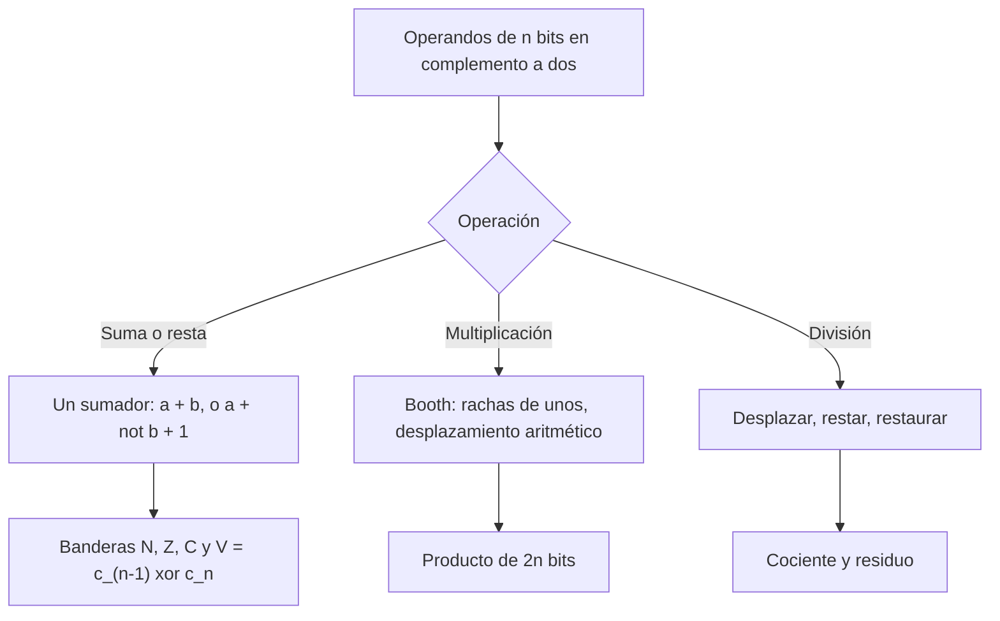

# Organización y Arquitectura de Computadoras - Representación de datos en una computadora digital

## 2.4 Representación de enteros con signo en una computadora digital

---

El tema 2.3 presentó las representaciones de los enteros con signo; este tema estudia cómo **opera** el hardware con ellos en complemento a dos. Como los registros tienen un número fijo de bits, los resultados pueden no caber: el **desbordamiento** es la diferencia esencial entre la aritmética de la computadora y la de los enteros. Se verán la suma y la resta con sus banderas, la regla para detectar el desbordamiento con su demostración, la aritmética saturada, la multiplicación con el **algoritmo de Booth** y la división con restauración.

### Suma y resta

Por el teorema del tema 2.3, la suma de dos números en complemento a dos se hace con el mismo sumador binario que para enteros sin signo, descartando el acarreo final. La resta $a - b$ se calcula como $a + (\overline{b} + 1):$ el circuito invierte los bits de $b$ y pone a 1 el acarreo de entrada del sumador, así que **un solo sumador hace las dos operaciones**.

**Ejemplos con 8 bits.**

$$ \begin{array}{rr} 45 & 00101101 \\ +\ 27 & 00011011 \\ \hline 72 & 01001000 \end{array} \qquad \begin{array}{rr} -50 & 11001110 \\ +\ 30 & 00011110 \\ \hline -20 & 11101100 \end{array} $$

### Desbordamiento

El resultado correcto de $a + b$ puede estar fuera del rango $[-2^{n-1}, 2^{n-1} - 1].$ Entonces el patrón obtenido representa $a + b \pm 2^n,$ un valor erróneo: es el **desbordamiento** (_overflow_).

**Teorema.** En la suma de dos números de $n$ bits en complemento a dos:

1. Si los sumandos tienen signos distintos, nunca hay desbordamiento.
2. Hay desbordamiento si y solo si los dos sumandos tienen el mismo signo y el resultado tiene el signo contrario.
3. Equivalentemente, hay desbordamiento si y solo si el acarreo que **entra** al bit de signo, $c_{n-1},$ es distinto del que **sale** de él, $c_n:$ $V = c_{n-1} \oplus c_n.$

**Demostración.** (1) Si $a \geq 0 > b,$ entonces $b \leq a + b \lt a,$ y el resultado está entre dos números representables. (2) Si ambos son no negativos, $0 \leq a + b \leq 2^n - 2;$ hay desbordamiento si $a + b \geq 2^{n-1},$ y entonces el patrón $a + b$ tiene el bit $n - 1$ en 1: parece negativo. Si ambos son negativos, $-2^n \leq a + b \lt 0;$ hay desbordamiento si $a + b \lt -2^{n-1},$ y el patrón $a + b + 2^n$ es menor que $2^{n-1}:$ parece no negativo. Si no hay desbordamiento, el signo es el correcto. (3) Sean $s_a,$ $s_b$ los bits de signo y $c_{n-1}$ el acarreo que entra a esa columna; el bit de signo del resultado es $s_a \oplus s_b \oplus c_{n-1}$ y el acarreo de salida es $c_n.$ Con $s_a = s_b = 0,$ $c_n = 0$ y el resultado tiene signo $c_{n-1}:$ hay desbordamiento justo cuando $c_{n-1} = 1 \neq c_n.$ Con $s_a = s_b = 1,$ $c_n = 1$ y el signo es $c_{n-1}:$ hay desbordamiento cuando $c_{n-1} = 0 \neq c_n.$ Con signos distintos, $c_n = c_{n-1}$ y no hay desbordamiento, de acuerdo con (1). $\blacksquare$

**Banderas.** Tras una operación, la ALU actualiza las banderas del registro de estado: **N** (negativo, el bit de signo del resultado), **Z** (cero), **C** (acarreo de salida: desbordamiento **sin signo**) y **V** (desbordamiento con signo). Las instrucciones de salto condicional consultan esas banderas: un mismo patrón de bits se interpreta como con o sin signo según la condición que se pruebe. Algunas arquitecturas, como MIPS, en lugar de banderas generan una **excepción** en las instrucciones `add` y `sub` cuando hay desbordamiento, y tienen `addu` y `subu` que lo ignoran; RISC-V no tiene banderas ni excepción y deja la detección al software.

**Aritmética saturada.** En procesamiento de señales e imágenes se prefiere que un resultado fuera de rango se quede en el extremo: $120 + 10 = 127$ en lugar de $-126.$ Las extensiones multimedia (SSE, NEON) tienen instrucciones de suma saturada.

### Multiplicación

**Sin signo: desplazar y sumar.** Para $n$ bits, el producto tiene hasta $2n$ bits. El hardware secuencial clásico usa un acumulador $A$ de $n$ bits y el multiplicador $Q:$ en cada uno de los $n$ pasos, si el bit menos significativo de $Q$ es 1 se suma el multiplicando a $A,$ y luego se desplaza el par $(A, Q)$ un bit a la derecha. Al final, $(A, Q)$ contiene el producto.

**Con signo: algoritmo de Booth (1951).** Se recorre el multiplicador $Q$ mirando pares de bits $(q_i, q_{i-1}),$ con $q_{-1} = 0:$

| $q_i\, q_{i-1}$ | Acción | Interpretación |
| --- | --- | --- |
| 0 0 | ninguna | en medio de una racha de ceros |
| 1 0 | $A \leftarrow A - M$ | empieza una racha de unos |
| 0 1 | $A \leftarrow A + M$ | termina una racha de unos |
| 1 1 | ninguna | en medio de una racha de unos |

y después de cada paso se hace un desplazamiento **aritmético** a la derecha de $(A, Q, q_{-1}),$ que copia el bit de signo.

**Teorema.** El algoritmo de Booth calcula correctamente $M \times Q$ para $Q$ en complemento a dos.

**Demostración.** El algoritmo suma $M \cdot (q_{i-1} - q_i) \cdot 2^i$ en el paso $i,$ así que calcula $M \sum_{i = 0}^{n - 1} (q_{i-1} - q_i)\, 2^i.$ La suma es telescópica:

$$ \sum_{i = 0}^{n - 1} q_{i-1} 2^i - \sum_{i = 0}^{n - 1} q_i 2^i = \sum_{j = 0}^{n - 2} q_j 2^{j+1} - \sum_{i = 0}^{n - 1} q_i 2^i = -q_{n-1} 2^{n-1} + \sum_{j = 0}^{n - 2} q_j 2^j $$

que es exactamente el valor de $Q$ en complemento a dos. $\blacksquare$

Una racha de unos $2^k + \cdots + 2^j$ se sustituye por $2^{k+1} - 2^j:$ una resta y una suma en lugar de muchas sumas, la idea que los multiplicadores modernos llevan más lejos con el **Booth de radix 4**, que procesa dos bits por paso. Un detalle: el acumulador necesita un bit extra para el caso $M = -2^{n-1},$ cuyo opuesto no cabe en $n$ bits.

### División

La **división con restauración** hace $n$ pasos: desplaza el par (residuo, cociente) un bit a la izquierda, resta el divisor del residuo y, si el resultado es negativo, **restaura** sumando el divisor y pone un 0 en el cociente; si no, pone un 1. Es la división larga en binario. La división **sin restauración** evita la suma de restauración alternando sumas y restas. Los enteros con signo se dividen como sin signo y se ajustan los signos; en C, Java y la mayoría de los procesadores el cociente se **trunca hacia cero** y el residuo tiene el signo del dividendo: $-7 / 2 = -3$ y $-7 \bmod 2 = -1.$



### Implementación en Python

El programa suma patrones de 8 bits calculando las cuatro banderas, comprueba exhaustivamente con 6 bits que la regla $V = c_{n-1} \oplus c_n$ detecta exactamente los desbordamientos, implementa la suma saturada, el algoritmo de Booth con su traza (y lo comprueba con todos los productos de 5 bits) y la división con restauración.

```python
def c2(x, n):
    return x & ((1 << n) - 1)


def valor(p, n):
    return p - (1 << n) if p >> (n - 1) else p


def suma(a, b, n=8):
    """Suma de patrones de n bits con las banderas N, Z, C, V."""
    pa, pb = c2(a, n), c2(b, n)
    total = pa + pb
    r = total & ((1 << n) - 1)
    C = total >> n
    # acarreo hacia el bit de signo
    c_in = ((pa & ((1 << (n - 1)) - 1)) + (pb & ((1 << (n - 1)) - 1))) >> (n - 1)
    V = c_in ^ C
    V_signos = int((pa >> (n - 1)) == (pb >> (n - 1)) != (r >> (n - 1)))
    assert V == V_signos
    return r, {"N": r >> (n - 1), "Z": int(r == 0), "C": C, "V": V}


print("ejercicio 1:")
for a, b in ((45, 27), (-50, 30), (-100, -30), (120, 10)):
    r, f = suma(a, b)
    print(f"   {a:5d} + {b:4d}: {c2(a, 8):08b} + {c2(b, 8):08b} = {r:08b} -> {valor(r, 8):5d}  banderas {f}"
          + ("  DESBORDAMIENTO" if f["V"] else ""))

# Comprobación exhaustiva de la regla del desbordamiento con 6 bits
n = 6
errores = 0
for a in range(-32, 32):
    for b in range(-32, 32):
        r, f = suma(a, b, n)
        fuera = not (-32 <= a + b <= 31)
        errores += f["V"] != fuera or (not fuera and valor(r, n) != a + b)
print("regla V = c_in xor c_out comprobada en las", 64 * 64, "sumas de 6 bits; errores:", errores)


def saturar(a, b, n=8):
    s = a + b
    return max(-(1 << (n - 1)), min((1 << (n - 1)) - 1, s))


print("suma saturada 120 + 10 =", saturar(120, 10), "| -100 - 30 =", saturar(-100, -30))


def booth(M, Q, n):
    """Multiplicación de Booth (radix 2) de dos enteros de n bits.

    El acumulador A tiene n + 1 bits para que A - M no se desborde cuando M = -2^(n-1).
    """
    w = n + 1
    A, q, q_1 = 0, c2(Q, n), 0
    m = c2(M, w)
    traza = []
    for _ in range(n):
        par = (q & 1, q_1)
        if par == (1, 0):
            A = c2(A - m, w)
            op = "A - M"
        elif par == (0, 1):
            A = c2(A + m, w)
            op = "A + M"
        else:
            op = "  -  "
        # desplazamiento aritmético a la derecha de (A, q, q_1)
        q_1 = q & 1
        q = (q >> 1) | ((A & 1) << (n - 1))
        A = (A >> 1) | (A & (1 << (w - 1)))
        traza.append(f"{par[0]}{par[1]} {op} -> A={A:0{w}b} Q={q:0{n}b} q-1={q_1}")
    return valor((A << n) | q, w + n), traza


prod, traza = booth(7, -3, 4)
print("Booth 7 x (-3) con 4 bits:")
for linea in traza:
    print("   ", linea)
print("   resultado:", prod)
errores = sum(booth(a, b, 5)[0] != a * b for a in range(-16, 16) for b in range(-16, 16))
print("Booth comprobado en todos los productos de 5 bits; errores:", errores)


def division_restauradora(D, d, n):
    """División sin signo con restauración: n pasos de desplazar, restar y restaurar."""
    R, Q = 0, D
    for _ in range(n):
        R = (R << 1) | (Q >> (n - 1))
        Q = (Q << 1) & ((1 << n) - 1)
        R -= d
        if R < 0:
            R += d           # restaurar
        else:
            Q |= 1
    return Q, R


print("división 13 / 4:", division_restauradora(13, 4, 4), "| 200 / 7:", division_restauradora(200, 7, 8),
      "=", divmod(200, 7))
```

Salida:

```text
ejercicio 1:
      45 +   27: 00101101 + 00011011 = 01001000 ->    72  banderas {'N': 0, 'Z': 0, 'C': 0, 'V': 0}
     -50 +   30: 11001110 + 00011110 = 11101100 ->   -20  banderas {'N': 1, 'Z': 0, 'C': 0, 'V': 0}
    -100 +  -30: 10011100 + 11100010 = 01111110 ->   126  banderas {'N': 0, 'Z': 0, 'C': 1, 'V': 1}  DESBORDAMIENTO
     120 +   10: 01111000 + 00001010 = 10000010 ->  -126  banderas {'N': 1, 'Z': 0, 'C': 0, 'V': 1}  DESBORDAMIENTO
regla V = c_in xor c_out comprobada en las 4096 sumas de 6 bits; errores: 0
suma saturada 120 + 10 = 127 | -100 - 30 = -128
Booth 7 x (-3) con 4 bits:
    10 A - M -> A=11100 Q=1110 q-1=1
    01 A + M -> A=00001 Q=1111 q-1=0
    10 A - M -> A=11101 Q=0111 q-1=1
    11   -   -> A=11110 Q=1011 q-1=1
   resultado: -21
Booth comprobado en todos los productos de 5 bits; errores: 0
división 13 / 4: (3, 1) | 200 / 7: (28, 4) = (28, 4)
```

En $120 + 10$ hay desbordamiento con signo, $V = 1,$ pero no acarreo final, $C = 0;$ en una suma como $-1 + 1$ ocurre lo contrario: $C = 1,$ $V = 0$ y el resultado, 0, es correcto. Las dos banderas son independientes: C indica desbordamiento si los patrones se interpretan sin signo, y V si se interpretan con signo.

### Ejercicios Propuestos

1. **Sumas con 8 bits.** Calcula en complemento a dos con 8 bits $45 + 27,$ $-50 + 30,$ $-100 - 30$ y $120 + 10,$ e indica si hay desbordamiento.

2. **Regla del acarreo.** Demuestra que hay desbordamiento si y solo si el acarreo que entra al bit de signo es distinto del que sale.

3. **Booth.** Multiplica $7 \times (-3)$ con 4 bits usando el algoritmo de Booth.

4. **División.** Divide $13$ entre $4$ con el algoritmo de restauración y 4 bits.

5. **Desbordamiento en C.** Escribe una función en C que detecte el desbordamiento en la suma de dos `int32_t`, sin provocar comportamiento indefinido.

### Soluciones

**Ejercicio 1.** $45 + 27 = 72$ y $-50 + 30 = -20$ sin desbordamiento (en la segunda, los signos son distintos). $-100 - 30$ da el patrón `01111110` $= 126:$ dos negativos dan un positivo, y hay desbordamiento porque $-130 \lt -128.$ $120 + 10$ da `10000010` $= -126:$ dos positivos dan un negativo, y hay desbordamiento porque $130 > 127.$

**Ejercicio 2.** Es el punto 3 del teorema del tema.

**Ejercicio 3.** $M = 0111,$ $Q = 1101.$ Los pares $(q_i, q_{i-1})$ son, de $i = 0$ a $3,$ $10,$ $01,$ $10$ y $11:$ restar, sumar, restar y nada, con un desplazamiento aritmético tras cada paso. El resultado de 8 bits es `11101011` $= -21,$ como muestra la traza del programa. Equivale a $7 \cdot (-1 + 2 - 4) = -21.$

**Ejercicio 4.** Tras los 4 pasos, el cociente es `0011` $= 3$ y el residuo `0001` $= 1:$ $13 = 3 \cdot 4 + 1.$

**Ejercicio 5.** En C, el desbordamiento de enteros con signo es **comportamiento indefinido**: el compilador puede suponer que no ocurre y eliminar una comprobación como `if (a + b < a)`. La solución es sumar como enteros sin signo, cuyo desbordamiento sí está definido como aritmética módulo $2^{32},$ y aplicar la regla de los signos: hay desbordamiento si $a$ y $b$ tienen el mismo signo y la suma otro, es decir, si el bit 31 de `~(a ^ b) & (a ^ s)` es 1.

```c
#include <stdio.h>
#include <stdint.h>
#include <limits.h>

/* Devuelve 1 si a + b se desborda en int32_t. La suma se hace con
   enteros sin signo, cuyo desbordamiento sí está definido en C. */
int suma_desborda(int32_t a, int32_t b, int32_t *r) {
    uint32_t s = (uint32_t)a + (uint32_t)b;
    *r = (int32_t)s;
    /* hay desbordamiento si a y b tienen el mismo signo y s tiene otro */
    return (int)((~((uint32_t)a ^ (uint32_t)b) & ((uint32_t)a ^ s)) >> 31);
}

int main(void) {
    int32_t casos[][2] = {{45, 27}, {INT32_MAX, 1}, {INT32_MIN, -1}, {-100, -30}, {INT32_MAX, INT32_MIN}};
    for (int i = 0; i < 5; i++) {
        int32_t r, r2;
        int v = suma_desborda(casos[i][0], casos[i][1], &r);
        int v2 = __builtin_add_overflow(casos[i][0], casos[i][1], &r2);
        printf("%11d + %11d = %11d  desborda: %d (GCC: %d)\n", casos[i][0], casos[i][1], r, v, v2);
    }
    return 0;
}
```

Salida, compilado con `gcc -O2 -Wall -Wextra`:

```text
         45 +          27 =          72  desborda: 0 (GCC: 0)
 2147483647 +           1 = -2147483648  desborda: 1 (GCC: 1)
-2147483648 +          -1 =  2147483647  desborda: 1 (GCC: 1)
       -100 +         -30 =        -130  desborda: 0 (GCC: 0)
 2147483647 + -2147483648 =          -1  desborda: 0 (GCC: 0)
```

GCC y Clang ofrecen además `__builtin_add_overflow`, que el compilador traduce a la suma seguida de la consulta de la bandera V, y C23 la estandariza como `ckd_add` en `<stdckdint.h>`.

### Referencias

1. Patterson, D. A., and Hennessy, J. L., _Computer Organization and Design: The Hardware/Software Interface_. Morgan Kaufmann, 2020. Capítulo 3.
2. Stallings, W., _Organización y arquitectura de computadores_. Pearson, 2006. Capítulo 9.
3. Booth, A. D., A signed binary multiplication technique. _The Quarterly Journal of Mechanics and Applied Mathematics_ 4(2), 1951.
4. Bryant, R. E., and O'Hallaron, D. R., _Computer Systems: A Programmer's Perspective_. Pearson, 2016. Sección 2.3.
5. Seacord, R. C., _Secure Coding in C and C++_. Addison-Wesley, 2013. Capítulo 5.
