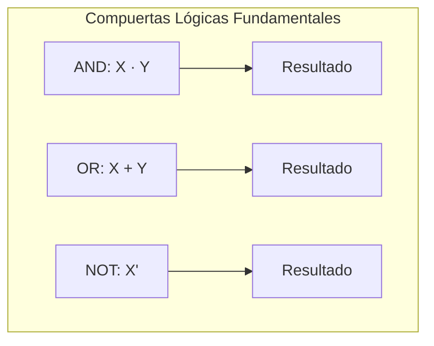

# Organización y Arquitectura de Computadoras - Álgebra booleana

## 3.1 Postulados del álgebra booleana

---

El álgebra booleana, desarrollada por George Boole en el siglo XIX, es la base matemática de los sistemas digitales y la arquitectura de computadoras. Los postulados del álgebra booleana establecen las reglas fundamentales que gobiernan las operaciones lógicas en circuitos digitales.

### Definición Básica

El álgebra booleana es una estructura algebraica definida sobre un conjunto de elementos $B = \{0, 1\}$ con tres operaciones básicas: AND (·), OR (+) y NOT (').

### Postulados Fundamentales

#### 1. Postulados de Cerradura

- **AND**: Si $X, Y \in B$, entonces $X · Y \in B$
- **OR**: Si $X, Y \in B$, entonces $X + Y \in B$
- **NOT**: Si $X \in B$, entonces $X' \in B$

#### 2. Postulados de Identidad

- Elemento identidad para OR: $X + 0 = X$
- Elemento identidad para AND: $X · 1 = X$

#### 3. Postulados de Complemento

- $X + X' = 1$
- $X · X' = 0$

#### 4. Postulados Conmutativos

- $X + Y = Y + X$
- $X · Y = Y · X$

#### 5. Postulados Distributivos

- $X · (Y + Z) = X · Y + X · Z$
- $X + (Y · Z) = (X + Y) · (X + Z)$

#### 6. Postulados de Idempotencia

- $X + X = X$
- $X · X = X$

#### 7. Postulados de Absorción

- $X + (X · Y) = X$
- $X · (X + Y) = X$

#### 8. Postulado de Involución

- $(X')' = X$

#### 9. Leyes de De Morgan

- $(X + Y)' = X' · Y'$
- $(X · Y)' = X' + Y'$

### Tablas de Verdad

#### Operación AND

| X   | Y   | X · Y |
| --- | --- | ----- |
| 0   | 0   | 0     |
| 0   | 1   | 0     |
| 1   | 0   | 0     |
| 1   | 1   | 1     |

#### Operación OR

| X   | Y   | X + Y |
| --- | --- | ----- |
| 0   | 0   | 0     |
| 0   | 1   | 1     |
| 1   | 0   | 1     |
| 1   | 1   | 1     |

#### Operación NOT

| X   | X'  |
| --- | --- |
| 0   | 1   |
| 1   | 0   |

### Diagrama de Compuertas Lógicas Básicas



### Ejemplos de Aplicación

#### Ejemplo 1: Simplificación de Expresión

Simplificar la expresión: $F = A · B + A · B'$

**Solución:**
$F = A · B + A · B' = A · (B + B') = A · 1 = A$

#### Ejemplo 2: Aplicación de De Morgan

Aplicar De Morgan a: $(A + B · C)'$

**Solución:**
$(A + B · C)' = A' · (B · C)' = A' · (B' + C')$

### Ejercicios Propuestos

#### Ejercicio 1

Demostrar usando postulados: $X + X' · Y = X + Y$

#### Ejercicio 2

Simplificar la expresión: $F = A · B' + A · B + A' · B$

#### Ejercicio 3

Aplicar las leyes de De Morgan a: $(A' + B · C')'$

#### Ejercicio 4

Probar que: $(X + Y) · (X' + Z) = X · Z + X' · Y$

#### Ejercicio 5

Implementar con compuertas lógicas la expresión: $F = (A + B') · C$

### Implementación en Código

```python
def operacion_and(x, y):
    """Implementación de la operación AND"""
    return x and y

def operacion_or(x, y):
    """Implementación de la operación OR"""
    return x or y

def operacion_not(x):
    """Implementación de la operación NOT"""
    return not x

# Ejemplo de uso
def evaluar_expresion(a, b, c):
    """Evalúa la expresión F = (A + B') · C"""
    not_b = operacion_not(b)
    term1 = operacion_or(a, not_b)
    resultado = operacion_and(term1, c)
    return resultado

# Prueba con valores específicos
print("F(0, 1, 1) =", evaluar_expresion(0, 1, 1))  # Debe retornar 1
print("F(1, 0, 0) =", evaluar_expresion(1, 0, 0))  # Debe retornar 0
```

### Aplicación en Arquitectura de Computadoras

Los postulados booleanos son fundamentales en el diseño de:

- Unidad Aritmético-Lógica (ALU)
- Circuitos combinacionales
- Memorias y registros
- Unidades de control

### Referencias

#### Bibliografía Básica

1. Mano, M. Morris y Charles Kime. "Logic and Computer Design Fundamentals", 4a Ed., Prentice Hall, 2007. (Capítulo 2)
2. Patterson, David A. y John L. Hennessy. "Computer Organization and Design: The Hardware/Software Interface", 4a Ed., Morgan Kaufmann, 2008. (Apéndice C)

#### Bibliografía Complementaria

1. Stallings, William. "Computer Organization and Architecture: Designing for Performance", Prentice Hall - Pearson, 2009. (Capítulo 11)

### Consejos de Estudio

1. **Memoriza los postulados** fundamentales y practica su aplicación
2. **Resuelve muchos ejercicios** de simplificación de expresiones
3. **Visualiza las operaciones** usando tablas de verdad
4. **Relaciona los conceptos** con implementaciones prácticas en circuitos
5. **Practica la aplicación** de las leyes de De Morgan

### Soluciones a Ejercicios Propuestos

#### Solución Ejercicio 1

$X + X' · Y = (X + X') · (X + Y) = 1 · (X + Y) = X + Y$

#### Solución Ejercicio 2

$F = A · B' + A · B + A' · B = A · (B' + B) + A' · B = A · 1 + A' · B = A + A' · B$
