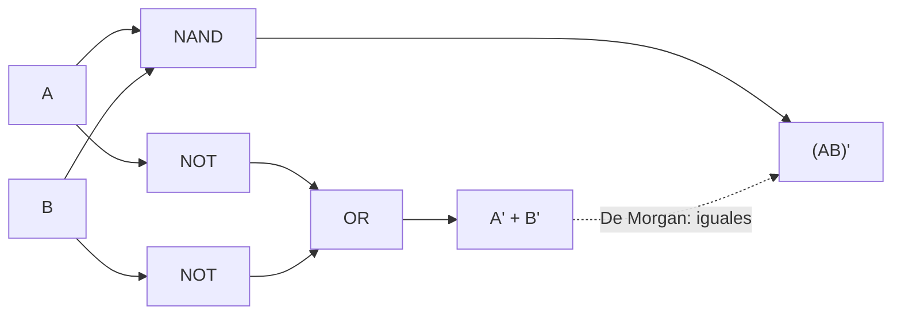

# Organización y Arquitectura de Computadoras - Álgebra booleana

## 3.1 Postulados del álgebra booleana

---

El **álgebra booleana**, introducida por George Boole en 1854 para formalizar la lógica, se convirtió en la herramienta para diseñar circuitos digitales cuando Claude Shannon mostró en 1938 que los circuitos de relevadores obedecen sus leyes. Las variables toman dos valores, 0 y 1, y las operaciones son la suma lógica (OR), el producto lógico (AND) y el complemento (NOT), que se implementan con **compuertas**. Este tema presenta los postulados de Huntington, deduce de ellos los teoremas que se usan para simplificar expresiones, explica el principio de dualidad y muestra que una sola compuerta, NAND, basta para construir cualquier circuito.

### Postulados de Huntington

Un **álgebra booleana** es un conjunto $B$ con dos operaciones binarias, $+$ y $\cdot,$ que cumplen (Huntington, 1904):

| Postulado | Para $+$ | Para $\cdot$ |
| --- | --- | --- |
| P1 cerradura | $x + y \in B$ | $x \cdot y \in B$ |
| P2 identidad | existe 0 con $x + 0 = x$ | existe 1 con $x \cdot 1 = x$ |
| P3 conmutatividad | $x + y = y + x$ | $x \cdot y = y \cdot x$ |
| P4 distributividad | $x + y z = (x + y)(x + z)$ | $x (y + z) = xy + xz$ |
| P5 complemento | para cada $x$ existe $x'$ con $x + x' = 1$ | $x \cdot x' = 0$ |
| P6 | hay al menos dos elementos distintos | |

El caso que interesa para los circuitos es $B = \{0, 1\}$ con las tablas de OR, AND y NOT, y se comprueba que cumple todos los postulados revisando las tablas. Otros modelos son los subconjuntos de un conjunto con unión, intersección y complemento, o las proposiciones con disyunción, conjunción y negación. Notación: se escribe $xy$ por $x \cdot y,$ y el complemento como $x'$ o $\overline{x}.$ El producto tiene precedencia sobre la suma.

**Principio de dualidad.** Los postulados vienen en pares que se obtienen intercambiando $+$ con $\cdot$ y 0 con 1. Por lo tanto, si una igualdad se deduce de los postulados, su **dual** también: basta aplicar en la demostración los postulados duales. Por ejemplo, de $x + 0 = x$ se obtiene $x \cdot 1 = x,$ y de $x + xy = x$ se obtiene $x(x + y) = x.$ Atención: la segunda forma de la distributividad, $x + yz = (x + y)(x + z),$ no es válida en la aritmética ordinaria.

### Teoremas

| Teorema | Forma | Forma dual |
| --- | --- | --- |
| T1 idempotencia | $x + x = x$ | $x x = x$ |
| T2 elemento nulo | $x + 1 = 1$ | $x \cdot 0 = 0$ |
| T3 involución | $(x')' = x$ | |
| T4 absorción | $x + xy = x$ | $x(x + y) = x$ |
| T5 asociatividad | $x + (y + z) = (x + y) + z$ | $x(yz) = (xy)z$ |
| T6 De Morgan | $(x + y)' = x' y'$ | $(xy)' = x' + y'$ |
| T7 eliminación | $x + x'y = x + y$ | $x(x' + y) = xy$ |
| T8 consenso | $xy + x'z + yz = xy + x'z$ | $(x + y)(x' + z)(y + z) = (x + y)(x' + z)$ |

**Demostraciones a partir de los postulados.**

- **T1.** $x + x = (x + x) \cdot 1 = (x + x)(x + x') = x + x x' = x + 0 = x,$ usando P2, P5, P4, P5 y P2.
- **T2.** $x + 1 = (x + 1) \cdot 1 = (x + 1)(x + x') = x + 1 \cdot x' = x + x' = 1.$
- **T4.** $x + xy = x \cdot 1 + x y = x (1 + y) = x \cdot 1 = x,$ usando T2.
- **Unicidad del complemento.** Si $x + a = 1,$ $xa = 0$ y también $x + b = 1,$ $xb = 0,$ entonces $a = a \cdot 1 = a(x + b) = ax + ab = 0 + ab = xb + ab = (x + a) b = 1 \cdot b = b.$
- **T3.** $x'$ cumple $x' + x = 1$ y $x' x = 0,$ así que $x$ es un complemento de $x';$ por la unicidad, $(x')' = x.$
- **T6.** Basta ver que $x'y'$ cumple las dos propiedades del complemento de $x + y.$ Por un lado, $(x + y) + x'y' = (x + y + x')(x + y + y') = 1 \cdot 1 = 1$ por la distributividad P4. Por otro, $(x + y)\, x'y' = x x' y' + y x' y' = 0 + 0 = 0.$ Por la unicidad, $(x + y)' = x'y'.$
- **T7.** $x + x'y = (x + x')(x + y) = 1 \cdot (x + y) = x + y.$
- **T8.** $yz = yz(x + x') = xyz + x'yz,$ y cada término es absorbido: $xy + xyz = xy$ y $x'z + x'yz = x'z.$ $\blacksquare$

**Verificación por tabla de verdad.** Como $B = \{0, 1\}$ es finito, una igualdad entre expresiones de $n$ variables se puede comprobar evaluando las $2^n$ asignaciones (inducción perfecta). Es lo que hace el programa de este tema. Para demostrar que una igualdad es **falsa** basta un contraejemplo: $(xy)' \neq x'y'$ porque con $x = 0,$ $y = 1$ el lado izquierdo vale 1 y el derecho 0.

### Compuertas lógicas

| Compuerta | Expresión | Salida 1 cuando |
| --- | --- | --- |
| NOT | $x'$ | $x = 0$ |
| AND | $xy$ | ambas entradas son 1 |
| OR | $x + y$ | alguna entrada es 1 |
| NAND | $(xy)'$ | alguna entrada es 0 |
| NOR | $(x + y)'$ | ambas entradas son 0 |
| XOR | $x \oplus y = x'y + xy'$ | las entradas son distintas |
| XNOR | $(x \oplus y)'$ | las entradas son iguales |

**Completitud funcional.** Hay $2^{2^n}$ funciones booleanas de $n$ variables, y todas se pueden escribir con AND, OR y NOT (tema 3.2). Más aún, **NAND por sí sola basta**: $x' = (xx)',$ $xy = \big( (xy)' \big)',$ y por De Morgan $x + y = (x'y')' = \big( (xx)' (yy)' \big)'.$ Lo mismo vale para NOR. En la tecnología CMOS, NAND y NOR son las compuertas más sencillas (cuatro transistores con dos entradas), y AND y OR se construyen como NAND o NOR seguidas de un inversor.



### Implementación en Python

El programa comprueba por inducción perfecta las leyes de la tabla y las igualdades de los ejercicios 1 a 4, encuentra contraejemplos para una igualdad falsa, construye NOT, AND y OR solo con NAND y genera la tabla de verdad del ejercicio 5.

```python
from itertools import product


def equivalentes(f, g, n):
    """Compara dos funciones booleanas de n variables en las 2^n asignaciones."""
    return all(f(*v) == g(*v) for v in product((0, 1), repeat=n))


NOT = lambda a: 1 - a
AND = lambda a, b: a & b
OR = lambda a, b: a | b

leyes = {
    "idempotencia  X + X = X": (lambda x: OR(x, x), lambda x: x, 1),
    "absorción     X + XY = X": (lambda x, y: OR(x, AND(x, y)), lambda x, y: x, 2),
    "De Morgan     (X + Y)' = X'Y'": (lambda x, y: NOT(OR(x, y)), lambda x, y: AND(NOT(x), NOT(y)), 2),
    "distributiva  X + YZ = (X + Y)(X + Z)": (lambda x, y, z: OR(x, AND(y, z)),
                                              lambda x, y, z: AND(OR(x, y), OR(x, z)), 3),
    "consenso      XY + X'Z + YZ = XY + X'Z": (lambda x, y, z: OR(OR(AND(x, y), AND(NOT(x), z)), AND(y, z)),
                                                lambda x, y, z: OR(AND(x, y), AND(NOT(x), z)), 3),
}
for nombre, (f, g, n) in leyes.items():
    print(f"{nombre:42s} {'✓' if equivalentes(f, g, n) else '✗'}")

ejercicios = {
    "1: X + X'Y = X + Y": (lambda x, y: OR(x, AND(NOT(x), y)), lambda x, y: OR(x, y), 2),
    "2: AB' + AB + A'B = A + B": (lambda a, b: OR(OR(AND(a, NOT(b)), AND(a, b)), AND(NOT(a), b)),
                                  lambda a, b: OR(a, b), 2),
    "3: (A' + BC')' = AB' + AC": (lambda a, b, c: NOT(OR(NOT(a), AND(b, NOT(c)))),
                                  lambda a, b, c: OR(AND(a, NOT(b)), AND(a, c)), 3),
    "4: (X + Y)(X' + Z) = XZ + X'Y": (lambda x, y, z: AND(OR(x, y), OR(NOT(x), z)),
                                      lambda x, y, z: OR(AND(x, z), AND(NOT(x), y)), 3),
}
for nombre, (f, g, n) in ejercicios.items():
    print(f"ejercicio {nombre:34s} {'✓' if equivalentes(f, g, n) else '✗'}")

# Una igualdad falsa: el contraejemplo lo da la tabla
f, g = (lambda x, y: NOT(AND(x, y))), (lambda x, y: AND(NOT(x), NOT(y)))
contra = [v for v in product((0, 1), repeat=2) if f(*v) != g(*v)]
print("(XY)' = X'Y' es falsa; contraejemplos (X, Y):", contra)

# Completitud de NAND: NOT, AND y OR construidos solo con NAND
NAND = lambda a, b: 1 - (a & b)
n_not = lambda a: NAND(a, a)
n_and = lambda a, b: NAND(NAND(a, b), NAND(a, b))
n_or = lambda a, b: NAND(NAND(a, a), NAND(b, b))
print("NAND universal:", equivalentes(n_not, NOT, 1), equivalentes(n_and, AND, 2), equivalentes(n_or, OR, 2))

# Ejercicio 5: F = (A + B')C, tabla de verdad
print("ejercicio 5: tabla de F = (A + B')C")
print("   A B C | F")
for a, b, c in product((0, 1), repeat=3):
    print(f"   {a} {b} {c} | {AND(OR(a, NOT(b)), c)}")
print("número de funciones booleanas de n variables:", {n: 2 ** (2 ** n) for n in range(1, 5)})
```

Salida:

```text
idempotencia  X + X = X                    ✓
absorción     X + XY = X                   ✓
De Morgan     (X + Y)' = X'Y'              ✓
distributiva  X + YZ = (X + Y)(X + Z)      ✓
consenso      XY + X'Z + YZ = XY + X'Z     ✓
ejercicio 1: X + X'Y = X + Y                 ✓
ejercicio 2: AB' + AB + A'B = A + B          ✓
ejercicio 3: (A' + BC')' = AB' + AC          ✓
ejercicio 4: (X + Y)(X' + Z) = XZ + X'Y      ✓
(XY)' = X'Y' es falsa; contraejemplos (X, Y): [(0, 1), (1, 0)]
NAND universal: True True True
ejercicio 5: tabla de F = (A + B')C
   A B C | F
   0 0 0 | 0
   0 0 1 | 1
   0 1 0 | 0
   0 1 1 | 0
   1 0 0 | 0
   1 0 1 | 1
   1 1 0 | 0
   1 1 1 | 1
número de funciones booleanas de n variables: {1: 4, 2: 16, 3: 256, 4: 65536}
```

### Ejercicios Propuestos

1. **Eliminación.** Demuestra con los postulados que $X + X'Y = X + Y.$

2. **Simplificación.** Simplifica $F = AB' + AB + A'B.$

3. **De Morgan.** Aplica las leyes de De Morgan a $(A' + BC')'$ y escribe el resultado como suma de productos.

4. **Una igualdad útil.** Demuestra que $(X + Y)(X' + Z) = XZ + X'Y.$

5. **Circuito.** Implementa con compuertas $F = (A + B')\, C$ y escribe su tabla de verdad. ¿Cómo sería solo con NAND?

### Soluciones

**Ejercicio 1.** Por P4, $X + X'Y = (X + X')(X + Y) = 1 \cdot (X + Y) = X + Y.$

**Ejercicio 2.** $AB' + AB = A(B' + B) = A,$ así que $F = A + A'B = A + B$ por el ejercicio 1.

**Ejercicio 3.** $(A' + BC')' = A'' \cdot (BC')' = A (B' + C'') = A(B' + C) = AB' + AC.$

**Ejercicio 4.** Desarrollando, $(X + Y)(X' + Z) = XX' + XZ + X'Y + YZ = XZ + X'Y + YZ,$ y por el teorema del consenso el término $YZ$ sobra: $XZ + X'Y.$

**Ejercicio 5.** Un inversor para $B,$ una OR de $A$ con $B'$ y una AND con $C.$ $F = 1$ solo en las filas $ABC = 001,$ $101$ y $111.$ Solo con NAND: $A + B' = (A' B)'$ es una NAND de $A'$ y $B,$ donde $A' = (AA)';$ y $F = \big( (A + B') C \big)''$ es una NAND seguida de un inversor hecho con otra NAND. En total, cuatro NAND.

### Referencias

1. Mano, M. M., and Ciletti, M. D., _Digital Design_. Pearson, 2018. Capítulo 2.
2. Huntington, E. V., Sets of independent postulates for the algebra of logic. _Transactions of the AMS_ 5, 1904.
3. Shannon, C. E., A symbolic analysis of relay and switching circuits. _Transactions of the AIEE_ 57, 1938.
4. Harris, D. M., and Harris, S. L., _Digital Design and Computer Architecture_. Morgan Kaufmann, 2013. Capítulo 2.
