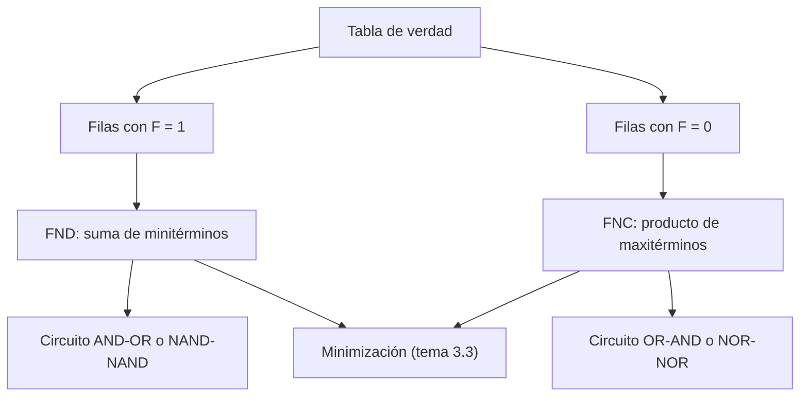

# Organización y Arquitectura de Computadoras - Álgebra booleana

## 3.2 Formas normales conjuntivas y disjuntivas

---

Una función booleana se puede describir con su **tabla de verdad** o con una **expresión**, y una misma función tiene infinitas expresiones equivalentes. Las **formas normales** (o canónicas) son expresiones estándar que se leen directamente de la tabla: la **forma normal disjuntiva** es una suma de productos y la **conjuntiva** un producto de sumas. Este tema las define, demuestra que toda función tiene exactamente una de cada tipo (lo que prueba que AND, OR y NOT bastan para cualquier función), explica cómo pasar de una a otra y cómo se implementan como circuitos de dos niveles.

### Minitérminos y maxitérminos

Para $n$ variables, un **minitérmino** es un producto en el que aparece cada variable exactamente una vez, normal o complementada. Hay $2^n,$ y se numeran por el patrón de bits que los hace valer 1: con tres variables $A, B, C,$ el minitérmino $m_5$ es $AB'C,$ que vale 1 solo cuando $ABC = 101.$

Un **maxitérmino** es una suma con cada variable exactamente una vez. El maxitérmino $M_i$ vale 0 solo en la fila $i:$ $M_5 = A' + B + C'.$ Por De Morgan, $M_i = m_i'.$

| Fila | $A B C$ | Minitérmino | Maxitérmino |
| --- | --- | --- | --- |
| 0 | 000 | $m_0 = A'B'C'$ | $M_0 = A + B + C$ |
| 1 | 001 | $m_1 = A'B'C$ | $M_1 = A + B + C'$ |
| 2 | 010 | $m_2 = A'BC'$ | $M_2 = A + B' + C$ |
| 3 | 011 | $m_3 = A'BC$ | $M_3 = A + B' + C'$ |
| 4 | 100 | $m_4 = AB'C'$ | $M_4 = A' + B + C$ |
| 5 | 101 | $m_5 = AB'C$ | $M_5 = A' + B + C'$ |
| 6 | 110 | $m_6 = ABC'$ | $M_6 = A' + B' + C$ |
| 7 | 111 | $m_7 = ABC$ | $M_7 = A' + B' + C'$ |

### Las formas normales

**Forma normal disjuntiva (FND),** o suma de minitérminos: la suma de los minitérminos de las filas donde $F = 1.$ Se abrevia $F = \sum m(\ldots).$

**Forma normal conjuntiva (FNC),** o producto de maxitérminos: el producto de los maxitérminos de las filas donde $F = 0.$ Se abrevia $F = \prod M(\ldots).$

**Teorema.** Toda función booleana de $n$ variables es igual a la suma de los minitérminos de las filas en que vale 1, y al producto de los maxitérminos de las filas en que vale 0. Estas representaciones son únicas (salvo el orden).

**Demostración.** En una asignación dada, exactamente un minitérmino vale 1, el de esa fila. La suma $\sum_{F(i) = 1} m_i$ vale 1 en la fila $j$ si y solo si $m_j$ está en la suma, es decir, si $F(j) = 1:$ coincide con $F$ en todas las filas. Dualmente, el producto $\prod_{F(i) = 0} M_i$ vale 0 en la fila $j$ si y solo si $M_j$ aparece, es decir, si $F(j) = 0.$ La unicidad se debe a que dos sumas de minitérminos distintas difieren en la fila de algún minitérmino que está en una y no en la otra. $\blacksquare$

**Corolario (completitud).** Toda función booleana se puede escribir con AND, OR y NOT, porque su FND solo usa esas operaciones.

**Expansión de Shannon.** Otra forma de verlo: para cualquier variable $A,$

$$ F(A, B, C) = A'\, F(0, B, C) + A\, F(1, B, C) $$

porque con $A = 0$ solo sobrevive el primer término y con $A = 1$ el segundo. Aplicándola a todas las variables se obtiene la FND. Esta expansión es también el principio de los **multiplexores** (tema 4.1) y de los diagramas de decisión binaria.

### Conversiones

- **Entre FND y FNC:** los índices de la FNC son los que **no** están en la FND. Si $F = \sum m(1, 3, 4, 7)$ con tres variables, $F = \prod M(0, 2, 5, 6).$
- **Complemento:** $F' = \sum m(\text{índices que faltan}).$
- **De una expresión cualquiera a FND:** distribuir para obtener una suma de productos y completar cada producto con las variables que le faltan, usando $X = X(Y + Y') = XY + XY'.$ Por ejemplo, $AC = AC(B + B') = ABC + AB'C.$
- **A FNC:** dualmente, obtener un producto de sumas con $X + YZ = (X + Y)(X + Z)$ y completar cada suma con $X = X + YY' = (X + Y)(X + Y').$

### Implementación con dos niveles de compuertas

La FND se implementa directamente como un circuito **AND-OR**: una compuerta AND por minitérmino y una OR que los reúne (más los inversores de las entradas). La FNC da un circuito **OR-AND**. Ambos tienen solo dos niveles de compuertas, así que el retardo es pequeño, pero las formas canónicas suelen tener muchos más términos de los necesarios: la minimización (tema 3.3) busca la suma de productos más pequeña. Por De Morgan, un circuito AND-OR es equivalente a uno NAND-NAND, y uno OR-AND a uno NOR-NOR. Los dispositivos lógicos programables (PLA, PAL) implementan sumas de productos con un plano AND y un plano OR programables.



### Implementación en Python

El programa genera las dos formas normales a partir de una tabla de verdad de tres variables (el ejercicio 5), las evalúa para comprobar que reproducen la tabla, resuelve los ejercicios 1 y 2 y comprueba la expansión de Shannon y la simplificación del ejercicio 4.

```python
from itertools import product

VARS = "ABC"


def minterm(i, n=3):
    bits = format(i, f"0{n}b")
    return "".join(v if b == "1" else v + "'" for v, b in zip(VARS, bits))


def maxterm(i, n=3):
    bits = format(i, f"0{n}b")
    return "(" + " + ".join(v if b == "0" else v + "'" for v, b in zip(VARS, bits)) + ")"


def formas_normales(tabla):
    """tabla: lista de 2^n salidas en el orden 000, 001, ..., 111."""
    unos = [i for i, f in enumerate(tabla) if f]
    ceros = [i for i, f in enumerate(tabla) if not f]
    fnd = " + ".join(minterm(i) for i in unos)
    fnc = "".join(maxterm(i) for i in ceros)
    return unos, ceros, fnd, fnc


def evaluar_fnd(unos, a, b, c):
    # la suma de minitérminos vale 1 exactamente en los índices listados
    return int(any(all((v == int(bit)) for v, bit in zip((a, b, c), format(m, "03b"))) for m in unos))


def evaluar_fnc(ceros, a, b, c):
    return int(all(any((v != int(bit)) for v, bit in zip((a, b, c), format(M, "03b"))) for M in ceros))


# Ejercicio 1
tabla1 = [0, 1, 0, 1, 1, 0, 0, 1]
unos, ceros, fnd, fnc = formas_normales(tabla1)
print("ejercicio 1: F = Σm", tuple(unos), "= ΠM", tuple(ceros))
print("   FND:", fnd)
print("   FNC:", fnc)
ok = all(evaluar_fnd(unos, *v) == evaluar_fnc(ceros, *v) == tabla1[4 * v[0] + 2 * v[1] + v[2]]
         for v in product((0, 1), repeat=3))
print("   ambas formas reproducen la tabla:", ok)

# Ejercicio 2: F = (A + B')(A' + C)
f2 = lambda a, b, c: (a | (1 - b)) & ((1 - a) | c)
tabla2 = [f2(*v) for v in product((0, 1), repeat=3)]
unos, ceros, fnd, fnc = formas_normales(tabla2)
print("ejercicio 2: tabla", tabla2, "-> Σm", tuple(unos), "= ΠM", tuple(ceros))
print("   FND:", fnd)
print("   FNC:", fnc)
g = lambda a, b, c: (a & c) | ((1 - a) & (1 - b))
print("   forma simplificada AC + A'B' equivalente:", all(f2(*v) == g(*v) for v in product((0, 1), repeat=3)))

# Expansión de Shannon: F = A' F(0, B, C) + A F(1, B, C)
shannon = lambda a, b, c: ((1 - a) & f2(0, b, c)) | (a & f2(1, b, c))
print("expansión de Shannon respecto a A con F(0, B, C) = B' y F(1, B, C) = C reproduce F:",
      all(shannon(*v) == f2(*v) for v in product((0, 1), repeat=3)))

# Ejercicio 5: generador para cualquier función de 3 variables, ejemplo: mayoría
mayoria = [int(a + b + c >= 2) for a, b, c in product((0, 1), repeat=3)]
u, z, fnd, fnc = formas_normales(mayoria)
print("mayoría: FND", fnd, "| FNC", fnc)
```

Salida:

```text
ejercicio 1: F = Σm (1, 3, 4, 7) = ΠM (0, 2, 5, 6)
   FND: A'B'C + A'BC + AB'C' + ABC
   FNC: (A + B + C)(A + B' + C)(A' + B + C')(A' + B' + C)
   ambas formas reproducen la tabla: True
ejercicio 2: tabla [1, 1, 0, 0, 0, 1, 0, 1] -> Σm (0, 1, 5, 7) = ΠM (2, 3, 4, 6)
   FND: A'B'C' + A'B'C + AB'C + ABC
   FNC: (A + B' + C)(A + B' + C')(A' + B + C)(A' + B' + C)
   forma simplificada AC + A'B' equivalente: True
expansión de Shannon respecto a A con F(0, B, C) = B' y F(1, B, C) = C reproduce F: True
mayoría: FND A'BC + AB'C + ABC' + ABC | FNC (A + B + C)(A + B + C')(A + B' + C)(A' + B + C)
```

### Ejercicios Propuestos

1. **Desde la tabla.** Encuentra la FND y la FNC de la función que vale 1 en las filas $ABC = 001,$ $011,$ $100$ y $111.$

2. **Desde una expresión.** Convierte $F = (A + B')(A' + C)$ a FND y FNC.

3. **Circuito.** Dibuja el circuito AND-OR de la FND del ejercicio 1. ¿Cuántas compuertas y entradas usa?

4. **Simplificación.** Simplifica la expresión del ejercicio 2 con los teoremas del tema 3.1.

5. **Programa.** Escribe un programa que genere las dos formas normales a partir de la tabla de verdad de una función de 3 variables.

### Soluciones

**Ejercicio 1.** $F = \sum m(1, 3, 4, 7) = A'B'C + A'BC + AB'C' + ABC$ y $F = \prod M(0, 2, 5, 6) = (A + B + C)(A + B' + C)(A' + B + C')(A' + B' + C).$

**Ejercicio 2.** Desarrollando, $F = AA' + AC + A'B' + B'C = AC + A'B' + B'C.$ Completando cada producto: $AC = ABC + AB'C,$ $A'B' = A'B'C + A'B'C',$ $B'C = AB'C + A'B'C,$ y eliminando repetidos, $F = \sum m(0, 1, 5, 7).$ Por lo tanto $F = \prod M(2, 3, 4, 6).$

**Ejercicio 3.** Tres inversores para $A',$ $B',$ $C',$ cuatro AND de tres entradas y una OR de cuatro entradas: 8 compuertas y 19 entradas. Agrupando minitérminos adyacentes (tema 3.3) se reduce a $A'C + BC + AB'C',$ con tres productos y 7 literales.

**Ejercicio 4.** Por el teorema del consenso, en $AC + A'B' + B'C$ el término $B'C$ es el consenso de $AC$ y $A'B'$ respecto a $A,$ y sobra: $F = AC + A'B'.$ Es, además, la expresión de un multiplexor: si $A = 1$ la salida es $C,$ y si $A = 0$ es $B'.$

**Ejercicio 5.** Es la función `formas_normales` del programa, aplicada también a la función mayoría.

### Referencias

1. Mano, M. M., and Ciletti, M. D., _Digital Design_. Pearson, 2018. Secciones 2.6 a 2.8.
2. Harris, D. M., and Harris, S. L., _Digital Design and Computer Architecture_. Morgan Kaufmann, 2013. Sección 2.2.
3. Shannon, C. E., A symbolic analysis of relay and switching circuits. _Transactions of the AIEE_ 57, 1938.
4. Rosen, K. H., _Matemática discreta y sus aplicaciones_. McGraw-Hill, 2004. Capítulo 10.
