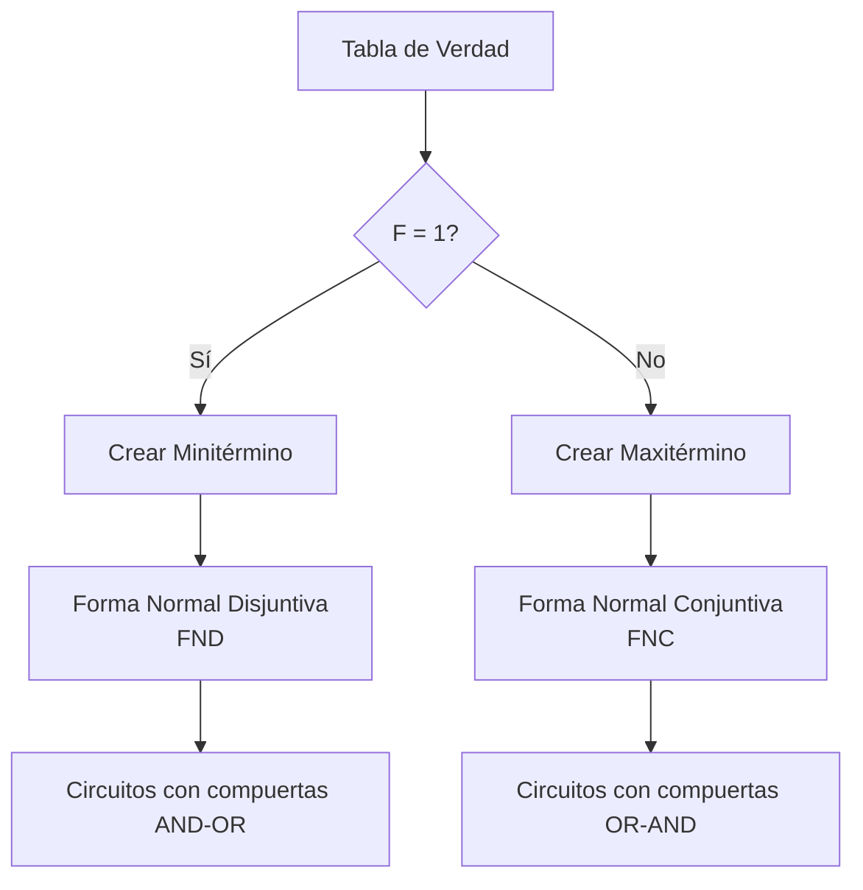
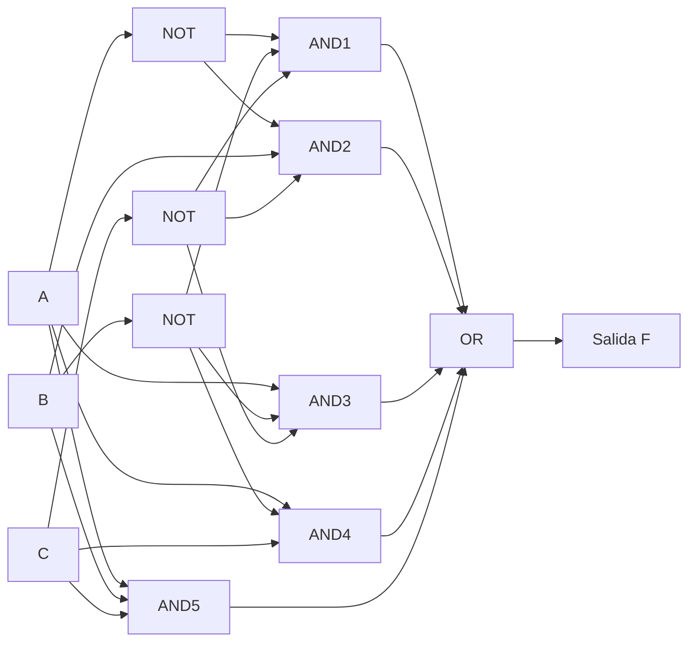
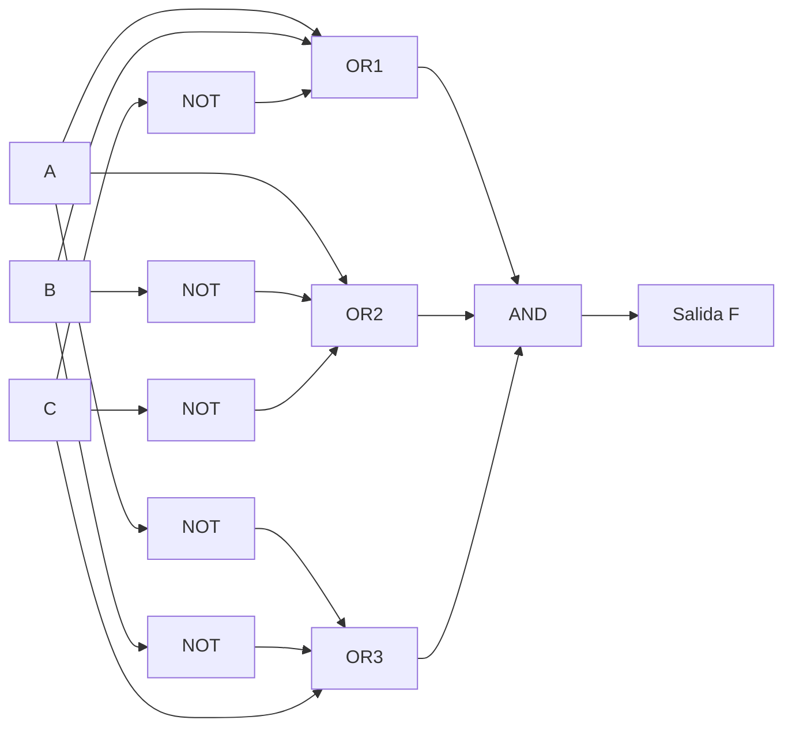

# Organización y Arquitectura de Computadoras - Álgebra booleana

## 3.2 Formas normales conjuntivas y disjuntivas

---

Las formas normales conjuntivas (FNC) y disjuntivas (FND) son representaciones estandarizadas de expresiones booleanas que juegan un papel crucial en el diseño y simplificación de circuitos lógicos en arquitectura de computadoras.

### Definiciones Fundamentales

#### Términos Básicos

- **Literal**: Variable booleana o su complemento ( $A$, $B'$, etc. )
- **Minitérmino**: Producto (AND) de todos los literales de una función donde la función vale 1
- **Maxitérmino**: Suma (OR) de todos los literales de una función donde la función vale 0

#### Forma Normal Disjuntiva (FND)

Suma de productos donde cada término es un minitérmino:

$$F = \sum m(i,j,k,...)$$

#### Forma Normal Conjuntiva (FNC)

Producto de sumas donde cada término es un maxitérmino:

$$F = \prod M(i,j,k,...)$$

### Conversión entre Formas Normales

#### De Tabla de Verdad a FND

Para cada combinación donde $F = 1$, crear un minitérmino:

$$F = \sum m_i$$ donde $f(i) = 1$

#### De Tabla de Verdad a FNC

Para cada combinación donde $F = 0$, crear un maxitérmino:

$$F = \prod M_i$$ donde $f(i) = 0$

### Ejemplo de Conversión

#### Tabla de Verdad

| A   | B   | C   | F   |
| --- | --- | --- | --- |
| 0   | 0   | 0   | 1   |
| 0   | 0   | 1   | 0   |
| 0   | 1   | 0   | 1   |
| 0   | 1   | 1   | 0   |
| 1   | 0   | 0   | 1   |
| 1   | 0   | 1   | 1   |
| 1   | 1   | 0   | 0   |
| 1   | 1   | 1   | 1   |

#### FND (Suma de Minitérminos)

$$F = m_0 + m_2 + m_4 + m_5 + m_7 = A'B'C' + A'BC' + AB'C' + AB'C + ABC$$

#### FNC (Producto de Maxitérminos)

$$F = M_1 · M_3 · M_6 = (A + B + C') · (A + B' + C') · (A' + B' + C)$$

### Diagrama de Conversión



### Implementación de Circuitos

#### Circuito FND (AND-OR)



#### Circuito FNC (OR-AND)



### Algoritmo de Conversión en Código

```python
class FormasNormales:
    def __init__(self, variables):
        self.variables = variables
        self.n = len(variables)

    def mintermino(self, valores):
        """Convierte una combinación a mintermino"""
        termino = []
        for i, val in enumerate(valores):
            if val == 0:
                termino.append(f"{self.variables[i]}'")
            else:
                termino.append(self.variables[i])
        return " · ".join(termino)

    def maxtermino(self, valores):
        """Convierte una combinación a maxtermino"""
        termino = []
        for i, val in enumerate(valores):
            if val == 0:
                termino.append(self.variables[i])
            else:
                termino.append(f"{self.variables[i]}'")
        return " + ".join(termino)

    def tabla_verdad_a_fnd(self, tabla):
        """Convierte tabla de verdad a FND"""
        minterminos = []
        for i, fila in enumerate(tabla):
            if fila[-1] == 1:  # Si la salida es 1
                minterminos.append(self.mintermino(fila[:-1]))
        return " + ".join(minterminos)

    def tabla_verdad_a_fnc(self, tabla):
        """Convierte tabla de verdad a FNC"""
        maxterminos = []
        for i, fila in enumerate(tabla):
            if fila[-1] == 0:  # Si la salida es 0
                maxterminos.append(f"({self.maxtermino(fila[:-1])})")
        return " · ".join(maxterminos)

# Ejemplo de uso
if __name__ == "__main__":
    # Tabla de verdad para F = A ⊕ B (XOR)
    tabla_xor = [
        [0, 0, 0],
        [0, 1, 1],
        [1, 0, 1],
        [1, 1, 0]
    ]

    fn = FormasNormales(['A', 'B'])

    print("FND:", fn.tabla_verdad_a_fnd(tabla_xor))
    print("FNC:", fn.tabla_verdad_a_fnc(tabla_xor))
```

### Ejercicios Propuestos

#### Ejercicio 1

Dada la siguiente tabla de verdad, encontrar ambas formas normales:

| A   | B   | C   | F   |
| --- | --- | --- | --- |
| 0   | 0   | 0   | 0   |
| 0   | 0   | 1   | 1   |
| 0   | 1   | 0   | 0   |
| 0   | 1   | 1   | 1   |
| 1   | 0   | 0   | 1   |
| 1   | 0   | 1   | 0   |
| 1   | 1   | 0   | 0   |
| 1   | 1   | 1   | 1   |

#### Ejercicio 2

Convertir la siguiente expresión a ambas formas normales:

$$F = (A + B') · (A' + C)$$

#### Ejercicio 3

Implementar el circuito para la FND del ejercicio 1 usando compuertas lógicas.

#### Ejercicio 4

Simplificar la FNC resultante del ejercicio 2 usando postulados booleanos.

#### Ejercicio 5

Crear un programa que genere automáticamente ambas formas normales a partir de una tabla de verdad de 3 variables.

### Aplicaciones en Arquitectura

#### En Diseño de Circuitos

- **FND**: Ideal para implementación con multiplexores y PALs
- **FNC**: Útil para implementación con demultiplexores y en lógica programable

#### En Minimización

- Las formas normales son el punto de partida para técnicas de minimización como mapas de Karnaugh y el algoritmo de Quine-McCluskey

### Referencias

#### Bibliografía Básica

1. Mano, M. Morris y Charles Kime. "Logic and Computer Design Fundamentals", 4a Ed., Prentice Hall, 2007. (Capítulo 2)
2. Kohavi, Zvi y Niraj K. Jha. "Switching and Finite Automata Theory", 3a Ed., Cambridge University Press, 2009. (Capítulo 3)

#### Bibliografía Complementaria

1. Stallings, William. "Computer Organization and Architecture: Designing for Performance", Prentice Hall - Pearson, 2009. (Capítulo 11)

### Consejos de Estudio

1. **Domina la conversión** entre tabla de verdad y formas normales
2. **Practica la identificación** de minitérminos y maxitérminos
3. **Visualiza los circuitos** correspondientes a cada forma normal
4. **Aprende a simplificar** las formas normales usando postulados booleanos
5. **Relaciona los conceptos** con aplicaciones prácticas en diseño digital

### Soluciones a Ejercicios Propuestos

#### Solución Ejercicio 1

**FND**: $F = A'B'C + A'BC + AB'C' + ABC$

**FNC**: $F = (A + B + C) · (A + B' + C) · (A' + B + C') · (A' + B' + C')$

#### Solución Ejercicio 2

**FND**: $F = A'B'C + AB'C' + ABC$

**FNC**: $F = (A + B' + C) · (A' + B + C')$
