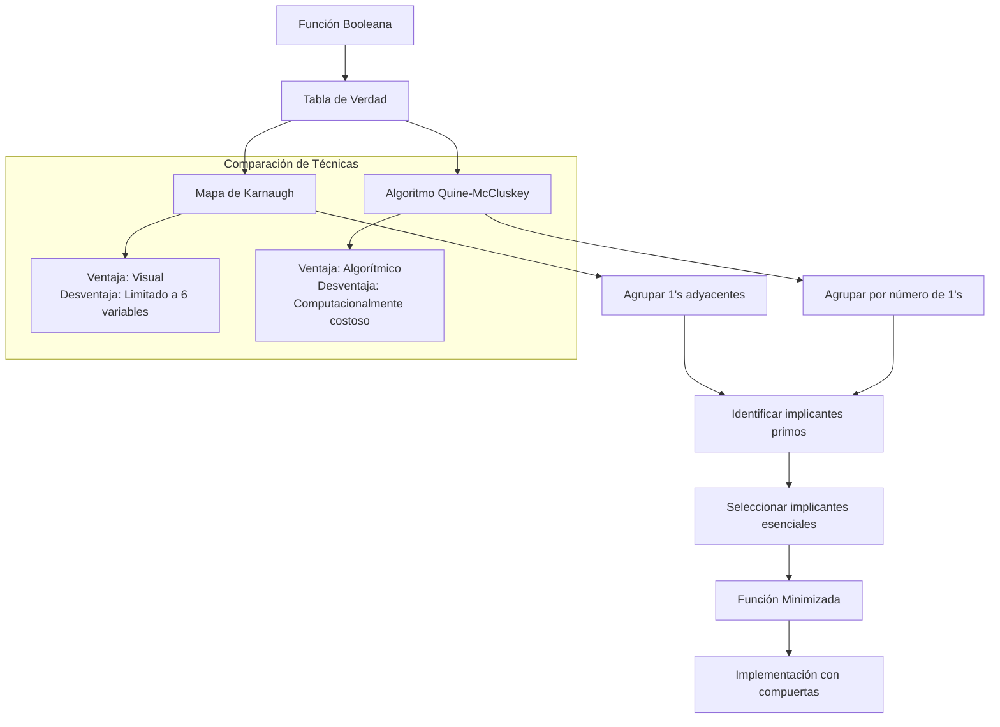

# Organización y Arquitectura de Computadoras - Álgebra booleana

## 3.3 Minimización de funciones

---

La minimización de funciones booleanas es un proceso fundamental en el diseño de circuitos digitales que permite reducir la complejidad de los circuitos, disminuir costos, mejorar el rendimiento y reducir el consumo de energía.

### Conceptos Fundamentales

#### Implicante y Implicante Primo

- **Implicante**: Término producto que representa una o más minitérminos de una función
- **Implicante Primo**: Implicante que no está contenido en ningún otro implicante más grande
- **Implicante Primo Esencial**: Implicante primo que cubre al menos un minitérmino no cubierto por otros implicantes primos

#### Representación Matemática

Para una función $F$ con variables $x_1, x_2, ..., x_n$:

- Un implicante es un término producto: $x_1^{a_1} · x_2^{a_2} · ... · x_n^{a_n}$ donde $a_i ∈ \{0, 1, -\}$
- El guión (-) representa una variable "don't care" (no importa)

### Técnicas de Minimización

#### 1. Mapas de Karnaugh (K-maps)

##### Estructura de K-maps para 3 variables

```
     BC
     00  01  11  10
A 0 | m₀ | m₁ | m₃ | m₂ |
  1 | m₄ | m₅ | m₇ | m₆ |
```

Donde:

- m₀ = A'B'C' (000)
- m₁ = A'B'C (001)
- m₂ = A'BC' (010)
- m₃ = A'BC (011)
- m₄ = AB'C' (100)
- m₅ = AB'C (101)
- m₆ = ABC' (110)
- m₇ = ABC (111)

##### Reglas para agrupamiento en K-maps:

- Agrupar 1's adyacentes en potencias de 2 (1, 2, 4, 8, ...)
- Los grupos deben ser lo más grandes posible
- Cada grupo debe ser rectangular o cuadrado
- Pueden envolverse los bordes del mapa

#### 2. Algoritmo de Quine-McCluskey

##### Pasos del algoritmo:

1. Listar todos los minitérminos de la función
2. Agrupar términos por número de 1's
3. Comparar términos entre grupos adyacentes
4. Repetir hasta que no haya más combinaciones posibles
5. Identificar implicantes primos esenciales
6. Cubrir todos los minitérminos con el mínimo número de implicantes

### Ejemplo de Minimización

#### Función a minimizar:

$$F(A, B, C) = \sum m(0, 2, 3, 4, 6, 7)$$

##### Tabla de verdad:

| A   | B   | C   | F   |
| --- | --- | --- | --- |
| 0   | 0   | 0   | 1   | m₀  |
| 0   | 0   | 1   | 0   |
| 0   | 1   | 0   | 1   | m₂  |
| 0   | 1   | 1   | 1   | m₃  |
| 1   | 0   | 0   | 1   | m₄  |
| 1   | 0   | 1   | 0   |
| 1   | 1   | 0   | 1   | m₆  |
| 1   | 1   | 1   | 1   | m₇  |

##### Mapa de Karnaugh:

```
     BC
     00  01  11  10
A  0| 1 | 0 | 1 | 1 |
  1| 1 | 0 | 1 | 1 |
```

##### Agrupamientos:

- Grupo 1: m₀, m₂, m₄, m₆ → $C'$ (A y B varían)
- Grupo 2: m₃, m₇ → $A·B$ (C varía)
- Grupo 3: m₆, m₇ → $A·C$ (B varía)

##### Función minimizada:

$$F = C' + A·B$$

### Implementación del Algoritmo Quine-McCluskey

```python
class QuineMcCluskey:
    def __init__(self, variables):
        self.variables = variables
        self.n = len(variables)

    def decimal_a_binario(self, num, bits):
        """Convierte decimal a binario con bits especificados"""
        return format(num, f'0{bits}b')

    def contar_unos(self, binario):
        """Cuenta el número de 1's en una representación binaria"""
        return binario.count('1')

    def diferencia(self, term1, term2):
        """Encuentra la diferencia entre dos términos"""
        diff = 0
        pos = -1
        for i in range(len(term1)):
            if term1[i] != term2[i]:
                diff += 1
                pos = i
        return diff, pos

    def quine_mccluskey(self, minterminos, dont_cares=[]):
        """Implementa el algoritmo de Quine-McCluskey"""
        todos_terminos = sorted(set(minterminos + dont_cares))
        grupos = {}

        # Agrupar por número de 1's
        for term in todos_terminos:
            binario = self.decimal_a_binario(term, self.n)
            unos = self.contar_unos(binario)
            if unos not in grupos:
                grupos[unos] = []
            grupos[unos].append((binario, [term]))

        # Combinar términos
        implicantes_primos = []
        combinados = True

        while combinados:
            combinados = False
            nuevos_grupos = {}
            usados = set()

            for unos in sorted(grupos.keys()):
                if unos + 1 in grupos:
                    for term1 in grupos[unos]:
                        for term2 in grupos[unos + 1]:
                            diff, pos = self.diferencia(term1[0], term2[0])
                            if diff == 1:
                                combinados = True
                                usados.add(term1[0])
                                usados.add(term2[0])

                                nuevo_binario = list(term1[0])
                                nuevo_binario[pos] = '-'
                                nuevo_binario = ''.join(nuevo_binario)

                                nuevos_minterminos = term1[1] + term2[1]

                                if unos not in nuevos_grupos:
                                    nuevos_grupos[unos] = []
                                nuevos_grupos[unos].append((nuevo_binario, nuevos_minterminos))

            # Agregar términos no combinados como implicantes primos
            for unos in grupos:
                for term in grupos[unos]:
                    if term[0] not in usados:
                        implicantes_primos.append(term)

            grupos = nuevos_grupos

        return implicantes_primos

    def encontrar_implicantes_esenciales(self, implicantes_primos, minterminos):
        """Encuentra los implicantes primos esenciales"""
        coverage = {m: [] for m in minterminos}

        for i, (binario, minterms) in enumerate(implicantes_primos):
            for m in minterms:
                if m in coverage:
                    coverage[m].append(i)

        esenciales = []
        for m, cubierto_por in coverage.items():
            if len(cubierto_por) == 1:
                esencial_idx = cubierto_por[0]
                if esencial_idx not in esenciales:
                    esenciales.append(esencial_idx)

        return esenciales

# Ejemplo de uso
if __name__ == "__main__":
    qm = QuineMcCluskey(['A', 'B', 'C'])
    minterminos = [0, 2, 3, 4, 6, 7]
    implicantes = qm.quine_mccluskey(minterminos)
    esenciales = qm.encontrar_implicantes_esenciales(implicantes, minterminos)

    print("Implicantes primos:")
    for i, (binario, minterms) in enumerate(implicantes):
        print(f"IP{i}: {binario} → {minterms}")

    print("\nImplicantes esenciales:", esenciales)
```

### Diagrama del Proceso de Minimización



### Ejercicios Propuestos

#### Ejercicio 1

Minimizar la siguiente función usando mapa de Karnaugh:

$$F(A, B, C, D) = \sum m(0, 1, 2, 5, 8, 9, 10, 13)$$

#### Ejercicio 2

Aplicar el algoritmo de Quine-McCluskey para minimizar:

$$F(A, B, C) = \sum m(0, 1, 3, 5, 7)$$

#### Ejercicio 3

Dada la función con condiciones "don't care":

$$F(A, B, C, D) = \sum m(1, 3, 7, 11, 15) + d(0, 2, 5)$$

Encontrar la forma mínima usando ambas técnicas.

#### Ejercicio 4

Implementar en Python una función que convierta implicantes primos en expresiones booleanas usando las variables ['A', 'B', 'C', 'D'].

#### Ejercicio 5

Comparar la complejidad de circuitos para la función original y minimizada del ejercicio 1, mostrando el ahorro en compuertas.

### Aplicaciones en Arquitectura de Computadoras

#### Optimización de Circuitos

- **Unidad Aritmético-Lógica (ALU)**: Minimización de funciones lógicas para operaciones aritméticas
- **Unidad de Control**: Optimización de circuitos de decodificación
- **Memoria Cache**: Diseño de circuitos de comparación y validación

#### Impacto en el Rendimiento

- Reducción del delay de propagación
- Disminución del consumo de energía
- Menor área de silicio en circuitos integrados

### Referencias

#### Bibliografía Básica

1. Mano, M. Morris y Charles Kime. "Logic and Computer Design Fundamentals", 4a Ed., Prentice Hall, 2007. (Capítulo 3)
2. Kohavi, Zvi y Niraj K. Jha. "Switching and Finite Automata Theory", 3a Ed., Cambridge University Press, 2009. (Capítulo 4)

#### Bibliografía Complementaria

1. Patterson, David A. y John L. Hennessy. "Computer Organization and Design: The Hardware/Software Interface", 4a Ed., Morgan Kaufmann, 2008. (Apéndice C)

### Consejos de Estudio

1. **Domina los mapas de Karnaugh** primero por su naturaleza visual
2. **Practica con diferentes configuraciones** de variables (3, 4, 5 variables)
3. **Aprende a identificar** implicantes primos esenciales rápidamente
4. **Utiliza condiciones "don't care"** para obtener mejores minimizaciones
5. **Verifica siempre tus resultados** mediante tablas de verdad

### Soluciones a Ejercicios Propuestos

#### Solución Ejercicio 1

**Función minimizada**: $F = B'D' + A'B' + AB'C'$

#### Solución Ejercicio 2

**Implicantes primos**: $A'B'$, $B'C$, $AC$
**Implicantes esenciales**: $A'B'$, $AC$
**Función minimizada**: $F = A'B' + AC$

Esta guía proporciona las herramientas necesarias para entender y aplicar las técnicas de minimización de funciones booleanas, esenciales para el diseño eficiente de circuitos digitales en arquitectura de computadoras.
