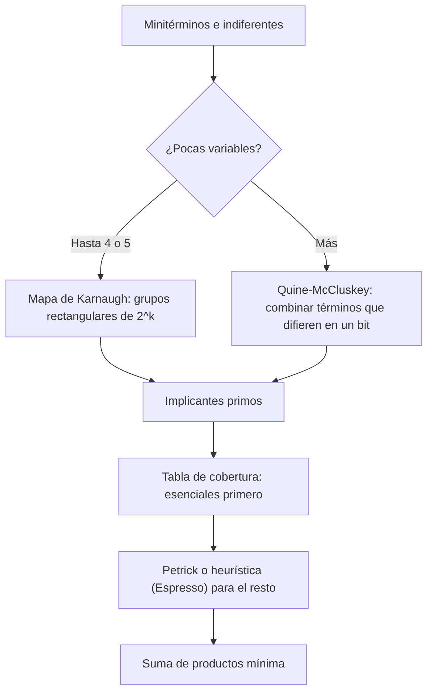

# Organización y Arquitectura de Computadoras - Álgebra booleana

## 3.3 Minimización de funciones

---

Las formas normales del tema 3.2 siempre existen, pero suelen ser grandes: un minitérmino por cada 1 de la tabla. **Minimizar** una función es encontrar una expresión equivalente con el menor costo posible, normalmente la suma de productos con menos términos y, entre ellas, con menos literales. Menos compuertas y menos entradas significan menos área, menos consumo y, a menudo, menos retardo. Este tema presenta la idea que hay detrás de todos los métodos, la adyacencia de minitérminos, y dos técnicas: los **mapas de Karnaugh**, para hacerlo a mano con hasta cuatro o cinco variables, y el **algoritmo de Quine-McCluskey**, que se puede programar para cualquier número de variables.

### La idea: combinar términos adyacentes

Dos productos que solo difieren en una variable, que aparece normal en uno y complementada en el otro, se combinan en uno con una variable menos:

$$ XY + XY' = X(Y + Y') = X $$

Por ejemplo, $A'BC + ABC = BC.$ Repitiendo, cuatro minitérminos que forman un "cuadrado" se reducen a un producto de $n - 2$ literales, ocho a uno de $n - 3,$ y en general un grupo de $2^k$ minitérminos que coinciden en $n - k$ variables y recorren todas las combinaciones de las otras $k$ se reduce a un producto de $n - k$ literales.

**Definiciones.**

- Un **implicante** de $F$ es un producto $P$ tal que $P = 1$ implica $F = 1.$
- Un **implicante primo** es un implicante del que no se puede quitar ningún literal sin que deje de serlo: corresponde a un grupo máximo.
- Un implicante primo es **esencial** si cubre algún minitérmino que ningún otro implicante primo cubre.

**Teorema.** Toda suma de productos mínima de $F$ está formada solo por implicantes primos, y contiene todos los esenciales.

**Demostración.** Si una suma mínima tuviera un implicante no primo $P,$ se podría sustituir por un primo $Q$ obtenido quitando literales de $P;$ $Q$ cubre al menos lo mismo y tiene menos literales, lo que contradice la minimalidad. Un esencial es el único primo que cubre cierto minitérmino, y como la suma solo tiene primos, tiene que incluirlo. $\blacksquare$

Así, minimizar consiste en dos pasos: encontrar todos los implicantes primos y elegir el menor subconjunto que cubra todos los minitérminos.

### Mapas de Karnaugh

Un **mapa de Karnaugh** (1953) es la tabla de verdad dispuesta en una cuadrícula cuyas filas y columnas siguen el **código Gray** (00, 01, 11, 10), de modo que dos celdas vecinas, incluidas las de los bordes opuestos, corresponden a minitérminos adyacentes. Para cuatro variables:

| $AB \backslash CD$ | 00 | 01 | 11 | 10 |
| --- | --- | --- | --- | --- |
| 00 | $m_0$ | $m_1$ | $m_3$ | $m_2$ |
| 01 | $m_4$ | $m_5$ | $m_7$ | $m_6$ |
| 11 | $m_{12}$ | $m_{13}$ | $m_{15}$ | $m_{14}$ |
| 10 | $m_8$ | $m_9$ | $m_{11}$ | $m_{10}$ |

**Procedimiento.**

1. Poner un 1 en las celdas de los minitérminos de $F$ (y una $x$ en las condiciones indiferentes).
2. Formar grupos **rectangulares** de 1, 2, 4, 8 o 16 celdas, lo más grandes posible, recordando que el mapa "se enrolla" por los bordes (las cuatro esquinas son vecinas).
3. Elegir primero los grupos esenciales y luego los mínimos necesarios para cubrir los 1 restantes.
4. Cada grupo da un producto con las variables que no cambian dentro de él.

**Condiciones indiferentes** (_don't care_). Si ciertas combinaciones de entrada nunca ocurren (por ejemplo, los códigos 10 a 15 en un circuito que recibe dígitos BCD), su salida puede tomarse como 0 o como 1, según convenga para formar grupos más grandes. No es obligatorio cubrirlas.

### Ejemplo resuelto

$F(A, B, C, D) = \sum m(0, 1, 2, 5, 8, 9, 10, 13).$ En el mapa:

| $AB \backslash CD$ | 00 | 01 | 11 | 10 |
| --- | --- | --- | --- | --- |
| 00 | 1 | 1 | 0 | 1 |
| 01 | 0 | 1 | 0 | 0 |
| 11 | 0 | 1 | 0 | 0 |
| 10 | 1 | 1 | 0 | 1 |

- Las cuatro esquinas, $m_0, m_2, m_8, m_{10},$ forman un grupo en el que $B = 0$ y $D = 0:$ el producto $B'D'.$
- La columna $CD = 01,$ $m_1, m_5, m_{13}, m_9,$ es un grupo con $C = 0,$ $D = 1:$ $C'D.$
- Ambos son esenciales y cubren todo: $F = B'D' + C'D.$ Hay un tercer implicante primo, $B'C',$ formado por las cuatro celdas con $B = 0$ y $C = 0,$ pero no hace falta.

### El algoritmo de Quine-McCluskey

Para muchas variables los mapas no sirven. El método tabular de Quine (1952) y McCluskey (1956) sistematiza la combinación:

1. Escribir los minitérminos (y los indiferentes) en binario.
2. Combinar todos los pares que difieren en un solo bit, poniendo un guion en esa posición; marcar los que se combinaron. Agruparlos por número de unos reduce las comparaciones, porque solo pueden combinarse términos de grupos vecinos.
3. Repetir con los nuevos términos (que solo se combinan si tienen los guiones en las mismas posiciones) hasta que no haya combinaciones. Los términos no marcados son los **implicantes primos**.
4. Construir la **tabla de cobertura** (primos contra minitérminos, sin los indiferentes), tomar los esenciales y resolver el resto, por ejemplo con el **método de Petrick**, que expresa la cobertura como un producto de sumas y busca el término más pequeño.

El paso 4 es un problema de **cobertura de conjuntos**, NP-difícil en general, y el número de implicantes primos puede crecer exponencialmente con $n.$ Por eso las herramientas de síntesis usan heurísticas como **Espresso** (Berkeley, 1984), que no garantizan el óptimo pero dan muy buenos resultados en circuitos reales.



### Implementación en Python

El programa implementa Quine-McCluskey con condiciones indiferentes, elige la cobertura mínima (esenciales y luego la combinación con menos implicantes y literales), comprueba cada resultado contra la tabla de verdad, dibuja los mapas de Karnaugh de los ejercicios 1 y 3 y compara el costo del circuito canónico y del mínimo.

```python
from itertools import combinations, product


def combinar(a, b):
    """Une dos implicantes ('0', '1', '-') que difieren en exactamente un bit."""
    dif = [i for i in range(len(a)) if a[i] != b[i]]
    if len(dif) == 1 and "-" not in (a[dif[0]], b[dif[0]]):
        i = dif[0]
        return a[:i] + "-" + a[i + 1:]
    return None


def primos(minterms, dc, n):
    grupo = {format(m, f"0{n}b") for m in minterms + dc}
    resultado = set()
    while grupo:
        usados, nuevo = set(), set()
        for a, b in combinations(sorted(grupo), 2):
            c = combinar(a, b)
            if c:
                nuevo.add(c)
                usados |= {a, b}
        resultado |= grupo - usados
        grupo = nuevo
    return sorted(resultado)


def cubre(imp, m, n):
    return all(c == "-" or c == b for c, b in zip(imp, format(m, f"0{n}b")))


def literales(imp):
    return sum(c != "-" for c in imp)


def cobertura_minima(imps, minterms, n):
    """Método de Petrick por fuerza bruta ordenada: menos implicantes y, a igualdad, menos literales."""
    esenciales = []
    for m in minterms:
        quienes = [p for p in imps if cubre(p, m, n)]
        if len(quienes) == 1 and quienes[0] not in esenciales:
            esenciales.append(quienes[0])
    resto = [m for m in minterms if not any(cubre(p, m, n) for p in esenciales)]
    candidatos = [p for p in imps if p not in esenciales]
    for k in range(len(candidatos) + 1):
        soluciones = [c for c in combinations(candidatos, k)
                      if all(any(cubre(p, m, n) for p in c) for m in resto)]
        if soluciones:
            mejor = min(soluciones, key=lambda c: sum(map(literales, c)))
            return esenciales, list(mejor)


def a_expresion(imp, vars_="ABCD"):
    t = "".join(v + ("'" if c == "0" else "") for v, c in zip(vars_, imp) if c != "-")
    return t or "1"


def minimizar(minterms, dc, n, nombre):
    imps = primos(minterms, dc, n)
    ess, extra = cobertura_minima(imps, minterms, n)
    sol = ess + extra
    expr = " + ".join(a_expresion(p) for p in sol)
    # verificación exhaustiva (los don't care pueden valer cualquier cosa)
    ok = all((any(cubre(p, m, n) for p in sol)) == (m in minterms)
             for m in range(2**n) if m not in dc)
    print(f"{nombre}: implicantes primos {[a_expresion(p) for p in imps]}")
    print(f"   esenciales {[a_expresion(p) for p in ess]} -> F = {expr}   (verificada: {ok})")
    return sol


def karnaugh(minterms, dc=()):
    gray = [0, 1, 3, 2]
    print("   CD:  00 01 11 10   (filas AB)")
    for ab in gray:
        fila = []
        for cd in gray:
            m = ab * 4 + cd
            fila.append("1" if m in minterms else ("x" if m in dc else "0"))
        print(f"   {ab:02b}    " + "  ".join(fila))


def costo(sol, n):
    """Compuertas AND de 2 o más literales, una OR, e inversores para las variables complementadas."""
    ands = [p for p in sol if literales(p) > 1]
    inv = {i for p in sol for i, c in enumerate(p) if c == "0"}
    entradas = sum(literales(p) for p in ands) + (len(sol) if len(sol) > 1 else 0)
    return len(ands) + (1 if len(sol) > 1 else 0) + len(inv), entradas


m1 = [0, 1, 2, 5, 8, 9, 10, 13]
print("ejercicio 1, mapa de Karnaugh:")
karnaugh(m1)
s1 = minimizar(m1, [], 4, "ejercicio 1")
minimizar([0, 1, 3, 5, 7], [], 3, "ejercicio 2")
print("ejercicio 3, mapa de Karnaugh:")
karnaugh([1, 3, 7, 11, 15], [0, 2, 5])
minimizar([1, 3, 7, 11, 15], [0, 2, 5], 4, "ejercicio 3")
minimizar([1, 3, 4, 7], [], 3, "función del tema 3.2")

canon = [format(m, "04b") for m in m1]
print("ejercicio 5: forma canónica (compuertas, entradas) =", costo(canon, 4),
      "| mínima =", costo(s1, 4))
```

Salida:

```text
ejercicio 1, mapa de Karnaugh:
   CD:  00 01 11 10   (filas AB)
   00    1  1  0  1
   01    0  1  0  0
   11    0  1  0  0
   10    1  1  0  1
ejercicio 1: implicantes primos ["C'D", "B'D'", "B'C'"]
   esenciales ["B'D'", "C'D"] -> F = B'D' + C'D   (verificada: True)
ejercicio 2: implicantes primos ['C', "A'B'"]
   esenciales ["A'B'", 'C'] -> F = A'B' + C   (verificada: True)
ejercicio 3, mapa de Karnaugh:
   CD:  00 01 11 10   (filas AB)
   00    x  1  1  x
   01    0  x  1  0
   11    0  0  1  0
   10    0  0  1  0
ejercicio 3: implicantes primos ['CD', "A'D", "A'B'"]
   esenciales ['CD'] -> F = CD + A'D   (verificada: True)
función del tema 3.2: implicantes primos ['BC', "A'C", "AB'C'"]
   esenciales ["A'C", "AB'C'", 'BC'] -> F = A'C + AB'C' + BC   (verificada: True)
ejercicio 5: forma canónica (compuertas, entradas) = (13, 40) | mínima = (6, 6)
```

En el ejercicio 5 el costo se cuenta como compuertas (AND, OR e inversores) y entradas de las AND y la OR: la forma canónica necesita 13 compuertas y 40 entradas, la mínima 6 compuertas y 6 entradas.

### Ejercicios Propuestos

1. **Karnaugh.** Minimiza $F(A, B, C, D) = \sum m(0, 1, 2, 5, 8, 9, 10, 13).$

2. **Quine-McCluskey.** Minimiza $F(A, B, C) = \sum m(0, 1, 3, 5, 7).$

3. **Indiferentes.** Minimiza $F(A, B, C, D) = \sum m(1, 3, 7, 11, 15) + d(0, 2, 5)$ con ambas técnicas.

4. **De implicante a expresión.** Escribe una función que convierta un implicante como `1-0-` en el producto correspondiente con las variables A, B, C y D.

5. **Ahorro.** Compara el número de compuertas y de entradas de la forma canónica y de la mínima del ejercicio 1.

### Soluciones

**Ejercicio 1.** $F = B'D' + C'D,$ como en el ejemplo del tema.

**Ejercicio 2.** En binario: 000, 001, 011, 101, 111. La primera ronda da 00-, 0-1, -01, -11, 1-1; la segunda, --1 (de 0-1 con 1-1, y de -01 con -11). Los primos son $A'B'$ (00-) y $C$ (--1), ambos esenciales: $F = A'B' + C.$

**Ejercicio 3.** La columna $CD = 11$ completa da $CD.$ Falta $m_1,$ y el grupo más grande que lo contiene es $\{m_1, m_3, m_5, m_7\},$ que usa el indiferente $m_5$ y da $A'D.$ Así $F = CD + A'D.$ Los indiferentes $m_0$ y $m_2$ forman con $m_1$ y $m_3$ el primo $A'B',$ pero no ayuda: cubre lo mismo que $A'D$ con los mismos literales, y el programa se queda con $A'D.$ Las dos soluciones, $CD + A'D$ y $CD + A'B',$ son mínimas.

**Ejercicio 4.** Es la función `a_expresion` del programa: cada 1 da la variable, cada 0 la variable complementada y cada guion se omite; `1-0-` da $AC'.$

**Ejercicio 5.** Canónica: 8 AND de 4 entradas, una OR de 8 entradas y 4 inversores, es decir 13 compuertas y 40 entradas. Mínima: 2 AND de 2 entradas, una OR de 2 entradas y 3 inversores para $B',$ $C'$ y $D',$ es decir 6 compuertas y 6 entradas.

### Referencias

1. Mano, M. M., and Ciletti, M. D., _Digital Design_. Pearson, 2018. Capítulo 3.
2. Karnaugh, M., The map method for synthesis of combinational logic circuits. _Transactions of the AIEE_ 72(9), 1953.
3. McCluskey, E. J., Minimization of Boolean functions. _Bell System Technical Journal_ 35(6), 1956.
4. Brayton, R. K., et al., _Logic Minimization Algorithms for VLSI Synthesis_. Kluwer, 1984.
