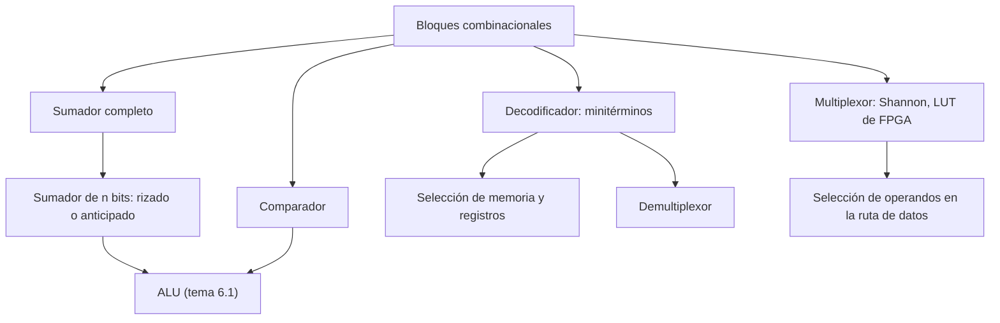

# Organización y Arquitectura de Computadoras - Circuitos combinacionales y secuenciales

## 4.1 Circuitos combinacionales elementales: sumadores, comparadores, decodificadores y multiplexores

---

Un circuito **combinacional** es aquel cuyas salidas dependen solo de los valores actuales de sus entradas, sin memoria: es la implementación física de una función booleana. Con unos pocos bloques combinacionales estándar se construye buena parte de un procesador: los **sumadores** forman la ALU, los **comparadores** deciden los saltos, los **decodificadores** seleccionan registros y posiciones de memoria, y los **multiplexores** eligen de dónde viene cada dato en la ruta de datos (tema 6.1). Este tema los diseña con las técnicas del tema 3, estudia su retardo y muestra cómo un sumador rápido evita propagar el acarreo bit por bit.

### Sumadores

**Medio sumador.** Suma dos bits $a,$ $b$ y produce la suma $s$ y el acarreo $c:$

$$ s = a \oplus b, \qquad c = ab $$

**Sumador completo.** Suma dos bits y un acarreo de entrada $c_{\text{in}}:$

$$ s = a \oplus b \oplus c_{\text{in}}, \qquad c_{\text{out}} = ab + c_{\text{in}} (a \oplus b) $$

La suma vale 1 cuando un número impar de entradas vale 1, y el acarreo cuando al menos dos valen 1: es la función mayoría, $ab + ac_{\text{in}} + bc_{\text{in}}.$ Se construye con dos medios sumadores y una OR.

**Sumador con propagación de acarreo** (_ripple-carry_). Para $n$ bits se encadenan $n$ sumadores completos, con el acarreo de salida de cada uno como entrada del siguiente. Es sencillo, pero lento: en el peor caso, como $0111\ldots1 + 0000\ldots1,$ el acarreo atraviesa los $n$ sumadores, unos dos niveles de compuertas por bit. El retardo crece **linealmente** con $n.$ Con un sumador completo más, un XOR en cada entrada $b$ y $c_0 = 1$ se obtiene un **sumador-restador** (tema 2.4).

**Sumador con acarreo anticipado** (_carry-lookahead_). Para cada bit se definen

$$ g_i = a_i b_i \;\text{(genera)}, \qquad p_i = a_i \oplus b_i \;\text{(propaga)} $$

El bit $i$ produce un acarreo si lo genera, o si lo propaga y le llega uno: $c_{i+1} = g_i + p_i c_i.$ Desarrollando la recurrencia,

$$ c_{i+1} = g_i + p_i g_{i-1} + p_i p_{i-1} g_{i-2} + \cdots + p_i \cdots p_0 c_0 $$

que es una suma de productos: todos los acarreos se calculan en **dos niveles** de compuertas a la vez, sin esperar. El costo es que las compuertas necesitan cada vez más entradas, por lo que en la práctica se agrupan bloques de 4 bits con generación y propagación de bloque, y esos bloques en un árbol. Los **sumadores de prefijos** (Kogge-Stone, Brent-Kung) organizan ese cálculo como un árbol con retardo proporcional a $\log_2 n:$ para 64 bits, unos 14 niveles en vez de 128.

### Comparadores

Un comparador de magnitud de dos números $A$ y $B$ de $n$ bits produce $A > B,$ $A = B$ y $A \lt B.$ Con $e_i = (a_i \oplus b_i)'$ (los bits $i$ son iguales), para 2 bits:

$$ (A = B) = e_1 e_0, \qquad (A > B) = a_1 b_1' + e_1 a_0 b_0', \qquad (A \lt B) = a_1' b_1 + e_1 a_0' b_0 $$

$A$ es mayor si lo es en el bit más significativo, o si son iguales ahí y lo es en el siguiente. La idea se extiende a $n$ bits. En un procesador, la comparación se suele hacer **restando** con la ALU y mirando las banderas Z, N, C y V (tema 2.4).

### Decodificadores

Un decodificador de $n$ a $2^n$ activa exactamente la salida cuyo índice es la entrada: la salida $i$ es el **minitérmino** $m_i$ de las entradas. Un decodificador 3 a 8 necesita 3 inversores y 8 compuertas AND de 3 entradas (de 4 si tiene entrada de habilitación). Usos: seleccionar una palabra de memoria a partir de la dirección, seleccionar el registro de destino, decodificar el código de operación de una instrucción. Como genera todos los minitérminos, un decodificador más una compuerta OR implementa cualquier función en FND.

### Multiplexores y demultiplexores

Un **multiplexor** (MUX) $2^n$ a 1 tiene $2^n$ entradas de datos $d_i,$ $n$ entradas de selección $s$ y una salida igual a $d_s:$

$$ y = \sum_{i = 0}^{2^n - 1} m_i(s)\, d_i $$

Un MUX 2 a 1 es $y = s' d_0 + s d_1.$ Un MUX de $2^n$ a 1 implementa **cualquier** función de $n$ variables: se conectan las variables a la selección y la tabla de verdad a los datos. Es la expansión de Shannon del tema 3.2, y la base de las tablas de búsqueda (LUT) de las FPGA. En la ruta de datos, los multiplexores eligen, por ejemplo, si el segundo operando de la ALU viene de un registro o de la propia instrucción.

Un **demultiplexor** hace lo contrario: envía una entrada $x$ a la salida $s,$ y las demás quedan en 0. Es un decodificador con la entrada $x$ como habilitación: $y_i = x \cdot m_i(s).$



### Implementación en Python

El programa simula los circuitos a nivel de compuertas: comprueba el sumador de 4 bits con propagación y el de acarreo anticipado en las 256 sumas posibles, compara su número de niveles, y verifica el comparador de 2 bits, el decodificador 3 a 8, el multiplexor 8 a 1 (usado como generador de funciones) y el demultiplexor.

```python
from itertools import product

AND = lambda *x: int(all(x))
OR = lambda *x: int(any(x))
XOR = lambda a, b: a ^ b
NOT = lambda a: 1 - a


def medio_sumador(a, b):
    return XOR(a, b), AND(a, b)                      # suma, acarreo


def sumador_completo(a, b, c):
    s1, c1 = medio_sumador(a, b)
    s, c2 = medio_sumador(s1, c)
    return s, OR(c1, c2)


def sumador_rizado(A, B, c=0):
    """A y B son listas de bits, el índice 0 es el menos significativo."""
    S = []
    for a, b in zip(A, B):
        s, c = sumador_completo(a, b, c)
        S.append(s)
    return S, c


def bits(x, n):
    return [(x >> i) & 1 for i in range(n)]


def entero(B):
    return sum(b << i for i, b in enumerate(B))


print("sumador completo:  a b c | s c_out")
for a, b, c in product((0, 1), repeat=3):
    print(f"                   {a} {b} {c} | {sumador_completo(a, b, c)[0]} {sumador_completo(a, b, c)[1]}")
err = sum(entero(sumador_rizado(bits(x, 4), bits(y, 4))[0]) + 16 * sumador_rizado(bits(x, 4), bits(y, 4))[1] != x + y
          for x in range(16) for y in range(16))
print("sumador de 4 bits comprobado en las 256 sumas; errores:", err)
print("ejercicio 1, sumador de 2 bits: 3 + 2 =", sumador_rizado(bits(3, 2), bits(2, 2)), "(bits, acarreo)")


def acarreo_anticipado(A, B, c0=0):
    """Acarreos con g_i = a_i b_i, p_i = a_i xor b_i: c_{i+1} = g_i + p_i c_i, desarrollado en dos niveles."""
    g = [AND(a, b) for a, b in zip(A, B)]
    p = [XOR(a, b) for a, b in zip(A, B)]
    c = [c0]
    for i in range(len(A)):
        # c_{i+1} = g_i + p_i g_{i-1} + ... + p_i ... p_0 c_0
        terminos = [g[i]]
        for j in range(i - 1, -1, -1):
            terminos.append(AND(*p[j + 1:i + 1], g[j]))
        terminos.append(AND(*p[:i + 1], c0))
        c.append(OR(*terminos))
    return [XOR(pi, ci) for pi, ci in zip(p, c)], c[-1]


err = sum(acarreo_anticipado(bits(x, 4), bits(y, 4)) != sumador_rizado(bits(x, 4), bits(y, 4))
          for x in range(16) for y in range(16))
print("acarreo anticipado de 4 bits igual al rizado en las 256 sumas; diferencias:", err)
for n in (4, 16, 64):
    print(f"   niveles de compuertas para el acarreo final con {n} bits: rizado {2 * n},"
          f" árbol de prefijos {2 * (n.bit_length() - 1) + 2}")


def comparador2(A1, A0, B1, B0):
    e1, e0 = NOT(XOR(A1, B1)), NOT(XOR(A0, B0))
    igual = AND(e1, e0)
    mayor = OR(AND(A1, NOT(B1)), AND(e1, A0, NOT(B0)))
    menor = OR(AND(NOT(A1), B1), AND(e1, NOT(A0), B0))
    return mayor, igual, menor


ok = all(comparador2(a >> 1, a & 1, b >> 1, b & 1) == (int(a > b), int(a == b), int(a < b))
         for a in range(4) for b in range(4))
print("ejercicio 2, comparador de 2 bits correcto en los 16 casos:", ok)


def decodificador(a2, a1, a0, en=1):
    entradas = (a2, a1, a0)
    return [AND(en, *[x if (i >> (2 - k)) & 1 else NOT(x) for k, x in enumerate(entradas)]) for i in range(8)]


print("ejercicio 3, decodificador 3 a 8, entrada 101:", decodificador(1, 0, 1))


def mux8(d, s2, s1, s0):
    sel = decodificador(s2, s1, s0)
    return OR(*[AND(di, si) for di, si in zip(d, sel)])


datos = [0, 1, 1, 0, 1, 0, 0, 1]
print("ejercicio 4, mux 8 a 1 con datos", datos, "->", [mux8(datos, *bits(s, 3)[::-1]) for s in range(8)])
# Un mux de 8 entradas implementa cualquier función de 3 variables: los datos son su tabla de verdad
print("   los datos 01101001 son la tabla de A xor B xor C:",
      all(mux8(datos, a, b, c) == a ^ b ^ c for a, b, c in product((0, 1), repeat=3)))


def demux(x, s1, s0):
    return [AND(x, s) for s in decodificador(0, s1, s0)[:4]]


print("ejercicio 5, demux 1 a 4 con x = 1 y selección 10:", demux(1, 1, 0))
```

Salida:

```text
sumador completo:  a b c | s c_out
                   0 0 0 | 0 0
                   0 0 1 | 1 0
                   0 1 0 | 1 0
                   0 1 1 | 0 1
                   1 0 0 | 1 0
                   1 0 1 | 0 1
                   1 1 0 | 0 1
                   1 1 1 | 1 1
sumador de 4 bits comprobado en las 256 sumas; errores: 0
ejercicio 1, sumador de 2 bits: 3 + 2 = ([1, 0], 1) (bits, acarreo)
acarreo anticipado de 4 bits igual al rizado en las 256 sumas; diferencias: 0
   niveles de compuertas para el acarreo final con 4 bits: rizado 8, árbol de prefijos 6
   niveles de compuertas para el acarreo final con 16 bits: rizado 32, árbol de prefijos 10
   niveles de compuertas para el acarreo final con 64 bits: rizado 128, árbol de prefijos 14
ejercicio 2, comparador de 2 bits correcto en los 16 casos: True
ejercicio 3, decodificador 3 a 8, entrada 101: [0, 0, 0, 0, 0, 1, 0, 0]
ejercicio 4, mux 8 a 1 con datos [0, 1, 1, 0, 1, 0, 0, 1] -> [0, 1, 1, 0, 1, 0, 0, 1]
   los datos 01101001 son la tabla de A xor B xor C: True
ejercicio 5, demux 1 a 4 con x = 1 y selección 10: [0, 0, 1, 0]
```

### Ejercicios Propuestos

1. **Sumador de 2 bits.** Diseña un sumador de 2 bits con un medio sumador y un sumador completo.

2. **Comparador.** Diseña un comparador de 2 bits y escribe sus tres funciones booleanas.

3. **Decodificador.** Construye un decodificador de 3 a 8. ¿Cuántas compuertas NOT, AND y OR necesita?

4. **Multiplexor.** Implementa un multiplexor de 8 a 1 y úsalo para generar la función $A \oplus B \oplus C.$

5. **Decodificador frente a demultiplexor.** ¿Qué diferencia hay entre ellos?

### Soluciones

**Ejercicio 1.** El bit 0 no tiene acarreo de entrada: un medio sumador da $s_0 = a_0 \oplus b_0$ y $c_1 = a_0 b_0.$ El bit 1 necesita un sumador completo: $s_1 = a_1 \oplus b_1 \oplus c_1$ y $c_2 = a_1 b_1 + c_1 (a_1 \oplus b_1).$ El resultado tiene 3 bits, $c_2 s_1 s_0;$ por ejemplo $11 + 10 = 101.$

**Ejercicio 2.** Son las tres ecuaciones del tema; el programa las comprueba en los 16 casos.

**Ejercicio 3.** 3 NOT, 8 AND de tres entradas y ninguna OR: cada salida es un minitérmino. Con habilitación, las AND son de cuatro entradas.

**Ejercicio 4.** Con las variables en la selección y los datos $d_0 \ldots d_7 = 0, 1, 1, 0, 1, 0, 0, 1,$ que son la tabla de verdad de la función de paridad. El programa lo implementa con un decodificador, 8 AND de 2 entradas y una OR de 8.

**Ejercicio 5.** Un decodificador convierte un código de $n$ bits en una de $2^n$ líneas activas; un demultiplexor dirige un dato a una de $2^n$ salidas. Es el mismo circuito: un decodificador con entrada de habilitación funciona como demultiplexor si el dato se conecta a la habilitación.

### Referencias

1. Mano, M. M., and Ciletti, M. D., _Digital Design_. Pearson, 2018. Capítulo 4.
2. Harris, D. M., and Harris, S. L., _Digital Design and Computer Architecture_. Morgan Kaufmann, 2013. Capítulos 2 y 5.
3. Patterson, D. A., and Hennessy, J. L., _Computer Organization and Design: The Hardware/Software Interface_. Morgan Kaufmann, 2020. Apéndice A.
4. Weste, N. H. E., and Harris, D. M., _CMOS VLSI Design_. Addison-Wesley, 2010. Capítulo 11.
