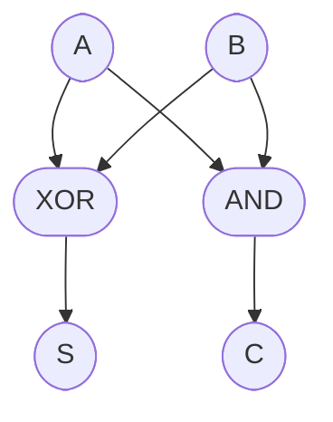
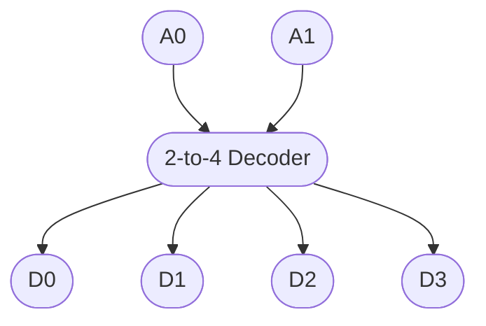
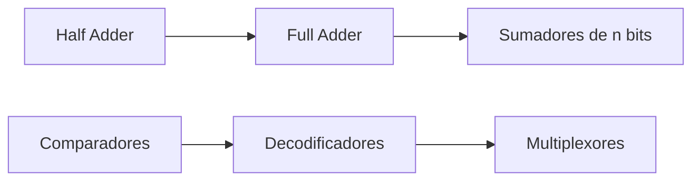

# Organización y Arquitectura de Computadoras - Circuitos combinacionales y secuenciales

## 4.1 Circuitos combinacionales elementales: sumadores, comparadores, decodificadores y multiplexores

---

### 1. Introducción

Los **circuitos combinacionales** son aquellos cuya salida depende únicamente de las entradas actuales, sin necesidad de memoria.
Se diferencian de los **circuitos secuenciales**, donde las salidas dependen de las entradas actuales y de estados pasados (memoria).

Ejemplos típicos de circuitos combinacionales elementales:

- **Sumadores** (half-adder, full-adder)
- **Comparadores**
- **Decodificadores**
- **Multiplexores**

### 2. Conceptos básicos

#### 2.1 Definición formal

Un circuito combinacional puede representarse como una función booleana:

$$ F: \{0,1\}^n \to \{0,1\}^m $$

donde:

- $n$ = número de entradas
- $m$ = número de salidas
- cada salida se obtiene aplicando álgebra booleana a las entradas.

### 3. Sumadores

#### 3.1 Half Adder (HA)

Un **sumador medio** tiene dos entradas $(A, B)$ y dos salidas:

- **Suma $(S)$**
- **Acarreo $(C)$**

Fórmulas:

$S = A \oplus B$

$C = A \cdot B$


| A   | B   | S   | C   |
| --- | --- | --- | --- |
| 0   | 0   | 0   | 0   |
| 0   | 1   | 1   | 0   |
| 1   | 0   | 1   | 0   |
| 1   | 1   | 0   | 1   |



#### 3.2 Full Adder (FA)

Un **sumador completo** añade un tercer bit de entrada $(C\_{in})$.

Fórmulas:

  $ S = A \oplus B \oplus C_{in} $

  $ C_{out} = (A \cdot B) + (C_{in} \cdot (A \oplus B)) $

Ejemplo de código en Python:

```python
def full_adder(A, B, Cin):
    S = (A ^ B) ^ Cin
    Cout = (A & B) | (Cin & (A ^ B))
    return S, Cout

print(full_adder(1, 1, 1))  # (1, 1)
```

### 4. Comparadores

Un **comparador** determina si dos números son iguales, mayores o menores.

#### 4.1 Comparador de 1 bit

Entradas: $A$, $B$.
Salidas:

- $A = B = 1$ si son iguales
- $A > B$
- $A < B$

Fórmulas:

$$ E = \overline{A \oplus B}, \quad G = A \cdot \overline{B}, \quad L = \overline{A} \cdot B $$

### 5. Decodificadores

Un **decodificador** convierte una entrada binaria en una única salida activa.

Ejemplo: **2-to-4 decodificador**

Entradas: $A_1, A_0$
Salidas: $D_0, D_1, D_2, D_3$

$$ D_0 = \overline{A_1}\cdot \overline{A_0}, \quad D_1 = \overline{A_1}\cdot A_0, \quad D_2 = A_1\cdot \overline{A_0}, \quad D_3 = A_1\cdot A_0 $$



### 6. Multiplexores (MUX)

Un **multiplexor** selecciona una de varias entradas para enviarla a la salida, según señales de control.

Ejemplo: **4-to-1 MUX**

Entradas: $I_0, I_1, I_2, I_3$, selectores $S_1, S_0$.
Salida:

$$ Y = I_0 \cdot \overline{S_1}\cdot \overline{S_0} + I_1 \cdot \overline{S_1}\cdot S_0 + I_2 \cdot S_1 \cdot \overline{S_0} + I_3 \cdot S_1 \cdot S_0 $$

### 7. Ejercicios propuestos

1. Diseña un **sumador de 2 bits** usando únicamente half adders y full adders.
2. Implementa un **comparador de 2 bits** y determina todas sus funciones booleanas.
3. Construye un **decodificador 3-to-8** e identifica cuántos compuertas NOT, AND y OR necesitas.
4. Implementa en Python un **multiplexor 8-to-1**.
5. ¿Qué diferencia existe entre un decodificador y un demultiplexor?

### 8. Diagramas de relación entre los circuitos



### 9. Referencias

#### Bibliografía básica:

1. Hennessy, John L. y Patterson, David A. _Computer Architecture: A Quantitative Approach_. 4a Ed. Morgan Kaufmann, 2006.
2. Kohavi, Zvi y Niraj K. Jha. _Switching and Finite Automata Theory_. 3a Ed. Cambridge University Press, 2009.
3. Mano, M. Morris y Kime, Charles. _Logic and Computer Design Fundamentals_. 4a Ed. Prentice Hall, 2007.
4. Patterson, David A. y Hennessy, John L. _Computer Organization and Design: The Hardware/Software Interface_. 4a Ed. Morgan Kaufmann, 2008.

#### Bibliografía complementaria:

1. Stallings, William. _Computer Organization and Architecture: Designing for Performance_. Prentice Hall - Pearson, 2009.
2. Tanenbaum, Andrew S. _Structured Computer Organization_. 5a Ed. Prentice Hall, 2005.
3. Silberschatz, Abraham; Galvin, Peter B.; Gagne, Greg. _Operating System Concepts_. 8a Ed. Wiley, 2008.
