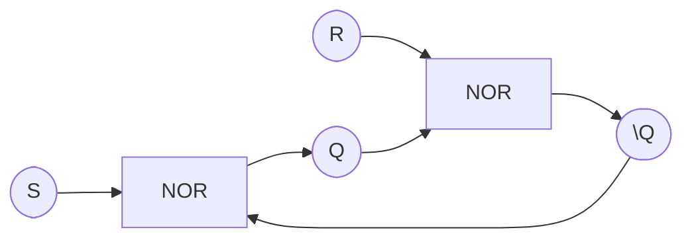
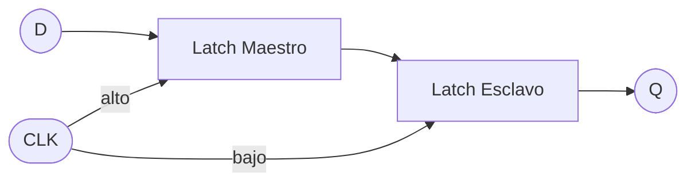
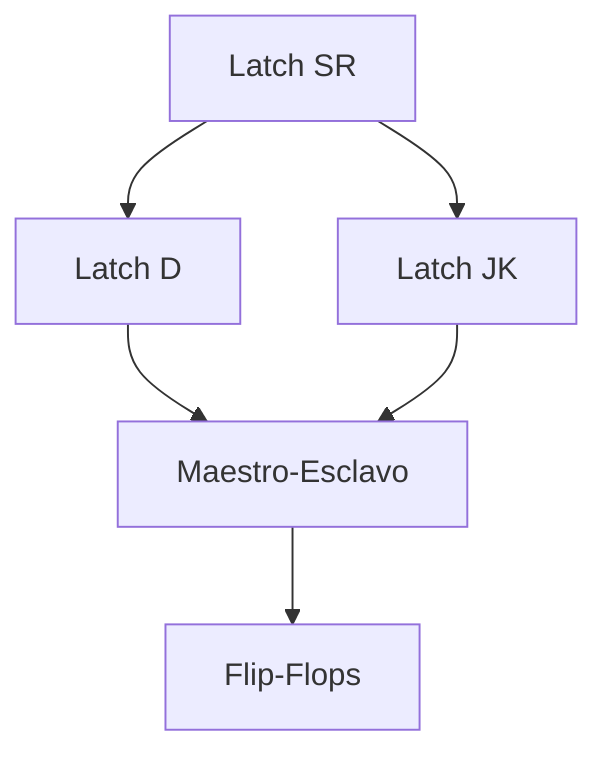

# Organización y Arquitectura de Computadoras - Circuitos combinacionales y secuenciales

## 4.2 Cerrojos (latches) SR, JK, D, maestro-esclavo

---

### 1. Introducción

Los **circuitos secuenciales** son aquellos cuya salida depende no solo de las entradas actuales, sino también de estados anteriores, lo que les da la capacidad de **almacenar información**.

Los **latches** (o cerrojos) son los bloques básicos de memoria en electrónica digital. Son **biestables**: pueden permanecer en un estado indefinidamente hasta que una señal externa los cambie.

### 2. Definiciones clave

- **Latch**: Dispositivo secuencial asíncrono controlado por **niveles** de señal.
- **Flip-flop**: Dispositivo secuencial síncrono controlado por **bordes** de señal (ej. flanco de subida o bajada).
- **Estado**: El valor binario almacenado en un latch o flip-flop.

### 3. Latch SR (Set-Reset)

#### 3.1 Descripción

- Entradas: **S (Set)**, **R (Reset)**.
- Salidas: **Q** y $\overline{Q}.$

#### 3.2 Función

- $ S = 1, R = 0 \implies Q = 1 $ (set).
- $ S = 0, R = 1 \implies Q = 0 $ (reset).
- $ S = 0, R = 0 \implies Q $ mantiene su valor anterior.
- $ S = 1, R = 1 \implies $ estado inválido (indeterminado).

#### 3.3 Tabla de verdad

| S   | R   | Q(t+1)            |
| --- | --- | ----------------- |
| 0   | 0   | Q(t)              |
| 0   | 1   | 0                 |
| 1   | 0   | 1                 |
| 1   | 1   | X (indeterminado) |



### 4. Latch D (Data o Delay)

#### 4.1 Descripción

Diseñado para evitar el estado inválido del SR.

- Entrada: **D (dato)**.
- Control: **Enable (E)**.
- Salidas: **Q**, $\overline{Q}.$

#### 4.2 Función

$Q(t+1) = D \quad \text{(cuando E = 1)}$
$Q(t+1) = Q(t) \quad \text{(cuando E = 0)}$

#### 4.3 Tabla de verdad

| E   | D   | Q(t+1) |
| --- | --- | ------ |
| 0   | X   | Q(t)   |
| 1   | 0   | 0      |
| 1   | 1   | 1      |

### 5. Latch JK

#### 5.1 Descripción

Es una mejora del latch SR.

- Entradas: **J**, **K**.
- Salida: **Q**.

#### 5.2 Función

- $ J=0, K=0 \implies Q(t+1) = Q(t) $ (mantiene estado).
- $ J=0, K=1 \implies Q(t+1) = 0 $ (reset).
- $ J=1, K=0 \implies Q(t+1) = 1 $ (set).
- $ J=1, K=1 \implies Q(t+1) = \overline{Q(t)} $ (conmutación).

#### 5.3 Tabla de verdad

| J   | K   | Q(t+1)              |
| --- | --- | ------------------- |
| 0   | 0   | Q(t)                |
| 0   | 1   | 0                   |
| 1   | 0   | 1                   |
| 1   | 1   | $ \overline{Q(t)} $ |

### 6. Latch Maestro–Esclavo

#### 6.1 Descripción

- Construido con **dos latches D o JK** conectados en cascada.
- El primero es el **maestro** y el segundo el **esclavo**.
- Controlados con una señal de reloj en **fase opuesta**.

#### 6.2 Función

- Durante el **nivel alto** del reloj, el **maestro** captura la entrada.
- Durante el **nivel bajo**, el **esclavo** actualiza la salida.
- Esto permite un comportamiento similar a un **flip-flop activado por borde**.



### 7. Ejemplo en Python

Simulación de un **latch D**:

```python
class DLatch:
    def __init__(self):
        self.Q = 0

    def update(self, D, E):
        if E == 1:
            self.Q = D
        return self.Q

latch = DLatch()
print(latch.update(1, 1))  # Q = 1
print(latch.update(0, 0))  # mantiene Q = 1
```

### 8. Ejercicios propuestos

1. Diseña la tabla de transición de estados para un **latch SR** con todas sus condiciones posibles.
2. Implementa un **simulador de latch JK** en Python o Verilog.
3. Explica por qué el **latch D** resuelve el problema del estado inválido en el latch SR.
4. Dibuja un **latch maestro–esclavo** usando compuertas lógicas básicas.
5. Compara el uso de **latches vs flip-flops** en diseño de registros.

### 9. Diagramas de relación



### 10. Referencias

#### Bibliografía básica:

1. Hennessy, John L. y Patterson, David A. _Computer Architecture: A Quantitative Approach_. 4a Ed. Morgan Kaufmann, 2006.
2. Kohavi, Zvi y Niraj K. Jha. _Switching and Finite Automata Theory_. 3a Ed. Cambridge University Press, 2009.
3. Mano, M. Morris y Kime, Charles. _Logic and Computer Design Fundamentals_. 4a Ed. Prentice Hall, 2007.
4. Patterson, David A. y Hennessy, John L. _Computer Organization and Design: The Hardware/Software Interface_. 4a Ed. Morgan Kaufmann, 2008.

#### Bibliografía complementaria:

1. Stallings, William. _Computer Organization and Architecture: Designing for Performance_. Prentice Hall - Pearson, 2009.
2. Tanenbaum, Andrew S. _Structured Computer Organization_. 5a Ed. Prentice Hall, 2005.
3. Silberschatz, Abraham; Galvin, Peter B.; Gagne, Greg. _Operating System Concepts_. 8a Ed. Wiley, 2008.
