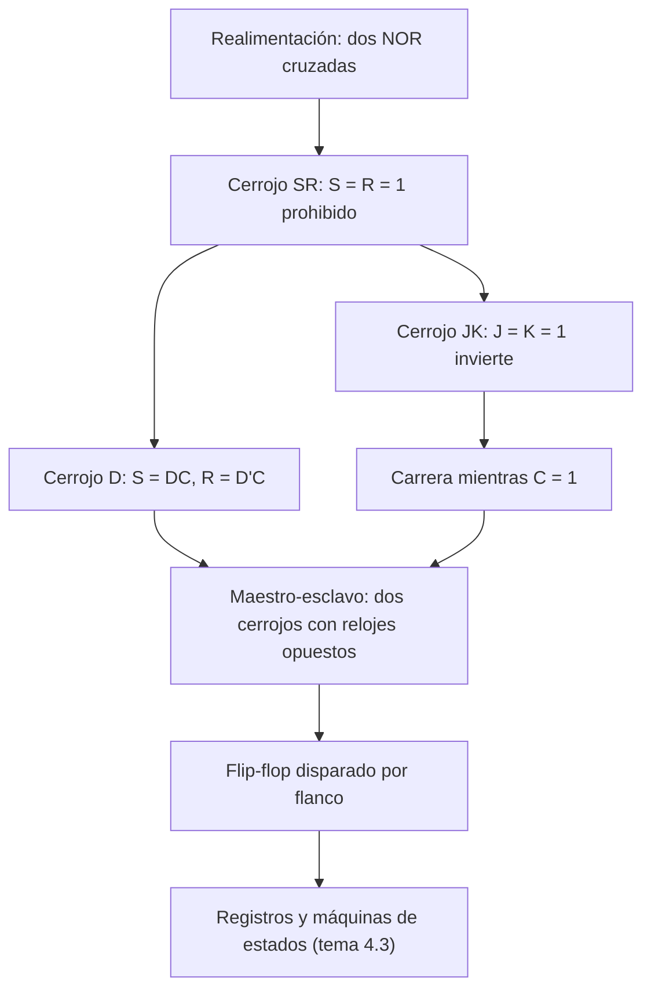

# Organización y Arquitectura de Computadoras - Circuitos combinacionales y secuenciales

## 4.2 Cerrojos (latches) SR, JK, D, maestro-esclavo

---

Un circuito **secuencial** tiene memoria: sus salidas dependen de las entradas actuales y de lo que ocurrió antes, resumido en un **estado**. La memoria se consigue con **realimentación**: conectar salidas de compuertas de vuelta a sus entradas. El elemento de memoria más simple guarda un bit y se llama **cerrojo** (_latch_). Este tema construye el cerrojo SR con dos compuertas, explica su estado prohibido, deriva de él los cerrojos D y JK, muestra el problema de la carrera en los dispositivos sensibles al nivel y cómo lo resuelve la estructura **maestro-esclavo**, que lleva a los **flip-flops** disparados por flanco con los que se construyen los registros de un procesador.

### Definiciones

- Un **cerrojo** (_latch_) es **sensible al nivel**: mientras su entrada de habilitación o reloj $C$ vale 1, la salida sigue a las entradas (es **transparente**); cuando $C = 0,$ conserva el valor.
- Un **flip-flop** es **sensible al flanco**: solo cambia en el instante en que el reloj pasa de 0 a 1 (flanco de subida) o de 1 a 0 (de bajada).
- La **ecuación característica** da el siguiente estado $Q^+$ en función de las entradas y del estado actual $Q.$

### El cerrojo SR

Dos compuertas NOR con las salidas cruzadas: $Q = (R + Q')'$ y $Q' = (S + Q)'.$

| $S$ | $R$ | $Q^+$ | Acción |
| --- | --- | --- | --- |
| 0 | 0 | $Q$ | mantener |
| 1 | 0 | 1 | poner a 1 (_set_) |
| 0 | 1 | 0 | poner a 0 (_reset_) |
| 1 | 1 | prohibido | $Q = Q' = 0$ |

**Por qué recuerda.** Con $S = R = 0,$ cada NOR actúa como un inversor de la otra salida: $Q = (Q')'$ y $Q' = Q'.$ Los dos inversores en lazo tienen dos estados estables, $Q = 0$ y $Q = 1,$ y el circuito se queda en el que esté.

**Por qué $S = R = 1$ está prohibido.** Las dos salidas valen 0, de modo que $Q'$ deja de ser el complemento de $Q.$ Peor aún: si después $S$ y $R$ bajan a 0 a la vez, las dos NOR ven entradas 0 y ponen sus salidas a 1, luego a 0, y así sucesivamente; el estado final depende de cuál compuerta sea más rápida (una **condición de carrera**) o el circuito puede quedar un tiempo en un estado intermedio, la **metaestabilidad**. La ecuación característica del cerrojo SR es $Q^+ = S + R'Q,$ válida con la restricción $SR = 0.$

El cerrojo $\overline{S}\,\overline{R}$ con NAND es el dual: sus entradas son activas en bajo y el estado prohibido es $\overline{S} = \overline{R} = 0.$

### El cerrojo D

Para eliminar el estado prohibido se genera $S$ y $R$ a partir de un solo dato $D$ y de la habilitación $C:$ $S = DC$ y $R = D'C.$ Nunca son 1 a la vez.

| $C$ | $D$ | $Q^+$ |
| --- | --- | --- |
| 0 | $x$ | $Q$ |
| 1 | 0 | 0 |
| 1 | 1 | 1 |

Ecuación característica: $Q^+ = DC + QC'.$ Mientras $C = 1,$ el cerrojo es transparente: $Q$ sigue a $D;$ al bajar $C,$ queda guardado el último valor.

### El cerrojo JK

Aprovecha la combinación prohibida para una acción útil: con $J = K = 1$ la salida se **invierte**. Se obtiene realimentando las salidas: $S = J Q' C$ y $R = K Q C.$

| $J$ | $K$ | $Q^+$ | Acción |
| --- | --- | --- | --- |
| 0 | 0 | $Q$ | mantener |
| 0 | 1 | 0 | reset |
| 1 | 0 | 1 | set |
| 1 | 1 | $Q'$ | invertir |

**Ecuación característica.** $Q^+ = J Q' + K' Q.$ Se comprueba en las cuatro filas: con $J = K = 1$ queda $Q',$ con $J = K = 0$ queda $Q,$ etcétera.

**El problema de la carrera** (_race-around_). Si $J = K = 1$ y el reloj permanece en 1 más tiempo que el retardo del lazo, la salida se invierte, la nueva salida vuelve a entrar y se invierte otra vez, y así mientras dure el pulso: el valor final depende de la duración exacta del pulso. Un cerrojo sensible al nivel no puede usarse como contador.

### Maestro-esclavo y flip-flops

La solución es separar la captura de la actualización con **dos cerrojos en serie** y relojes complementarios:

- Mientras $C = 1,$ el **maestro** está abierto y captura el siguiente estado, calculado a partir de la salida del **esclavo**, que está cerrado y no cambia.
- Cuando $C$ pasa a 0, el maestro se cierra y el esclavo se abre y copia al maestro.

Como en ningún momento hay un camino transparente de la entrada a la salida, la salida cambia **una sola vez por ciclo**, en el flanco de bajada, y desaparece la carrera. Un JK maestro-esclavo con $J = K = 1$ divide la frecuencia del reloj entre 2: es la celda de un contador binario.

Los **flip-flops D disparados por flanco** usados en la práctica se construyen así (dos cerrojos D en serie) u otras estructuras equivalentes. Tienen restricciones de tiempo: el dato debe estar estable un **tiempo de preparación** (_setup_) antes del flanco y un **tiempo de retención** (_hold_) después. Si se violan, el flip-flop puede entrar en metaestabilidad.

**Cerrojos frente a flip-flops en registros.** Los flip-flops hacen el diseño **síncrono** muy sencillo: todos los registros cambian en el mismo instante y la lógica combinacional entre ellos tiene un ciclo completo para estabilizarse. Los cerrojos ocupan menos área y permiten "tomar prestado" tiempo entre etapas, pero hacen más difícil el análisis de tiempos; se usan en diseños de muy alto rendimiento y en algunas memorias.



### Implementación en Python

El programa simula el cerrojo SR a nivel de compuertas, con un paso de tiempo por retardo de compuerta, y muestra la oscilación al salir del estado prohibido; simula después el cerrojo D, la tabla del JK, la carrera del JK sensible al nivel según la duración del pulso, el JK maestro-esclavo dividiendo la frecuencia y un flip-flop D disparado por flanco de subida.

```python
NOR = lambda a, b: 1 - (a | b)
NAND = lambda a, b: 1 - (a & b)


def latch_sr(S, R, Q, Qn, pasos=6):
    """Dos NOR cruzadas; cada paso es un retardo de compuerta (actualización simultánea)."""
    hist = []
    for _ in range(pasos):
        Q, Qn = NOR(R, Qn), NOR(S, Q)
        hist.append((Q, Qn))
    return Q, Qn, hist


Q, Qn = 0, 1
print("latch SR con NOR (Q, Q'):")
for S, R, nombre in ((1, 0, "set"), (0, 0, "mantener"), (0, 1, "reset"), (0, 0, "mantener"), (1, 1, "S = R = 1")):
    Q, Qn, h = latch_sr(S, R, Q, Qn)
    print(f"   S={S} R={R} ({nombre:9s}) -> Q={Q} Q'={Qn}   transitorio {h[:3]}")
Q, Qn, h = latch_sr(0, 0, Q, Qn)
print(f"   soltar S y R a la vez desde Q = Q' = 0: {h}  (oscila: estado prohibido)")


def latch_d(D, C, Q):
    """Latch D: transparente mientras C = 1 (S = DC, R = D'C)."""
    S, R = D & C, (1 - D) & C
    Q, Qn, _ = latch_sr(S, R, Q, 1 - Q)
    return Q


Q = 0
traza = []
for C, D in ((1, 1), (1, 0), (1, 1), (0, 0), (0, 1), (1, 0)):
    Q = latch_d(D, C, Q)
    traza.append(f"C={C} D={D}->Q={Q}")
print("latch D:", " | ".join(traza))

# JK: ecuación característica Q+ = J Q' + K' Q
print("JK, tabla característica:")
for J in (0, 1):
    for K in (0, 1):
        sig = [J & (1 - q) | (1 - K) & q for q in (0, 1)]
        accion = {(0, 1): "mantener", (0, 0): "reset", (1, 1): "set", (1, 0): "invertir"}[tuple(sig)]
        print(f"   J={J} K={K}: Q=0 -> {sig[0]}, Q=1 -> {sig[1]}  ({accion})")


def jk_nivel(J, K, Q, duracion_pulso):
    """Latch JK sensible al nivel: mientras C = 1 la salida se realimenta cada retardo."""
    for _ in range(duracion_pulso):
        Q = J & (1 - Q) | (1 - K) & Q
    return Q


print("carrera (race-around) del latch JK con J = K = 1: Q final según la duración del pulso:",
      [jk_nivel(1, 1, 0, d) for d in range(1, 7)])


class FlipFlopMaestroEsclavo:
    """El maestro captura con C = 1; el esclavo copia al maestro con C = 0 (flanco de bajada)."""

    def __init__(self):
        self.m = self.q = 0

    def paso(self, J, K, C):
        if C == 1:
            self.m = J & (1 - self.q) | (1 - K) & self.q    # usa la salida del esclavo, que no cambia
        else:
            self.q = self.m
        return self.q


ff = FlipFlopMaestroEsclavo()
reloj = [1, 1, 1, 0, 0, 1, 1, 1, 0, 0, 1, 1, 0, 0]
salida = [ff.paso(1, 1, c) for c in reloj]
print("maestro-esclavo JK con J = K = 1, reloj:", "".join(map(str, reloj)), "Q:", "".join(map(str, salida)),
      "(un cambio por ciclo: divide la frecuencia entre 2)")


# Flip-flop D disparado por flanco de subida
class FlipFlopD:
    def __init__(self):
        self.q, self.c_ant = 0, 0

    def paso(self, D, C):
        if self.c_ant == 0 and C == 1:
            self.q = D
        self.c_ant = C
        return self.q


ff = FlipFlopD()
C = [0, 1, 1, 0, 0, 1, 1, 0, 0, 1]
D = [1, 1, 0, 0, 0, 0, 1, 1, 1, 1]
print("flip-flop D: C", "".join(map(str, C)), "D", "".join(map(str, D)),
      "Q", "".join(str(ff.paso(d, c)) for d, c in zip(D, C)))
```

Salida:

```text
latch SR con NOR (Q, Q'):
   S=1 R=0 (set      ) -> Q=1 Q'=0   transitorio [(0, 0), (1, 0), (1, 0)]
   S=0 R=0 (mantener ) -> Q=1 Q'=0   transitorio [(1, 0), (1, 0), (1, 0)]
   S=0 R=1 (reset    ) -> Q=0 Q'=1   transitorio [(0, 0), (0, 1), (0, 1)]
   S=0 R=0 (mantener ) -> Q=0 Q'=1   transitorio [(0, 1), (0, 1), (0, 1)]
   S=1 R=1 (S = R = 1) -> Q=0 Q'=0   transitorio [(0, 0), (0, 0), (0, 0)]
   soltar S y R a la vez desde Q = Q' = 0: [(1, 1), (0, 0), (1, 1), (0, 0), (1, 1), (0, 0)]  (oscila: estado prohibido)
latch D: C=1 D=1->Q=1 | C=1 D=0->Q=0 | C=1 D=1->Q=1 | C=0 D=0->Q=1 | C=0 D=1->Q=1 | C=1 D=0->Q=0
JK, tabla característica:
   J=0 K=0: Q=0 -> 0, Q=1 -> 1  (mantener)
   J=0 K=1: Q=0 -> 0, Q=1 -> 0  (reset)
   J=1 K=0: Q=0 -> 1, Q=1 -> 1  (set)
   J=1 K=1: Q=0 -> 1, Q=1 -> 0  (invertir)
carrera (race-around) del latch JK con J = K = 1: Q final según la duración del pulso: [1, 0, 1, 0, 1, 0]
maestro-esclavo JK con J = K = 1, reloj: 11100111001100 Q: 00011111000011 (un cambio por ciclo: divide la frecuencia entre 2)
flip-flop D: C 0110011001 D 1100001111 Q 0111100001
```

En la carrera, con un pulso de 1, 3 o 5 retardos el latch JK termina en 1, y con 2, 4 o 6 en 0: el resultado depende de un detalle de tiempo incontrolable. El maestro-esclavo, en cambio, cambia exactamente en cada flanco de bajada.

### Ejercicios Propuestos

1. **Tabla del SR.** Escribe la tabla de transiciones del cerrojo SR con NOR para todas las combinaciones de $S,$ $R$ y $Q,$ y su ecuación característica.

2. **Simulador JK.** Implementa un simulador del cerrojo JK y muestra el problema de la carrera.

3. **Cerrojo D.** Explica por qué el cerrojo D no tiene estado prohibido.

4. **Maestro-esclavo.** Dibuja un flip-flop D maestro-esclavo con compuertas básicas y explica en qué flanco cambia.

5. **Registros.** Compara el uso de cerrojos y flip-flops para construir los registros de un procesador.

### Soluciones

**Ejercicio 1.** Para $SRQ = 000$ y $001,$ $Q^+ = Q;$ para $100$ y $101,$ $Q^+ = 1;$ para $010$ y $011,$ $Q^+ = 0;$ $110$ y $111$ son prohibidas. Simplificando con las prohibidas como indiferentes, $Q^+ = S + R'Q,$ con $SR = 0.$

**Ejercicio 2.** Es la función `jk_nivel` del programa: con $J = K = 1$ la salida final alterna según la duración del pulso.

**Ejercicio 3.** Porque $S = DC$ y $R = D'C$ no pueden valer 1 a la vez: su producto es $DD'C = 0.$

**Ejercicio 4.** Dos cerrojos D, cada uno con su par de AND (o NAND) de entrada y su par de NOR cruzadas. El maestro recibe $C$ y el esclavo $C'$ (un inversor). Con este conexionado, la salida cambia en el **flanco de bajada**; si se invierte el reloj del maestro, en el de subida.

**Ejercicio 5.** Ver la última sección: los flip-flops dan un diseño síncrono sencillo y robusto; los cerrojos ahorran área y retardo, pero exigen un análisis de tiempos más cuidadoso, porque son transparentes durante medio ciclo.

### Referencias

1. Mano, M. M., and Ciletti, M. D., _Digital Design_. Pearson, 2018. Capítulo 5.
2. Harris, D. M., and Harris, S. L., _Digital Design and Computer Architecture_. Morgan Kaufmann, 2013. Capítulo 3.
3. Patterson, D. A., and Hennessy, J. L., _Computer Organization and Design: The Hardware/Software Interface_. Morgan Kaufmann, 2020. Apéndice A.
4. Wakerly, J. F., _Digital Design: Principles and Practices_. Pearson, 2017. Capítulo 10.
