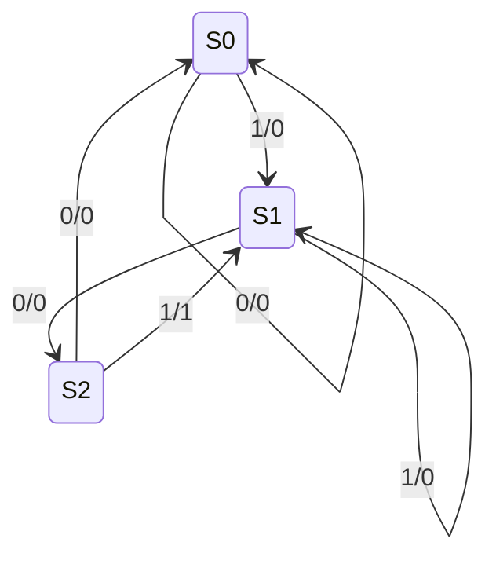

# Organización y Arquitectura de Computadoras - Circuitos combinacionales y secuenciales

## 4.3 Diagramas de estado, diseño de circuitos secuenciales

---

Un circuito secuencial síncrono está formado por un **registro de estado** (flip-flops, tema 4.2) y **lógica combinacional** (tema 4.1) que calcula el siguiente estado y las salidas. Su comportamiento se describe con una **máquina de estados finitos** (FSM), representada por un **diagrama de estados** o una **tabla de transiciones**. Este tema presenta los dos modelos de máquina, Moore y Mealy, el procedimiento completo de diseño (desde el enunciado hasta las ecuaciones de los flip-flops), la minimización de estados y la descripción de una FSM en un lenguaje de descripción de hardware. La unidad de control de un procesador (tema 6.3) es una FSM de este tipo.

### Máquinas de estados finitos

Una FSM es una tupla $(S, I, O, \delta, \lambda, s_0)$ con un conjunto finito de estados $S,$ un alfabeto de entrada $I,$ uno de salida $O,$ una función de transición $\delta: S \times I \to S,$ una función de salida $\lambda$ y un estado inicial $s_0.$ Según de qué dependa la salida:

| | Moore | Mealy |
| --- | --- | --- |
| salida | $\lambda: S \to O,$ solo del estado | $\lambda: S \times I \to O,$ del estado y la entrada |
| en el diagrama | dentro de cada estado | en cada transición, como `entrada/salida` |
| respuesta | un ciclo después de la entrada | en el mismo ciclo |
| número de estados | suele necesitar más | suele necesitar menos |
| salidas | estables durante todo el ciclo | pueden tener pulsos espurios si la entrada cambia |

Ambos modelos son equivalentes en poder expresivo: toda máquina de Mealy se convierte en una de Moore (añadiendo estados) y viceversa, con la salida desplazada un ciclo.

### Procedimiento de diseño

1. **Enunciado** → diagrama de estados: decidir qué debe "recordar" el circuito.
2. **Tabla de transiciones**: estado actual, entrada, siguiente estado, salida.
3. **Minimización de estados**: fusionar estados equivalentes.
4. **Asignación de estados**: codificar cada estado en binario. Con $k$ estados hacen falta $\lceil \log_2 k \rceil$ flip-flops (binaria); con la codificación **one-hot** se usa un flip-flop por estado, más flip-flops pero lógica más sencilla, habitual en FPGA.
5. **Ecuaciones**: con flip-flops D, la entrada $D_i$ de cada uno es el bit $i$ del siguiente estado; se obtienen las funciones de siguiente estado y de salida y se **minimizan** (tema 3.3), usando los códigos no usados como indiferentes.
6. **Circuito**: flip-flops, lógica combinacional y verificación por simulación.

### Ejemplo: detector de la secuencia 101 (Mealy)

El circuito recibe un bit $x$ por ciclo y debe poner $z = 1$ cuando los tres últimos bits sean 101, admitiendo traslape (en 10101 detecta dos veces).

**Estados.** $S_0:$ no hay prefijo útil; $S_1:$ el último bit fue 1; $S_2:$ los últimos fueron 10.



**Tabla, asignación y ecuaciones.** Con $S_0 = 00,$ $S_1 = 01,$ $S_2 = 10$ (el código 11 no se usa):

| $Q_1 Q_0$ | $x$ | $Q_1^+ Q_0^+$ | $z$ |
| --- | --- | --- | --- |
| 00 | 0 | 00 | 0 |
| 00 | 1 | 01 | 0 |
| 01 | 0 | 10 | 0 |
| 01 | 1 | 01 | 0 |
| 10 | 0 | 00 | 0 |
| 10 | 1 | 01 | 1 |

Con 11 como indiferente, los mapas de Karnaugh dan

$$ D_1 = Q_1^+ = Q_0\, x', \qquad D_0 = Q_0^+ = x, \qquad z = Q_1\, x $$

Dos flip-flops D, una AND con un inversor para $D_1$ y una AND para la salida. Tras un 1 el circuito siempre está en $S_1,$ por eso $Q_0^+ = x.$

### Minimización de estados

Dos estados son **equivalentes** si, para toda secuencia de entradas, producen la misma secuencia de salidas. El **algoritmo de particiones** (Moore, 1956) los encuentra:

1. Partir los estados en bloques según su salida.
2. Refinar: dos estados de un mismo bloque siguen juntos solo si, para cada entrada, van a estados del mismo bloque.
3. Repetir hasta que la partición no cambie. Cada bloque final es un estado de la máquina mínima.

**Corrección.** Por inducción, tras $k$ refinamientos dos estados están en el mismo bloque si y solo si no se distinguen con ninguna secuencia de longitud $k + 1$ o menos. La partición solo puede refinarse a lo sumo $|S| - 1$ veces, y cuando se estabiliza ya no hay secuencias que distingan estados del mismo bloque. Es el mismo algoritmo que minimiza autómatas finitos en teoría de la computación.

### Implementación en Python

El programa simula el detector de 110 como máquina de Moore (ejercicio 1) y el de 101 como Mealy, comparándolos con una búsqueda directa del patrón en 200 cadenas aleatorias; simula el circuito sintetizado a partir de las ecuaciones, la máquina de paridad del ejercicio 2 y el algoritmo de particiones del ejercicio 3.

```python
import random

# Ejercicio 1: detector de "110" como máquina de Moore (con traslape)
# Estados: A = nada útil, B = "1", C = "11", D = "110" (salida 1)
moore = {"A": {"0": "A", "1": "B"}, "B": {"0": "A", "1": "C"},
         "C": {"0": "D", "1": "C"}, "D": {"0": "A", "1": "B"}}
salida_moore = {"A": 0, "B": 0, "C": 0, "D": 1}


def correr_moore(cadena, inicio="A"):
    e, out = inicio, []
    for x in cadena:
        e = moore[e][x]
        out.append(salida_moore[e])
    return out


# Detector "101" como máquina de Mealy (con traslape): S0 nada, S1 "1", S2 "10"
mealy = {"S0": {"0": ("S0", 0), "1": ("S1", 0)},
         "S1": {"0": ("S2", 0), "1": ("S1", 0)},
         "S2": {"0": ("S0", 0), "1": ("S1", 1)}}


def correr_mealy(cadena, inicio="S0"):
    e, out = inicio, []
    for x in cadena:
        e, z = mealy[e][x]
        out.append(z)
    return out


def directo(cadena, patron):
    return [int(cadena[max(0, i - len(patron) + 1):i + 1] == patron) for i in range(len(cadena))]


ej = "0110110111010110"
print("entrada      ", ej)
print("Moore '110'  ", "".join(map(str, correr_moore(ej))))
print("Mealy '101'  ", "".join(map(str, correr_mealy(ej))))
random.seed(7)
pruebas = ["".join(random.choice("01") for _ in range(60)) for _ in range(200)]
print("comparación con la búsqueda directa en 200 cadenas aleatorias:",
      all(correr_moore(c) == directo(c, "110") and correr_mealy(c) == directo(c, "101") for c in pruebas))

# Síntesis del Mealy '101' con S0 = 00, S1 = 01, S2 = 10 y flip-flops D:
#   Q1+ = Q0 x',  Q0+ = x,  z = Q1 x
def circuito(cadena):
    q1 = q0 = 0
    out = []
    for c in cadena:
        x = int(c)
        z = q1 & x
        q1, q0 = q0 & (1 - x), x
        out.append(z)
    return out


print("el circuito sintetizado coincide con la tabla en las 200 cadenas:",
      all(circuito(c) == correr_mealy(c) for c in pruebas))

# Ejercicio 2: paridad (Moore de dos estados): Q+ = Q xor x
def paridad(cadena):
    q, out = 0, []
    for c in cadena:
        q ^= int(c)
        out.append(q)
    return out


print("paridad      ", "".join(map(str, paridad(ej))), "(1 = número impar de unos hasta ese momento)")


# Ejercicio 3: minimización de estados por refinamiento de particiones (Moore)
def minimizar(trans, sal, entradas="01"):
    clases = {}
    for e in trans:
        clases.setdefault(sal[e], set()).add(e)
    particion = list(clases.values())
    while True:
        indice = {e: i for i, bloque in enumerate(particion) for e in bloque}
        nueva = []
        for bloque in particion:
            sub = {}
            for e in bloque:
                firma = tuple(indice[trans[e][x]] for x in entradas)
                sub.setdefault(firma, set()).add(e)
            nueva.extend(sub.values())
        if len(nueva) == len(particion):
            return sorted(sorted(b) for b in nueva)
        particion = nueva


maquina = {"A": {"0": "B", "1": "C"}, "B": {"0": "D", "1": "E"}, "C": {"0": "D", "1": "E"},
           "D": {"0": "A", "1": "E"}, "E": {"0": "A", "1": "E"}}
sal = {"A": 0, "B": 0, "C": 0, "D": 1, "E": 1}
print("ejercicio 3, clases de estados equivalentes:", minimizar(maquina, sal))
print("detector '110' ya es mínimo:", minimizar(moore, salida_moore))
```

Salida:

```text
entrada       0110110111010110
Moore '110'   0001001000100001
Mealy '101'   0000100100010100
comparación con la búsqueda directa en 200 cadenas aleatorias: True
el circuito sintetizado coincide con la tabla en las 200 cadenas: True
paridad       0100100101100100 (1 = número impar de unos hasta ese momento)
ejercicio 3, clases de estados equivalentes: [['A'], ['B', 'C'], ['D', 'E']]
detector '110' ya es mínimo: [['A'], ['B'], ['C'], ['D']]
```

La salida de Moore aparece en el mismo ciclo que el último bit porque aquí se registra el estado después de la transición; en el hardware, el registro de estado hace que se vea un ciclo después que la de Mealy.

### Ejercicios Propuestos

1. **Detector de 110 con Moore.** Diseña un detector de la secuencia 110 como máquina de Moore, con traslape.

2. **Paridad.** Diseña un circuito secuencial que indique si el número de unos recibidos hasta el momento es par o impar.

3. **Minimización.** Minimiza la máquina de Moore con estados $A$ a $E,$ salidas $0, 0, 0, 1, 1$ y transiciones (con entrada 0 y 1): $A \to B, C;$ $B \to D, E;$ $C \to D, E;$ $D \to A, E;$ $E \to A, E.$

4. **Verilog.** Describe y simula el detector de 101 en Verilog.

5. **Cerrojos o flip-flops.** ¿Por qué el registro de estado de una FSM se construye con flip-flops y no con cerrojos?

### Soluciones

**Ejercicio 1.** Estados $A$ (nada), $B$ (1), $C$ (11) y $D$ (110, salida 1). Transiciones con 0 y 1: $A \to A, B;$ $B \to A, C;$ $C \to D, C;$ $D \to A, B.$ Con 11 en $C,$ un 1 más deja los dos últimos en 11; desde $D,$ un 1 inicia un nuevo prefijo. La máquina de Moore necesita un estado más que la de Mealy, el que tiene la salida 1.

**Ejercicio 2.** Dos estados, par e impar; la entrada 1 cambia de estado y la 0 no. Con un flip-flop, $Q^+ = Q \oplus x:$ un flip-flop T con $T = x,$ o un D con un XOR.

**Ejercicio 3.** La partición inicial es $\{A, B, C\}, \{D, E\}.$ Con entrada 0, $A$ va al bloque de $B$ y $B, C$ al de $D:$ $A$ se separa. Después ya no hay cambios: $\{A\}, \{B, C\}, \{D, E\}.$ La máquina mínima tiene 3 estados.

**Ejercicio 4.** La descripción en Verilog separa el registro de estado (bloque `always @(posedge clk)`), la lógica de siguiente estado (bloque combinacional `always @(*)`) y la salida de Mealy:

```verilog
// Detector de "101" (Mealy, con traslape)
module detector101(input wire clk, input wire rst, input wire x, output wire z);
    localparam S0 = 2'b00, S1 = 2'b01, S2 = 2'b10;
    reg [1:0] estado, siguiente;

    always @(posedge clk)
        if (rst) estado <= S0;
        else     estado <= siguiente;

    always @(*)
        case (estado)
            S0:      siguiente = x ? S1 : S0;
            S1:      siguiente = x ? S1 : S2;
            S2:      siguiente = x ? S1 : S0;
            default: siguiente = S0;
        endcase

    assign z = (estado == S2) && x;
endmodule

module prueba;
    reg clk = 0, rst = 1, x = 0;
    wire z;
    reg [15:0] entrada = 16'b0110110111010110;
    integer i;
    detector101 dut(.clk(clk), .rst(rst), .x(x), .z(z));
    always #5 clk = ~clk;
    initial begin
        #10 rst = 0;
        $write("entrada ");
        for (i = 15; i >= 0; i = i - 1) $write("%b", entrada[i]);
        $write("\nsalida  ");
        for (i = 15; i >= 0; i = i - 1) begin
            x = entrada[i];
            #1 $write("%b", z);   // salida de Mealy: se lee antes del flanco
            @(posedge clk); #1;
        end
        $write("\n");
        $finish;
    end
endmodule
```

Salida de la simulación con Icarus Verilog (`iverilog` y `vvp`), que coincide con la de Python:

```text
entrada 0110110111010110
salida  0000100100010100
det101.v:39: $finish called at 166 (1s)
```

**Ejercicio 5.** Con cerrojos, mientras el reloj está en 1 el nuevo estado pasaría por la lógica combinacional y volvería a la entrada del cerrojo, cambiando de nuevo: la misma carrera del cerrojo JK (tema 4.2). Los flip-flops actualizan el estado una sola vez por ciclo, en el flanco.

### Referencias

1. Mano, M. M., and Ciletti, M. D., _Digital Design_. Pearson, 2018. Capítulos 5 y 6.
2. Harris, D. M., and Harris, S. L., _Digital Design and Computer Architecture_. Morgan Kaufmann, 2013. Capítulos 3 y 4.
3. Hopcroft, J. E., Motwani, R., and Ullman, J. D., _Introducción a la teoría de autómatas, lenguajes y computación_. Pearson, 2007. Sección 4.4.
4. Kohavi, Z., and Jha, N. K., _Switching and Finite Automata Theory_. Cambridge University Press, 2010. Capítulo 10.
