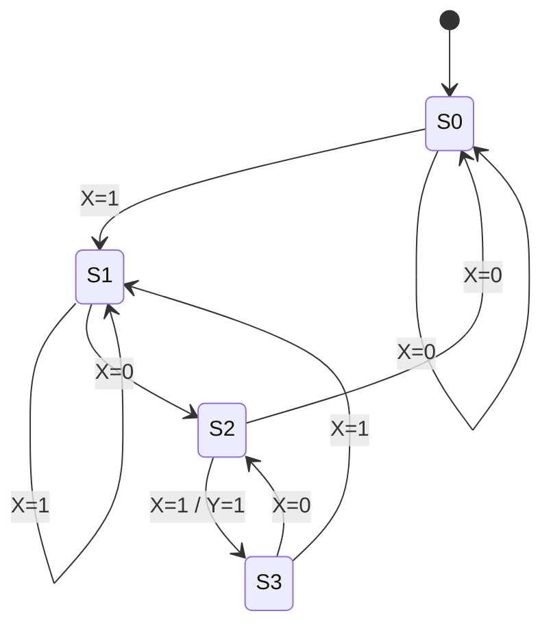
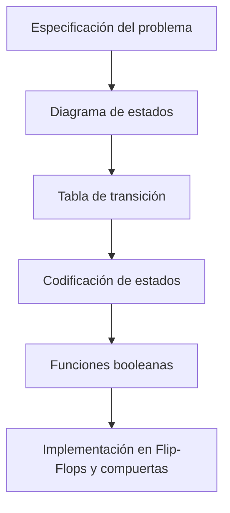

# Organización y Arquitectura de Computadoras - Circuitos combinacionales y secuenciales

## 4.3 Diagramas de estado, diseño de circuitos secuenciales

---

### 1. Introducción

Los **circuitos secuenciales** almacenan información y dependen de:

- **Entradas actuales**
- **Estados anteriores (memoria)**

Para diseñarlos, se utilizan herramientas como **tablas de transición** y **diagramas de estado**, que permiten modelar el comportamiento antes de implementar el hardware.

### 2. Definiciones clave

- **Estado**: Configuración interna de un circuito secuencial en un instante dado.
- **Diagrama de estado**: Representación gráfica de los estados y sus transiciones.
- **Tabla de transición de estados**: Representación tabular que describe cómo evolucionan los estados en función de las entradas.
- **Máquina de estados finitos (FSM)**: Modelo matemático de un circuito secuencial.

### 3. Modelos de máquinas de estado

Existen dos modelos fundamentales:

1. **Máquina de Mealy**

   - La salida depende de **estado actual + entradas**.

   $$ Y(t) = f(Q(t), X(t)) $$

   $$ Q(t+1) = g(Q(t), X(t)) $$

2. **Máquina de Moore**

   - La salida depende **solo del estado actual**.

   $$ Y(t) = f(Q(t)) $$

   $$ Q(t+1) = g(Q(t), X(t)) $$

-> Diferencia clave: En Mealy, la salida puede cambiar instantáneamente con la entrada; en Moore, la salida cambia solo con el cambio de estado.

### 4. Ejemplo práctico: Detector de secuencia "101"

#### 4.1 Especificación

- Entrada: $X$
- Salida: $Y = 1$ cuando se detecta la secuencia "101".

#### 4.2 Estados propuestos

- $S_0:$ estado inicial (no se ha detectado nada).
- $S_1:$ se detectó un "1".
- $S_2:$ se detectó "10".
- $S_3:$ se detectó "101" (estado de aceptación).

#### 4.3 Diagrama de estados (Mealy)



### 5. Pasos para el diseño de circuitos secuenciales

1. **Definir especificación** (entrada, salida, comportamiento esperado).
2. **Identificar estados** necesarios.
3. **Construir el diagrama de estados** (Moore o Mealy).
4. **Generar tabla de transición de estados**.
5. **Codificar los estados** en binario (minimización si es posible).
6. **Obtener funciones lógicas** para próximas salidas y estados.
7. **Implementar con flip-flops y compuertas lógicas**.

### 6. Ejemplo de tabla de transición (Detector "101")

| Estado actual | Entrada X | Próximo estado | Salida Y |
| ------------- | --------- | -------------- | -------- |
| $S_0$         | 0         | $S_0$          | 0        |
| $S_0$         | 1         | $S_1$          | 0        |
| $S_1$         | 0         | $S_2$          | 0        |
| $S_1$         | 1         | $S_1$          | 0        |
| $S_2$         | 0         | $S_0$          | 0        |
| $S_2$         | 1         | $S_3$          | 1        |
| $S_3$         | 0         | $S_2$          | 0        |
| $S_3$         | 1         | $S_1$          | 0        |

### 7. Ejemplo en Python (simulación FSM Mealy)

```python
class SequenceDetector:
    def __init__(self):
        self.state = "S0"

    def step(self, X):
        if self.state == "S0":
            if X == 1: self.state, Y = "S1", 0
            else: self.state, Y = "S0", 0
        elif self.state == "S1":
            if X == 0: self.state, Y = "S2", 0
            else: self.state, Y = "S1", 0
        elif self.state == "S2":
            if X == 1: self.state, Y = "S3", 1
            else: self.state, Y = "S0", 0
        elif self.state == "S3":
            if X == 1: self.state, Y = "S1", 0
            else: self.state, Y = "S2", 0
        return Y

# Ejemplo: detectar "101"
fsm = SequenceDetector()
sequence = [1,0,1,1,0,1]
output = [fsm.step(x) for x in sequence]
print(output)  # [0,0,1,0,0,1]
```

### 8. Ejercicios propuestos

1. Diseñar un detector de secuencia "110" con máquina de **Moore**.
2. Implementar un **circuito secuencial de paridad** que indique si el número de unos recibidos hasta el momento es par o impar.
3. Codificar estados para un FSM con **minimización de estados** usando el método de partición.
4. Simular el detector "101" en **Verilog o VHDL**.
5. Explicar las diferencias prácticas entre usar **latches** y **flip-flops** en la implementación de FSM.

### 9. Diagramas de relación



### 10. Referencias

#### Bibliografía básica:

1. Hennessy, John L. y Patterson, David A. _Computer Architecture: A Quantitative Approach_. 4a Ed. Morgan Kaufmann, 2006.
2. Kohavi, Zvi y Niraj K. Jha. _Switching and Finite Automata Theory_. 3a Ed. Cambridge University Press, 2009.
3. Mano, M. Morris y Kime, Charles. _Logic and Computer Design Fundamentals_. 4a Ed. Prentice Hall, 2007.
4. Patterson, David A. y Hennessy, John L. _Computer Organization and Design: The Hardware/Software Interface_. 4a Ed. Morgan Kaufmann, 2008.

#### Bibliografía complementaria:

1. Stallings, William. _Computer Organization and Architecture: Designing for Performance_. Prentice Hall - Pearson, 2009.
2. Tanenbaum, Andrew S. _Structured Computer Organization_. 5a Ed. Prentice Hall, 2005.
3. Silberschatz, Abraham; Galvin, Peter B.; Gagne, Greg. _Operating System Concepts_. 8a Ed. Wiley, 2008.
