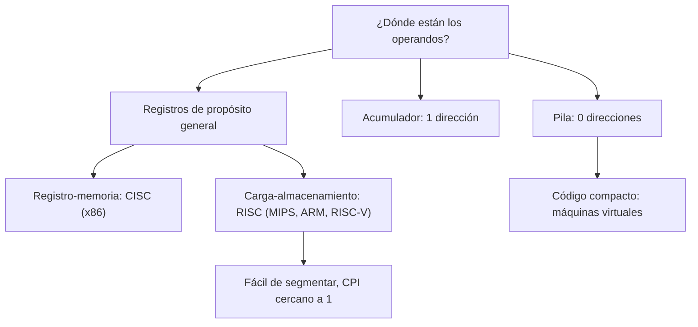

# Organización y Arquitectura de Computadoras - Diseño del conjunto de instrucciones

## 5.1 Tipos de arquitectura del conjunto de instrucciones

---

La **arquitectura del conjunto de instrucciones** (ISA, _Instruction Set Architecture_) es el contrato entre el hardware y el software: define las instrucciones, los registros visibles, los tipos de datos, los modos de direccionamiento y el modelo de memoria. Todo lo que está por debajo (cuántas etapas de segmentación, qué cachés) es **organización** o microarquitectura y puede cambiar sin que los programas lo noten. Este tema clasifica las ISA según dónde se guardan los operandos (pila, acumulador, registros), compara su eficiencia con un mismo cálculo y discute la diferencia entre los enfoques CISC y RISC.

### Clasificación por el almacenamiento de los operandos

La diferencia básica entre ISA es dónde están los operandos de las instrucciones aritméticas:

| Tipo | Operandos | Ejemplo de $C = A + B$ | Máquinas |
| --- | --- | --- | --- |
| **pila** | implícitos, en la cima de una pila | `PUSH A`, `PUSH B`, `ADD`, `POP C` | B5000, máquina virtual de Java, WebAssembly |
| **acumulador** | uno implícito, el acumulador; el otro en memoria | `LOAD A`, `ADD B`, `STORE C` | EDSAC, PDP-8, 6502 |
| **registro-memoria** | un registro y un operando en memoria | `LOAD R1, A`, `ADD R1, B`, `STORE C, R1` | IBM 360, x86, 68000 |
| **carga-almacenamiento** (registro-registro) | solo registros; la memoria solo con `LOAD` y `STORE` | `LW R1, A`, `LW R2, B`, `ADD R3, R1, R2`, `SW R3, C` | MIPS, ARM, RISC-V, SPARC, PowerPC |
| **memoria-memoria** | todos en memoria | `ADD C, A, B` | VAX (en parte) |

Las instrucciones también se clasifican por el **número de direcciones** explícitas: 0 (pila), 1 (acumulador), 2 (el destino es uno de los fuentes, como `ADD R1, R2` en x86) o 3 (destino y dos fuentes, como `ADD R3, R1, R2`).

**Por qué ganaron los registros.** Desde 1980 casi todas las ISA nuevas son de carga-almacenamiento con un banco de registros de propósito general (normalmente 32):

- Los registros son mucho más rápidos que la memoria, y el compilador puede mantener en ellos variables que se reutilizan, reduciendo el tráfico con la memoria.
- Con registros, el orden de evaluación es libre; en una pila, los operandos deben usarse en el orden en que se apilaron, lo que dificulta reutilizar subexpresiones.
- Las instrucciones de longitud fija y operandos en registros son más fáciles de **segmentar** (tema 7).

Las pilas siguen vivas en las **máquinas virtuales** (la JVM, la CLR de .NET, WebAssembly), porque su código es compacto y fácil de generar, y se traduce a registros al compilar a código nativo.

### CISC y RISC

En los años setenta, con la memoria cara y los compiladores sencillos, se diseñaron ISA con instrucciones potentes y complejas (VAX, x86): muchos modos de direccionamiento, instrucciones de longitud variable, operaciones como copiar cadenas o evaluar polinomios en una instrucción. Es el enfoque **CISC** (_Complex Instruction Set Computer_). Hacia 1980, los estudios de programas reales mostraron que la mayoría de las instrucciones ejecutadas eran sencillas (cargas, almacenamientos, sumas, saltos) y que las complejas apenas se usaban. Los proyectos RISC de Berkeley (Patterson) y Stanford (Hennessy) propusieron:

- instrucciones simples, de **longitud fija** (32 bits) y pocos formatos;
- arquitectura de **carga-almacenamiento** con muchos registros;
- pocos modos de direccionamiento;
- diseño pensado para la **segmentación**, con CPI cercano a 1.

Por la ecuación del desempeño (tema 1.2), RISC acepta un número de instrucciones mayor a cambio de un CPI y un tiempo de ciclo mucho menores. Hoy la distinción está difuminada: los procesadores x86 traducen internamente sus instrucciones a **microoperaciones** de tipo RISC, y las ISA RISC modernas han incorporado instrucciones más ricas. El tema 5.2 cuantifica el compromiso.



### Implementación en Python

El programa interpreta el cálculo de $X = (A + B)(C - D)$ escrito para cuatro máquinas de distinto tipo y cuenta las instrucciones ejecutadas y los accesos a memoria de datos.

```python
# X = (A + B) * (C - D) en cuatro estilos de conjunto de instrucciones.
# Cada intérprete cuenta instrucciones y accesos a memoria de datos.
MEM0 = {"A": 7, "B": 5, "C": 9, "D": 4, "X": 0}
OPS = {"ADD": lambda a, b: a + b, "SUB": lambda a, b: a - b, "MUL": lambda a, b: a * b}


def pila(programa):
    mem, st, accesos = dict(MEM0), [], 0
    for ins in programa:
        op, *arg = ins.split()
        if op == "PUSH":
            st.append(mem[arg[0]]); accesos += 1
        elif op == "POP":
            mem[arg[0]] = st.pop(); accesos += 1
        else:
            b, a = st.pop(), st.pop()
            st.append(OPS[op](a, b))
    return mem["X"], len(programa), accesos


def acumulador(programa):
    mem, acc, accesos = dict(MEM0), 0, 0
    for ins in programa:
        op, x = ins.split()
        accesos += 1
        if op == "LOAD":
            acc = mem[x]
        elif op == "STORE":
            mem[x] = acc
        else:
            acc = OPS[op](acc, mem[x])
    return mem["X"], len(programa), accesos


def registro_memoria(programa):
    mem, R, accesos = dict(MEM0), {}, 0
    for ins in programa:
        op, dst, src = ins.replace(",", "").split()
        if op == "LOAD":
            R[dst] = mem[src]; accesos += 1
        elif op == "STORE":
            mem[dst] = R[src]; accesos += 1
        else:                                     # operando fuente en memoria o en registro
            v = R[src] if src.startswith("R") else mem[src]
            accesos += 0 if src.startswith("R") else 1
            R[dst] = OPS[op](R[dst], v)
    return mem["X"], len(programa), accesos


def carga_almacenamiento(programa):
    mem, R, accesos = dict(MEM0), {}, 0
    for ins in programa:
        op, *a = ins.replace(",", "").split()
        if op == "LW":
            R[a[0]] = mem[a[1]]; accesos += 1
        elif op == "SW":
            mem[a[1]] = R[a[0]]; accesos += 1
        else:
            R[a[0]] = OPS[op](R[a[1]], R[a[2]])
    return mem["X"], len(programa), accesos


programas = {
    "pila": (pila, ["PUSH A", "PUSH B", "ADD", "PUSH C", "PUSH D", "SUB", "MUL", "POP X"]),
    "acumulador": (acumulador, ["LOAD A", "ADD B", "STORE X", "LOAD C", "SUB D", "MUL X", "STORE X"]),
    "registro-memoria": (registro_memoria, ["LOAD R1, A", "ADD R1, B", "LOAD R2, C", "SUB R2, D",
                                            "MUL R1, R2", "STORE X, R1"]),
    "carga-almacenamiento": (carga_almacenamiento, ["LW R1, A", "LW R2, B", "LW R3, C", "LW R4, D",
                                                    "ADD R1, R1, R2", "SUB R3, R3, R4", "MUL R1, R1, R3",
                                                    "SW R1, X"]),
}
print(f"X = (A + B)(C - D) con A, B, C, D = 7, 5, 9, 4; resultado esperado {(7 + 5) * (9 - 4)}")
print(f"{'arquitectura':22s} resultado instrucciones accesos a datos")
for nombre, (maquina, prog) in programas.items():
    r, n, acc = maquina(prog)
    print(f"{nombre:22s} {r:9d} {n:13d} {acc:16d}")
```

Salida:

```text
X = (A + B)(C - D) con A, B, C, D = 7, 5, 9, 4; resultado esperado 60
arquitectura           resultado instrucciones accesos a datos
pila                          60             8                5
acumulador                    60             7                7
registro-memoria              60             6                5
carga-almacenamiento          60             8                5
```

La máquina de acumulador necesita guardar el resultado intermedio en memoria, porque no tiene dónde más: 7 accesos frente a 5. La de carga-almacenamiento ejecuta más instrucciones que la de registro-memoria, pero son más sencillas; y si $A, B, C, D$ se reutilizaran después, ya estarían en registros.

### Ejercicios Propuestos

1. **Clasificación.** ¿A qué tipo de arquitectura pertenece cada instrucción: `ADD A`, `PUSH B`, `ADD R1, R2, R3`?

2. **Desempeño.** ¿Cómo cambia el tiempo de ejecución si se reduce el CPI? ¿Y si se aumenta la frecuencia de reloj? ¿Qué puede impedir que ambas mejoras se combinen?

3. **Multiplicación de matrices.** Escribe en ensamblador de MIPS el producto de dos matrices de $2 \times 2.$

4. **Pila.** Escribe el código de pila para $X = A \cdot B + C \cdot D$ y muestra el contenido de la pila tras cada instrucción.

5. **Densidad de código.** Si en la máquina de pila las instrucciones `ADD`, `SUB` y `MUL` ocupan 1 byte y `PUSH`/`POP` 3 bytes, y en la de carga-almacenamiento todas ocupan 4 bytes, ¿cuántos bytes ocupa en cada una el programa del tema?

### Soluciones

**Ejercicio 1.** `ADD A`: acumulador (un operando explícito, el otro implícito). `PUSH B`: pila. `ADD R1, R2, R3`: registros, de tres direcciones, típica de carga-almacenamiento.

**Ejercicio 2.** $T = I \cdot \text{CPI} / f:$ el tiempo es proporcional al CPI e inversamente proporcional a la frecuencia. Pero los factores no son independientes: subir la frecuencia suele requerir una segmentación más profunda, que aumenta las penalizaciones por riesgos (tema 7) y por tanto el CPI.

**Ejercicio 3.** El programa recorre $i,$ $j$ y $k,$ calcula las direcciones de $A[i][k]$ y $B[k][j]$ como $\text{base} + 4(2i + k)$ (almacenamiento por filas, palabras de 4 bytes) y acumula los productos:

```asm
# C = A x B para matrices de 2 x 2 de enteros, guardadas por filas
        .data
A:      .word 1, 2, 3, 4
B:      .word 5, 6, 7, 8
C:      .space 16
esp:    .asciiz " "
nl:     .asciiz "\n"
        .text
main:   la   $s0, A
        la   $s1, B
        la   $s2, C
        li   $t0, 0              # i
fila:   li   $t1, 0              # j
col:    li   $t3, 0              # suma
        li   $t2, 0              # k
prod:   sll  $t4, $t0, 1         # i*2
        add  $t4, $t4, $t2       # i*2 + k
        sll  $t4, $t4, 2         # en bytes
        add  $t4, $t4, $s0
        lw   $t5, 0($t4)         # A[i][k]
        sll  $t6, $t2, 1         # k*2
        add  $t6, $t6, $t1       # k*2 + j
        sll  $t6, $t6, 2
        add  $t6, $t6, $s1
        lw   $t7, 0($t6)         # B[k][j]
        mul  $t5, $t5, $t7
        add  $t3, $t3, $t5
        addi $t2, $t2, 1
        blt  $t2, 2, prod
        sll  $t4, $t0, 1         # C[i][j] = suma
        add  $t4, $t4, $t1
        sll  $t4, $t4, 2
        add  $t4, $t4, $s2
        sw   $t3, 0($t4)
        move $a0, $t3            # imprimir
        li   $v0, 1
        syscall
        bnez $t1, sig            # espacio solo entre columnas
        la   $a0, esp
        li   $v0, 4
        syscall
sig:    addi $t1, $t1, 1
        blt  $t1, 2, col
        la   $a0, nl
        li   $v0, 4
        syscall
        addi $t0, $t0, 1
        blt  $t0, 2, fila
        li   $v0, 10
        syscall
```

Salida en el simulador SPIM, con $A = \begin{pmatrix} 1 & 2 \\ 3 & 4 \end{pmatrix}$ y $B = \begin{pmatrix} 5 & 6 \\ 7 & 8 \end{pmatrix}:$

```text
19 22
43 50
```

**Ejercicio 4.** `PUSH A` [A], `PUSH B` [A, B], `MUL` [AB], `PUSH C` [AB, C], `PUSH D` [AB, C, D], `MUL` [AB, CD], `ADD` [AB + CD], `POP X` [ ]. La pila nunca tiene más de tres elementos.

**Ejercicio 5.** Pila: 5 instrucciones `PUSH`/`POP` de 3 bytes y 3 aritméticas de 1 byte, 18 bytes. Carga-almacenamiento: 8 instrucciones de 4 bytes, 32 bytes. El código de pila es casi la mitad, lo que explica su uso en máquinas virtuales que transmiten código por la red.

### Referencias

1. Hennessy, J. L., and Patterson, D. A., _Computer Architecture: A Quantitative Approach_. Morgan Kaufmann, 2019. Apéndice A.
2. Patterson, D. A., and Hennessy, J. L., _Computer Organization and Design: The Hardware/Software Interface_. Morgan Kaufmann, 2020. Capítulo 2.
3. Patterson, D. A., and Ditzel, D. R., The case for the reduced instruction set computer. _ACM SIGARCH Computer Architecture News_ 8(6), 1980.
4. Stallings, W., _Organización y arquitectura de computadores_. Pearson, 2006. Capítulos 10 y 13.
