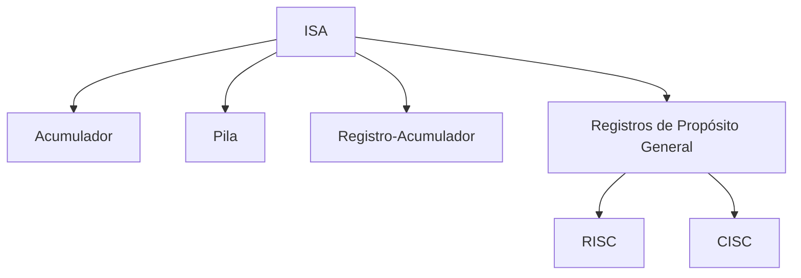

# Organización y Arquitectura de Computadoras - Diseño del conjunto de instrucciones

## 5.1 Tipos de arquitectura del conjunto de instrucciones

---

### 1. Definición General

El **Conjunto de Instrucciones** o **ISA (Instruction Set Architecture)** es la interfaz abstracta entre el **hardware** y el **software**. Define:

- El repertorio de operaciones que la máquina puede ejecutar.
- El formato de las instrucciones.
- Los modos de direccionamiento de memoria.
- El comportamiento visible para el programador.

En otras palabras, el ISA es el **“lenguaje máquina”** de la computadora.

### 2. Tipos de Arquitecturas ISA

#### 2.1 Arquitectura basada en acumulador

- Usa un **registro acumulador (ACC)** como fuente y destino de operaciones.
- El acceso a memoria es frecuente.

**Ejemplo de suma:**

```asm
LOAD A     ; ACC = M[A]
ADD  B     ; ACC = ACC + M[B]
STORE C    ; M[C] = ACC
```

- Ventaja: instrucciones simples y cortas.
- Desventaja: muchas operaciones intermedias de memoria.

#### 2.2 Arquitectura basada en pila (Stack-based)

- Usa una **pila LIFO**.
- Operandos implícitos en el tope de la pila.

**Ejemplo de suma:**

```asm
PUSH A
PUSH B
ADD    ; Suma los dos valores en la cima
POP C  ; Guarda resultado en C
```

- Ventaja: instrucciones compactas.
- Desventaja: difícil optimización, dependencia estricta de la pila.

#### 2.3 Arquitectura con registro-acumulador (Load/Store híbrida)

- Un número reducido de **registros generales** y un **acumulador principal**.
- Uso combinado de registros y memoria.

#### 2.4 Arquitectura de registros de propósito general (GPR – General Purpose Registers)

- Las operaciones se realizan principalmente entre registros.
- Solo instrucciones **Load/Store** acceden a memoria.
- Es la más usada actualmente (ej. MIPS, ARM, RISC-V).

**Ejemplo en estilo RISC:**

```asm
LW   R1, A    ; R1 = M[A]
LW   R2, B    ; R2 = M[B]
ADD  R3, R1, R2
SW   R3, C    ; M[C] = R3
```

#### 2.5 Clasificación CISC vs RISC

- **CISC (Complex Instruction Set Computer):**

  - Muchas instrucciones, algunas muy complejas.
  - Acceso a memoria en múltiples instrucciones.
  - Ejemplo: x86.

- **RISC (Reduced Instruction Set Computer):**

  - Conjunto pequeño y regular de instrucciones.
  - Filosofía **Load/Store**.
  - Ejemplo: MIPS, ARM, RISC-V.

### 3. Modos de direccionamiento

Los modos de direccionamiento definen **cómo localizar los operandos**. Ejemplos:

- **Inmediato:** el operando está en la instrucción. $OP = valor$
- **Directo:** el operando está en una dirección de memoria. $OP = M[dir]$
- **Indirecto:** la instrucción da la dirección donde se encuentra la dirección real. $OP = M[M[dir]]$
- **Indexado:** dirección base + desplazamiento. $OP = M[base + offset]$

### 4. Representación Gráfica (Mermaid)

#### Comparación entre arquitecturas ISA



### 5. Fórmulas y Conceptos Clave

- **Tiempo de ejecución de un programa:**

$$ T_{ejec} = \frac{N_{instrucciones} \times CPI}{f_{reloj}} $$

donde:

- $N_{instrucciones}$ = número de instrucciones ejecutadas

- $CPI$ = ciclos por instrucción promedio

- $f_{reloj}$ = frecuencia del procesador

- El **diseño del ISA** afecta directamente $N_{instrucciones}$ y $CPI.$

### 6. Ejemplo Comparativo

**Suma de dos arreglos de 100 enteros**

- **En CISC (x86, instrucciones complejas):**

```asm
LOOP: MOV AX, [SI]
      ADD AX, [DI]
      MOV [DI], AX
      INC SI
      INC DI
      LOOP LOOP
```

- **En RISC (MIPS, instrucciones simples):**

```asm
LOOP: LW   R1, 0(SI)
      LW   R2, 0(DI)
      ADD  R3, R1, R2
      SW   R3, 0(DI)
      ADDI SI, SI, 4
      ADDI DI, DI, 4
      BNE  SI, END, LOOP
```

### 7. Ejercicios Propuestos

1. Clasificar las siguientes instrucciones como de **acumulador, pila o registros**:

   - `ADD A`
   - `PUSH B`
   - `ADD R1, R2, R3`

2. Explicar cómo variaría el **tiempo de ejecución** si:

   - Se reducen ciclos por instrucción $(CPI).$
   - Se incrementa la frecuencia $(f_{reloj}).$

3. Implementar en **MIPS** la multiplicación de dos matrices $2\times 2.$

4. Dibujar el **diagrama de flujo de instrucciones** para una arquitectura de pila.

### 8. Referencias

#### Bibliografía básica

1. Hennessy, J. L. y Patterson, D. A. _Computer Architecture: A Quantitative Approach_, 4a Ed., Morgan Kaufmann, 2006.
2. Kohavi, Z. y Jha, N. K. _Switching and Finite Automata Theory_, 3a Ed., Cambridge University Press, 2009.
3. Mano, M. Morris y Kime, C. _Logic and Computer Design Fundamentals_, 4a Ed., Prentice Hall, 2007.
4. Patterson, D. A. y Hennessy, J. L. _Computer Organization and Design: The Hardware/Software Interface_, 4a Ed., Morgan Kaufmann, 2008.

#### Bibliografía complementaria

1. Stallings, W. _Computer Organization and Architecture: Designing for Performance_, Prentice Hall, 2009.
2. Tanenbaum, A. S. _Structured Computer Organization_, 5a Ed., Prentice Hall, 2005.
3. Silberschatz, A., Galvin, P. B. y Gagne, G. _Operating System Concepts_, 8a Ed., Wiley, 2008.
