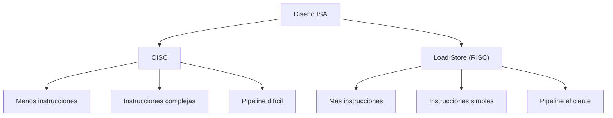

# Organización y Arquitectura de Computadoras - Diseño del conjunto de instrucciones

## 5.2 Arquitecturas load-store y su relación costo-beneficio

---

### 1. Definición General

Una **arquitectura Load-Store** es aquella en la cual:

- **Las operaciones aritméticas y lógicas solo ocurren entre registros.**
- **Únicamente las instrucciones de carga (LOAD) y almacenamiento (STORE) acceden a memoria.**

-> Ejemplo típico: **MIPS, ARM, RISC-V**.

Esto contrasta con arquitecturas **CISC**, donde varias instrucciones permiten operar directamente con memoria.

### 2. Características principales

- **Separación clara entre cómputo y acceso a memoria**.
- Uso intensivo de **registros de propósito general (GPRs)**.
- Instrucciones simples, con formato fijo y generalmente de un solo ciclo.
- Filosofía asociada a **RISC (Reduced Instruction Set Computer)**.

### 3. Ventajas y desventajas

#### (✓) Ventajas (beneficios):

- Instrucciones más simples → **pipeline más eficiente**.
- Predecibilidad → **CPI ≈ 1** en la mayoría de las instrucciones.
- Menor complejidad del hardware → menor consumo de energía y mayor frecuencia de reloj.

#### (X) Desventajas (costos):

- Mayor número de instrucciones para realizar una tarea (más accesos a registros).
- El compilador debe optimizar de manera más agresiva.
- Programas en lenguaje máquina tienden a ser **más largos** que en CISC.

### 4. Fórmulas y Relación Costo-Beneficio

El **tiempo de ejecución de un programa** se calcula como:

$$ T_{ejec} = \frac{N_{ins} \times CPI}{f_{reloj}} $$

donde:

- $N_{ins}$ = número de instrucciones ejecutadas
- $CPI$ = ciclos por instrucción promedio
- $f_{reloj}$ = frecuencia del procesador

#### Relación costo-beneficio

- En **Load-Store (RISC)**:

  - $N_{ins}$ ↑ (más instrucciones necesarias)
  - $CPI$ ↓ (≈ 1)
  - $f_{reloj}$ ↑ (hardware más sencillo permite frecuencias más altas)

- En **CISC**:

  - $N_{ins}$ ↓
  - $CPI$ ↑
  - $f_{reloj}$ ↓

-> **El costo-beneficio depende del equilibrio entre $N_{ins},$ $CPI$ y $f_{reloj}$.**

### 5. Ejemplo en Código

#### Ejemplo: $C = A + B$

- **En CISC (x86):**

```asm
ADD C, A, B   ; C = A + B (operación con memoria directa)
```

- **En Load-Store (MIPS):**

```asm
LW   R1, A    ; R1 = M[A]
LW   R2, B    ; R2 = M[B]
ADD  R3, R1, R2
SW   R3, C    ; M[C] = R3
```

En MIPS se requieren **4 instrucciones** en lugar de **1 en CISC**, pero cada instrucción es más rápida y predecible.

### 6. Diagrama Comparativo



### 7. Ejercicio Resuelto

**Problema:**
Comparar el tiempo de ejecución entre un procesador **CISC** y uno **Load-Store (RISC)**.

- Datos:

  - Programa requiere **100 operaciones aritméticas**.
  - En **CISC**, cada operación toma $CPI = 4.$
  - En **RISC**, cada operación requiere 3 instrucciones más $(N_{ins} = 400),$ pero $(CPI = 1).$
  - Ambos tienen la misma frecuencia de $2 , GHz.$

**Cálculo:**

- CISC:

$$ T_{CISC} = \frac{100 \times 4}{2 \times 10^9} = 2 \times 10^{-7} \, s $$

- RISC:

$$ T_{RISC} = \frac{400 \times 1}{2 \times 10^9} = 2 \times 10^{-7} \, s $$

Ambos tiempos resultan iguales → **el costo-beneficio se equilibra**.

### 8. Ejercicios Propuestos

1. Implementar en ensamblador MIPS el cálculo del factorial de un número $n,$ usando únicamente instrucciones Load-Store.
2. Comparar el tiempo de ejecución de una suma de arreglos de 1000 elementos en CISC vs RISC.
3. Dibujar un pipeline de 5 etapas (IF, ID, EX, MEM, WB) y explicar por qué las arquitecturas Load-Store son más adecuadas para él.
4. Analizar cómo la optimización del compilador puede reducir el costo de $N_{ins}$ en arquitecturas RISC.

### 9. Referencias

#### Bibliografía básica

1. Hennessy, J. L. y Patterson, D. A. _Computer Architecture: A Quantitative Approach_, 4a Ed., Morgan Kaufmann, 2006.
2. Kohavi, Z. y Jha, N. K. _Switching and Finite Automata Theory_, 3a Ed., Cambridge University Press, 2009.
3. Mano, M. Morris y Kime, C. _Logic and Computer Design Fundamentals_, 4a Ed., Prentice Hall, 2007.
4. Patterson, D. A. y Hennessy, J. L. _Computer Organization and Design: The Hardware/Software Interface_, 4a Ed., Morgan Kaufmann, 2008.

#### Bibliografía complementaria

1. Stallings, W. _Computer Organization and Architecture: Designing for Performance_, Prentice Hall, 2009.
2. Tanenbaum, A. S. _Structured Computer Organization_, 5a Ed., Prentice Hall, 2005.
3. Silberschatz, A., Galvin, P. B. y Gagne, G. _Operating System Concepts_, 8a Ed., Wiley, 2008.
