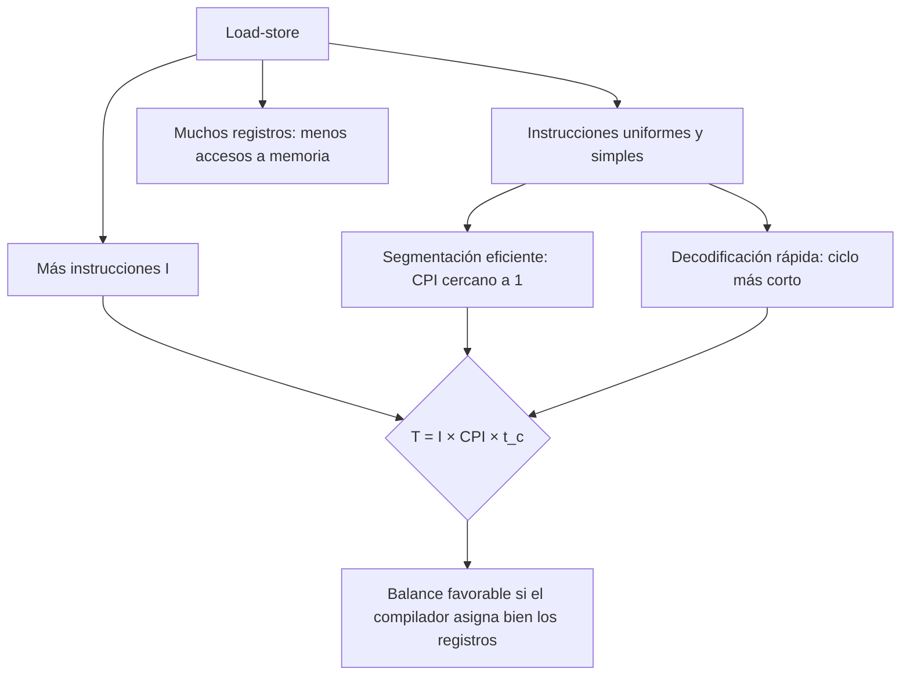

# Organización y Arquitectura de Computadoras - Diseño del conjunto de instrucciones

## 5.2 Arquitecturas load-store y su relación costo-beneficio

---

En una arquitectura **load-store** (carga-almacenamiento), las únicas instrucciones que acceden a la memoria son las de carga (`load`) y almacenamiento (`store`); todas las operaciones aritméticas y lógicas trabajan sobre registros. Es la base de MIPS, ARM, RISC-V, SPARC y PowerPC. Este tema describe sus características, analiza con la ecuación del desempeño qué se gana y qué se pierde frente a las arquitecturas registro-memoria, y explica por qué el balance resultó favorable: el hardware más simple permite segmentar y subir la frecuencia, y el compilador compensa las instrucciones adicionales.

### Características

- **Separación de funciones:** `LW`/`SW` (y sus variantes de byte y media palabra) mueven datos entre memoria y registros; `ADD`, `SUB`, `AND`, `SLT` y las demás operan solo con registros o constantes inmediatas.
- **Muchos registros** de propósito general (32 en MIPS, RISC-V y ARMv8), para que el compilador mantenga en ellos las variables usadas con frecuencia.
- **Instrucciones de longitud fija** (32 bits) y pocos formatos (tema 5.5), que se decodifican en paralelo con la lectura de registros.
- **Pocos modos de direccionamiento**: básicamente registro + desplazamiento (tema 5.4).
- Cada instrucción hace **como mucho un acceso a memoria**, y lo hace siempre en la misma etapa de la segmentación.

### La relación costo-beneficio

Con la ecuación $T = I \times \text{CPI} \times t_c$ (tema 1.2):

| Factor | Efecto de load-store | Motivo |
| --- | --- | --- |
| instrucciones $I$ | aumenta | hay que cargar los operandos explícitamente |
| CPI | disminuye mucho | instrucciones uniformes, segmentación sin conflictos de recursos |
| tiempo de ciclo $t_c$ | disminuye | decodificación sencilla, menos lógica por etapa |
| tamaño de código | aumenta | más instrucciones y todas de 4 bytes |
| tráfico de memoria de datos | disminuye | las variables viven en registros |
| complejidad del compilador | aumenta | asignación de registros y planificación de instrucciones |

**El costo de las instrucciones complejas.** Añadir una instrucción que sustituye una secuencia de $n$ instrucciones simples solo compensa si la mejora en las secuencias que reemplaza supera la pérdida en todas las demás. Si una fracción $q$ de las instrucciones forma esas secuencias, la nueva instrucción tiene CPI $c$ y su lógica alarga el ciclo de reloj en un factor $k,$ el tiempo relativo es

$$ \frac{T_{\text{nuevo}}}{T} = k \left( (1 - q) + \frac{q}{n} c \right) $$

con CPI 1 para las simples. Si la instrucción se usa poco, con $q$ pequeño, o hace más lento el reloj de todas las demás, no conviene: es el argumento cuantitativo de RISC y una aplicación de la ley de Amdahl.

**La evidencia histórica.** Un estudio clásico (Bhandarkar y Clark, 1991) comparó un VAX con un MIPS de tecnología similar: el MIPS ejecutaba del orden del doble de instrucciones, pero el VAX necesitaba del orden de seis veces más ciclos por instrucción, de modo que el MIPS resultaba unas tres veces más rápido con la misma frecuencia.

**El costo en tamaño de código** importa en sistemas empotrados con poca memoria y en la caché de instrucciones. Las respuestas han sido los formatos comprimidos de 16 bits (Thumb en ARM, la extensión C de RISC-V), que reducen el código en un 25 a 30 %.



### Ejemplo resuelto: suma de arreglos

$C[i] = A[i] + B[i]$ para $i = 0, \ldots, 999.$ En una máquina registro-memoria el bucle tiene 5 instrucciones (una carga, una suma con operando en memoria, un almacenamiento, un incremento y un salto); en una load-store, 7 (dos cargas, una suma, un almacenamiento, dos incrementos y un salto). Ambas hacen 3 accesos a datos por elemento. Con los supuestos del programa (CPI 3 a 2 GHz frente a CPI 1.2 a 3 GHz), la load-store ejecuta un 40 % más de instrucciones pero tarda 2.8 µs frente a 7.5 µs. Si además el compilador **desenrolla** el bucle cuatro veces, los incrementos y el salto se pagan una vez por cada cuatro elementos y el número de instrucciones baja un 32 %.

### Implementación en Python

El programa evalúa el ejemplo con la ecuación del desempeño, el efecto del desenrollado, la comparación histórica VAX-MIPS y el modelo de costo-beneficio de una instrucción compleja en cuatro escenarios.

```python
# Ejercicio 2: C[i] = A[i] + B[i] para 1000 elementos en un CISC y en un RISC hipotéticos.
# Las cifras de CPI y frecuencia son supuestos del ejercicio, no medidas de procesadores reales.
N = 1000
cisc = {"nombre": "CISC registro-memoria", "instr_por_iter": 5, "cpi": 3.0, "f": 2.0e9, "bytes": 3.5}
risc = {"nombre": "RISC carga-almacenamiento", "instr_por_iter": 7, "cpi": 1.2, "f": 3.0e9, "bytes": 4}
# CISC: MOV EAX,[ESI]; ADD EAX,[EDI]; MOV [EBX],EAX; ADD ...; LOOP  (accesos: 3 por iteración)
# RISC: LW; LW; ADD; SW; ADDI; ADDI; BNE                             (accesos: 3 por iteración)
for m in (cisc, risc):
    I = m["instr_por_iter"] * N
    ciclos = I * m["cpi"]
    m["t"] = ciclos / m["f"]
    print(f"{m['nombre']:26s}: I = {I}, ciclos = {ciclos:.0f}, tiempo = {m['t'] * 1e6:.2f} µs, "
          f"código del bucle ≈ {m['instr_por_iter'] * m['bytes']:.1f} bytes")
print(f"aceleración del RISC: {cisc['t'] / risc['t']:.2f}")

# Desenrollar el bucle 4 veces en el RISC (ejercicio 4): se ahorran incrementos y saltos
I_desenr = (4 * 4 + 3) * (N // 4)        # 16 de datos + 2 incrementos + 1 salto por cada 4 elementos
print(f"RISC con el bucle desenrollado 4 veces: I = {I_desenr} ({I_desenr / (7 * N):.0%} del original),"
      f" tiempo = {I_desenr * 1.2 / 3e9 * 1e6:.2f} µs")

# Comparación histórica VAX 8700 frente a MIPS M2000 (Bhandarkar y Clark, 1991), valores aproximados
razon_instr = 2.0      # el MIPS ejecuta del orden del doble de instrucciones
razon_cpi = 6.0        # el VAX necesita del orden de 6 veces más ciclos por instrucción
print(f"VAX frente a MIPS con la misma frecuencia: ventaja del MIPS ≈ {razon_cpi / razon_instr:.1f} veces")


# Modelo de costo-beneficio: añadir una instrucción compleja que sustituye secuencias de n simples.
# q: fracción de las instrucciones simples que forman parte de esas secuencias;
# c: CPI de la compleja; k: factor en que se alarga el ciclo de reloj de TODAS las instrucciones.
def tiempo_relativo(q, n, c, k):
    return ((1 - q) * 1.0 + (q / n) * c) * k     # con CPI 1 para las simples y tiempo base 1


for q, n, c, k in ((0.3, 3, 2, 1.0), (0.3, 3, 2, 1.1), (0.05, 3, 2, 1.05), (0.3, 3, 4, 1.0)):
    t = tiempo_relativo(q, n, c, k)
    print(f"q = {q:4.2f}, n = {n}, CPI compleja = {c}, ciclo x{k:4.2f}: tiempo relativo {t:.3f}"
          f" -> {'conviene' if t < 1 else 'no conviene'}")
```

Salida:

```text
CISC registro-memoria     : I = 5000, ciclos = 15000, tiempo = 7.50 µs, código del bucle ≈ 17.5 bytes
RISC carga-almacenamiento : I = 7000, ciclos = 8400, tiempo = 2.80 µs, código del bucle ≈ 28.0 bytes
aceleración del RISC: 2.68
RISC con el bucle desenrollado 4 veces: I = 4750 (68% del original), tiempo = 1.90 µs
VAX frente a MIPS con la misma frecuencia: ventaja del MIPS ≈ 3.0 veces
q = 0.30, n = 3, CPI compleja = 2, ciclo x1.00: tiempo relativo 0.900 -> conviene
q = 0.30, n = 3, CPI compleja = 2, ciclo x1.10: tiempo relativo 0.990 -> conviene
q = 0.05, n = 3, CPI compleja = 2, ciclo x1.05: tiempo relativo 1.032 -> no conviene
q = 0.30, n = 3, CPI compleja = 4, ciclo x1.00: tiempo relativo 1.100 -> no conviene
```

Una instrucción compleja muy usada, con $q = 0.3,$ compensa aunque alargue el ciclo un 10 %; si solo cubre el 5 % de las instrucciones y alarga el ciclo un 5 %, el programa se vuelve más lento.

### Ejercicios Propuestos

1. **Factorial.** Escribe en ensamblador de MIPS el cálculo recursivo del factorial; observa qué instrucciones acceden a la memoria.

2. **Suma de arreglos.** Compara el tiempo de la suma de dos arreglos de 1000 elementos en una máquina CISC con CPI 3 a 2 GHz y 5 instrucciones por iteración, y en una RISC con CPI 1.2 a 3 GHz y 7 instrucciones por iteración.

3. **Segmentación.** Dibuja la segmentación de 5 etapas (IF, ID, EX, MEM, WB) y explica por qué una arquitectura load-store encaja mejor en ella que una con operandos en memoria.

4. **Compilador.** ¿Cómo puede el compilador reducir el número de instrucciones $I$ en una arquitectura load-store?

### Soluciones

**Ejercicio 1.** Solo las instrucciones `sw` y `lw` que guardan y recuperan `$ra` y el argumento $n$ en la pila acceden a la memoria; la multiplicación y la comparación trabajan con registros:

```asm
# Factorial recursivo: la pila guarda $ra y n con sw/lw (carga-almacenamiento)
        .data
nl:     .asciiz "\n"
        .text
main:   li   $s0, 0              # n = 0, 1, ..., 10
bucle:  move $a0, $s0
        jal  fact
        move $a0, $v0            # imprimir n!
        li   $v0, 1
        syscall
        la   $a0, nl
        li   $v0, 4
        syscall
        addi $s0, $s0, 2
        ble  $s0, 10, bucle
        li   $v0, 10
        syscall

fact:   addi $sp, $sp, -8        # reservar dos palabras en la pila
        sw   $ra, 4($sp)
        sw   $a0, 0($sp)
        slti $t0, $a0, 2         # n < 2 ?
        beq  $t0, $zero, rec
        li   $v0, 1              # caso base: 1
        addi $sp, $sp, 8
        jr   $ra
rec:    addi $a0, $a0, -1
        jal  fact                # v0 = (n - 1)!
        lw   $a0, 0($sp)         # recuperar n y $ra
        lw   $ra, 4($sp)
        addi $sp, $sp, 8
        mul  $v0, $a0, $v0       # n * (n - 1)!
        jr   $ra
```

Salida en SPIM, con $n = 0, 2, 4, \ldots, 10:$

```text
1
2
24
720
40320
3628800
```

**Ejercicio 2.** CISC: $5000 \times 3 / (2 \times 10^9) = 7.5$ µs. RISC: $7000 \times 1.2 / (3 \times 10^9) = 2.8$ µs. El RISC es unas 2.7 veces más rápido.

**Ejercicio 3.** En la segmentación de 5 etapas cada instrucción usa la memoria de datos solo en la etapa MEM y la ALU solo en EX. Con operandos en memoria, una instrucción como `ADD R1, [R2]` necesitaría acceder a la memoria **antes** de usar la ALU, y una con destino en memoria, después: habría que añadir etapas o detener la segmentación. Además, las instrucciones de longitud variable complican la etapa IF, que no sabe dónde empieza la siguiente instrucción hasta decodificar la actual.

**Ejercicio 4.** Asignación de registros (mantener variables en registros en vez de cargarlas cada vez), eliminación de subexpresiones comunes, desenrollado de bucles, propagación de constantes con instrucciones inmediatas, reducción de fuerza (desplazamientos en lugar de multiplicaciones) y uso del modo registro + desplazamiento para acceder a varios elementos sin recalcular direcciones (tema 8.1).

### Referencias

1. Hennessy, J. L., and Patterson, D. A., _Computer Architecture: A Quantitative Approach_. Morgan Kaufmann, 2019. Apéndice A.
2. Patterson, D. A., and Hennessy, J. L., _Computer Organization and Design: The Hardware/Software Interface_. Morgan Kaufmann, 2020. Capítulo 2.
3. Bhandarkar, D., and Clark, D. W., Performance from architecture: comparing a RISC and a CISC with similar hardware organization. _ASPLOS IV_, 1991.
4. Waterman, A., and Asanović, K. (eds.), _The RISC-V Instruction Set Manual, Volume I_. RISC-V International, 2019.
