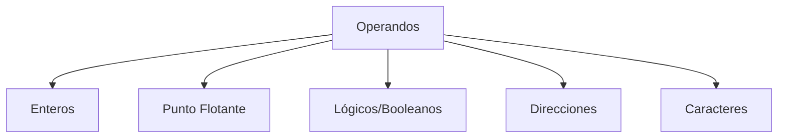

# Organización y Arquitectura de Computadoras - Diseño del conjunto de instrucciones

## 5.3 Tipos y tamaño de operandos

---

### 1. Definición

Un **operando** es el valor o la dirección de memoria sobre el cual una instrucción actúa.
Ejemplo: en la instrucción

```asm
ADD R1, R2, R3   ; R1 = R2 + R3
```

- `R2` y `R3` son **operandos fuente**.
- `R1` es el **operando destino**.

El **ISA** define los **tipos de operandos** (datos que pueden manipularse) y sus **tamaños** (número de bits que ocupan en memoria o registros).

### 2. Tipos de operandos

1. **Operandos de datos enteros**

   - Positivos y negativos.
   - Generalmente en complemento a dos.
   - Tamaños comunes: 8, 16, 32, 64 bits.

2. **Operandos de punto flotante**

   - Representan números reales.
   - Siguen el estándar **IEEE 754**:

     - Simple precisión: 32 bits (1 bit signo, 8 bits exponente, 23 bits mantisa).
     - Doble precisión: 64 bits (1 bit signo, 11 bits exponente, 52 bits mantisa).

3. **Operandos lógicos o booleanos**

   - Valores: $0$ (falso) y $1$ (verdadero).
   - Tamaño: 1 bit (aunque usualmente se almacenan en una palabra mínima de 8 bits).

4. **Direcciones de memoria**

   - Operandos que representan posiciones en memoria.
   - Tamaño depende del **espacio de direccionamiento**:

     - $2^{32}$ direcciones → 32 bits.
     - $2^{64}$ direcciones → 64 bits.

5. **Caracteres**

   - Usualmente codificados en **ASCII (8 bits)** o **Unicode (16-32 bits)**.

### 3. Tamaño de operandos

El **tamaño de operando** define la **precisión** y la **cantidad de memoria requerida**.

Ejemplo de tamaños:

| Tipo de dato | Tamaño común |
| ------------ | ------------ |
| Byte         | 8 bits       |
| Halfword     | 16 bits      |
| Word         | 32 bits      |
| Doubleword   | 64 bits      |
| Quadword     | 128 bits     |

-> El **tamaño de los operandos** influye directamente en:

- **Ancho del bus de datos**.
- **Tamaño de los registros del procesador**.
- **Número de ciclos por instrucción $(CPI)$**.

### 4. Fórmulas

1. **Número máximo representable sin signo**:

$$ Max_{unsigned} = 2^n - 1 $$

2. **Rango en complemento a dos (con signo)**:

$$ [-2^{n-1}, \; 2^{n-1} - 1] $$

Ejemplo: con $n=8$ bits:

- Entero sin signo: $[0, 255].$
- Entero con signo: $[-128, 127].$

### 5. Ejemplos en código

#### MIPS (Load/Store con distintos tamaños de operandos)

```asm
LB   R1, 0(R2)    ; Cargar un byte con signo
LBU  R1, 0(R2)    ; Cargar un byte sin signo
LH   R1, 0(R2)    ; Cargar un halfword (16 bits)
LW   R1, 0(R2)    ; Cargar una palabra (32 bits)
LD   R1, 0(R2)    ; Cargar un doubleword (64 bits)
```

#### Operaciones con punto flotante (IEEE 754)

```asm
L.S   F1, 0(R2)   ; Cargar flotante simple (32 bits)
L.D   F2, 0(R3)   ; Cargar flotante doble (64 bits)
ADD.S F3, F1, F2  ; Suma de simples
ADD.D F4, F2, F2  ; Suma de dobles
```

### 6. Representación Gráfica (Mermaid)

#### Clasificación de operandos



### 7. Ejemplo Resuelto

**Problema:** ¿Cuál es el rango de un operando entero con signo de 16 bits?

**Solución:**

$$ Rango = [-2^{15}, 2^{15} - 1] = [-32768, 32767] $$

### 8. Ejercicios Propuestos

1. Determinar el rango de representación para:

   - Un operando sin signo de 12 bits.
   - Un operando con signo de 32 bits.

2. Explicar cómo afecta el **tamaño de los operandos** al **ancho del bus de datos** en un procesador.

3. Escribir en **MIPS** instrucciones que sumen dos números de 8 bits, de 16 bits y de 32 bits.

4. Representar en IEEE 754 simple precisión el número $-5.75.$

5. Realizar un diagrama de flujo que clasifique los operandos en **numéricos, lógicos y direcciones**.

### 9. Referencias

#### Bibliografía básica

1. Hennessy, J. L. y Patterson, D. A. _Computer Architecture: A Quantitative Approach_, 4a Ed., Morgan Kaufmann, 2006.
2. Kohavi, Z. y Jha, N. K. _Switching and Finite Automata Theory_, 3a Ed., Cambridge University Press, 2009.
3. Mano, M. Morris y Kime, C. _Logic and Computer Design Fundamentals_, 4a Ed., Prentice Hall, 2007.
4. Patterson, D. A. y Hennessy, J. L. _Computer Organization and Design: The Hardware/Software Interface_, 4a Ed., Morgan Kaufmann, 2008.

#### Bibliografía complementaria

1. Stallings, W. _Computer Organization and Architecture: Designing for Performance_, Prentice Hall, 2009.
2. Tanenbaum, A. S. _Structured Computer Organization_, 5a Ed., Prentice Hall, 2005.
3. Silberschatz, A., Galvin, P. B. y Gagne, G. _Operating System Concepts_, 8a Ed., Wiley, 2008.
