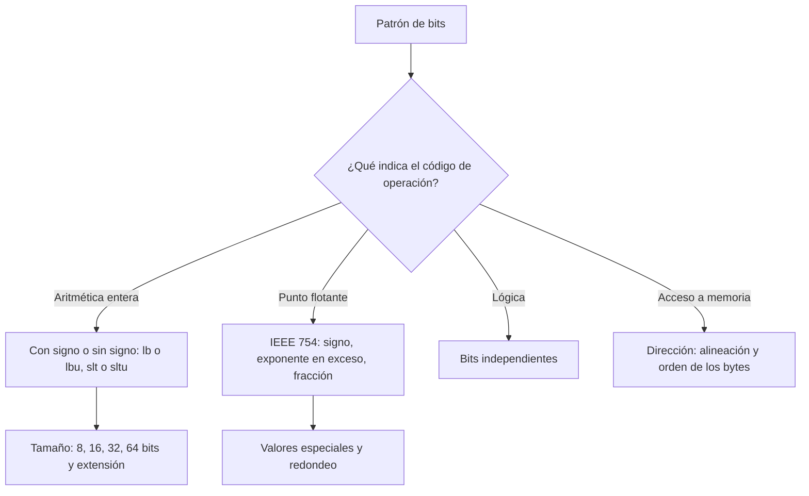

# Organización y Arquitectura de Computadoras - Diseño del conjunto de instrucciones

## 5.3 Tipos y tamaño de operandos

---

Una instrucción opera sobre bits, pero esos bits significan cosas distintas según el **tipo** de operando: un entero con o sin signo, un número de punto flotante, un carácter, una dirección. El **tamaño** del operando (8, 16, 32 o 64 bits) determina su rango y precisión. La ISA indica el tipo con el código de operación (`add` frente a `add.s`, `lb` frente a `lbu`), no con etiquetas en los datos. Este tema repasa los tipos que soportan los procesadores, estudia en detalle el formato de punto flotante IEEE 754 y explica dos cuestiones de organización de la memoria: la **alineación** y el **orden de los bytes**.

### Tipos de operandos

| Tipo | Tamaños habituales | Representación | Ejemplo de instrucciones (MIPS) |
| --- | --- | --- | --- |
| entero sin signo | 8, 16, 32, 64 | binario natural (tema 2.2) | `lbu`, `addu`, `sltu` |
| entero con signo | 8, 16, 32, 64 | complemento a dos (tema 2.3) | `lb`, `lh`, `add`, `slt` |
| punto flotante | 32 (simple), 64 (doble); 16 en aprendizaje automático | IEEE 754 | `add.s`, `mul.d` |
| carácter | 8 (ASCII), 16 o 32 (Unicode) | códigos | `lb`, `lbu` |
| decimal | 4 bits por dígito | BCD | instrucciones especiales en x86 y en IBM z |
| booleano y bits | 1 bit en una palabra | máscaras | `and`, `or`, `xor` |
| dirección | ancho de la dirección | entero sin signo | `la`, `lw` con base |

Los nombres de los tamaños dependen de la arquitectura: en MIPS, RISC-V y ARM una **palabra** tiene 32 bits, una **media palabra** 16 y una **doble palabra** 64; en x86, por herencia del 8086, una palabra tiene 16 bits. Estudios de uso en programas reales muestran que la mayoría de los accesos a datos son de 32 o 64 bits; los de byte se deben sobre todo a caracteres.

**Rangos.** Con $n$ bits, sin signo: de $0$ a $2^n - 1;$ con signo en complemento a dos: de $-2^{n-1}$ a $2^{n-1} - 1.$ Un operando de 12 bits sin signo va de 0 a 4095; uno de 32 bits con signo, de $-2\,147\,483\,648$ a $2\,147\,483\,647.$

**Cargas con extensión.** Al cargar un dato pequeño en un registro de 32 o 64 bits hay que rellenar los bits altos: `lb` y `lh` hacen **extensión de signo** y `lbu` y `lhu` **extensión con ceros**. El mismo byte `0xFD` vale $-3$ o $253$ según la instrucción.

### Punto flotante IEEE 754

Un número real se representa como $(-1)^s \times 1.f \times 2^{e - \text{sesgo}},$ con tres campos:

| Formato | Signo $s$ | Exponente $e$ | Fracción $f$ | Sesgo | Dígitos decimales |
| --- | --- | --- | --- | --- | --- |
| simple (32 bits) | 1 | 8 | 23 | 127 | unos 7 |
| doble (64 bits) | 1 | 11 | 52 | 1023 | unos 16 |

- **Normalizados**, con $e$ entre 1 y el máximo menos 1: el bit 1 antes del punto es implícito y no se guarda, lo que da un bit de precisión extra.
- **Exponente en exceso** (tema 2.3): permite comparar números positivos como si fueran enteros.
- **Valores especiales:** $e = 0$ y $f = 0$ es el cero, que tiene signo: hay $+0$ y $-0;$ $e = 0$ con $f \neq 0$ da los **desnormalizados**, $0.f \times 2^{1 - \text{sesgo}},$ que llenan el hueco cerca de cero (subdesbordamiento gradual); $e$ máximo con $f = 0$ es $\pm\infty;$ con $f \neq 0,$ **NaN** (_not a number_), el resultado de operaciones como $0/0.$
- **Redondeo:** cada operación da el resultado exacto redondeado al representable más cercano (por defecto, con empates al par). El error relativo es como mucho la mitad del **épsilon de la máquina**, $2^{-23}$ en simple y $2^{-52}$ en doble.

**Ejemplo: $-5.75$ en precisión simple.** $5.75 = 101.11_2 = 1.0111_2 \times 2^2.$ Signo 1; exponente $2 + 127 = 129 = 10000001_2;$ fracción $0111$ seguida de ceros. El patrón es `1 10000001 01110000000000000000000` $= \text{0xC0B80000}.$

**Consecuencias del redondeo.** La suma no es asociativa: $(10^{16} - 10^{16}) + 1 = 1,$ pero $10^{16} + (-10^{16} + 1) = 0,$ porque $-10^{16} + 1$ se redondea a $-10^{16}.$ En simple, $2^{24} + 1 = 16\,777\,217$ no es representable. Por eso no se deben comparar flotantes con `==`, sino con una tolerancia.

### Caracteres

**ASCII** usa 7 bits (128 caracteres, el inglés). **Unicode** asigna un número (punto de código) a más de 150 000 caracteres de todas las escrituras. Su codificación más usada, **UTF-8**, es de longitud variable: 1 byte para ASCII, 2 para la mayoría de los alfabetos latinos con acentos y para el griego, el cirílico, el hebreo o el árabe, 3 para el resto del plano básico (incluidos el chino y el japonés comunes, y el €) y 4 para el resto. Es compatible con ASCII y no tiene problemas de orden de bytes.

### Alineación y orden de los bytes

**Alineación.** Un dato de $k$ bytes está **alineado** si su dirección es múltiplo de $k.$ Muchas ISA RISC solo permiten accesos alineados (MIPS genera una excepción con un `lw` desalineado), y las que los permiten los hacen más lentos, porque el dato puede cruzar dos palabras o dos líneas de caché. Por eso el compilador inserta **relleno** en las estructuras: en C, `struct {char c; int32_t i; int16_t s;}` ocupa 12 bytes, y reordenando los campos de mayor a menor tamaño, 8.

**Orden de los bytes** (_endianness_). Una palabra de 4 bytes se puede guardar con el byte más significativo en la dirección menor (**big-endian**: redes, SPARC, IBM z) o con el menos significativo (**little-endian**: x86, y en la práctica ARM y RISC-V). `0x12345678` en big-endian es `12 34 56 78`, y en little-endian `78 56 34 12`. Importa al intercambiar datos binarios entre máquinas o por la red, que usa big-endian (el "orden de red").



### Implementación en Python

El programa resuelve los ejercicios 1 y 4, descompone varios números en sus campos de IEEE 754 (incluidos un desnormalizado, el infinito, NaN y los dos ceros), muestra los límites de la precisión simple y los efectos del redondeo, codifica caracteres en UTF-8 y un número en BCD, y comprueba el orden de los bytes y el relleno de las estructuras de C.

```python
import ctypes
import math
import struct


def campos_float(x):
    b = struct.unpack(">I", struct.pack(">f", x))[0]
    s, e, m = b >> 31, (b >> 23) & 0xFF, b & 0x7FFFFF
    return b, s, e, m


def describir(x):
    b, s, e, m = campos_float(x)
    if e == 0xFF:
        tipo = "NaN" if m else "infinito"
    elif e == 0:
        tipo = "cero" if m == 0 else "desnormalizado"
    else:
        tipo = f"normalizado, (-1)^{s} x 1.{format(m, '023b').rstrip('0') or '0'} x 2^{e - 127}"
    return f"{x!r:>14}: 0x{b:08X} = {s} {e:08b} {m:023b}  {tipo}"


print("ejercicio 1: 12 bits sin signo 0 ..", 2**12 - 1, "| 32 bits con signo", -2**31, "..", 2**31 - 1)
print("ejercicio 4 y otros valores en precisión simple:")
for x in (-5.75, 1.0, 0.1, 1e-45, float("inf"), float("nan"), 0.0, -0.0):
    print("  ", describir(x))
# reconstrucción del valor de -5.75 a partir de los campos
_, s, e, m = campos_float(-5.75)
print("   valor reconstruido:", (-1) ** s * (1 + m / 2**23) * 2 ** (e - 127))

print("máximo float:", struct.unpack(">f", struct.pack(">I", 0x7F7FFFFF))[0],
      "| mínimo normalizado:", 2.0**-126, "| épsilon simple:", 2.0**-23, "| épsilon doble:", 2.0**-52)
# El redondeo hace que la suma no sea asociativa
a, b, c = 1e16, -1e16, 1.0
print("(a + b) + c =", (a + b) + c, " a + (b + c) =", a + (b + c))
f32 = lambda v: struct.unpack("f", struct.pack("f", v))[0]
print("16 777 217 en precisión simple:", f32(16_777_217.0), "(2^24 + 1 no es representable)")
print("0.1 en simple:", f"{f32(0.1):.12f}", " en doble:", f"{0.1:.20f}")

# Caracteres: ASCII y UTF-8
for ch in ("A", "ñ", "€", "𝄞"):
    n = len(ch.encode("utf-8"))
    print(f"'{ch}': U+{ord(ch):04X}, UTF-8 = {ch.encode('utf-8').hex(' ')} ({n} byte{'s' if n > 1 else ''})")

# BCD empaquetado de 1995
print("1995 en BCD empaquetado:", " ".join(format(int(d), "04b") for d in "1995"), "| binario:", format(1995, "b"))

# Orden de los bytes
v = 0x12345678
print("0x12345678 en memoria: big-endian", struct.pack(">I", v).hex(" "), "| little-endian", struct.pack("<I", v).hex(" "))


# Alineación: tamaño de una estructura en C con relleno
class S1(ctypes.Structure):
    _fields_ = [("c", ctypes.c_char), ("i", ctypes.c_int32), ("s", ctypes.c_int16)]


class S2(ctypes.Structure):
    _fields_ = [("i", ctypes.c_int32), ("s", ctypes.c_int16), ("c", ctypes.c_char)]


print("struct {char; int32; int16}:", ctypes.sizeof(S1), "bytes | struct {int32; int16; char}:", ctypes.sizeof(S2), "bytes",
      "| desplazamientos", [getattr(S1, f).offset for f, _ in S1._fields_])
print("¿math.isclose(0.1 + 0.2, 0.3)?", math.isclose(0.1 + 0.2, 0.3), "| ¿0.1 + 0.2 == 0.3?", 0.1 + 0.2 == 0.3)
```

Salida:

```text
ejercicio 1: 12 bits sin signo 0 .. 4095 | 32 bits con signo -2147483648 .. 2147483647
ejercicio 4 y otros valores en precisión simple:
            -5.75: 0xC0B80000 = 1 10000001 01110000000000000000000  normalizado, (-1)^1 x 1.0111 x 2^2
              1.0: 0x3F800000 = 0 01111111 00000000000000000000000  normalizado, (-1)^0 x 1.0 x 2^0
              0.1: 0x3DCCCCCD = 0 01111011 10011001100110011001101  normalizado, (-1)^0 x 1.10011001100110011001101 x 2^-4
            1e-45: 0x00000001 = 0 00000000 00000000000000000000001  desnormalizado
              inf: 0x7F800000 = 0 11111111 00000000000000000000000  infinito
              nan: 0x7FC00000 = 0 11111111 10000000000000000000000  NaN
              0.0: 0x00000000 = 0 00000000 00000000000000000000000  cero
             -0.0: 0x80000000 = 1 00000000 00000000000000000000000  cero
   valor reconstruido: -5.75
máximo float: 3.4028234663852886e+38 | mínimo normalizado: 1.1754943508222875e-38 | épsilon simple: 1.1920928955078125e-07 | épsilon doble: 2.220446049250313e-16
(a + b) + c = 1.0  a + (b + c) = 0.0
16 777 217 en precisión simple: 16777216.0 (2^24 + 1 no es representable)
0.1 en simple: 0.100000001490  en doble: 0.10000000000000000555
'A': U+0041, UTF-8 = 41 (1 byte)
'ñ': U+00F1, UTF-8 = c3 b1 (2 bytes)
'€': U+20AC, UTF-8 = e2 82 ac (3 bytes)
'𝄞': U+1D11E, UTF-8 = f0 9d 84 9e (4 bytes)
1995 en BCD empaquetado: 0001 1001 1001 0101 | binario: 11111001011
0x12345678 en memoria: big-endian 12 34 56 78 | little-endian 78 56 34 12
struct {char; int32; int16}: 12 bytes | struct {int32; int16; char}: 8 bytes | desplazamientos [0, 4, 8]
¿math.isclose(0.1 + 0.2, 0.3)? True | ¿0.1 + 0.2 == 0.3? False
```

### Ejercicios Propuestos

1. **Rangos.** Determina el rango de un operando sin signo de 12 bits y de uno con signo de 32 bits.

2. **Bus de datos.** ¿Cómo afecta el tamaño de los operandos al ancho del bus de datos y al número de accesos a memoria?

3. **Sumas de varios tamaños.** Escribe en MIPS la suma de dos números de 8 bits, dos de 16 y dos de 32, cargándolos de memoria con la instrucción adecuada.

4. **IEEE 754.** Representa $-5.75$ en precisión simple.

5. **Clasificación.** Haz un diagrama de flujo que clasifique un operando como numérico, lógico o dirección según la instrucción que lo usa.

### Soluciones

**Ejercicio 1.** De 0 a $2^{12} - 1 = 4095,$ y de $-2^{31}$ a $2^{31} - 1.$

**Ejercicio 2.** Si los operandos son más anchos que el bus, cada uno requiere varias transferencias (un dato de 64 bits por un bus de 32 necesita dos). Si son más estrechos, se desperdicia parte de cada transferencia, aunque se pueden traer varios a la vez si están contiguos, que es lo que hacen las cachés con sus líneas de 64 bytes. Los procesadores de 64 bits tienen registros y caminos de datos de 64 bits, y buses hacia la memoria todavía más anchos.

**Ejercicio 3.** Las cargas `lb`, `lh` y `lw` extienden el signo hasta 32 bits, y luego la suma es la misma. Con `lbu` el byte de $-3$ se lee como 253. En la suma de 32 bits se usa `addu`, que no genera excepción, y el resultado se desborda:

```asm
# Sumas con operandos de 8, 16 y 32 bits
        .data
b1:     .byte  -3
b2:     .byte  100
h1:     .half  -1000
h2:     .half  30000
        .align 2
w1:     .word  2000000000
w2:     .word  1000000000
nl:     .asciiz "\n"
        .text
main:   lb   $t0, b1             # lb extiende el signo: -3
        lb   $t1, b2
        add  $a0, $t0, $t1       # 97
        jal  imprime
        lbu  $a0, b1             # el mismo byte sin signo: 253
        jal  imprime
        lh   $t0, h1
        lh   $t1, h2
        add  $a0, $t0, $t1       # 29000
        jal  imprime
        lw   $t0, w1
        lw   $t1, w2
        addu $a0, $t0, $t1       # 3 000 000 000 no cabe en 32 bits con signo
        jal  imprime
        li   $v0, 10
        syscall
imprime: li  $v0, 1
        syscall
        la   $a0, nl
        li   $v0, 4
        syscall
        jr   $ra
```

Salida en SPIM:

```text
97
253
29000
-1294967296
```

$3\,000\,000\,000 - 2^{32} = -1\,294\,967\,296.$ Con `add` en lugar de `addu`, el procesador habría generado una excepción de desbordamiento.

**Ejercicio 4.** `0xC0B80000`, como se dedujo en el tema y confirma el programa.

**Ejercicio 5.** Es el diagrama de flujo del tema: el operando no lleva su tipo, lo decide la instrucción. Los operandos de `add`, `slt`, `mul.s` son numéricos; los de `and`, `or`, `xor` y los desplazamientos, lógicos; el registro base de `lw`, `sw` y `jr`, direcciones.

### Referencias

1. Patterson, D. A., and Hennessy, J. L., _Computer Organization and Design: The Hardware/Software Interface_. Morgan Kaufmann, 2020. Secciones 2.9 y 3.5.
2. IEEE, _IEEE Standard for Floating-Point Arithmetic (IEEE 754-2019)_. IEEE, 2019.
3. Goldberg, D., What every computer scientist should know about floating-point arithmetic. _ACM Computing Surveys_ 23(1), 1991.
4. Hennessy, J. L., and Patterson, D. A., _Computer Architecture: A Quantitative Approach_. Morgan Kaufmann, 2019. Apéndice A.
