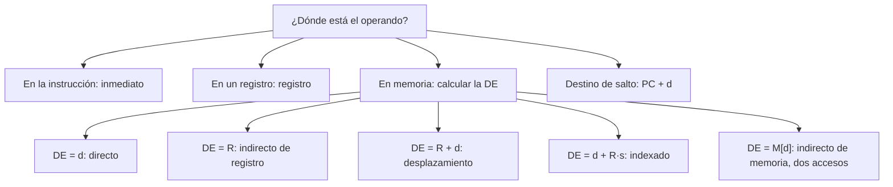

# Organización y Arquitectura de Computadoras - Diseño del conjunto de instrucciones

## 5.4 Modos de direccionamiento

---

Un **modo de direccionamiento** es la regla con que una instrucción especifica dónde está su operando: dentro de la propia instrucción, en un registro o en una posición de memoria cuya dirección se calcula de cierta forma. La dirección calculada se llama **dirección efectiva** (DE). Más modos dan instrucciones más expresivas y menos instrucciones por programa, pero complican la decodificación y la segmentación. Este tema define los modos clásicos con sus fórmulas, muestra qué estructuras de los lenguajes de alto nivel corresponde a cada uno, analiza cuáles se usan realmente y cómo se resuelven en una ISA load-store como MIPS.

### Los modos clásicos

Notación: $M[x]$ es el contenido de la memoria en la dirección $x,$ $R[r]$ el del registro $r,$ $d$ un desplazamiento o constante contenida en la instrucción.

| Modo | Ejemplo | Operando o DE | Uso típico |
| --- | --- | --- | --- |
| inmediato | `ADD R3, #25` | operando $= d$ | constantes |
| registro | `ADD R3, R1` | operando $= R[r]$ | variables en registros |
| directo o absoluto | `ADD R3, (100)` | $\text{DE} = d$ | variables globales |
| indirecto de memoria | `ADD R3, @(100)` | $\text{DE} = M[d]$ | `*p` con `p` en memoria |
| indirecto de registro | `ADD R3, (R1)` | $\text{DE} = R[r]$ | `*p` con `p` en un registro |
| desplazamiento (base + desplazamiento) | `ADD R3, 12(R1)` | $\text{DE} = R[r] + d$ | variables locales, campos de estructuras |
| indexado escalado | `ADD R3, 200(R2*8)` | $\text{DE} = d + R[i] \cdot s$ | arreglos `a[i]` |
| relativo al PC | `BEQ ..., +20` | $\text{destino} = PC + d$ | saltos |
| autoincremento | `ADD R3, (R2)+` | $\text{DE} = R[r]$ y luego $R[r] \leftarrow R[r] + s$ | recorrer arreglos, pilas |

El modo inmediato y el de registro no acceden a la memoria; el indirecto de memoria hace **dos** accesos, uno para leer la dirección y otro para el dato.

**Relativo al PC.** Hace el código **reubicable**: el programa funciona cargado en cualquier dirección, porque los saltos indican distancias y no posiciones. Los saltos suelen ser cercanos, así que bastan pocos bits. En MIPS el desplazamiento se cuenta en **palabras** y desde la instrucción **siguiente**: $\text{destino} = (PC + 4) + 4d.$ Con un campo de 16 bits se alcanzan $\pm 2^{15}$ instrucciones, unos $\pm 128$ KiB.

### ¿Qué modos se usan?

Las mediciones en programas reales para máquinas con muchos modos, como el VAX, dan resultados muy claros: el desplazamiento y el inmediato suman en promedio tres cuartas partes de los accesos, el indirecto de registro es frecuente, y los modos sofisticados (indirecto de memoria, autoincremento) son raros. Además, la mayoría de los desplazamientos caben en 12 a 16 bits y la mayoría de las constantes inmediatas en 8 a 16. Esta evidencia guio el diseño de las ISA RISC: MIPS tiene solo los modos **registro**, **inmediato** (16 bits), **base + desplazamiento** (16 bits) para cargas y almacenamientos, **relativo al PC** para saltos condicionales y **pseudodirecto** (26 bits) para `j` y `jal`. El indirecto de registro es el caso $d = 0$ del desplazamiento, y el directo, el caso con el registro `$zero` como base.

Los demás modos se sintetizan con varias instrucciones: `a[i]` se calcula con un desplazamiento a la izquierda y una suma; un acceso indirecto de memoria, con dos cargas. El costo en instrucciones se compensa con un hardware más sencillo, porque todas las cargas calculan su dirección igual, con una suma en la etapa EX.



### Implementación en Python

El programa calcula la dirección efectiva, el operando y el número de accesos a memoria de cada modo con una memoria y unos registros de ejemplo, resuelve el ejercicio 2 con las dos convenciones, muestra el alcance de los campos según su número de bits y resume las frecuencias de uso medidas en el VAX con tres programas (Hennessy y Patterson).

```python
# Cálculo de la dirección efectiva (DE) y del operando en cada modo de direccionamiento.
# Memoria de ejemplo: M[dirección] = valor; registros R1 = 200, R2 = 3; PC = 400.
M = {100: 300, 200: 7, 212: 11, 224: 13, 300: 42, 404: 0, 420: 99, 424: 55}
R = {"R1": 200, "R2": 3}
PC = 400

modos = [
    ("inmediato", "ADD R3, #25", None, lambda: 25),
    ("registro", "ADD R3, R1", None, lambda: R["R1"]),
    ("directo (absoluto)", "ADD R3, (100)", 100, None),
    ("indirecto de memoria", "ADD R3, @(100)", M[100], None),
    ("indirecto de registro", "ADD R3, (R1)", R["R1"], None),
    ("desplazamiento (base + d)", "ADD R3, 12(R1)", R["R1"] + 12, None),
    ("indexado escalado", "ADD R3, 200(R2*8)", 200 + R["R2"] * 8, None),
    ("relativo al PC", "BEQ ..., +20", PC + 20, None),
]
print(f"{'modo':28s} {'ejemplo':20s} {'DE':>5s} {'operando':>9s} {'accesos':>8s}")
for nombre, ejemplo, de, valor in modos:
    if de is None:
        op, acc = valor(), 0
        de_txt = "-"
    else:
        de_txt = str(de)
        op = de if nombre == "relativo al PC" else M[de]
        acc = 0 if nombre == "relativo al PC" else (2 if "indirecto de memoria" in nombre else 1)
    print(f"{nombre:28s} {ejemplo:20s} {de_txt:>5s} {op:>9} {acc:>8}")

# Ejercicio 2: salto relativo con PC = 400 y desplazamiento +20
print("ejercicio 2: relativo al PC actual:", PC + 20, "| convención MIPS, (PC + 4) + 4 x 20:", PC + 4 + 4 * 20)

# Rango de cada modo según el número de bits del campo
for bits in (8, 16, 26):
    print(f"campo de {bits} bits: inmediato con signo de {-2 ** (bits - 1)} a {2 ** (bits - 1) - 1};"
          f" desplazamiento de salto en palabras: ±{2 ** (bits - 1) * 4} bytes")

# Frecuencia de uso de los modos en programas del VAX (Hennessy y Patterson, apéndice A), en porcentaje
frecuencias = {"desplazamiento": (32, 55, 40), "inmediato": (43, 17, 39), "indirecto de registro": (24, 3, 11),
               "escalado": (0, 16, 6), "indirecto de memoria": (1, 6, 1)}
print("uso (%) en TeX, spice y gcc:")
for modo, f in frecuencias.items():
    print(f"   {modo:22s} {f}")
print("   desplazamiento + inmediato en promedio:",
      round(sum(sum(f) for m, f in frecuencias.items() if m in ("desplazamiento", "inmediato")) / 3), "%")
```

Salida:

```text
modo                         ejemplo                 DE  operando  accesos
inmediato                    ADD R3, #25              -        25        0
registro                     ADD R3, R1               -       200        0
directo (absoluto)           ADD R3, (100)          100       300        1
indirecto de memoria         ADD R3, @(100)         300        42        2
indirecto de registro        ADD R3, (R1)           200         7        1
desplazamiento (base + d)    ADD R3, 12(R1)         212        11        1
indexado escalado            ADD R3, 200(R2*8)      224        13        1
relativo al PC               BEQ ..., +20           420       420        0
ejercicio 2: relativo al PC actual: 420 | convención MIPS, (PC + 4) + 4 x 20: 484
campo de 8 bits: inmediato con signo de -128 a 127; desplazamiento de salto en palabras: ±512 bytes
campo de 16 bits: inmediato con signo de -32768 a 32767; desplazamiento de salto en palabras: ±131072 bytes
campo de 26 bits: inmediato con signo de -33554432 a 33554431; desplazamiento de salto en palabras: ±134217728 bytes
uso (%) en TeX, spice y gcc:
   desplazamiento         (32, 55, 40)
   inmediato              (43, 17, 39)
   indirecto de registro  (24, 3, 11)
   escalado               (0, 16, 6)
   indirecto de memoria   (1, 6, 1)
   desplazamiento + inmediato en promedio: 75 %
```

En la fila del modo relativo al PC, el "operando" es la dirección de destino del salto.

### Ejercicios Propuestos

1. **Directo e indirecto.** Explica la diferencia entre el direccionamiento directo y el indirecto con un ejemplo de cada uno.

2. **Salto relativo.** Si $PC = 400$ y una instrucción de salto relativo tiene desplazamiento $+20,$ ¿cuál es la dirección de destino?

3. **Arreglos.** Escribe en MIPS el acceso a $A[5]$ con el modo base + desplazamiento, y el acceso a $A[i]$ con $i$ en un registro.

4. **Complejidad.** Relaciona los modos de direccionamiento con la complejidad del hardware y de la segmentación.

5. **Tres modos.** Resuelve el mismo problema, sumar 10 a una variable $x,$ con el modo inmediato, con el modo registro y con un acceso indirecto.

### Soluciones

**Ejercicio 1.** En el directo, la instrucción contiene la dirección del dato: `LOAD R1, (100)` lee $M[100].$ En el indirecto contiene la dirección de un puntero: `LOAD R1, @(100)` lee $M[M[100]];$ con los datos del programa, $M[100] = 300$ y el operando es $M[300] = 42.$ El indirecto permite que la misma instrucción acceda a datos distintos cambiando el puntero, a costa de un acceso adicional.

**Ejercicio 2.** Si el desplazamiento se suma al PC actual y se mide en bytes, $400 + 20 = 420.$ Con la convención de MIPS, $(400 + 4) + 4 \cdot 20 = 484.$

**Ejercicio 3.** Con la base de $A$ en `$s0` y palabras de 4 bytes, $A[5]$ está en el desplazamiento $4 \cdot 5 = 20:$ `lw $a0, 20($s0)`. Para $A[i]$ hay que calcular la dirección: `sll` para multiplicar $i$ por 4, `add` con la base y `lw` con desplazamiento 0. El programa también resuelve el ejercicio 5:

```asm
# Modos de direccionamiento en MIPS
        .data
A:      .word 10, 20, 30, 40, 50, 60, 70, 80
x:      .word 5
px:     .word x                  # puntero a x
nl:     .asciiz "\n"
        .text
main:   la   $s0, A              # base del arreglo
        lw   $a0, 20($s0)        # base + desplazamiento: A[5] en A + 4*5
        jal  imprime
        li   $t0, 3              # indice en un registro
        sll  $t1, $t0, 2         # 4*i
        add  $t1, $s0, $t1
        lw   $a0, 0($t1)         # A[i] con direccion calculada: A[3]
        jal  imprime
        # x = x + 10 de tres formas
        lw   $t2, x              # directo (pseudoinstruccion: lui + lw)
        addi $a0, $t2, 10        # inmediato: 10 va dentro de la instruccion
        jal  imprime
        li   $t3, 10
        add  $a0, $t2, $t3       # registro: 10 en un registro
        jal  imprime
        lw   $t4, px             # indirecto: primero el puntero...
        lw   $t5, 0($t4)         # ...luego el dato al que apunta
        addi $a0, $t5, 10
        jal  imprime
        li   $v0, 10
        syscall
imprime: li  $v0, 1
        syscall
        la   $a0, nl
        li   $v0, 4
        syscall
        jr   $ra
```

Salida en SPIM, con $A = 10, 20, \ldots, 80$ y $x = 5:$

```text
60
40
15
15
15
```

**Ejercicio 4.** Cada modo adicional requiere más casos en el decodificador y, si calcula la dirección de forma distinta o accede varias veces a la memoria, más etapas o ciclos variables. Los modos con efectos secundarios (autoincremento) modifican registros además del destino, lo que complica la gestión de las excepciones y de las dependencias en la segmentación. Por eso RISC se limita a un modo de memoria con una sola suma.

**Ejercicio 5.** Inmediato: `addi $a0, $t2, 10`, la constante viaja dentro de la instrucción. Registro: la constante se carga antes en un registro y se usa `add`. Indirecto: la variable se lee a través de un puntero, `lw $t4, px` seguido de `lw $t5, 0($t4)`. Las tres dan 15; la inmediata es la más eficiente, y la indirecta la más flexible.

### Referencias

1. Hennessy, J. L., and Patterson, D. A., _Computer Architecture: A Quantitative Approach_. Morgan Kaufmann, 2019. Apéndice A, sección A.3.
2. Patterson, D. A., and Hennessy, J. L., _Computer Organization and Design: The Hardware/Software Interface_. Morgan Kaufmann, 2020. Sección 2.10.
3. Stallings, W., _Organización y arquitectura de computadores_. Pearson, 2006. Capítulo 11.
4. Murdocca, M. J., and Heuring, V. P., _Principios de arquitectura de computadoras_. Prentice Hall, 2002. Capítulo 4.
