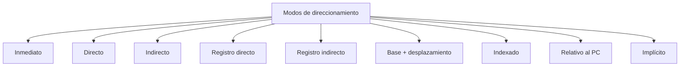

# Organización y Arquitectura de Computadoras - Diseño del conjunto de instrucciones

## 5.4 Modos de direccionamiento

---

### 1. Definición

Un **modo de direccionamiento** es la forma en que una instrucción especifica **dónde se encuentra el operando** (ya sea en un registro, en memoria o directamente en la instrucción).

-> Los modos de direccionamiento son esenciales porque determinan:

- **Flexibilidad del conjunto de instrucciones.**
- **Complejidad del hardware.**
- **Eficiencia en el acceso a datos.**

### 2. Clasificación de los modos de direccionamiento

#### 2.1 Inmediato

El operando está en la propia instrucción.

- Ejemplo en MIPS:

```asm
ADDI R1, R0, 5   ; R1 = 0 + 5
```

- Ventaja: rápido.
- Desventaja: limitado por el tamaño del campo inmediato.

#### 2.2 Directo o absoluto

La instrucción contiene la **dirección de memoria** del operando.

```asm
LOAD R1, 1000   ; R1 = M[1000]
```

#### 2.3 Indirecto

La instrucción contiene la dirección de memoria donde está guardada **otra dirección**.

```asm
LOAD R1, (1000) ; R1 = M[M[1000]]
```

#### 2.4 Registro directo

El operando está en un **registro**.

```asm
ADD R1, R2, R3  ; R1 = R2 + R3
```

#### 2.5 Registro indirecto

El registro contiene la dirección del operando en memoria.

```asm
LOAD R1, (R2)   ; R1 = M[R2]
```

#### 2.6 Desplazamiento (Base + offset)

La dirección efectiva se calcula como:

$$
EA = R_b + \text{desplazamiento}
$$

Ejemplo en MIPS:

```asm
LW R1, 4(R2)   ; R1 = M[R2 + 4]
```

#### 2.7 Indexado

Similar al anterior, pero usando un **registro índice**.

$$
EA = R_i + D
$$

#### 2.8 Relativo al PC

La dirección efectiva se obtiene sumando un desplazamiento al **contador de programa (PC)**.

```asm
BEQ R1, R2, etiqueta   ; Salto a PC + offset si R1 = R2
```

#### 2.9 Implícito

El operando está implícito en la instrucción.
Ejemplo:

```asm
CLR      ; Limpia el acumulador (ACC = 0)
```

### 3. Fórmulas

- **Dirección efectiva (EA):**

$$
EA = f(\text{registro}, \text{constante}, \text{PC})
$$

Ejemplos:

- Registro indirecto: $EA = [R]$
- Base + offset: $EA = R_b + \text{offset}$
- Relativo al PC: $EA = PC + \text{offset}$

### 4. Ejemplo comparativo en MIPS

**Acceso a A[i] con base en R2 (dirección base) y R3 (índice i):**

```asm
SLL  R4, R3, 2     ; R4 = i * 4 (palabras de 4 bytes)
ADD  R4, R4, R2    ; Dirección efectiva = base + offset
LW   R1, 0(R4)     ; R1 = A[i]
```

### 5. Diagrama (Mermaid)



### 6. Ejemplo Resuelto

**Problema:** En un procesador de 32 bits, con instrucción `LW R1, 8(R2)` y $R2 = 1000$, ¿cuál es la dirección efectiva (EA)?

**Solución:**

$$ EA = R2 + offset = 1000 + 8 = 1008 $$

-> El operando cargado es $M[1008]$.

### 7. Ejercicios Propuestos

1. Explica qué diferencia hay entre los modos de direccionamiento **directo** e **indirecto** con ejemplos.
2. Si $PC = 400$ y se ejecuta una instrucción de salto relativo con desplazamiento $+20$, ¿cuál será la nueva dirección?
3. Escribe un fragmento en MIPS que acceda a la celda de memoria $A[5]$ usando el modo **base + desplazamiento**.
4. Representa gráficamente la relación entre modos de direccionamiento y complejidad del hardware.
5. Diseña un ejemplo donde el mismo problema pueda resolverse con:

   - Modo inmediato.
   - Modo registro.
   - Modo indirecto.

### 8. Referencias

#### Bibliografía básica

1. Hennessy, J. L. y Patterson, D. A. _Computer Architecture: A Quantitative Approach_, 4a Ed., Morgan Kaufmann, 2006.
2. Kohavi, Z. y Jha, N. K. _Switching and Finite Automata Theory_, 3a Ed., Cambridge University Press, 2009.
3. Mano, M. Morris y Kime, C. _Logic and Computer Design Fundamentals_, 4a Ed., Prentice Hall, 2007.
4. Patterson, D. A. y Hennessy, J. L. _Computer Organization and Design: The Hardware/Software Interface_, 4a Ed., Morgan Kaufmann, 2008.

#### Bibliografía complementaria

1. Stallings, W. _Computer Organization and Architecture: Designing for Performance_, Prentice Hall, 2009.
2. Tanenbaum, A. S. _Structured Computer Organization_, 5a Ed., Prentice Hall, 2005.
3. Silberschatz, A., Galvin, P. B. y Gagne, G. _Operating System Concepts_, 8a Ed., Wiley, 2008.
