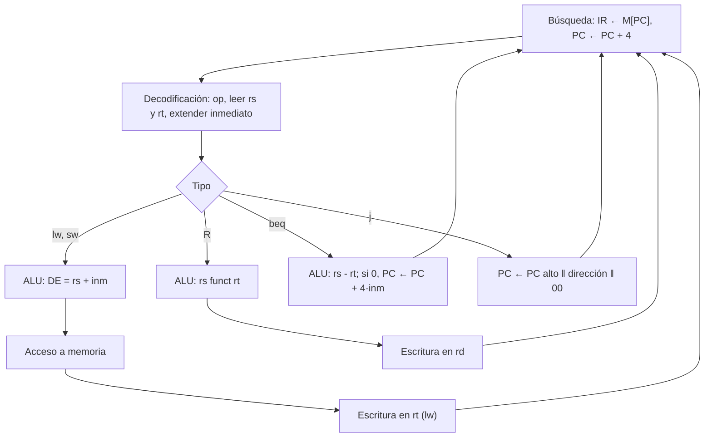

# Organización y Arquitectura de Computadoras - Diseño del conjunto de instrucciones

## 5.5 Formatos de instrucción y su proceso de ejecución

---

Una instrucción en memoria es una cadena de bits dividida en **campos**: el código de operación, los registros, las constantes, los desplazamientos. El **formato de instrucción** fija el tamaño y la posición de esos campos. Un buen formato equilibra varias exigencias: que el código sea compacto, que quepan constantes y desplazamientos razonables, y que el hardware pueda decodificarlo rápido. Este tema compara los formatos de longitud fija y variable, estudia en detalle los tres formatos de MIPS (con su codificación bit a bit), y describe el **ciclo de instrucción** con el que el procesador busca, decodifica y ejecuta cada instrucción.

### Longitud fija y longitud variable

| | Longitud fija (MIPS, ARM, RISC-V) | Longitud variable (x86, VAX) |
| --- | --- | --- |
| tamaño | todas de 32 bits | de 1 a 15 bytes en x86 |
| decodificación | sencilla, en paralelo con la lectura de registros | secuencial: la longitud se conoce al decodificar |
| densidad de código | menor | mayor |
| segmentación | natural: la siguiente instrucción está en $PC + 4$ | difícil; los x86 traducen a microoperaciones |
| constantes grandes | requieren dos instrucciones (`lui` + `ori`) | caben en la instrucción |

Las ISA RISC con extensiones comprimidas (Thumb, RISC-V C) usan un término medio: instrucciones de 16 y 32 bits, identificables por sus bits iniciales.

### Los formatos de MIPS

Todas las instrucciones tienen 32 bits y el código de operación (_opcode_) ocupa siempre los 6 bits más altos. Los campos de registro, de 5 bits (32 registros), están en las mismas posiciones en todos los formatos que los usan, para leer los registros antes de saber qué instrucción es.

**Tipo R** (registro), para las operaciones aritméticas y lógicas entre registros:

| op | rs | rt | rd | shamt | funct |
| --- | --- | --- | --- | --- | --- |
| 6 bits | 5 | 5 | 5 | 5 | 6 |

`op` vale 0, `rs` y `rt` son los operandos fuente, `rd` el destino, `shamt` la cantidad de desplazamiento (en `sll`, `srl`) y `funct` selecciona la operación concreta.

**Tipo I** (inmediato), para operaciones con constantes, cargas, almacenamientos y saltos condicionales:

| op | rs | rt | inmediato |
| --- | --- | --- | --- |
| 6 bits | 5 | 5 | 16 |

En `addi` y `lw`, `rt` es el destino; en `sw` y `beq`, una fuente. El inmediato se extiende con signo a 32 bits. En los saltos condicionales es la distancia en palabras desde $PC + 4.$

**Tipo J** (salto):

| op | dirección |
| --- | --- |
| 6 bits | 26 |

La dirección de destino es $(PC + 4)_{31..28} \,\|\, \text{dirección} \,\|\, 00:$ los 4 bits altos del PC, los 26 bits del campo y dos ceros, porque las instrucciones están alineadas a 4 bytes. Así se alcanza cualquier instrucción dentro de un bloque de 256 MiB.

**Ejemplo: `add $5, $6, $7`.** Tipo R con `op = 0`, `rs = 6`, `rt = 7`, `rd = 5`, `shamt = 0` y `funct = 32` (100000):

$$ \underbrace{000000}_{op}\ \underbrace{00110}_{rs}\ \underbrace{00111}_{rt}\ \underbrace{00101}_{rd}\ \underbrace{00000}_{shamt}\ \underbrace{100000}_{funct} = \text{0x00C72820} $$

### El ciclo de instrucción

El procesador repite indefinidamente:

1. **Búsqueda** (_fetch_): leer la instrucción en la dirección del PC y guardarla en el registro de instrucción (IR); $PC \leftarrow PC + 4.$
2. **Decodificación**: interpretar el código de operación y leer los registros `rs` y `rt`; extender el signo del inmediato.
3. **Ejecución**: la ALU suma, resta o compara; en las cargas y almacenamientos calcula la dirección efectiva; en los saltos, compara y calcula el destino $PC + 4 + 4 \cdot \text{inm}.$
4. **Acceso a memoria**: solo cargas y almacenamientos.
5. **Escritura**: guardar el resultado en el registro destino.

Si hay una **interrupción** pendiente, al final del ciclo se guarda el PC y se salta a la rutina de atención (tema 8.2). En un procesador monociclo las cinco fases se hacen en un ciclo largo; en uno multiciclo, en varios ciclos cortos (tema 6.1); en uno segmentado, las cinco fases de instrucciones distintas se solapan (tema 7.2).

**Ejemplo: `beq $1, $2, etiqueta`.** Búsqueda: IR $\leftarrow M[PC],$ $PC \leftarrow PC + 4.$ Decodificación: se leen `$1` y `$2` y se extiende el desplazamiento. Ejecución: la ALU resta los dos registros; si el resultado es cero, $PC \leftarrow PC + 4 \cdot \text{desplazamiento}$ (sobre el PC ya incrementado). No hay acceso a memoria ni escritura en registros.



### Implementación en Python

El programa codifica una instrucción de cada formato, muestra sus campos y su valor como entero con signo, y simula el ciclo de instrucción de un MIPS reducido que suma los números del 1 al 5 con un bucle controlado por `bne`.

```python
OPCODE = {"lw": 0x23, "sw": 0x2B, "beq": 0x04, "bne": 0x05, "addi": 0x08, "j": 0x02}
FUNCT = {"add": 0x20, "sub": 0x22, "and": 0x24, "or": 0x25, "slt": 0x2A}


def tipo_r(f, rd, rs, rt, shamt=0):
    return (0 << 26) | (rs << 21) | (rt << 16) | (rd << 11) | (shamt << 6) | FUNCT[f]


def tipo_i(op, rt, rs, inm):
    return (OPCODE[op] << 26) | (rs << 21) | (rt << 16) | (inm & 0xFFFF)


def tipo_j(op, direccion):
    return (OPCODE[op] << 26) | ((direccion >> 2) & 0x3FFFFFF)


def con_signo(w):
    return w - (1 << 32) if w >> 31 else w


def campos(w):
    op = w >> 26
    if op == 0:
        return f"R: op={op:06b} rs={(w >> 21) & 31:05b} rt={(w >> 16) & 31:05b} rd={(w >> 11) & 31:05b} " \
               f"shamt={(w >> 6) & 31:05b} funct={w & 63:06b}"
    if op in (2, 3):
        return f"J: op={op:06b} destino={w & 0x3FFFFFF:026b}"
    return f"I: op={op:06b} rs={(w >> 21) & 31:05b} rt={(w >> 16) & 31:05b} inm={w & 0xFFFF:016b}"


codigos = [("add $5, $6, $7", tipo_r("add", 5, 6, 7)),
           ("lw $8, 12($9)", tipo_i("lw", 8, 9, 12)),
           ("beq $3, $4, codigo", tipo_i("beq", 4, 3, -3)),      # destino = (PC + 4) + 4 * (-3)
           ("j main", tipo_j("j", 0x00400024))]                  # main está en 0x00400024 en SPIM
for texto, w in codigos:
    print(f"{texto:20s} 0x{w:08X} = {con_signo(w):11d}  {campos(w)}")


# Simulación del ciclo de instrucción: suma de 1 a 5 en un MIPS reducido
def ensamblar():
    return [tipo_i("addi", 8, 0, 0),        # 0: $t0 = 0      (suma)
            tipo_i("addi", 9, 0, 1),        # 1: $t1 = 1      (i)
            tipo_i("addi", 10, 0, 6),       # 2: $t2 = 6      (límite)
            tipo_r("add", 8, 8, 9),         # 3: bucle: suma += i
            tipo_i("addi", 9, 9, 1),        # 4: i += 1
            tipo_i("bne", 10, 9, -3),       # 5: si i != 6, saltar a 3
            tipo_i("sw", 8, 0, 100)]        # 6: M[100] = suma


def ejecutar(prog, traza_saltos=True):
    R = [0] * 32
    M = {}
    PC, ciclos = 0, 0
    while PC // 4 < len(prog):
        IR = prog[PC // 4]                  # 1. búsqueda (fetch)
        PC += 4                             #    PC <- PC + 4
        op = IR >> 26                       # 2. decodificación y lectura de registros
        rs, rt = (IR >> 21) & 31, (IR >> 16) & 31
        inm = (IR & 0xFFFF) - (0x10000 if IR & 0x8000 else 0)
        ciclos += 1
        if op == 0:                         # 3. ejecución; 4. memoria; 5. escritura
            rd = (IR >> 11) & 31
            R[rd] = R[rs] + R[rt]
        elif op == OPCODE["addi"]:
            R[rt] = R[rs] + inm
        elif op == OPCODE["sw"]:
            M[R[rs] + inm] = R[rt]
        elif op in (OPCODE["beq"], OPCODE["bne"]):
            cond = (R[rs] == R[rt]) == (op == OPCODE["beq"])
            destino = PC + 4 * inm
            if traza_saltos and R[9] in (2, 6):
                print(f"   bne en {PC - 4}: R[rs]={R[rs]} R[rt]={R[rt]} -> "
                      f"{'salta a ' + str(destino) if cond else 'no salta, sigue en ' + str(PC)}")
            if cond:
                PC = destino
    return M, ciclos


print("simulación (se muestran el primer y el último salto):")
M, n = ejecutar(ensamblar())
print("M[100] =", M[100], "| instrucciones ejecutadas:", n)
```

Salida:

```text
add $5, $6, $7       0x00C72820 =    13051936  R: op=000000 rs=00110 rt=00111 rd=00101 shamt=00000 funct=100000
lw $8, 12($9)        0x8D28000C = -1926758388  I: op=100011 rs=01001 rt=01000 inm=0000000000001100
beq $3, $4, codigo   0x1064FFFD =   275054589  I: op=000100 rs=00011 rt=00100 inm=1111111111111101
j main               0x08100009 =   135266313  J: op=000010 destino=00000100000000000000001001
simulación (se muestran el primer y el último salto):
   bne en 20: R[rs]=2 R[rt]=6 -> salta a 12
   bne en 20: R[rs]=6 R[rt]=6 -> no salta, sigue en 24
M[100] = 15 | instrucciones ejecutadas: 19
```

Para comprobar las codificaciones, el siguiente programa de MIPS lee sus propias instrucciones como datos y las imprime como enteros; se ejecuta en SPIM con la opción `-delayed_branches`, que calcula los saltos desde $PC + 4$ como el MIPS real:

```asm
# El programa lee sus propias instrucciones como datos e imprime sus codigos
# (se ejecuta con spim -delayed_branches, como el MIPS real)
        .data
nl:     .asciiz "\n"
        .text
main:   la   $s0, codigo
        li   $s1, 4              # numero de instrucciones a mostrar
mostrar: lw  $a0, 0($s0)
        li   $v0, 1              # imprime la palabra como entero
        syscall
        la   $a0, nl
        li   $v0, 4
        syscall
        addi $s0, $s0, 4
        addi $s1, $s1, -1
        bnez $s1, mostrar
        nop                      # ranura de retardo del salto
        li   $v0, 10
        syscall
codigo: add  $5, $6, $7          # tipo R
        lw   $8, 12($9)          # tipo I
        beq  $3, $4, codigo      # tipo I, relativo al PC (salto hacia atras)
        j    main                # tipo J
```

```text
13051936
-1926758388
275054589
135266313
```

Los cuatro valores coinciden con los calculados en Python.

### Ejercicios Propuestos

1. **Tipo R.** Dibuja los campos de una instrucción de tipo R y explica la función de cada uno.

2. **Codificación.** Codifica `add $5, $6, $7` en binario y hexadecimal.

3. **Fija o variable.** Explica las ventajas y desventajas de los formatos de longitud fija y variable.

4. **Ciclo de un salto.** Describe el ciclo de ejecución de `beq $1, $2, etiqueta`.

5. **Los tres formatos.** Escribe un fragmento en MIPS que use instrucciones de los tres formatos y codifícalas.

### Soluciones

**Ejercicio 1.** `op` (6 bits, 0 en tipo R), `rs` y `rt` (5 bits cada uno, los registros fuente), `rd` (5 bits, el destino), `shamt` (5 bits, desplazamientos) y `funct` (6 bits, la operación).

**Ejercicio 2.** `000000 00110 00111 00101 00000 100000` $= \text{0x00C72820},$ que como entero con signo es $13\,051\,936,$ el valor que imprime SPIM.

**Ejercicio 3.** Ver la tabla del tema: la longitud fija simplifica la búsqueda, la decodificación y la segmentación; la variable da código más compacto y constantes más grandes en una instrucción.

**Ejercicio 4.** Es el ejemplo del tema. La simulación muestra los dos casos: si los registros difieren (`bne` salta) el PC pasa a $20 + 4 - 12 = 12;$ si no, sigue en 24.

**Ejercicio 5.** El programa de SPIM usa `add` (R), `lw` y `beq` (I) y `j` (J); sus codificaciones son `0x00C72820`, `0x8D28000C`, `0x1064FFFD` y `0x08100009`. En `beq` el desplazamiento es $-3:$ el destino está tres instrucciones antes de $PC + 4.$ En `j`, el campo $\text{0x100009}$ multiplicado por 4 da la dirección de `main`, $\text{0x00400024}.$

### Referencias

1. Patterson, D. A., and Hennessy, J. L., _Computer Organization and Design: The Hardware/Software Interface_. Morgan Kaufmann, 2020. Secciones 2.5 y 2.10.
2. Hennessy, J. L., and Patterson, D. A., _Computer Architecture: A Quantitative Approach_. Morgan Kaufmann, 2019. Apéndice A.
3. Stallings, W., _Organización y arquitectura de computadores_. Pearson, 2006. Capítulos 12 y 13.
4. Larus, J. R., _SPIM: A MIPS32 Simulator_. Universidad de Wisconsin, 2010.
