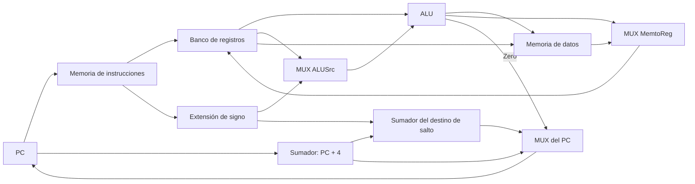

# Organización y Arquitectura de Computadoras - Unidad de control

## 6.1 El diagrama de flujo de datos (datapath).

---

Un procesador se divide en dos partes: la **ruta de datos** (_datapath_), formada por los elementos que guardan, transportan y transforman los datos (registros, ALU, memorias, multiplexores), y la **unidad de control**, que en cada momento le dice a la ruta de datos qué hacer mediante **señales de control** (tema 6.2). Este tema construye paso a paso la ruta de datos de un MIPS reducido que ejecuta `lw`, `sw`, `add`, `sub`, `and`, `or`, `slt`, `beq` y `j`, sigue el recorrido de cada clase de instrucción, calcula el tiempo de ciclo de la implementación **monociclo** y explica por qué es ineficiente, lo que motiva las implementaciones multiciclo y segmentada.

### Elementos de la ruta de datos

Hay dos tipos de elementos: **combinacionales**, cuya salida depende solo de las entradas (ALU, sumadores, multiplexores, extensor de signo), y de **estado**, que guardan información y se actualizan en el flanco de reloj (PC, banco de registros, memorias).

| Elemento | Función | Entradas y salidas |
| --- | --- | --- |
| contador de programa (PC) | dirección de la instrucción actual | registro de 32 bits |
| memoria de instrucciones | entrega la instrucción en la dirección del PC | dirección → instrucción |
| sumador del PC | calcula $PC + 4$ | |
| banco de registros | 32 registros; dos lecturas y una escritura por ciclo | `rs`, `rt` → dos datos; `rd` o `rt`, dato y `RegWrite` → escritura |
| extensor de signo | lleva el inmediato de 16 a 32 bits | |
| ALU | operaciones aritméticas y lógicas; salida `Zero` | dos operandos y la operación → resultado |
| memoria de datos | lectura (`lw`) y escritura (`sw`) | dirección, dato, `MemRead`, `MemWrite` |
| sumador del destino de salto | $PC + 4 + (\text{inm} \ll 2)$ | |
| multiplexores | eligen entre fuentes: registro destino, segundo operando de la ALU, dato a escribir, siguiente PC | |

En la implementación monociclo hay **dos memorias** (instrucciones y datos) porque cada elemento solo puede usarse una vez por ciclo, y una instrucción `lw` necesita leer la instrucción y el dato en el mismo ciclo. Por la misma razón hay sumadores separados para el PC y para el destino del salto, además de la ALU.

### El recorrido de cada instrucción

Todas las instrucciones empiezan igual: el PC direcciona la memoria de instrucciones y el sumador calcula $PC + 4.$ Después:

- **Tipo R** (`add $rd, $rs, $rt`): se leen `rs` y `rt`, la ALU opera, y el resultado se escribe en `rd`.
- **`lw $rt, d($rs)`**: se lee `rs`, la ALU suma `rs` y el inmediato extendido, la memoria de datos lee esa dirección y el dato se escribe en `rt`. Es la instrucción que usa **más** elementos en serie.
- **`sw $rt, d($rs)`**: igual que `lw` hasta la ALU; después se escribe `rt` en la memoria. No escribe registros.
- **`beq $rs, $rt, d`**: la ALU resta los dos registros; si `Zero = 1`, el siguiente PC es $PC + 4 + 4d.$
- **`j dirección`**: el siguiente PC se forma con los 4 bits altos de $PC + 4$ y los 26 bits del campo desplazados dos lugares.

Los **multiplexores** permiten compartir los elementos entre instrucciones: el destino puede ser `rt` (`lw`, `addi`) o `rd` (tipo R); el segundo operando de la ALU, un registro o el inmediato; el dato que se escribe, la salida de la ALU o la de la memoria.



### El tiempo de ciclo monociclo

En la implementación monociclo cada instrucción se completa en **un** ciclo de reloj, así que $\text{CPI} = 1,$ pero el ciclo debe ser tan largo como el camino más lento. Con retardos típicos de 200 ps para las memorias, 100 ps para la ALU y 50 ps para leer o escribir el banco de registros:

| Clase | Componentes en serie | Tiempo |
| --- | --- | --- |
| tipo R | memoria de instrucciones, registros, ALU, escritura | 400 ps |
| `lw` | memoria de instrucciones, registros, ALU, memoria de datos, escritura | 600 ps |
| `sw` | memoria de instrucciones, registros, ALU, memoria de datos | 550 ps |
| `beq` | memoria de instrucciones, registros, ALU | 350 ps |
| `j` | memoria de instrucciones | 200 ps |

El ciclo es de 600 ps, impuesto por `lw`, aunque la mayoría de las instrucciones terminarían antes. Con una mezcla típica, un reloj ideal que durara lo justo para cada instrucción daría unos 448 ps en promedio: el monociclo desperdicia un 25 % del tiempo. Y el problema empeora con instrucciones más largas, como las de punto flotante. Hay dos soluciones:

- **Multiciclo** (tema 6.3): dividir la ejecución en pasos de un ciclo corto cada uno (unos 200 ps, el de una memoria), con un número de ciclos distinto por instrucción. Además permite reutilizar elementos: una sola memoria y una sola ALU.
- **Segmentación** (tema 7): solapar los pasos de instrucciones distintas, de modo que, idealmente, termine una instrucción por ciclo corto.

### Implementación en Python

El programa calcula el tiempo de cada clase de instrucción en la ruta de datos monociclo, el tiempo de ciclo, la pérdida frente a un reloj ideal de longitud variable, el ejercicio 4, y simula funcionalmente la ruta de datos ejecutando cargas, operaciones, un salto y almacenamientos (ejercicio 3).

```python
# Ruta de datos monociclo de MIPS: cada instrucción recorre los componentes que necesita.
RETARDO = {"mem_instr": 200, "reg_lect": 50, "alu": 100, "mem_datos": 200, "reg_escr": 50}   # picosegundos

CAMINOS = {   # componentes en el camino crítico de cada clase de instrucción
    "tipo R": ["mem_instr", "reg_lect", "alu", "reg_escr"],
    "lw": ["mem_instr", "reg_lect", "alu", "mem_datos", "reg_escr"],
    "sw": ["mem_instr", "reg_lect", "alu", "mem_datos"],
    "beq": ["mem_instr", "reg_lect", "alu"],
    "j": ["mem_instr"],
}
tiempos = {k: sum(RETARDO[c] for c in v) for k, v in CAMINOS.items()}
for k, t in tiempos.items():
    print(f"{k:7s}: {' + '.join(CAMINOS[k])} = {t} ps")
ciclo = max(tiempos.values())
print(f"ciclo del monociclo = {ciclo} ps (lo impone lw), frecuencia {1e12 / ciclo / 1e9:.2f} GHz")

mezcla = {"lw": 0.25, "sw": 0.10, "tipo R": 0.45, "beq": 0.15, "j": 0.05}
promedio = sum(mezcla[k] * tiempos[k] for k in mezcla)
print(f"con un reloj ideal de longitud variable: {promedio:.1f} ps por instrucción;"
      f" el monociclo es {ciclo / promedio:.2f} veces más lento que ese ideal")

# Ejercicio 4
I, tc = 1e6, 1e-9
for cpi in (1.0, 1.5):
    print(f"ejercicio 4: CPI {cpi}: T = {I * cpi * tc * 1e3:.2f} ms")


# Simulación funcional de la ruta de datos: lw, sw, add, sub, beq
class RutaDatos:
    def __init__(self, programa):
        self.PC, self.R, self.M, self.prog = 0, [0] * 32, {}, programa

    def paso(self):
        ins = self.prog[self.PC // 4]                         # memoria de instrucciones
        pc4 = self.PC + 4                                     # sumador del PC
        op, *a = ins
        if op in ("add", "sub"):
            rd, rs, rt = a
            A, B = self.R[rs], self.R[rt]                     # banco de registros: dos lecturas
            res = A + B if op == "add" else A - B             # ALU
            self.R[rd] = res                                  # escritura (MemtoReg = 0)
        elif op in ("lw", "sw"):
            rt, desp, rs = a
            dir_ = self.R[rs] + desp                          # ALU con el inmediato extendido (ALUSrc = 1)
            if op == "lw":
                self.R[rt] = self.M.get(dir_, 0)              # memoria de datos -> registro (MemtoReg = 1)
            else:
                self.M[dir_] = self.R[rt]
        elif op == "beq":
            rs, rt, desp = a
            if self.R[rs] - self.R[rt] == 0:                  # la ALU resta; la salida Zero decide
                pc4 = pc4 + 4 * desp                          # sumador del destino
        self.R[0] = 0
        self.PC = pc4                                         # multiplexor del PC


prog = [("lw", 8, 0, 16), ("lw", 9, 4, 16), ("add", 10, 8, 9), ("sub", 11, 8, 9),
        ("sw", 10, 8, 16), ("beq", 8, 9, 1), ("sw", 11, 12, 16)]
rd = RutaDatos(prog)
rd.R[16] = 1000
rd.M.update({1000: 30, 1004: 12})
while rd.PC // 4 < len(prog):
    rd.paso()
print("ejercicio 3: $t2 =", rd.R[10], "$t3 =", rd.R[11], "M[1008] =", rd.M[1008], "M[1012] =", rd.M[1012])
```

Salida:

```text
tipo R : mem_instr + reg_lect + alu + reg_escr = 400 ps
lw     : mem_instr + reg_lect + alu + mem_datos + reg_escr = 600 ps
sw     : mem_instr + reg_lect + alu + mem_datos = 550 ps
beq    : mem_instr + reg_lect + alu = 350 ps
j      : mem_instr = 200 ps
ciclo del monociclo = 600 ps (lo impone lw), frecuencia 1.67 GHz
con un reloj ideal de longitud variable: 447.5 ps por instrucción; el monociclo es 1.34 veces más lento que ese ideal
ejercicio 4: CPI 1.0: T = 1.00 ms
ejercicio 4: CPI 1.5: T = 1.50 ms
ejercicio 3: $t2 = 42 $t3 = 18 M[1008] = 42 M[1012] = 18
```

### Ejercicios Propuestos

1. **Ruta de `lw`.** Dibuja la parte de la ruta de datos que usa `lw $t0, 8($s0)` e indica por qué es la instrucción más lenta.

2. **`sub`.** ¿Qué elementos usa `sub $5, $6, $7` y qué deben elegir los multiplexores?

3. **Simulación.** Simula `lw` y `sw` en una ruta de datos sencilla.

4. **CPI.** ¿Cómo cambia el tiempo de un programa de $10^6$ instrucciones con un ciclo de 1 ns si el CPI pasa de 1 a 1.5?

5. **Memorias separadas.** ¿Por qué la ruta de datos monociclo necesita dos memorias y tres sumadores (contando la ALU)?

### Soluciones

**Ejercicio 1.** PC → memoria de instrucciones → lectura de `$s0` y extensión del 8 → ALU (suma) → memoria de datos → escritura en `$t0`. Es la más lenta porque es la única que encadena las dos memorias, los dos accesos al banco de registros y la ALU: 600 ps.

**Ejercicio 2.** Memoria de instrucciones, banco de registros (lee `$6` y `$7`, escribe `$5`), ALU restando. Multiplexores: destino `rd` (RegDst = 1), segundo operando un registro (ALUSrc = 0), dato a escribir de la ALU (MemtoReg = 0), siguiente PC $= PC + 4.$ La memoria de datos no se usa.

**Ejercicio 3.** Es la clase `RutaDatos` del programa: con $M[1000] = 30$ y $M[1004] = 12,$ las dos cargas, la suma y la resta dan 42 y 18, que se almacenan en 1008 y 1012.

**Ejercicio 4.** $T = 10^6 \times 1 \times 1 \text{ ns} = 1$ ms con CPI 1, y 1.5 ms con CPI 1.5: el tiempo crece en la misma proporción que el CPI.

**Ejercicio 5.** En un ciclo cada elemento solo puede hacer una operación: `lw` necesita leer la instrucción y el dato, y en el mismo ciclo hay que calcular $PC + 4,$ el destino del salto y la operación de la ALU. Un diseño multiciclo puede usar una sola memoria y una sola ALU en ciclos distintos.

### Referencias

1. Patterson, D. A., and Hennessy, J. L., _Computer Organization and Design: The Hardware/Software Interface_. Morgan Kaufmann, 2020. Secciones 4.1 a 4.4.
2. Harris, D. M., and Harris, S. L., _Digital Design and Computer Architecture_. Morgan Kaufmann, 2013. Capítulo 7.
3. Stallings, W., _Organización y arquitectura de computadores_. Pearson, 2006. Capítulo 12.
4. Hamacher, C., Vranesic, Z., Zaky, S., and Manjikian, N., _Computer Organization and Embedded Systems_. McGraw-Hill, 2011. Capítulo 7.
