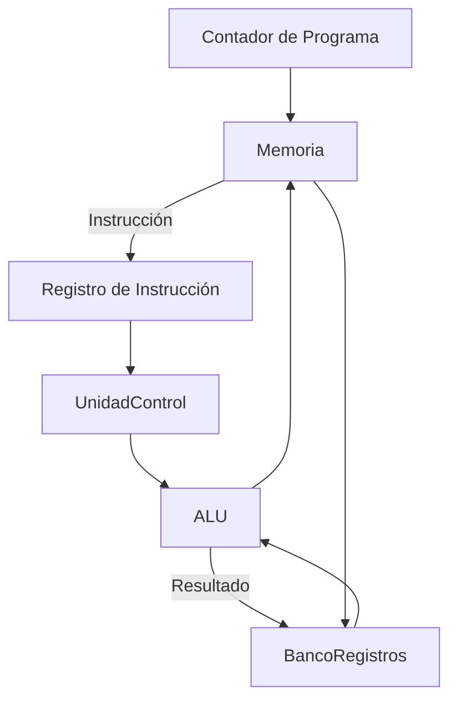

# Organización y Arquitectura de Computadoras - Unidad de control

## 6.1 El diagrama de flujo de datos (datapath).

---

### 1. Definición

El **datapath** es el conjunto de componentes hardware que realizan las operaciones aritméticas, lógicas, de almacenamiento y transferencia de datos en un procesador. Está íntimamente ligado con la **unidad de control**, que coordina cómo fluye la información a través de él.

-> En términos simples:

- **Datapath = dónde se procesan los datos.**
- **Unidad de Control = quién dirige el flujo de datos.**

### 2. Elementos principales del datapath

El datapath se compone de bloques funcionales interconectados:

- **Registros**: almacenan datos temporales.
- **ALU (Unidad Aritmético-Lógica)**: realiza operaciones matemáticas y lógicas.
- **Memoria**: contiene instrucciones y datos.
- **Multiplexores (MUX)**: seleccionan entre varias fuentes de datos.
- **Contador de Programa (PC)**: indica la dirección de la siguiente instrucción.
- **Banco de registros**: conjunto de registros accesibles por el procesador.

### 3. Relación entre Datapath y Unidad de Control

- El **datapath** ejecuta las operaciones.
- La **unidad de control** genera señales que guían al datapath:

  - Señales de lectura/escritura en memoria.
  - Selección de operaciones en la ALU.
  - Control de multiplexores.

### 4. Flujo de ejecución de una instrucción

En un ciclo de ejecución típico (modelo RISC), el datapath sigue este flujo:

1. **Fetch**: Se obtiene la instrucción de memoria.
2. **Decode**: Se interpretan los campos de la instrucción.
3. **Execute**: La ALU realiza la operación.
4. **Memory Access**: Acceso a memoria si es necesario.
5. **Write Back**: El resultado se guarda en un registro.

### 5. Representación gráfica del Datapath

#### Ejemplo simplificado (MIPS):



Este diagrama muestra cómo los datos fluyen entre PC, memoria, banco de registros y la ALU.

### 6. Ejemplo de instrucción en el datapath

Para la instrucción MIPS:    $\text{add } R1, R2, R3$   
( se suma el contenido de $R2$ y $R3$, guardando el resultado en $R1$ ):

- **Decode**: se identifican registros fuente $(R2, R3)$ y destino $(R1)$.
- **Execute**: la ALU suma $R2 + R3$.
- **Write Back**: el resultado se guarda en $R1$.

### 7. Código ilustrativo (simulación en Python)

```python
class Datapath:
    def __init__(self):
        self.registers = [0]*32  # Banco de registros
        self.PC = 0             # Contador de programa

    def execute_add(self, rd, rs, rt):
        self.registers[rd] = self.registers[rs] + self.registers[rt]
        self.PC += 4  # siguiente instrucción

# Ejemplo
dp = Datapath()
dp.registers[2] = 10
dp.registers[3] = 20
dp.execute_add(1, 2, 3)
print("R1 =", dp.registers[1])  # Resultado: 30
```

### 8. Fórmulas relevantes

El rendimiento de un datapath puede analizarse con:

$$ \text{CPU Time} = \text{Instruction Count} \times \text{CPI} \times \text{Clock Cycle Time} $$

donde:

- $CPI$ = ciclos por instrucción.
- Instruction Count = número total de instrucciones.

### 9. Ejercicios propuestos

1. Dibuja el datapath de una instrucción tipo **load** en MIPS.
2. Explica qué señales de control deben activarse para la instrucción `sub R5, R6, R7`.
3. Implementa en Python una simulación de `lw` y `sw` en un datapath simple.
4. Analiza el impacto en el tiempo de ejecución si el CPI aumenta de 1 a 1.5 en un programa de $10^6$ instrucciones con ciclo de reloj de 1 ns.

### 10. Referencias bibliográficas

#### Básicas

1. Hennessy, John L. y David A. Patterson, _Computer Architecture: A Quantitative Approach_, 4a Ed.; Morgan Kaufmann, 2006.
2. Kohavi, Zvi y Niraj K. Jha, _Switching and Finite Automata Theory_, 3a Ed., Cambridge University Press, 2009.
3. Mano, M. Morris y Charles Kime, _Logic and Computer Design Fundamentals_, 4a Ed., Prentice Hall, 2007.
4. Patterson, David A. y John L. Hennessy, _Computer Organization and Design: The Hardware/Software Interface_, 4a Ed., Morgan Kaufmann, 2008.

#### Complementarias

1. Stallings, William, _Computer Organization and Architecture: Designing for Performance_, Prentice Hall - Pearson, 2009.
2. Tanenbaum, Andrew S., _Structured Computer Organization_, 5a Ed., Prentice Hall, 2005.
3. Silberschatz Abraham, Peter B. Galvin y Greg Gagne, _Operating System Concepts_, 8a Ed., Wiley, 2008.
