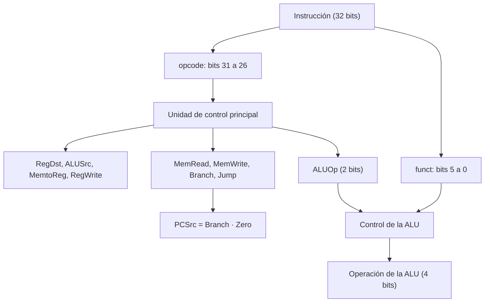

# Organización y Arquitectura de Computadoras - Unidad de control

## 6.2 Señales de control.

---

La ruta de datos del tema 6.1 puede ejecutar cualquier instrucción del repertorio, pero necesita que alguien le diga, para cada instrucción, qué registro escribir, qué operación hace la ALU, si se lee o escribe la memoria y de dónde viene el siguiente PC. Eso lo hacen las **señales de control**, generadas por la **unidad de control** a partir del código de operación. Este tema define las señales de la ruta de datos monociclo de MIPS, construye la tabla de verdad de la unidad de control principal y del control de la ALU, deduce sus ecuaciones lógicas y analiza el efecto de las señales sobre el tiempo de ejecución.

### Tipos de señales

- **Selección de multiplexores:** eligen entre varias fuentes de datos (`RegDst`, `ALUSrc`, `MemtoReg`, `PCSrc`, `Jump`).
- **Habilitación de escritura:** permiten que un elemento de estado cambie en el flanco de reloj (`RegWrite`, `MemWrite`). Si están en 0, el elemento conserva su valor aunque cambien sus entradas.
- **Lectura:** activan la lectura de la memoria de datos (`MemRead`).
- **Operación:** indican a la ALU qué hacer (`ALUOp`, y de ahí las 4 líneas de operación de la ALU).

| Señal | Si vale 0 | Si vale 1 |
| --- | --- | --- |
| `RegDst` | el registro destino es `rt` (bits 20 a 16) | el destino es `rd` (bits 15 a 11) |
| `ALUSrc` | el segundo operando de la ALU es un registro | es el inmediato extendido |
| `MemtoReg` | se escribe en el registro la salida de la ALU | se escribe el dato leído de memoria |
| `RegWrite` | no se escribe el banco de registros | se escribe el registro destino |
| `MemRead` | no se lee la memoria de datos | se lee la dirección calculada por la ALU |
| `MemWrite` | no se escribe la memoria | se escribe el dato de `rt` |
| `Branch` | el PC es $PC + 4$ | si además `Zero = 1`, el PC es el destino del salto |
| `Jump` | sin efecto | el PC es la dirección de salto incondicional |

`PCSrc = Branch · Zero` es una AND entre la señal de control y la salida de la ALU.

### La tabla de la unidad de control principal

La unidad de control principal es un circuito combinacional cuya entrada son los 6 bits del código de operación. Una $x$ indica que el valor no importa: en `sw` y `beq` no se escribe ningún registro, así que da igual qué registro selecciona `RegDst` o qué dato `MemtoReg`.

| Instrucción | opcode | RegDst | ALUSrc | MemtoReg | RegWrite | MemRead | MemWrite | Branch | Jump | ALUOp |
| --- | --- | --- | --- | --- | --- | --- | --- | --- | --- | --- |
| tipo R | 000000 | 1 | 0 | 0 | 1 | 0 | 0 | 0 | 0 | 10 |
| `lw` | 100011 | 0 | 1 | 1 | 1 | 1 | 0 | 0 | 0 | 00 |
| `sw` | 101011 | x | 1 | x | 0 | 0 | 1 | 0 | 0 | 00 |
| `beq` | 000100 | x | 0 | x | 0 | 0 | 0 | 1 | 0 | 01 |
| `addi` | 001000 | 0 | 1 | 0 | 1 | 0 | 0 | 0 | 0 | 00 |
| `j` | 000010 | x | x | x | 0 | 0 | 0 | 0 | 1 | xx |

**Ecuaciones.** Cada señal es la OR de los decodificadores de las instrucciones en que vale 1. Por ejemplo, con $R = \overline{op_5}\, \overline{op_4}\, \overline{op_3}\, \overline{op_2}\, \overline{op_1}\, \overline{op_0}$ y $\text{lw} = op_5\, \overline{op_4}\, \overline{op_3}\, \overline{op_2}\, op_1\, op_0,$

$$ \text{RegWrite} = R + \text{lw} + \text{addi}, \qquad \text{ALUSrc} = \text{lw} + \text{sw} + \text{addi}, \qquad \text{MemtoReg} = \text{lw} $$

Es una suma de productos que se implementa directamente con un decodificador y compuertas OR, o con una PLA. Los valores indiferentes permiten simplificar: `MemtoReg` puede ser simplemente $op_5$ si solo existen estas instrucciones.

### El control de la ALU

Para no meter los 6 bits de `funct` en la unidad principal, el control es **jerárquico**: la unidad principal genera `ALUOp` de 2 bits, y un pequeño circuito, el control de la ALU, lo combina con `funct`:

| ALUOp | funct | Operación | Líneas de la ALU |
| --- | --- | --- | --- |
| 00 (`lw`, `sw`, `addi`) | x | suma | 0010 |
| 01 (`beq`) | x | resta | 0110 |
| 10 (tipo R) | 100000 (`add`) | suma | 0010 |
| 10 | 100010 (`sub`) | resta | 0110 |
| 10 | 100100 (`and`) | AND | 0000 |
| 10 | 100101 (`or`) | OR | 0001 |
| 10 | 101010 (`slt`) | menor que | 0111 |

Esta división en dos niveles reduce el tamaño de la lógica y puede acelerarla, porque el control principal, que va en el camino crítico, es más pequeño.



### Efecto de las señales en el desempeño

En la ruta de datos monociclo, las señales de control se calculan en paralelo con la lectura de los registros, así que solo añaden retardo si la unidad de control es más lenta que el banco de registros. En un diseño **multiciclo** (tema 6.3) las señales cambian en cada paso, y añadir un paso a una instrucción aumenta su número de ciclos: si la lectura de memoria, controlada por `MemRead`, necesitara un ciclo más, `lw` pasaría de 5 a 6 ciclos y el CPI promedio aumentaría en la fracción de cargas.

### Implementación en Python

El programa imprime la tabla de control, deduce las ecuaciones de cada señal como suma de las instrucciones que la activan, decodifica las instrucciones de los ejercicios 1 y 3 (obteniendo señales, registro destino y operación de la ALU) y calcula el ejercicio 4.

```python
# Unidad de control principal del MIPS monociclo (Patterson y Hennessy, con addi y j)
SENALES = ["RegDst", "ALUSrc", "MemtoReg", "RegWrite", "MemRead", "MemWrite", "Branch", "Jump", "ALUOp"]
X = "x"     # indiferente
TABLA = {   # opcode: valores
    0b000000: ("R",    [1, 0, 0, 1, 0, 0, 0, 0, "10"]),
    0b100011: ("lw",   [0, 1, 1, 1, 1, 0, 0, 0, "00"]),
    0b101011: ("sw",   [X, 1, X, 0, 0, 1, 0, 0, "00"]),
    0b000100: ("beq",  [X, 0, X, 0, 0, 0, 1, 0, "01"]),
    0b001000: ("addi", [0, 1, 0, 1, 0, 0, 0, 0, "00"]),
    0b000010: ("j",    [X, X, X, 0, 0, 0, 0, 1, "xx"]),
}
print(f"{'instr':5s} {'opcode':7s} " + " ".join(f"{s:>8s}" for s in SENALES))
for op, (nombre, v) in TABLA.items():
    print(f"{nombre:5s} {op:06b}  " + " ".join(f"{str(x):>8s}" for x in v))

# Ecuaciones: cada señal es la OR de las instrucciones (minitérminos del opcode) en las que vale 1
print("ecuaciones de la unidad de control:")
for i, s in enumerate(SENALES[:-1]):
    activos = [nombre for op, (nombre, v) in TABLA.items() if v[i] == 1]
    print(f"   {s:8s} = {' + '.join(activos)}")


def control_alu(aluop, funct):
    if aluop == "00":
        return "0010", "suma"
    if aluop == "01":
        return "0110", "resta"
    return {0b100000: ("0010", "suma"), 0b100010: ("0110", "resta"), 0b100100: ("0000", "and"),
            0b100101: ("0001", "or"), 0b101010: ("0111", "slt")}[funct]


def decodificar(palabra):
    op, rs, rt = palabra >> 26, (palabra >> 21) & 31, (palabra >> 16) & 31
    rd, funct = (palabra >> 11) & 31, palabra & 63
    nombre, v = TABLA[op]
    s = dict(zip(SENALES, v))
    destino = rd if s["RegDst"] == 1 else rt
    return nombre, s, destino, control_alu(s["ALUOp"], funct) if s["ALUOp"] != "xx" else None


# Ejercicio 3: add $1, $2, $3 = 0x00430820
w = (2 << 21) | (3 << 16) | (1 << 11) | 0x20
nombre, s, dest, alu = decodificar(w)
print(f"ejercicio 3: 0x{w:08X} -> {nombre}, destino ${dest}, ALU {alu[1]} ({alu[0]}), ALUOp {s['ALUOp']},"
      f" señales en 1: {[k for k, v in s.items() if v == 1]}")
# Ejercicio 1: addi $1, $2, 10
w = (0b001000 << 26) | (2 << 21) | (1 << 16) | 10
nombre, s, dest, alu = decodificar(w)
print(f"ejercicio 1: 0x{w:08X} -> {nombre}, destino ${dest}, ALU {alu[1]} ({alu[0]}), ALUOp {s['ALUOp']},"
      f" señales en 1: {[k for k, v in s.items() if v == 1]}")

# Ejercicio 4: si MemRead añade un ciclo, en un diseño multiciclo lw pasa de 5 a 6 ciclos
mezcla = {"lw": 0.25, "sw": 0.10, "R": 0.45, "beq": 0.15, "j": 0.05}
ciclos = {"lw": 5, "sw": 4, "R": 4, "beq": 3, "j": 3}
cpi = sum(mezcla[k] * ciclos[k] for k in mezcla)
ciclos["lw"] += 1
cpi2 = sum(mezcla[k] * ciclos[k] for k in mezcla)
print(f"ejercicio 4: CPI multiciclo {cpi:.2f} -> {cpi2:.2f} ({cpi2 / cpi - 1:.1%} más lento)")
```

Salida:

```text
instr opcode    RegDst   ALUSrc MemtoReg RegWrite  MemRead MemWrite   Branch     Jump    ALUOp
R     000000         1        0        0        1        0        0        0        0       10
lw    100011         0        1        1        1        1        0        0        0       00
sw    101011         x        1        x        0        0        1        0        0       00
beq   000100         x        0        x        0        0        0        1        0       01
addi  001000         0        1        0        1        0        0        0        0       00
j     000010         x        x        x        0        0        0        0        1       xx
ecuaciones de la unidad de control:
   RegDst   = R
   ALUSrc   = lw + sw + addi
   MemtoReg = lw
   RegWrite = R + lw + addi
   MemRead  = lw
   MemWrite = sw
   Branch   = beq
   Jump     = j
ejercicio 3: 0x00430820 -> R, destino $1, ALU suma (0010), ALUOp 10, señales en 1: ['RegDst', 'RegWrite']
ejercicio 1: 0x2041000A -> addi, destino $1, ALU suma (0010), ALUOp 00, señales en 1: ['ALUSrc', 'RegWrite']
ejercicio 4: CPI multiciclo 4.05 -> 4.30 (6.2% más lento)
```

### Ejercicios Propuestos

1. **`addi`.** Completa la fila de la tabla de control para `addi $1, $2, 10`.

2. **`beq`.** Describe el flujo de señales de `beq` y qué determina el siguiente PC.

3. **Decodificación.** Decodifica `add $1, $2, $3` y obtén sus señales de control y la operación de la ALU.

4. **Un ciclo más.** En un procesador multiciclo con 25 % de `lw` (5 ciclos), 10 % de `sw` (4), 45 % de tipo R (4), 15 % de `beq` (3) y 5 % de `j` (3), ¿cómo cambia el CPI si la lectura de memoria añade un ciclo a `lw`?

5. **Señal bloqueada.** ¿Qué pasaría si `RegWrite` se quedara permanentemente en 1? ¿Y en 0?

### Soluciones

**Ejercicio 1.** `RegDst = 0` (el destino es `rt`), `ALUSrc = 1` (el inmediato), `MemtoReg = 0`, `RegWrite = 1`, `MemRead = MemWrite = Branch = Jump = 0` y `ALUOp = 00` (suma). Es como un `lw` sin acceso a memoria.

**Ejercicio 2.** `ALUSrc = 0` para que la ALU reste los dos registros (`ALUOp = 01`), `Branch = 1`, `RegWrite = MemWrite = MemRead = 0`. En paralelo, un sumador calcula $PC + 4 + 4 \cdot \text{inm}.$ Si `Zero = 1`, `PCSrc = 1` y el PC toma ese destino; si no, $PC + 4.$

**Ejercicio 3.** `0x00430820`: tipo R, destino `$1` porque `RegDst = 1`, `RegWrite = 1`, `ALUOp = 10` y `funct = 100000`, así que la ALU suma.

**Ejercicio 4.** El CPI pasa de $0.25 \cdot 5 + 0.10 \cdot 4 + 0.45 \cdot 4 + 0.15 \cdot 3 + 0.05 \cdot 3 = 4.05$ a $4.30,$ un 6.2 % más lento.

**Ejercicio 5.** En 1, `sw`, `beq` y `j` escribirían basura en algún registro (el seleccionado por `RegDst` con el dato de `MemtoReg`), corrompiendo el estado. En 0, ninguna instrucción podría guardar resultados: el procesador solo podría escribir en memoria valores que no podría calcular.

### Referencias

1. Patterson, D. A., and Hennessy, J. L., _Computer Organization and Design: The Hardware/Software Interface_. Morgan Kaufmann, 2020. Sección 4.4 y apéndice C.
2. Harris, D. M., and Harris, S. L., _Digital Design and Computer Architecture_. Morgan Kaufmann, 2013. Secciones 7.3 y 7.4.
3. Stallings, W., _Organización y arquitectura de computadores_. Pearson, 2006. Capítulo 16.
4. Hennessy, J. L., and Patterson, D. A., _Computer Architecture: A Quantitative Approach_. Morgan Kaufmann, 2019. Apéndice C.
