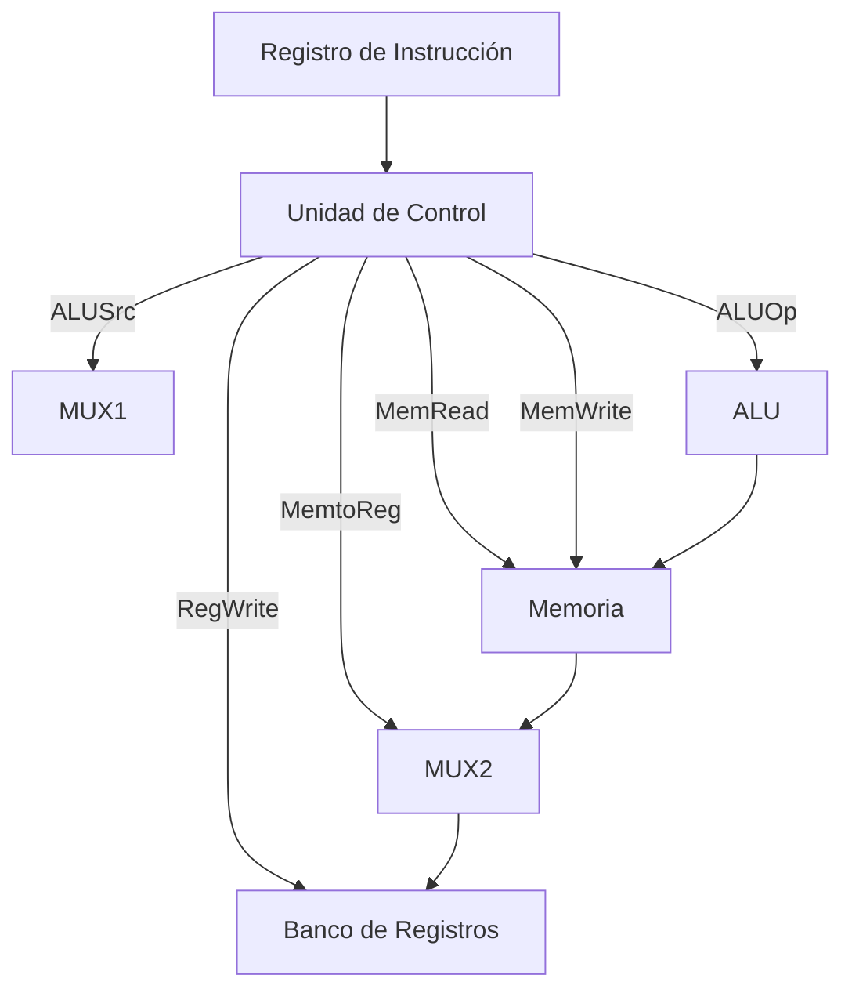

# Organización y Arquitectura de Computadoras - Unidad de control

## 6.2 Señales de control.

---

### 1. Definición

Las **señales de control** son líneas lógicas generadas por la **unidad de control** de un procesador, cuya función es **coordinar y sincronizar** el movimiento de datos a través del **datapath**.

- Se producen a partir de la **decodificación de la instrucción**.
- Determinan qué componentes se activan (ALU, registros, memoria, multiplexores, etc.).

-> En palabras simples: **Las señales de control son órdenes eléctricas que indican a cada bloque del procesador qué hacer en cada ciclo de instrucción.**

### 2. Tipos de señales de control

Podemos clasificarlas en tres categorías principales:

1. **Señales hacia la ALU**

   - Indican la operación a realizar: suma, resta, AND, OR, desplazamiento, etc.
   - Ejemplo: $ALUOp = 010 \implies \text{Resta}$

2. **Señales hacia la memoria**

   - Controlan lectura y escritura:

     - $MemRead = 1 \implies$ habilita lectura de memoria.
     - $MemWrite = 1 \implies$ habilita escritura en memoria.

3. **Señales hacia registros**

   - $RegWrite = 1 \implies$ habilita la escritura en un registro destino.
   - $RegDst:$ selecciona el campo de la instrucción que indica el registro destino.

### 3. Ejemplo de señales en MIPS (RISC)

En el procesador **MIPS** simplificado (según Patterson & Hennessy), las señales de control típicas son:

| Señal        | Función                                                                           |
| ------------ | --------------------------------------------------------------------------------- |
| **RegDst**   | Selecciona si el registro destino viene de `rt` o `rd`.                           |
| **ALUSrc**   | Selecciona entre registro o inmediato como entrada a la ALU.                      |
| **MemtoReg** | Selecciona si el dato que se escribe en el registro viene de la ALU o de memoria. |
| **RegWrite** | Habilita escritura en el banco de registros.                                      |
| **MemRead**  | Habilita lectura de memoria.                                                      |
| **MemWrite** | Habilita escritura en memoria.                                                    |
| **Branch**   | Indica si la instrucción es de salto condicional.                                 |
| **ALUOp**    | Indica qué operación debe ejecutar la ALU.                                        |

### 4. Tabla de señales de control (ejemplo simplificado en MIPS)

| Instrucción                | RegDst | ALUSrc | MemtoReg | RegWrite | MemRead | MemWrite | Branch | ALUOp |
| -------------------------- | ------ | ------ | -------- | -------- | ------- | -------- | ------ | ----- |
| R-type (add, sub, and, or) | 1      | 0      | 0        | 1        | 0       | 0        | 0      | 10    |
| lw                         | 0      | 1      | 1        | 1        | 1       | 0        | 0      | 00    |
| sw                         | X      | 1      | X        | 0        | 0       | 1        | 0      | 00    |
| beq                        | X      | 0      | X        | 0        | 0       | 0        | 1      | 01    |

-> Notación: **X** = irrelevante.

### 5. Fórmulas de rendimiento asociadas

La eficiencia del procesador depende de cómo las señales controlan el flujo:

$$ \text{CPU Time} = \text{Instruction Count} \times \text{CPI} \times T_{clock} $$

Un mal diseño de señales puede incrementar el **CPI** (ciclos por instrucción).

### 6. Diagrama de señales en el datapath



### 7. Ejemplo práctico

Instrucción:    $lw \ R1, 0(R2)$

1. **Señales activadas:**

   - $ALUSrc = 1$ (usar inmediato 0).
   - $MemRead = 1$ (leer memoria).
   - $RegWrite = 1$ (guardar en registro R1).
   - $MemtoReg = 1$ (dato de memoria va al registro).

2. **Flujo:**

   - La ALU calcula $R2 + 0.$
   - Se accede a memoria en esa dirección.
   - El dato se guarda en $R1.$

### 8. Código de simulación en Python

```python
class ControlUnit:
    def __init__(self):
        self.signals = {}

    def decode(self, instruction):
        if instruction == "lw":
            self.signals = {
                "RegDst": 0,
                "ALUSrc": 1,
                "MemtoReg": 1,
                "RegWrite": 1,
                "MemRead": 1,
                "MemWrite": 0,
                "Branch": 0,
                "ALUOp": "00"
            }
        elif instruction == "sw":
            self.signals = {
                "RegDst": "X",
                "ALUSrc": 1,
                "MemtoReg": "X",
                "RegWrite": 0,
                "MemRead": 0,
                "MemWrite": 1,
                "Branch": 0,
                "ALUOp": "00"
            }
        return self.signals

# Ejemplo
uc = ControlUnit()
print("Señales para lw:", uc.decode("lw"))
```

### 9. Ejercicios propuestos

1. Completa la tabla de señales de control para la instrucción `addi R1, R2, 10`.
2. Diseña un **diagrama de flujo de señales** para la instrucción `beq`.
3. Implementa en Python la decodificación de una instrucción tipo R (`add R1, R2, R3`).
4. Analiza cómo cambiaría el CPI si la señal `MemRead` genera un retardo adicional de un ciclo en el datapath.

### 10. Referencias bibliográficas

#### Básicas

1. Hennessy, John L. y David A. Patterson, _Computer Architecture: A Quantitative Approach_, 4a Ed.; Morgan Kaufmann, 2006.
2. Kohavi, Zvi y Niraj K. Jha, _Switching and Finite Automata Theory_, 3a Ed., Cambridge University Press, 2009.
3. Mano, M. Morris y Charles Kime, _Logic and Computer Design Fundamentals_, 4a Ed., Prentice Hall, 2007.
4. Patterson, David A. y John L. Hennessy, _Computer Organization and Design: The Hardware/Software Interface_, 4a Ed., Morgan Kaufmann, 2008.

#### Complementarias

1. Stallings, William, _Computer Organization and Architecture: Designing for Performance_, Prentice Hall - Pearson, 2009.
2. Tanenbaum, Andrew S., _Structured Computer Organization_, 5a Ed., Prentice Hall, 2005.
3. Silberschatz Abraham, Peter B. Galvin y Greg Gagne, _Operating System Concepts_, 8a Ed., Wiley, 2008.
