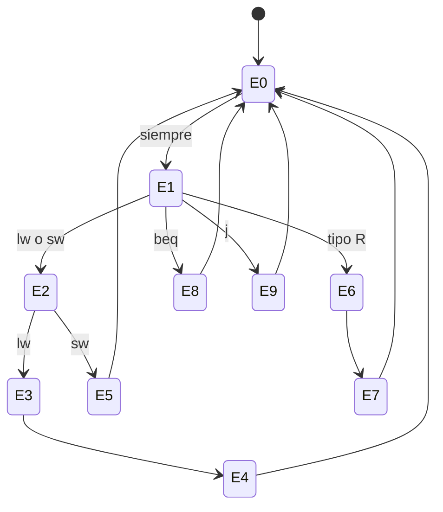

# Organización y Arquitectura de Computadoras - Unidad de control

## 6.3 Unidades de control microprogramadas y alambradas (hardwired)

---

En un procesador **multiciclo**, cada instrucción se ejecuta en varios pasos y las señales de control cambian de un paso a otro, así que la unidad de control ya no es un simple circuito combinacional: es una **máquina de estados finitos** (tema 4.3). Hay dos maneras de implementarla. En el control **alambrado** (_hardwired_), la FSM se sintetiza con compuertas y flip-flops. En el control **microprogramado**, propuesto por Maurice Wilkes en 1951, las señales de cada paso se guardan como palabras (**microinstrucciones**) en una memoria de control, y un pequeño secuenciador las va leyendo: cada instrucción de máquina es un pequeño programa. Este tema presenta la FSM del MIPS multiciclo, la implementa de las dos formas y compara sus ventajas.

### La FSM del MIPS multiciclo

Con un ciclo del tamaño de una memoria (tema 6.1), las instrucciones se dividen en pasos. Los dos primeros son comunes a todas: no se sabe cuál es la instrucción hasta decodificarla.

| Estado | Acción (transferencia entre registros) | Instrucciones |
| --- | --- | --- |
| 0 | $IR \leftarrow M[PC];$ $PC \leftarrow PC + 4$ | todas |
| 1 | $A \leftarrow R[rs];$ $B \leftarrow R[rt];$ $ALUOut \leftarrow PC + (\text{inm} \ll 2)$ | todas |
| 2 | $ALUOut \leftarrow A + \text{inm}$ | `lw`, `sw` |
| 3 | $MDR \leftarrow M[ALUOut]$ | `lw` |
| 4 | $R[rt] \leftarrow MDR$ | `lw` |
| 5 | $M[ALUOut] \leftarrow B$ | `sw` |
| 6 | $ALUOut \leftarrow A \text{ op } B$ | tipo R |
| 7 | $R[rd] \leftarrow ALUOut$ | tipo R |
| 8 | si $A = B,$ $PC \leftarrow ALUOut$ | `beq` |
| 9 | $PC \leftarrow PC_{31..28} \,\|\, (\text{dir} \ll 2)$ | `j` |

En el estado 1 se calcula de forma **especulativa** el destino del salto, aprovechando que la ALU está libre: si la instrucción no es `beq`, el resultado simplemente no se usa. Resultan 5 ciclos para `lw`, 4 para `sw` y tipo R, y 3 para `beq` y `j`. Con la mezcla del tema 6.2 el CPI promedio es 4.05, pero con un ciclo de unos 200 ps en lugar de 600 ps.



### Control alambrado

La FSM se implementa con un **registro de estado** de 4 bits y lógica combinacional que, a partir del estado y del código de operación, calcula las señales de control del paso actual y el siguiente estado. Esa lógica se puede construir con compuertas minimizadas o con una PLA. Con 4 bits de estado y 6 de código de operación hay 10 entradas: como ROM sería de $2^{10} = 1024$ palabras, pero como la mayoría de las combinaciones dan el mismo resultado, una PLA o compuertas minimizadas son mucho más pequeñas.

**Ventajas:** es rápido (solo el retardo de la lógica) y compacto para repertorios sencillos. **Desventajas:** cualquier cambio en el repertorio obliga a rediseñar el circuito, y para repertorios grandes y complejos el diseño se vuelve inmanejable.

### Control microprogramado

Cada estado se convierte en una **microinstrucción**, una palabra con:

- los **campos de control**, que dan directamente los valores de las señales (o codificados, para ahorrar bits);
- un **campo de secuenciación**, que indica cuál es la siguiente microinstrucción: la siguiente en orden (**sig**), volver a la búsqueda (**búsqueda**), o saltar según el código de operación usando una **tabla de despacho**.

El **secuenciador** mantiene un micro-PC, un sumador que lo incrementa y un multiplexor que elige entre $\mu PC + 1,$ 0 y las salidas de las tablas de despacho. En el MIPS multiciclo bastan 10 microinstrucciones y dos tablas de despacho: la primera, usada en el estado 1, elige entre los estados 2, 6, 8 y 9 según el código de operación; la segunda, en el estado 2, entre 3 (`lw`) y 5 (`sw`).

| Tipo de microcódigo | Formato | Características |
| --- | --- | --- |
| horizontal | un bit por señal | microinstrucciones anchas, mucho paralelismo, decodificación nula |
| vertical | campos codificados | microinstrucciones estrechas, necesitan decodificadores, menos paralelismo |

**Ventajas:** el control es tan fácil de modificar como un programa; un repertorio complejo (como el VAX, con cientos de instrucciones y modos de direccionamiento) se implementa escribiendo microcódigo; si la memoria de control es escribible, se pueden corregir errores después de fabricar el chip, como hacen los procesadores x86 con sus **actualizaciones de microcódigo**. **Desventajas:** leer la memoria de control añade retardo a cada ciclo, y la memoria ocupa área.

### Comparación

| Aspecto | Alambrado | Microprogramado |
| --- | --- | --- |
| velocidad | mayor: solo lógica | menor: acceso a la memoria de control |
| flexibilidad | baja | alta |
| repertorio adecuado | sencillo, regular (RISC) | complejo, irregular (CISC) |
| corrección de errores tras la fabricación | imposible | posible con microcódigo escribible |
| diseño y verificación | difícil para repertorios grandes | sistemático |

En los procesadores actuales se combinan: los x86 decodifican por hardware las instrucciones frecuentes a microoperaciones y recurren a una ROM de microcódigo solo para las instrucciones complejas o raras; los RISC usan control alambrado.

### Implementación en Python

El programa implementa la lógica de siguiente estado de la FSM de dos formas, como una función (alambrado) y como un microprograma con campo de secuenciación y tablas de despacho, comprueba que dan la misma secuencia de estados para cada clase de instrucción, muestra el microprograma de `sw` (ejercicio 4) y compara tiempos suponiendo un ciclo un 10 % más largo en la versión microprogramada.

```python
# Control multiciclo de MIPS (estados de Patterson y Hennessy) en dos versiones:
# alambrado (función de siguiente estado) y microprogramado (ROM con secuenciador).
ACCIONES = {
    0: "IR <- M[PC]; PC <- PC + 4",
    1: "A <- R[rs]; B <- R[rt]; ALUOut <- PC + (inm << 2)",
    2: "ALUOut <- A + inm",
    3: "MDR <- M[ALUOut]",
    4: "R[rt] <- MDR",
    5: "M[ALUOut] <- B",
    6: "ALUOut <- A op B",
    7: "R[rd] <- ALUOut",
    8: "si A == B: PC <- ALUOut",
    9: "PC <- PC[31:28] || dir << 2",
}


def siguiente_alambrado(estado, op):
    """La lógica de siguiente estado de la FSM, como se sintetizaría en compuertas."""
    if estado == 0:
        return 1
    if estado == 1:
        return {"lw": 2, "sw": 2, "R": 6, "beq": 8, "j": 9}[op]
    if estado == 2:
        return 3 if op == "lw" else 5
    if estado == 3:
        return 4
    if estado == 6:
        return 7
    return 0                                   # estados 4, 5, 7, 8, 9 terminan la instrucción


# Microprograma: cada microinstrucción tiene su acción y un campo de secuenciación
SEQ = {0: "sig", 1: "despacho1", 2: "despacho2", 3: "sig", 4: "busqueda", 5: "busqueda",
       6: "sig", 7: "busqueda", 8: "busqueda", 9: "busqueda"}
DESPACHO1 = {"R": 6, "j": 9, "beq": 8, "lw": 2, "sw": 2}
DESPACHO2 = {"lw": 3, "sw": 5}


def siguiente_micro(upc, op):
    s = SEQ[upc]
    if s == "sig":
        return upc + 1
    if s == "busqueda":
        return 0
    return (DESPACHO1 if s == "despacho1" else DESPACHO2)[op]


def ejecutar(op, siguiente):
    estado, pasos = 0, [0]
    while True:
        estado = siguiente(estado, op)
        if estado == 0:
            return pasos
        pasos.append(estado)


for op in ("lw", "sw", "R", "beq", "j"):
    a, m = ejecutar(op, siguiente_alambrado), ejecutar(op, siguiente_micro)
    assert a == m
    print(f"{op:3s}: {len(a)} ciclos, estados {a}")

print("ejercicio 4, microinstrucciones de sw:")
for e in ejecutar("sw", siguiente_micro):
    print(f"   {e}: {ACCIONES[e]:50s} secuencia: {SEQ[e]}")

mezcla = {"lw": 0.25, "sw": 0.10, "R": 0.45, "beq": 0.15, "j": 0.05}
cpi = sum(p * len(ejecutar(op, siguiente_alambrado)) for op, p in mezcla.items())
print(f"CPI promedio = {cpi:.2f}")
# Ejercicio 3: mismo número de ciclos; el microprogramado suele necesitar un ciclo algo más largo
for nombre, tc in (("alambrado", 200), ("microprogramado", 220)):     # ciclos supuestos
    print(f"   {nombre:15s}: add = 4 ciclos x {tc} ps = {4 * tc} ps; programa medio {cpi * tc:.0f} ps por instrucción")

# Tamaño de la lógica de control como ROM
estados_bits, op_bits, salidas = 4, 6, 16
print(f"FSM como una sola ROM: 2^{estados_bits + op_bits} = {2 ** (estados_bits + op_bits)} palabras de {salidas + 4} bits")
print(f"microprograma: 10 microinstrucciones de {salidas} + 2 bits, más dos tablas de despacho de 2^6 entradas")
```

Salida:

```text
lw : 5 ciclos, estados [0, 1, 2, 3, 4]
sw : 4 ciclos, estados [0, 1, 2, 5]
R  : 4 ciclos, estados [0, 1, 6, 7]
beq: 3 ciclos, estados [0, 1, 8]
j  : 3 ciclos, estados [0, 1, 9]
ejercicio 4, microinstrucciones de sw:
   0: IR <- M[PC]; PC <- PC + 4                          secuencia: sig
   1: A <- R[rs]; B <- R[rt]; ALUOut <- PC + (inm << 2)  secuencia: despacho1
   2: ALUOut <- A + inm                                  secuencia: despacho2
   5: M[ALUOut] <- B                                     secuencia: busqueda
CPI promedio = 4.05
   alambrado      : add = 4 ciclos x 200 ps = 800 ps; programa medio 810 ps por instrucción
   microprogramado: add = 4 ciclos x 220 ps = 880 ps; programa medio 891 ps por instrucción
FSM como una sola ROM: 2^10 = 1024 palabras de 20 bits
microprograma: 10 microinstrucciones de 16 + 2 bits, más dos tablas de despacho de 2^6 entradas
```

### Ejercicios Propuestos

1. **Alambrado.** Describe la unidad de control alambrada de la ruta de datos multiciclo para una instrucción de tipo R: qué estados recorre y qué señales activa en cada uno.

2. **Microprogramado.** Describe la unidad microprogramada para `lw`: qué microinstrucciones ejecuta y cómo se decide la secuencia.

3. **CPI.** Compara el CPI y el tiempo de una instrucción `add` en un procesador alambrado y en uno microprogramado con el mismo número de pasos.

4. **Microprograma de `sw`.** Simula la secuencia de microinstrucciones de `sw`.

5. **RISC y CISC.** ¿Qué tipo de control es más adecuado para un procesador RISC y para uno CISC? ¿Por qué?

### Soluciones

**Ejercicio 1.** Estados 0, 1, 6 y 7. En el 0, lectura de memoria con el PC (`IorD = 0`, `MemRead`), escritura del IR (`IRWrite`) y $PC + 4$ con la ALU (`PCWrite`). En el 1, lectura de registros y cálculo especulativo del destino de salto. En el 6, la ALU opera según `funct` (`ALUSrcA = 1`, `ALUSrcB = 00`, `ALUOp = 10`). En el 7, `RegDst = 1`, `MemtoReg = 0`, `RegWrite`. La lógica de siguiente estado manda del 1 al 6 si el código es 000000 y del 7 de vuelta al 0.

**Ejercicio 2.** Microinstrucciones 0 (búsqueda, secuencia "sig"), 1 (decodificación, despacho 1 que lleva a la 2), 2 (cálculo de la dirección, despacho 2 que lleva a la 3), 3 (lectura de memoria, "sig") y 4 (escritura en `rt`, vuelta a la búsqueda): 5 ciclos.

**Ejercicio 3.** Ambos necesitan 4 pasos, así que el CPI es el mismo, 4. Pero si el ciclo microprogramado es más largo por la lectura de la memoria de control (220 ps frente a 200 ps en el ejemplo), `add` tarda 880 ps frente a 800 ps. En repertorios complejos la diferencia suele ser mayor, porque las instrucciones necesitan más microinstrucciones.

**Ejercicio 4.** Microinstrucciones 0, 1, 2 y 5: búsqueda, decodificación, cálculo de la dirección $A + \text{inm}$ y escritura de $B$ en memoria, como muestra el programa.

**Ejercicio 5.** RISC: alambrado, porque el repertorio es pequeño y regular, y la velocidad es prioritaria; además, la segmentación (tema 7) encaja mejor con un control combinacional por etapa. CISC: microprogramado, al menos para las instrucciones complejas, porque implementar con compuertas cientos de instrucciones con muchos modos sería muy costoso y propenso a errores.

### Referencias

1. Patterson, D. A., and Hennessy, J. L., _Computer Organization and Design: The Hardware/Software Interface_. Morgan Kaufmann, 2020. Sección 4.5 y apéndice C (en línea: diseño multiciclo).
2. Stallings, W., _Organización y arquitectura de computadores_. Pearson, 2006. Capítulos 15 y 16.
3. Wilkes, M. V., The best way to design an automatic calculating machine. _Manchester University Computer Inaugural Conference_, 1951.
4. Hamacher, C., Vranesic, Z., Zaky, S., and Manjikian, N., _Computer Organization and Embedded Systems_. McGraw-Hill, 2011. Capítulo 7.
