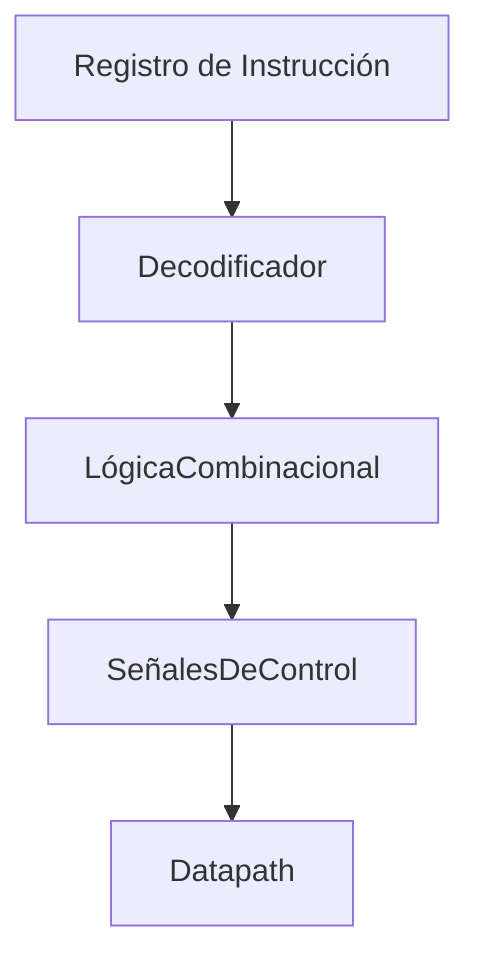
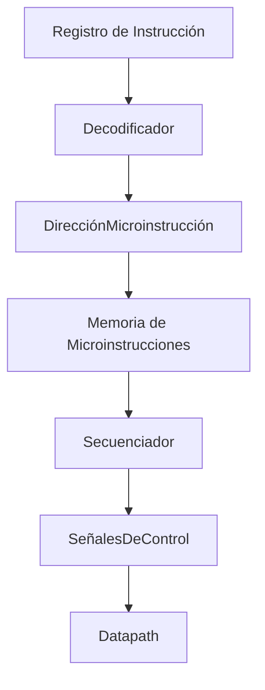

# Organización y Arquitectura de Computadoras - Unidad de control

## 6.3 Unidades de control microprogramadas y alambradas (hardwired)

---

### 1. Definición

La **unidad de control (UC)** es el componente del procesador que **coordina y dirige** todas las operaciones del datapath, generando **señales de control** según la instrucción que se esté ejecutando.

Existen dos tipos principales de unidades de control:

1. **Hardwired (Alambrada)**:

   - Implementada mediante **circuitos combinacionales** y secuenciales.
   - Las señales de control se generan mediante **lógica fija**, usando puertas lógicas, flip-flops y multiplexores.
   - Características: rápida, pero difícil de modificar.

2. **Microprogramada**:

   - Basada en un **conjunto de microinstrucciones** almacenadas en memoria especial llamada **control store**.
   - Cada instrucción máquina se traduce en **secuencia de microinstrucciones**, generando señales de control paso a paso.
   - Características: más flexible, fácil de modificar, pero generalmente más lenta que la UC hardwired.

### 2. Comparación general

| Característica             | Hardwired         | Microprogramada   |
| -------------------------- | ----------------- | ----------------- |
| Velocidad                  | Alta              | Media             |
| Flexibilidad               | Baja              | Alta              |
| Complejidad de diseño      | Alta              | Media             |
| Facilidad de actualización | Baja              | Alta              |
| Uso típico                 | Procesadores RISC | Procesadores CISC |

### 3. Hardwired Control (Control Alambrado)

#### a) Estructura

- **Entrada**: campos de la instrucción, flags de ALU, señales de estado.
- **Lógica combinacional**: genera las señales de control de manera **directa**.
- **Secuencia de operación**: implementada mediante **contadores y decodificadores**.

#### b) Diagrama simplificado



#### c) Ejemplo conceptual

Para instrucción `ADD R1, R2, R3`:

1. El decodificador identifica la instrucción como R-type.
2. La lógica combinacional activa:

   - `ALUOp = 010` (suma)
   - `RegDst = 1` (escribir en R1)
   - `RegWrite = 1`

### 4. Microprogrammed Control (Control Microprogramado)

#### a) Estructura

- **Control Store (ROM o RAM)**: contiene microinstrucciones.
- **Secuenciador**: determina el orden de ejecución de microinstrucciones.
- **Salida**: señales de control activadas según cada microinstrucción.

#### b) Diagrama simplificado



#### c) Ejemplo conceptual

Para instrucción `LW R1, 0(R2)`:

1. Microinstrucción 1: Calcula dirección efectiva (`R2 + 0`).
2. Microinstrucción 2: Accede a memoria (`MemRead = 1`).
3. Microinstrucción 3: Escribe resultado en R1 (`RegWrite = 1`).

> Cada microinstrucción activa un conjunto específico de señales de control.

### 5. Fórmulas relevantes

El **tiempo de ejecución de la CPU** depende del tipo de control:

- **Hardwired:**

$$ T_{CPU} = IC \cdot CPI_{hw} \cdot T_{clock} $$

- **Microprogramado:**

$$ T_{CPU} = IC \cdot \text{(Microinstrucciones por instrucción)} \cdot CPI_{\mu p} \cdot T_{clock} $$

> Generalmente, $ CPI_{\mu p} > CPI_{hw} $ debido al ciclo adicional de lectura de microinstrucción.

### 6. Ventajas y desventajas

#### Hardwired

- **Ventajas:** rápido, eficiente, bajo consumo de memoria.
- **Desventajas:** poco flexible, difícil de modificar ante nuevas instrucciones.

#### Microprogramado

- **Ventajas:** fácil de actualizar, permite instrucciones complejas, modular.
- **Desventajas:** más lento, requiere memoria adicional.

### 7. Ejemplo de microinstrucciones (conceptual en Python)

```python
class MicroprogrammedControl:
    def __init__(self):
        # Control store: secuencia de microinstrucciones
        self.microprogram = {
            "LW": [
                {"ALUSrc":1, "MemRead":0, "RegWrite":0},  # Calcular dirección
                {"ALUSrc":0, "MemRead":1, "RegWrite":0},  # Leer memoria
                {"ALUSrc":0, "MemRead":0, "RegWrite":1},  # Guardar en registro
            ]
        }

    def execute(self, instruction):
        for micro in self.microprogram[instruction]:
            print("Ejecutando microinstrucción:", micro)

# Ejemplo
uc = MicroprogrammedControl()
uc.execute("LW")
```

### 8. Ejercicios propuestos

1. Dibuja un **datapath controlado por unidad hardwired** para una instrucción R-type.
2. Dibuja un **datapath controlado por unidad microprogramada** para una instrucción `LW`.
3. Compara el **CPI** de una instrucción tipo `ADD` en un procesador hardwired vs microprogramado.
4. Simula en Python la secuencia de microinstrucciones para una instrucción `SW`.
5. Discute qué tipo de control es más adecuado para un procesador RISC y uno CISC, y por qué.

### 9. Referencias bibliográficas

#### Básicas

1. Hennessy, John L. y David A. Patterson, _Computer Architecture: A Quantitative Approach_, 4a Ed.; Morgan Kaufmann, 2006.
2. Kohavi, Zvi y Niraj K. Jha, _Switching and Finite Automata Theory_, 3a Ed., Cambridge University Press, 2009.
3. Mano, M. Morris y Charles Kime, _Logic and Computer Design Fundamentals_, 4a Ed., Prentice Hall, 2007.
4. Patterson, David A. y John L. Hennessy, _Computer Organization and Design: The Hardware/Software Interface_, 4a Ed., Morgan Kaufmann, 2008.

#### Complementarias

1. Stallings, William, _Computer Organization and Architecture: Designing for Performance_, Prentice Hall - Pearson, 2009.
2. Tanenbaum, Andrew S., _Structured Computer Organization_, 5a Ed., Prentice Hall, 2005.
3. Silberschatz Abraham, Peter B. Galvin y Greg Gagne, _Operating System Concepts_, 8a Ed., Wiley, 2008.
