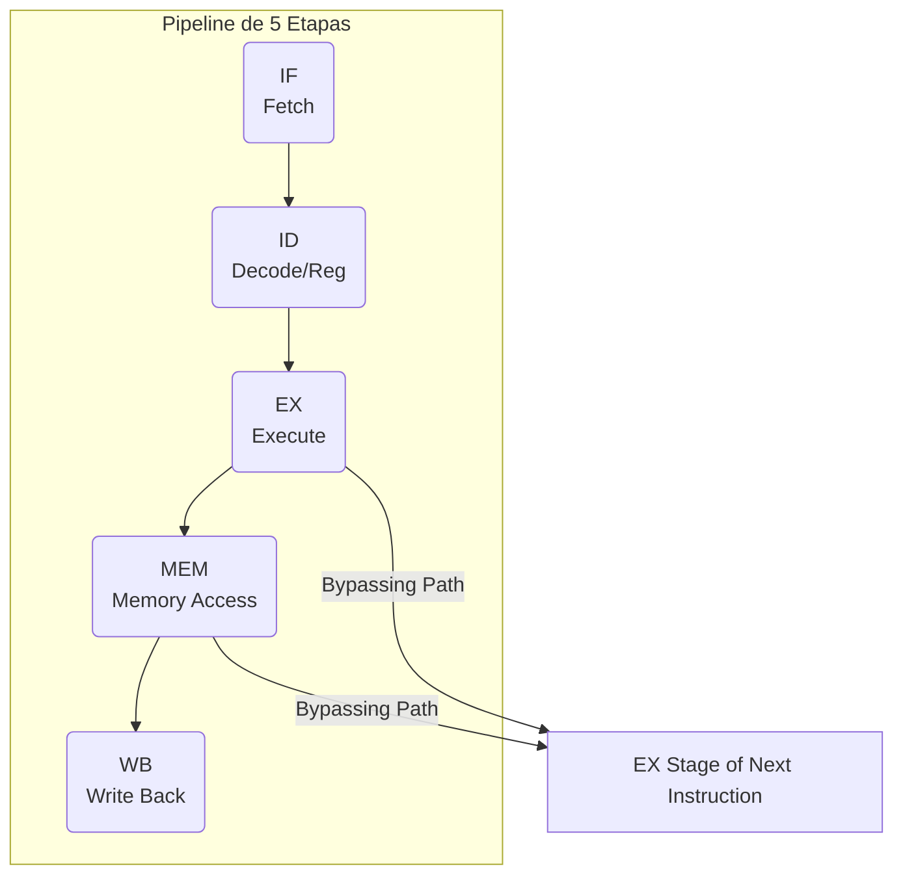
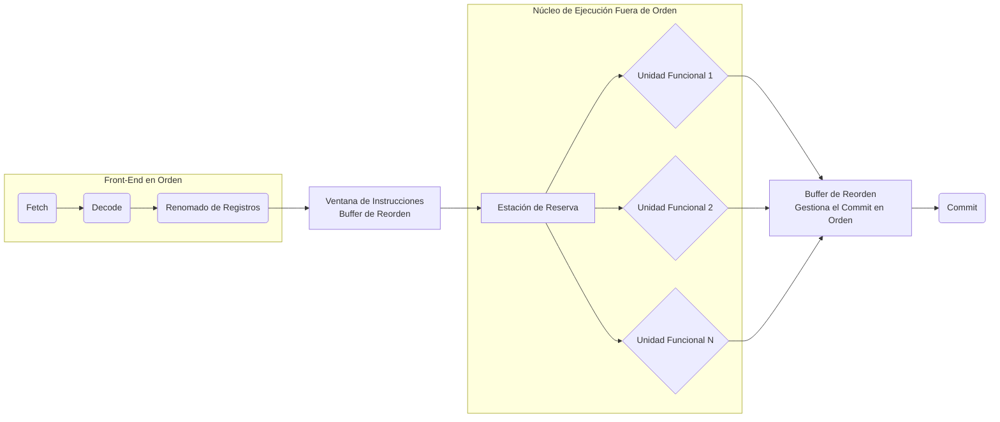

# Organización y Arquitectura de Computadoras - Cause segmentado de ejecución (pipeline)

## 7.1 Paralelismo a nivel de instrucción (ILP)

---

### 1. Definición de ILP

El **Paralelismo a Nivel de Instrucción (ILP)** es una medida del número de operaciones en un programa que pueden ejecutarse simultáneamente. Es la capacidad de un procesador para ejecutar múltiples instrucciones en paralelo dentro de un único flujo de instrucciones (hilo o _thread_), explotando así el cauce segmentado al máximo.

> "ILP es la base de los procesadores modernos de alto rendimiento. Se aprovecha del hecho de que, salvo dependencias de datos o de control, muchas instrucciones en un programa son independientes y podrían ejecutarse al mismo tiempo." — _Hennessy & Patterson, Computer Architecture: A Quantitative Approach_.

La búsqueda de un ILP elevado es el motor detrás de la evolución de las técnicas de pipeline superescalar, la ejecución fuera de orden (_out-of-order execution_) y la predicción de saltos.

### 2. Limitaciones del Pipeline Básico: Los Peligros (Hazards)

El pipeline ideal supone que cada etapa está ocupada en cada ciclo de reloj. Sin embargo, esto se ve interrumpido por tres tipos de peligros o _hazards_:

#### a) Peligro de Estructura (Structural Hazard)

Ocurre cuando los recursos hardware del computador (memoria, unidades funcionales, buses) son insuficientes para permitir la superposición de instrucciones.

- **Ejemplo:** Un procesador con una única memoria para instrucciones y datos. Si una instrucción está en la etapa de fetch (IF) y otra en la etapa de acceso a memoria (MEM), ambas necesitarán usar el bus de memoria al mismo tiempo, causando un conflicto.

#### b) Peligro de Datos (Data Hazard)

Ocurre cuando una instrucción depende del resultado de una instrucción anterior que aún no ha terminado y, por lo tanto, ese resultado no está disponible.

- **Tipos:**
  - **RAW (Read After Write):** La instrucción posterior lee un registro que la instrucción anterior debe escribir. Es el peligro más común.
    `I1: ADD R1, R2, R3  // Escribe en R1`
    `I2: SUB R4, R1, R5  // Lee R1 -> ¡Peligro!`
  - **WAR (Write After Read):** La instrucción posterior escribe un registro que la instrucción anterior debe leer.
    `I1: ADD R1, R2, R3  // Lee R2`
    `I2: SUB R2, R4, R5  // Escribe en R2 -> ¡Peligro!` (Poco común en pipelines simples en orden)
  - **WAW (Write After Write):** Ambas instrucciones escriben en el mismo registro. El orden de escritura debe preservarse.
    `I1: ADD R1, R2, R3  // Escribe en R1`
    `I2: SUB R1, R4, R5  // Escribe en R1 -> ¡Peligro!`

#### c) Peligro de Control (Control Hazard)

Ocurre a causa de las instrucciones de bifurcación (saltos, llamadas a función, retornos). El pipeline no sabe qué instrucción fetch a continuación hasta que la instrucción de salto se resuelve (generalmente en la etapa EX o MEM), lo que puede llevar a haber cargado y empezado a ejecutar instrucciones que no deberían ejecutarse.

### 3. Técnicas para Incrementar el ILP

Para superar estas limitaciones y lograr un mayor paralelismo, se emplean diversas técnicas.

#### a) Forwarding (o Bypassing)

Es la técnica más crucial para resolver peligros de datos RAW. Consiste en conectar directamente la salida de una etapa (e.g., ALU en EX) a la entrada de la etapa que lo necesita (e.g., ALU en EX de la siguiente instrucción), evitando esperar a que el resultado se escriba en el banco de registros.

**Diagrama de Forwarding:**



_La línea punteada representa el camino de forwarding que evita tener que esperar a la etapa WB._

#### b) Planificación de Instrucciones (Scheduling) por el Compilador

El compilador reordena las instrucciones del programa (sin alterar su semántica) para evitar que las instrucciones dependientes estén adyacentes, insertando instrucciones independientes entre ellas.

**Ejemplo:**

```asm
; Código original con peligro RAW
ADD R1, R2, R3
SUB R4, R1, R5   ; Depende de R1 de ADD
MUL R6, R7, R8   ; Instrucción independiente

; Código reordenado por el compilador
ADD R1, R2, R3
MUL R6, R7, R8   ; Instrucción independiente (rellena el hueco)
SUB R4, R1, R5   ; Ahora R1 está disponible por forwarding
```

#### c) Predicción de Saltos (Branch Prediction)

Para mitigar los peligros de control, se predice si un salto se tomará o no antes de que se sepa con certeza. Si la predicción es correcta, el pipeline no se detiene. Las técnicas van desde predicción estática (siempre se toma, nunca se toma) hasta dinámica (basada en un historial de saltos anteriores almacenado en una **Branch History Table - BHT**).

#### d) Ejecución Speculativa

Es la ejecución de instrucciones más allá de un salto cuya dirección aún no se conoce, asumiendo que la predicción de salto es correcta. Si la predicción falla, los resultados especulativos deben descartarse (_flush_ del pipeline).

#### e) Ejecución Fuera de Orden (Out-of-Order Execution - OoO)

Los procesadores superescalares modernos (e.g., basados en la arquitectura Intel x86 o ARM Cortex-A) utilizan esta técnica. Las instrucciones se fetch y decode en orden, pero una ventana de instrucciones es examinada en busca de instrucciones listas para ejecutar (sus operandos están disponibles), ejecutándolas en el orden que permitan las dependencias de datos y los recursos hardware, no necesariamente en el orden del programa. Una etapa de **commit** se encarga de retirar las instrucciones y escribir sus resultados en el orden original del programa para preservar la semántica.

**Diagrama Simplificado de un Procesador OoO:**



### 4. Medición del Desempeño y Fórmulas

El desempeño de un pipeline se mide por su **rendimiento** (throughput), definido como el número de instrucciones completadas por unidad de tiempo.

- **Ciclos Por Instrucción (CPI) en Pipeline:**
  El CPI ideal de un pipeline de _k_ etapas es 1. Sin embargo, los _hazards_ introducen paradas (_stalls_ o _burbujas_), aumentando el CPI.

  $$ CPI_{pipeline} = CPI_{ideal} + \text{Penalización por Stalls} \rbrace = 1 + \text{Penalización por Stalls} \rbrace $$
  
  donde la penalización por stalls es el promedio de ciclos de parada por instrucción.

- **Speedup del Pipeline:**
  Compara el tiempo de ejecución con y sin pipeline.
  
  $$ Speedup = \frac{Tiempo_{sin\ pipeline}}{Tiempo_{con\ pipeline}} = \frac{CPI_{sin\ pipeline} \times CicloDeReloj_{sin\ pipeline} \times N_{inst}}{CPI_{con\ pipeline} \times CicloDeReloj_{con\ pipeline} \times N_{inst}} $$

  Asumiendo que el ciclo de reloj con pipeline es ligeramente mayor debido a la sobrecarga de los registros entre etapas ( $CicloDeReloj_{con\ pipeline} \approx CicloDeReloj_{sin\ pipeline}$ ), y que $CPI_{sin\ pipeline}=1$ para una CPU monociclo, la fórmula se simplifica a:

  $$ Speedup \approx \frac{N_{etapas}}{CPI_{con\ pipeline}} $$

  El speedup máximo ideal para un pipeline de _k_ etapas es _k_ ( cuando $CPI = 1$ ).

### 5. Ejercicios Propuestos

1.  **Identificación de Peligros:** Dado el siguiente fragmento de código en lenguaje ensamblador para un pipeline de 5 etapas (IF, ID, EX, MEM, WB), identifica todos los peligros de datos (RAW, WAR, WAW) y de control. Asume que no hay forwarding ni predicción de saltos.

    ```asm
    LOOP: LW R1, 0(R2)    ; Load Word: R1 = Mem[R2 + 0]
          ADD R3, R1, R4   ; R3 = R1 + R4
          SW R3, 0(R2)     ; Store Word: Mem[R2 + 0] = R3
          SUB R2, R2, #4   ; R2 = R2 - 4
          BNEZ R2, LOOP    ; Branch if R2 != 0
          ADD R5, R6, R7   ; Instrucción después del salto
    ```

2.  **Cálculo de CPI y Speedup:** En un pipeline de 5 etapas, el 20% de las instrucciones son saltos. La predicción de saltos utilizada tiene una tasa de acierto del 90%. Cada fallo de predicción incurre en una penalización de 3 ciclos (se deben descartar 3 instrucciones fetchadas incorrectamente). No hay otros stalls. Calcula el CPI efectivo y el speedup respecto a una implementación monociclo (CPI=1, ciclo de reloj=5x el del pipeline). Asume que el ciclo de reloj del pipeline es 5ns y el de la CPU monociclo es 25ns.

3.  **Reordenamiento de Código:** Reordena las siguientes instrucciones para minimizar los stalls por dependencias de datos en un pipeline sin forwarding. Muestra el nuevo orden y explica por qué es mejor.
    ```asm
    MULTD F0, F4, F6
    SUBD F8, F0, F2
    ADDD F2, F10, F2
    LD F4, 0(R1)
    LD F6, 0(R2)
    ```

### 6. Referencias

- **Bibliografía Básica:**
  1.  Hennessy, John L. y David A. Patterson. _Computer Architecture: A Quantitative Approach_. 4a Ed. Capítulos 1, 2 y 3. (Análisis detallado de ILP, hazards, y técnicas avanzadas).
  2.  Patterson, David A. y John L. Hennessy. _Computer Organization and Design: The Hardware/Software Interface_. 4a Ed. Capítulo 4. (Explicación muy clara del pipeline y los hazards).

- **Bibliografía Complementaria:**
  1.  Stallings, William. _Computer Organization and Architecture: Designing for Performance_. Capítulos 12 y 14. (Aborda el pipeline y la arquitectura superescalar de manera extensa).
  2.  Tanenbaum, Andrew S. _Structured Computer Organization_. 5a Ed. Capítulo 4. (Presenta los conceptos de una forma muy estructurada y fácil de seguir).
