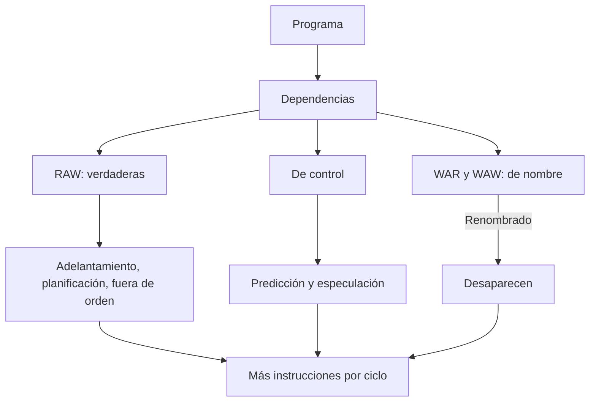

# Organización y Arquitectura de Computadoras - Cause segmentado de ejecución (pipeline)

## 7.1 Paralelismo a nivel de instrucción (ILP)

---

Desde los años ochenta, la principal fuente de aumento del desempeño de un solo procesador ha sido ejecutar **varias instrucciones a la vez**, aprovechando que muchas instrucciones consecutivas no dependen unas de otras. Ese solapamiento potencial es el **paralelismo a nivel de instrucción** (ILP, _Instruction-Level Parallelism_). Este tema define las **dependencias** que lo limitan, distingue entre dependencias (propiedades del programa) y **riesgos** (propiedades de la implementación), y presenta las técnicas para explotarlo, de la segmentación (temas 7.2 a 7.4) a la emisión múltiple y la ejecución fuera de orden (tema 12).

### Segmentación: la forma básica de ILP

La **segmentación** (_pipelining_) divide la ejecución en $k$ etapas y empieza una instrucción nueva en cada ciclo, como una línea de montaje: cada instrucción sigue tardando lo mismo (**latencia**), pero terminan más instrucciones por unidad de tiempo (**productividad**).

**Aceleración ideal.** Si cada etapa dura $t$ y no hay detenciones, $n$ instrucciones tardan $k + n - 1$ ciclos (los $k$ de la primera más uno por cada una de las demás), frente a $n k$ ciclos sin segmentar:

$$ S = \frac{n k}{k + n - 1} \xrightarrow{n \to \infty} k $$

En la práctica la aceleración es menor porque las etapas no están perfectamente equilibradas, los registros entre etapas añaden retardo, y sobre todo porque hay **riesgos** que obligan a detener la segmentación:

$$ \text{CPI}_{\text{segmentado}} = \text{CPI}_{\text{ideal}} + \text{detenciones por instrucción} = 1 + \text{detenciones por riesgos estructurales, de datos y de control} $$

### Dependencias

Dos instrucciones $i$ y $j,$ con $i$ antes de $j$ en el programa:

- **Dependencia de datos verdadera** (RAW, _read after write_): $j$ lee un resultado que escribe $i.$ El orden es esencial: el valor no existe antes.
- **Antidependencia** (WAR, _write after read_): $j$ escribe un registro que $i$ lee. Si $j$ escribiera antes, $i$ leería un valor equivocado.
- **Dependencia de salida** (WAW, _write after write_): ambas escriben el mismo registro; el valor final debe ser el de $j.$
- **Dependencia de control:** $j$ se ejecuta o no según el resultado de un salto anterior.

Las WAR y WAW son **dependencias de nombre**: no hay flujo de datos, solo la reutilización de un mismo registro. Se eliminan **renombrando** registros, ya sea el compilador (usando otros registros) o el hardware (tema 12.1). Las RAW son inevitables: limitan el paralelismo de cualquier implementación.

Una dependencia es una propiedad del programa; un **riesgo** (_hazard_) aparece cuando la implementación concreta podría violar el orden que la dependencia exige. En la segmentación de 5 etapas de MIPS, las WAR y WAW no causan riesgos (todas las instrucciones leen registros en ID y escriben en WB, en orden), pero sí las RAW y las de control (tema 7.3).

### Técnicas para aumentar el ILP

| Técnica | Qué reduce | Dónde |
| --- | --- | --- |
| adelantamiento (_forwarding_) | detenciones por RAW | hardware, tema 7.3 |
| predicción de saltos | detenciones de control | hardware, tema 7.4 |
| planificación de instrucciones | detenciones por RAW | compilador, tema 8.1 |
| desenrollado de bucles | instrucciones de control y dependencias de nombre | compilador |
| renombrado de registros | WAR y WAW | hardware o compilador |
| ejecución fuera de orden | detenciones por RAW con latencias largas | hardware, tema 12.1 |
| emisión múltiple (superescalar, VLIW) | CPI por debajo de 1 | hardware o compilador, temas 12.1 y 12.2 |
| especulación | dependencias de control | hardware y compilador, tema 12.3 |

**Límites.** El paralelismo disponible dentro de un bloque básico (las 4 a 7 instrucciones entre dos saltos) es pequeño. Aun con renombrado perfecto, predicción perfecta y recursos ilimitados, los estudios de límites (Wall, 1991) encontraron decenas de instrucciones paralelas en programas numéricos, pero con recursos realistas el IPC sostenido de los programas de enteros apenas pasa de 2 a 4. Esa barrera, junto con el muro de la potencia (tema 1.1), llevó a los procesadores de varios núcleos (tema 11).



### Implementación en Python

El programa encuentra las dependencias del fragmento del ejercicio 1, calcula el paralelismo ideal (recursos ilimitados y latencia 1) de tres iteraciones desenrolladas de `x[i] = x[i] + s` que reutilizan los mismos registros, con y sin renombrado, resuelve el ejercicio 2 y evalúa la aceleración ideal de la segmentación.

```python
# Análisis de dependencias y paralelismo a nivel de instrucción
prog = [  # (texto, destino, fuentes)
    ("LW   R1, 0(R2)", "R1", ["R2"]),
    ("ADD  R3, R1, R4", "R3", ["R1", "R4"]),
    ("SW   R3, 0(R2)", None, ["R3", "R2"]),
    ("SUB  R2, R2, #4", "R2", ["R2"]),
    ("BNEZ R2, LOOP", None, ["R2"]),
    ("ADD  R5, R6, R7", "R5", ["R6", "R7"]),
]
print("ejercicio 1, dependencias (i -> j):")
for j, (tj, dj, fj) in enumerate(prog):
    for i in range(j):
        ti, di, fi = prog[i]
        if di and di in fj:
            print(f"   RAW {di}: {i + 1} -> {j + 1}   ({ti} | {tj})")
        if dj and dj in fi:
            print(f"   WAR {dj}: {i + 1} -> {j + 1}")
        if di and di == dj:
            print(f"   WAW {di}: {i + 1} -> {j + 1}")
print("   control: la instrucción 6 depende del salto 5")


# Paralelismo ideal: longitud del camino crítico del grafo de dependencias
def ilp(instrucciones, renombrar):
    """Ciclo más temprano de cada instrucción con latencia 1 y recursos ilimitados."""
    listo, ultimo_uso, ultima_escr = {}, {}, {}
    ciclos = []
    for d, fs in instrucciones:
        t = max([listo.get(r, 0) for r in fs] + [0]) + 1          # RAW
        if not renombrar and d:
            t = max(t, ultimo_uso.get(d, 0), ultima_escr.get(d, 0) + 1)   # WAR y WAW
        ciclos.append(t)
        for r in fs:
            ultimo_uso[r] = max(ultimo_uso.get(r, 0), t)
        if d:
            listo[d] = t
            ultima_escr[d] = t
    return len(instrucciones) / max(ciclos), max(ciclos)


# Dos iteraciones desenrolladas de x[i] = x[i] + s reutilizando los mismos registros
desenrollado = [("F0", ["R1"]), ("F4", ["F0", "F2"]), (None, ["F4", "R1"]),
                ("F0", ["R1"]), ("F4", ["F0", "F2"]), (None, ["F4", "R1"]),
                ("F0", ["R1"]), ("F4", ["F0", "F2"]), (None, ["F4", "R1"])]
for ren in (False, True):
    ipc, prof = ilp(desenrollado, ren)
    print(f"x[i] + s, 3 iteraciones, {'con' if ren else 'sin'} renombrado: {prof} ciclos, IPC ideal {ipc:.2f}")

# Ejercicio 2
cpi = 1 + 0.20 * 0.10 * 3
print(f"ejercicio 2: CPI = {cpi:.2f}; tiempo por instrucción {cpi * 5:.2f} ns frente a 25 ns;"
      f" aceleración {25 / (cpi * 5):.2f}")
# Aceleración ideal de una segmentación de k etapas con n instrucciones
for k in (5, 10, 20):
    n = 1000
    print(f"k = {k:2d}: aceleración ideal con {n} instrucciones = {n * k / (k + n - 1):.2f}")
```

Salida:

```text
ejercicio 1, dependencias (i -> j):
   RAW R1: 1 -> 2   (LW   R1, 0(R2) | ADD  R3, R1, R4)
   RAW R3: 2 -> 3   (ADD  R3, R1, R4 | SW   R3, 0(R2))
   WAR R2: 1 -> 4
   WAR R2: 3 -> 4
   RAW R2: 4 -> 5   (SUB  R2, R2, #4 | BNEZ R2, LOOP)
   control: la instrucción 6 depende del salto 5
x[i] + s, 3 iteraciones, sin renombrado: 5 ciclos, IPC ideal 1.80
x[i] + s, 3 iteraciones, con renombrado: 3 ciclos, IPC ideal 3.00
ejercicio 2: CPI = 1.06; tiempo por instrucción 5.30 ns frente a 25 ns; aceleración 4.72
k =  5: aceleración ideal con 1000 instrucciones = 4.98
k = 10: aceleración ideal con 1000 instrucciones = 9.91
k = 20: aceleración ideal con 1000 instrucciones = 19.63
```

Sin renombrado, cada iteración debe esperar a que la anterior termine de usar `F0` y `F4`, y las tres iteraciones necesitan 5 ciclos; renombrando, son independientes y las 9 instrucciones caben en 3 ciclos, el camino crítico de una iteración.

### Ejercicios Propuestos

1. **Dependencias.** Identifica todas las dependencias del fragmento:

   ```asm
   LOOP: LW   R1, 0(R2)
         ADD  R3, R1, R4
         SW   R3, 0(R2)
         SUB  R2, R2, #4
         BNEZ R2, LOOP
         ADD  R5, R6, R7
   ```

2. **CPI y aceleración.** En una segmentación de 5 etapas, el 20 % de las instrucciones son saltos, la predicción acierta el 90 % de las veces y cada fallo cuesta 3 ciclos. Calcula el CPI y la aceleración frente a un procesador monociclo con ciclo de 25 ns, si el ciclo segmentado es de 5 ns.

3. **Renombrado.** Explica por qué el renombrado elimina las dependencias WAR y WAW pero no las RAW.

4. **Aceleración ideal.** ¿Por qué la aceleración de una segmentación de $k$ etapas nunca llega a $k?$

### Soluciones

**Ejercicio 1.** RAW: `R1` de 1 a 2, `R3` de 2 a 3 y `R2` de 4 a 5. WAR: `R2` de 1 a 4 y de 3 a 4 (las dos leen `R2` antes de que `SUB` lo modifique). No hay WAW. De control: la instrucción 6 depende del salto 5, y en el bucle, todas las instrucciones de la siguiente iteración también.

**Ejercicio 2.** $\text{CPI} = 1 + 0.2 \cdot 0.1 \cdot 3 = 1.06;$ cada instrucción tarda en promedio $1.06 \cdot 5 = 5.3$ ns, y la aceleración es $25 / 5.3 \approx 4.72.$

**Ejercicio 3.** WAR y WAW existen solo porque dos instrucciones usan el mismo nombre de registro para valores distintos; dando a cada valor un registro físico distinto, ya no hay conflicto. En una RAW, en cambio, la segunda instrucción necesita **el valor** producido por la primera, sea cual sea el registro donde esté.

**Ejercicio 4.** Por los $k - 1$ ciclos del llenado inicial, por las detenciones debidas a riesgos, por el desequilibrio entre etapas (el ciclo lo marca la más lenta) y por el retardo de los registros de segmentación.

### Referencias

1. Hennessy, J. L., and Patterson, D. A., _Computer Architecture: A Quantitative Approach_. Morgan Kaufmann, 2019. Capítulo 3 y apéndice C.
2. Patterson, D. A., and Hennessy, J. L., _Computer Organization and Design: The Hardware/Software Interface_. Morgan Kaufmann, 2020. Secciones 4.6 y 4.10.
3. Wall, D. W., Limits of instruction-level parallelism. _ASPLOS IV_, 1991.
4. Shen, J. P., and Lipasti, M. H., _Modern Processor Design_. McGraw-Hill, 2005. Capítulo 1.
