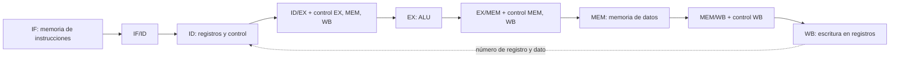

# Organización y Arquitectura de Computadoras - Cause segmentado de ejecución (pipeline)

## 7.2 Diseño de un procesador con cause segmentado

---

Este tema transforma la ruta de datos monociclo del tema 6.1 en una **segmentada** de cinco etapas, la organización clásica de MIPS y de los primeros procesadores RISC, que sigue siendo la base de los diseños actuales. La idea es cortar la ruta de datos en etapas de duración parecida, separarlas con **registros de segmentación** que guardan todo lo que cada instrucción necesita en las etapas siguientes, y hacer viajar con la instrucción sus propias señales de control. Se estudiarán las etapas, el contenido de los registros, el control segmentado, el rendimiento y los riesgos estructurales; los riesgos de datos y de control se tratan en los temas 7.3 y 7.4.

### Las cinco etapas

| Etapa | Nombre | Qué hace | Recursos |
| --- | --- | --- | --- |
| IF | búsqueda | lee la instrucción en $M[PC]$ y calcula $PC + 4$ | memoria de instrucciones, sumador |
| ID | decodificación | decodifica, lee los registros, extiende el inmediato | banco de registros (lectura), control |
| EX | ejecución | opera en la ALU o calcula una dirección o el destino de un salto | ALU, sumador del salto |
| MEM | memoria | lee o escribe la memoria de datos | memoria de datos |
| WB | escritura | escribe el resultado en el banco de registros | banco de registros (escritura) |

Cada etapa dura un ciclo. Con los retardos del tema 6.1, el ciclo pasa de 600 ps a unos 200 ps, el de la etapa más lenta (las memorias). Una instrucción tarda ahora 5 ciclos, 1000 ps (más que en el monociclo), pero en régimen termina una instrucción cada 200 ps: el triple de productividad.

**Por qué el repertorio de MIPS es fácil de segmentar:** todas las instrucciones miden 32 bits (IF siempre lee una palabra), los campos de registro están en el mismo lugar (ID puede leer los registros antes de saber qué instrucción es), los operandos en memoria solo aparecen en cargas y almacenamientos (la dirección se calcula en EX y se usa en MEM) y los accesos están alineados (una sola lectura de memoria por acceso).

### Registros de segmentación

Entre cada par de etapas hay un registro que se escribe en cada flanco de reloj. Guarda **todo** lo que la instrucción necesitará después, porque la etapa anterior ya estará trabajando con otra instrucción:

| Registro | Contenido |
| --- | --- |
| IF/ID | instrucción, $PC + 4$ |
| ID/EX | $PC + 4,$ valores de `rs` y `rt`, inmediato extendido, números de `rt` y `rd`, señales de control de EX, MEM y WB |
| EX/MEM | destino del salto, `Zero`, resultado de la ALU, valor de `rt` (para `sw`), número del registro destino, control de MEM y WB |
| MEM/WB | dato leído de memoria, resultado de la ALU, número del registro destino, control de WB |

Un detalle importante: el **número del registro destino** debe viajar hasta WB. Si en WB se usara el campo `rd` de la instrucción que está en IF/ID, se escribiría el registro de otra instrucción.

### Control segmentado

Las señales de control son las mismas del tema 6.2, pero se generan en ID y se guardan en ID/EX agrupadas por la etapa que las usa: las de EX (`RegDst`, `ALUOp`, `ALUSrc`) se consumen en EX; las de MEM (`Branch`, `MemRead`, `MemWrite`) pasan a EX/MEM; y las de WB (`RegWrite`, `MemtoReg`) llegan hasta MEM/WB. Cada instrucción lleva consigo sus señales a lo largo de la segmentación.



### Riesgos estructurales

Un **riesgo estructural** ocurre cuando dos instrucciones necesitan el mismo recurso en el mismo ciclo. En este diseño se evitan:

- **Memorias separadas** de instrucciones y de datos (en la práctica, cachés separadas): en el mismo ciclo, IF lee una instrucción y MEM accede a un dato.
- **Banco de registros** con dos puertos de lectura y uno de escritura, que **escribe en la primera mitad del ciclo y lee en la segunda**: una instrucción en WB y otra en ID pueden usarlo a la vez, y la de ID ve el valor recién escrito.
- **Sumadores** propios para $PC + 4$ y para el destino del salto, además de la ALU.

### Rendimiento

Con $n$ instrucciones y $k$ etapas, sin detenciones, el tiempo es $(k + n - 1)$ ciclos; con detenciones,

$$ \text{ciclos} = (k - 1) + n + \text{detenciones}, \qquad \text{CPI} \approx 1 + \frac{\text{detenciones}}{n} $$

### Implementación en Python

El programa usa un simulador de la segmentación que calcula en qué ciclo entra cada instrucción a cada etapa (respetando las dependencias, con o sin adelantamiento) y ejecuta las instrucciones para comprobar el resultado. Dibuja el diagrama de ciclos de un pequeño programa, muestra el contenido de los registros de segmentación para `lw` (ejercicio 1) y resuelve el ejercicio 3. Un guion indica que la instrucción está detenida.

```python
# Simulador de una segmentación de 5 etapas (IF, ID, EX, MEM, WB) a nivel de calendario:
# calcula en qué ciclo entra cada instrucción a cada etapa, con o sin adelantamiento.
# Instrucciones: (op, destino, fuente1, fuente2, inmediato)  con op en add, sub, addi, lw, sw, beq, bne
ETAPAS = ["IF", "ID", "EX", "MEM", "WB"]


def fuentes(ins):
    op, d, s1, s2, _ = ins
    if op in ("add", "sub", "beq", "bne"):
        return [s1, s2]
    if op == "sw":
        return [s1, d]          # sw: d es el registro que se guarda, s1 la base
    return [s1]                 # addi, lw


def destino(ins):
    return None if ins[0] in ("sw", "beq", "bne") else ins[1]


def segmentar(programa, adelantamiento=True, salto_en="ID", R=None, M=None, max_instr=200):
    """Ejecuta el programa y devuelve la lista de (texto, {etapa: ciclo}) y el número de ciclos."""
    R = dict(R or {})
    M = dict(M or {})
    listo = {}              # registro -> primer ciclo en que su valor puede usarse en EX (adelantamiento)
    escrito = {}            # registro -> ciclo de WB (sin adelantamiento se lee en ID desde ese ciclo)
    filas, pc, sig_if, n = [], 0, 1, 0
    while pc < len(programa) and n < max_instr:
        ins = programa[pc]
        op, d, s1, s2, inm = ins
        c_if = sig_if
        c_id = c_if + 1
        if adelantamiento:
            c_ex = max([c_id + 1] + [listo.get(r, 0) for r in fuentes(ins) if r])
            if op in ("beq", "bne") and salto_en == "ID":   # el salto compara en ID: necesita los datos ahí
                c_ex = max([c_id + 1] + [listo.get(r, 0) + 1 for r in fuentes(ins) if r])
            c_id = c_ex - 1
        else:
            c_id = max([c_id] + [escrito.get(r, 0) for r in fuentes(ins) if r])
            c_ex = c_id + 1
        c_mem, c_wb = c_ex + 1, c_ex + 2
        etapas = {"IF": c_if, "ID": c_id, "EX": c_ex, "MEM": c_mem, "WB": c_wb}
        # ejecución funcional
        v = lambda r: R.get(r, 0)
        nuevo_pc = pc + 1
        if op == "add":
            R[d] = v(s1) + v(s2)
        elif op == "sub":
            R[d] = v(s1) - v(s2)
        elif op == "addi":
            R[d] = v(s1) + inm
        elif op == "lw":
            R[d] = M.get(v(s1) + inm, 0)
        elif op == "sw":
            M[v(s1) + inm] = v(d)
        elif op in ("beq", "bne"):
            if (v(s1) == v(s2)) == (op == "beq"):
                nuevo_pc = pc + 1 + inm
        dst = destino(ins)
        if dst:
            listo[dst] = c_mem if op == "lw" else c_ex     # el dato existe al final de esa etapa
            listo[dst] += 1
            escrito[dst] = c_wb
        tomado = op in ("beq", "bne") and nuevo_pc != pc + 1
        # la siguiente búsqueda: tras un salto tomado se pierde lo buscado hasta resolverlo
        sig_if = c_id if not tomado else (etapas[salto_en] + 1)
        sig_if = max(sig_if, c_if + 1)
        filas.append((texto(ins), etapas))
        pc, n = nuevo_pc, n + 1
    return filas, filas[-1][1]["WB"], R, M


def texto(ins):
    op, d, s1, s2, inm = ins
    if op in ("lw", "sw"):
        return f"{op} {d}, {inm}({s1})"
    if op == "addi":
        return f"{op} {d}, {s1}, {inm}"
    if op in ("beq", "bne"):
        return f"{op} {s1}, {s2}, {inm:+d}"
    return f"{op} {d}, {s1}, {s2}"


def diagrama(filas, ancho=None):
    ultimo = filas[-1][1]["WB"]
    ancho = ancho or ultimo
    lineas = []
    for t, e in filas:
        celdas = ["   "] * ancho
        for nombre, c in e.items():
            if c <= ancho:
                celdas[c - 1] = f"{nombre:3s}"[:3]
        for c in range(e["IF"] + 1, e["ID"]):           # ciclos detenido en IF
            celdas[c - 1] = " - "
        lineas.append((f"{t:18s}|" + "|".join(celdas)).rstrip())
    cab = f"{'ciclo':18s}|" + "|".join(f"{c:3d}" for c in range(1, ancho + 1))
    return "\n".join([cab] + lineas)


# Programa: C = A + B y D = A - B con datos en memoria; R2 apunta a A
prog = [("lw", "R1", "R2", None, 0), ("lw", "R4", "R2", None, 4), ("add", "R3", "R1", "R4", 0),
        ("sub", "R5", "R1", "R4", 0), ("sw", "R3", "R2", None, 8), ("sw", "R5", "R2", None, 12)]
for adel in (False, True):
    filas, ciclos, R, M = segmentar(prog, adelantamiento=adel, R={"R2": 100}, M={100: 30, 104: 12})
    print(f"{'con' if adel else 'sin'} adelantamiento: {ciclos} ciclos para {len(prog)} instrucciones;"
          f" M[108] = {M[108]}, M[112] = {M[112]}")
    print(diagrama(filas))

# Ejercicio 1: contenido de los registros de segmentación para lw $t0, 4($s0) con $s0 = 1000, M[1004] = 77
pc, s0, mem = 0x00400000, 1000, {1004: 77}
etapa = [
    ("IF/ID", f"PC + 4 = 0x{pc + 4:08X}, IR = lw $t0, 4($s0)"),
    ("ID/EX", f"A = $s0 = {s0}, inm = 4, rt = 8 ($t0); control EX: ALUSrc = 1, ALUOp = 00; "
              "MEM: MemRead = 1; WB: RegWrite = 1, MemtoReg = 1"),
    ("EX/MEM", f"ALUOut = {s0 + 4}, rt = 8; control MEM: MemRead = 1; WB: RegWrite = 1, MemtoReg = 1"),
    ("MEM/WB", f"dato leído = {mem[s0 + 4]}, rt = 8; control WB: RegWrite = 1, MemtoReg = 1"),
    ("WB", f"$t0 <- {mem[s0 + 4]}"),
]
print("ejercicio 1:")
for reg, contenido in etapa:
    print(f"   {reg:7s} {contenido}")

# Ejercicio 3
n = 1000
detenciones_carga = n * 0.15 * 0.20 * 1
detenciones_salto = n * 0.12 * 0.15 * 2
total = n + 4 + detenciones_carga + detenciones_salto
print(f"ejercicio 3: {n} + 4 de llenado + {detenciones_carga:.0f} + {detenciones_salto:.0f} = {total:.0f} ciclos;"
      f" CPI = {total / n:.3f} (sin el llenado {(total - 4) / n:.3f})")
```

Salida:

```text
sin adelantamiento: 13 ciclos para 6 instrucciones; M[108] = 42, M[112] = 18
ciclo             |  1|  2|  3|  4|  5|  6|  7|  8|  9| 10| 11| 12| 13
lw R1, 0(R2)      |IF |ID |EX |MEM|WB |   |   |   |   |   |   |   |
lw R4, 4(R2)      |   |IF |ID |EX |MEM|WB |   |   |   |   |   |   |
add R3, R1, R4    |   |   |IF | - | - |ID |EX |MEM|WB |   |   |   |
sub R5, R1, R4    |   |   |   |   |   |IF |ID |EX |MEM|WB |   |   |
sw R3, 8(R2)      |   |   |   |   |   |   |IF | - |ID |EX |MEM|WB |
sw R5, 12(R2)     |   |   |   |   |   |   |   |   |IF |ID |EX |MEM|WB
con adelantamiento: 11 ciclos para 6 instrucciones; M[108] = 42, M[112] = 18
ciclo             |  1|  2|  3|  4|  5|  6|  7|  8|  9| 10| 11
lw R1, 0(R2)      |IF |ID |EX |MEM|WB |   |   |   |   |   |
lw R4, 4(R2)      |   |IF |ID |EX |MEM|WB |   |   |   |   |
add R3, R1, R4    |   |   |IF | - |ID |EX |MEM|WB |   |   |
sub R5, R1, R4    |   |   |   |   |IF |ID |EX |MEM|WB |   |
sw R3, 8(R2)      |   |   |   |   |   |IF |ID |EX |MEM|WB |
sw R5, 12(R2)     |   |   |   |   |   |   |IF |ID |EX |MEM|WB
ejercicio 1:
   IF/ID   PC + 4 = 0x00400004, IR = lw $t0, 4($s0)
   ID/EX   A = $s0 = 1000, inm = 4, rt = 8 ($t0); control EX: ALUSrc = 1, ALUOp = 00; MEM: MemRead = 1; WB: RegWrite = 1, MemtoReg = 1
   EX/MEM  ALUOut = 1004, rt = 8; control MEM: MemRead = 1; WB: RegWrite = 1, MemtoReg = 1
   MEM/WB  dato leído = 77, rt = 8; control WB: RegWrite = 1, MemtoReg = 1
   WB      $t0 <- 77
ejercicio 3: 1000 + 4 de llenado + 30 + 36 = 1070 ciclos; CPI = 1.070 (sin el llenado 1.066)
```

Sin adelantamiento, `add` debe esperar a que el segundo `lw` escriba en WB (lo lee en ID en ese mismo ciclo, gracias a la escritura en la primera mitad), y `sw` espera a `add`: 13 ciclos. Con adelantamiento (tema 7.3) solo queda la detención entre la carga y su uso: 11 ciclos, frente al mínimo de $5 + 6 - 1 = 10.$

### Ejercicios Propuestos

1. **Recorrido de `lw`.** Sigue `lw $t0, 4($s0)` por las cinco etapas e indica el contenido relevante de cada registro de segmentación y las señales de control activas.

2. **Lógica de adelantamiento.** ¿Qué campos de los registros de segmentación hay que comparar para adelantar un resultado desde EX/MEM o MEM/WB hacia la ALU?

3. **Rendimiento.** Un programa de 1000 instrucciones tiene un 15 % de cargas; el 20 % de las instrucciones que siguen a una carga dependen de ella y se detienen 1 ciclo. El 12 % son saltos, predichos con 85 % de acierto, con 2 ciclos de penalización por fallo. Calcula los ciclos totales y el CPI.

4. **Etapas desequilibradas.** Si las etapas tardaran 200, 100, 150, 200 y 100 ps, ¿cuál sería el ciclo y cuál la aceleración máxima respecto al monociclo de 750 ps?

### Soluciones

**Ejercicio 1.** Ver la salida del programa: IF/ID guarda la instrucción y $PC + 4;$ ID/EX, el valor de `$s0`, el inmediato 4, el número del registro destino (8) y todas las señales; EX/MEM, la dirección 1004 y el control de MEM y WB; MEM/WB, el dato leído y `RegWrite = MemtoReg = 1`; en WB, `$t0` recibe el dato.

**Ejercicio 2.** Se adelanta desde EX/MEM si `EX/MEM.RegWrite = 1`, `EX/MEM.RegistroDestino ≠ 0` y es igual a `ID/EX.rs` (o `ID/EX.rt`). Desde MEM/WB, con las mismas condiciones sobre MEM/WB y siempre que no se cumpla ya la de EX/MEM, que tiene el valor más reciente. Las comparaciones controlan los multiplexores de entrada de la ALU (tema 7.3).

**Ejercicio 3.** Detenciones por cargas: $1000 \cdot 0.15 \cdot 0.20 \cdot 1 = 30;$ por saltos: $1000 \cdot 0.12 \cdot 0.15 \cdot 2 = 36.$ Total: $4 + 1000 + 30 + 36 = 1070$ ciclos, CPI $\approx 1.07.$

**Ejercicio 4.** El ciclo lo fija la etapa más lenta, 200 ps (más el retardo de los registros, que aquí se desprecia). La aceleración máxima es $750 / 200 = 3.75,$ no 5: el desequilibrio entre etapas desperdicia tiempo en las rápidas.

### Referencias

1. Patterson, D. A., and Hennessy, J. L., _Computer Organization and Design: The Hardware/Software Interface_. Morgan Kaufmann, 2020. Secciones 4.6 y 4.7.
2. Hennessy, J. L., and Patterson, D. A., _Computer Architecture: A Quantitative Approach_. Morgan Kaufmann, 2019. Apéndice C.
3. Harris, D. M., and Harris, S. L., _Digital Design and Computer Architecture_. Morgan Kaufmann, 2013. Sección 7.5.
4. Stallings, W., _Organización y arquitectura de computadores_. Pearson, 2006. Capítulo 12.
