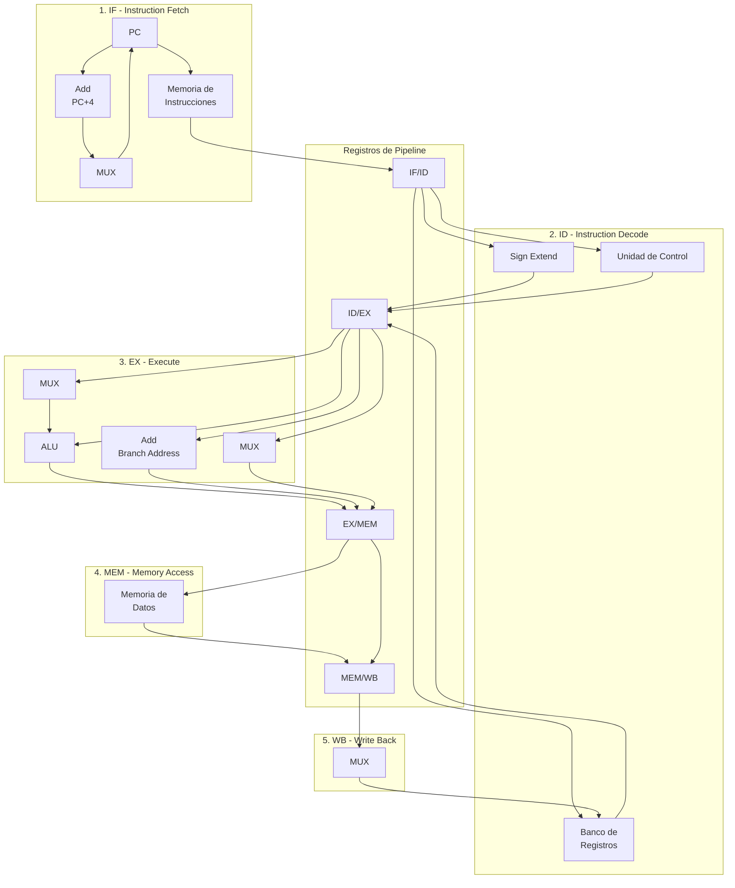

# Organización y Arquitectura de Computadoras - Cause segmentado de ejecución (pipeline)

## 7.2 Diseño de un procesador con cause segmentado

---

### 1. Introducción y Definición

El **diseño de un procesador con cauce segmentado** implica dividir la ruta de datos (_datapath_) y la unidad de control de una CPU monociclo en varias etapas discretas, separadas por registros de pipeline. Cada etapa trabaja en una parte diferente de una instrucción en cada ciclo de reloj, permitiendo la superposición de la ejecución de múltiples instrucciones y aumentando el rendimiento (throughput) del procesador.

El diseño fundamental que se estudia es el **pipeline de 5 etapas** clásico (Etapas de Búsqueda, Decodificación, Ejecución, Acceso a Memoria y Escritura), que es la base de arquitecturas como MIPS y RISC-V.

> "La segmentación es una técnica de implementación que explota el paralelismo entre las instrucciones de un flujo secuencial. La segmentación no es visible para el programador." — _Patterson & Hennessy, Computer Organization and Design_.

### 2. Las 5 Etapas del Pipeline Clásico (MIPS)

Cada instrucción requiere 5 pasos para su completa ejecución:

1.  **IF (Instruction Fetch - Búsqueda de instrucción):**
    - **Función:** Leer la instrucción desde la memoria.
    - **Señales de control:** `MemRead`, `IorD=0` (para seleccionar la dirección de instrucción).
    - **Componentes clave:** Memoria de Instrucciones, PC (Contador de Programa), Sumador (PC+4).

2.  **ID (Instruction Decode / Register Fetch - Decodificación / Lectura de registros):**
    - **Función:** Decodificar la instrucción y leer los registros del banco de registros. También se calcula la dirección de salto potencial (PC + offset) de manera temprana.
    - **Señales de control:** (La unidad de control establece la mayoría de sus señales en esta etapa).
    - **Componentes clave:** Banco de Registros, Unidad de Control, Sign-Extend (Extensión de signo).

3.  **EX (Execution / Address Calculation - Ejecución / Cálculo de dirección):**
    - **Función:** La ALU realiza la operación aritmética/lógica o calcula la dirección de memoria para un acceso.
    - **Señales de control:** `ALUSrc`, `ALUOp`, `RegDst`.
    - **Componentes clave:** ALU, MUX para operandos.

4.  **MEM (Memory Access - Acceso a memoria):**
    - **Función:** Acceder a la memoria de datos para instrucciones load (`lw`) o store (`sw`).
    - **Señales de control:** `MemRead`, `MemWrite`, `Branch`.
    - **Componentes clave:** Memoria de Datos.

5.  **WB (Write Back - Escritura):**
    - **Función:** Escribir el resultado de una operación (de la ALU o de memoria) en el banco de registros.
    - **Señales de control:** `MemtoReg`, `RegWrite`.
    - **Componentes clave:** MUX para seleccionar dato a escribir.

### 3. Diagrama del Datapath Segmentado

El siguiente diagrama de Mermaid.js muestra la integración de las 5 etapas, destacando los registros de pipeline (IF/ID, ID/EX, EX/MEM, MEM/WB) que aíslan cada etapa y el hardware adicional necesario (MUX, ALU, etc.).

### 4. Los Registros de Pipeline y La Unidad de Control

- **Registros de Pipeline (IF/ID, ID/EX, EX/MEM, MEM/WB):** Son el elemento clave del diseño. Actúan como "barreras" o registros de almacenamiento temporales entre cada etapa. Al final de un ciclo de reloj, todos los resultados generados en una etapa (junto con las señales de control necesarias para las etapas futuras) se capturan en el registro de pipeline que precede a la siguiente etapa. Esto asegura que la información de una instrucción avance sincrónicamente por el cauce.

- **Unidad de Control Segmentada:** A diferencia del diseño monociclo, la unidad de control en un pipeline debe generar las señales de control en la etapa ID, pero estas señales deben propagarse junto con la instrucción a través de los registros de pipeline para ser utilizadas en las etapas EX, MEM y WB en los ciclos correctos. Por ejemplo, la señal `RegWrite` se genera en ID pero no se usa hasta la etapa WB.

### 5. Fórmulas de Desempeño

El objetivo del pipeline es mejorar el **throughput** (rendimiento), medido en instrucciones por segundo.

- **Tiempo de Ejecución:**

  $$ Tiempo_{programa} = (N_{ciclos} + N_{stalls}) \times T_{ciclo} $$

  donde $N_{ciclos}$ es el número de instrucciones más los ciclos de penalización, y $T_{ciclo}$ es la duración del ciclo de reloj (generalmente dictada por la etapa más lenta).

- **Ciclos Por Instrucción (CPI) Ideal:**

  $$ CPI_{ideal} = 1 $$

  Esto significa que en promedio, se completa una instrucción por ciclo de reloj.

- **Speedup:**
  El speedup teórico máximo de un pipeline de $k$ etapas sobre un diseño monociclo es $k$, asumiendo que $T_{ciclo_{pipeline}} \approx T_{ciclo_{monociclo}}/k$ y que no hay _stalls_.
  
  $$ Speedup = \frac{Tiempo_{monociclo}}{Tiempo_{pipeline}} = \frac{CPI_{monociclo} \times T_{ciclo_{monociclo}} \times N_{inst}}{CPI_{pipeline} \times T_{ciclo_{pipeline}} \times N_{inst}} $$
  
  Asumiendo $CPI_{monociclo}=1$ y $T_{ciclo_{monociclo}} \approx k \times T_{ciclo_{pipeline}}$:
  
  $$ Speedup_{max} = \frac{1 \times (k \times T_{ciclo}) \times N_{inst}}{1 \times T_{ciclo} \times N_{inst}} = k $$

  El speedup real es menor debido a los _stalls_ ( $CPI_{pipeline} > 1$ ) y al overhead de los registros de pipeline ( $T_{ciclo_{pipeline}} > T_{ciclo_{monociclo}}/k$ ).

### 6. Ejercicios Propuestos

1.  **Análisis de Señales:** Sigue la instrucción `lw $t0, 4($s0)` (load word) a través de las 5 etapas del pipeline. Para cada etapa, identifica los valores clave en los registros de pipeline (e.g., el valor del PC, la instrucción, los registros leídos, el resultado de la ALU) y el estado de las señales de control relevantes (`RegWrite`, `MemtoReg`, `MemRead`, `ALUSrc`, etc.) en esa etapa.

2.  **Diseño de la Lógica de Forwarding:** El diagrama presentado no incluye la lógica de forwarding. Extiende el diagrama Mermaid con los caminos de forwarding necesarios (desde las salidas EX/MEM y MEM/WB hacia las entradas de la ALU en la etapa EX) y describe bajo qué condiciones (qué campos de los registros de pipeline deben compararse) se debe activar la forwarding.

3.  **Cálculo de Rendimiento:** Un programa de 1000 instrucciones se ejecuta en un pipeline de 5 etapas. El 15% de las instrucciones son loads (`lw`). El 20% de las instrucciones que siguen a un `lw` tienen una dependencia de datos RAW con él, lo que causa un _stall_ de 1 ciclo por cada dependencia (asume que NO hay forwarding). El 12% de las instrucciones son branches. La predicción de saltos usada tiene una tasa de acierto del 85%, y cada fallo incurre en una penalización de 2 ciclos. Calcula el número total de ciclos para ejecutar el programa y el CPI efectivo.

### 7. Referencias

- **Bibliografía Básica:**
  1.  Patterson, David A. y John L. Hennessy. _Computer Organization and Design: The Hardware/Software Interface_. 4a Ed. **Capítulo 4.5 - 4.8**. (La referencia principal y más clara para el diseño del pipeline de 5 etapas, con diagramas detallados del datapath).
  2.  Hennessy, John L. y David A. Patterson. _Computer Architecture: A Quantitative Approach_. 4a Ed. **Capítulo 1 y C.1 - C.2**. (Profundiza en los aspectos cuantitativos y de rendimiento).

- **Bibliografía Complementaria:**
  1.  Stallings, William. _Computer Organization and Architecture: Designing for Performance_. **Capítulo 12**. (Ofrece una perspectiva alternativa muy bien estructurada sobre el concepto de pipeline).
  2.  Harris, David y Sarah Harris. _Digital Design and Computer Architecture_. **Capítulo 7**. (Incluye excelentes diagramas y explicaciones paso a paso para construir el datapath segmentado).
