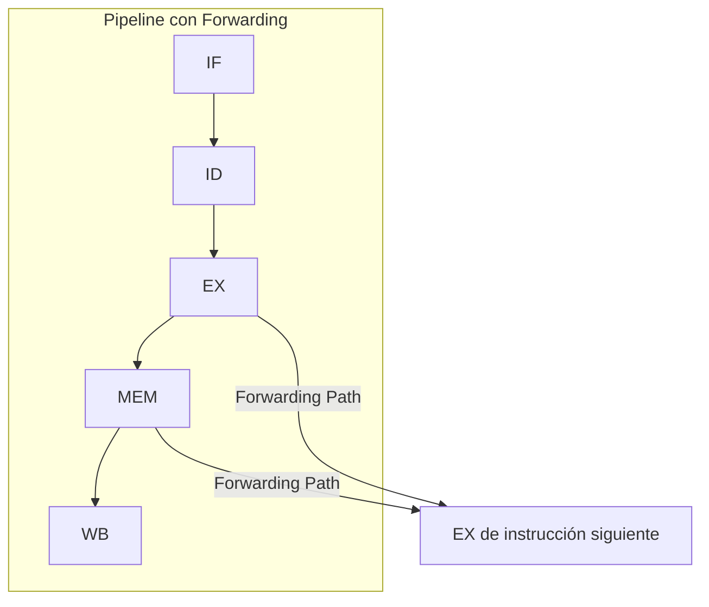
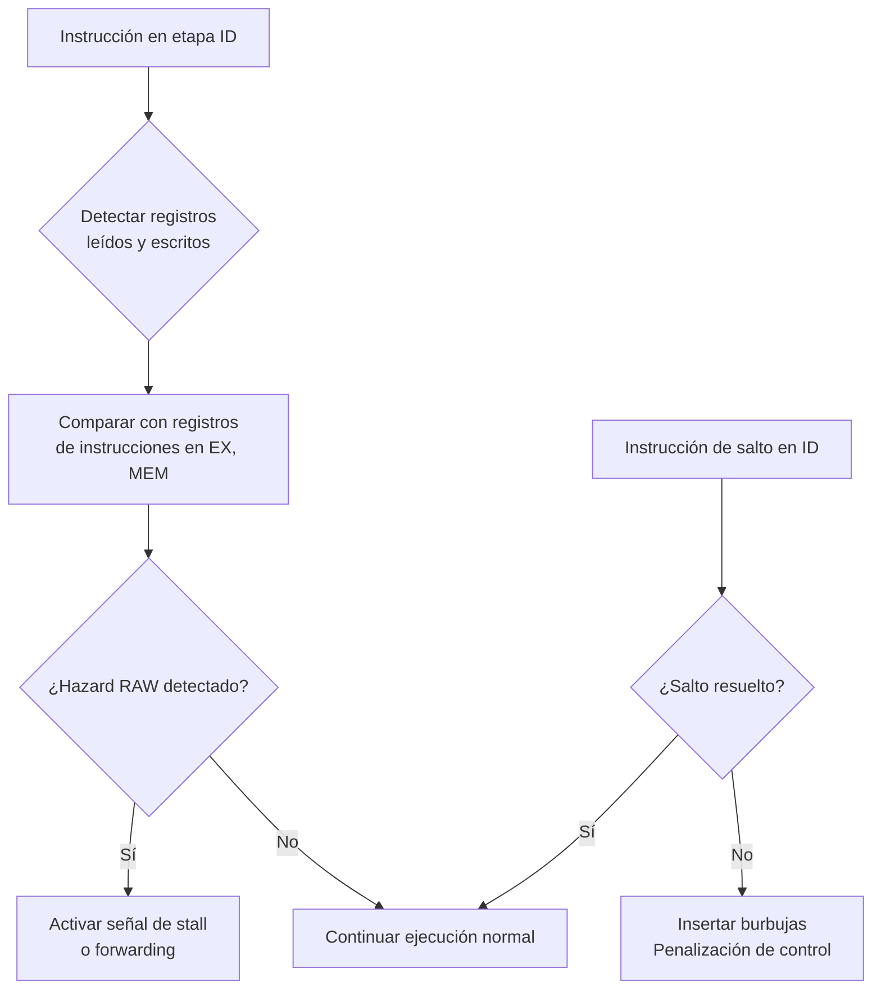

# Organización y Arquitectura de Computadoras - Cause segmentado de ejecución (pipeline)

## 7.3 Conictos (hazards) de control y de datos

---

### 1. Introducción a los Conflictos (Hazards)

En un pipeline ideal, esperaríamos que cada instrucción avance una etapa en cada ciclo de reloj, logrando un CPI (Ciclos Por Instrucción) de 1. Sin embargo, en la práctica, **los conflictos o hazards** impiden esta ejecución ideal, forzando al pipeline a detenerse (insertar _burbujas_ o _stalls_) y reduciendo el rendimiento.

> "Los hazards son situaciones que impiden que la siguiente instrucción en la secuencia de ejecución sea ejecutada durante el ciclo de reloj designado." — _Patterson & Hennessy, Computer Organization and Design_.

Existen tres tipos principales de hazards:

1. **Estructurales (Structural hazards)**
2. **De datos (Data hazards)**
3. **De control (Control hazards)**

### 2. Conflictos de Datos (Data Hazards)

Ocurren cuando una instrucción depende del resultado de una instrucción previa que aún no ha completado su ejecución en el pipeline.

#### Tipos de Dependencias y Hazards de Datos

| Tipo                        | Descripción                                                            | Ejemplo en código                      |
| --------------------------- | ---------------------------------------------------------------------- | -------------------------------------- |
| **RAW (Read After Write)**  | La instrucción posterior lee un registro que la anterior debe escribir | `ADD R1, R2, R3` <br> `SUB R4, R1, R5` |
| **WAR (Write After Read)**  | La instrucción posterior escribe un registro que la anterior debe leer | `ADD R1, R2, R3` <br> `SUB R2, R4, R5` |
| **WAW (Write After Write)** | Ambas instrucciones escriben en el mismo registro                      | `ADD R1, R2, R3` <br> `SUB R1, R4, R5` |

**Nota:** En pipelines simples en orden (como el de 5 etapas), los hazards RAW son los más comunes y críticos.

#### Ejemplo de Hazard RAW

```asm
ADD R1, R2, R3   ; Escribe en R1 en etapa WB
SUB R4, R1, R5   ; Lee R1 en etapa ID → ¡Problema!
AND R6, R1, R7   ; Lee R1 en etapa ID → ¡Problema!
OR R8, R1, R9    ; Lee R1 en etapa ID → ¡Problema!
```

**Visualización del problema:**

```mermaid
gantt
    title Ejemplo de Hazard RAW sin Forwarding
    dateFormat HH
    axisFormat %S

    section ADD R1, R2, R3
    IF :a1, 00, 1s
    ID :a2, after a1, 1s
    EX :a3, after a2, 1s
    MEM: a4, after a3, 1s
    WB :a5, after a4, 1s

    section SUB R4, R1, R5
    IF :b1, 01, 1s
    ID :b2, after b1, 1s
    EX :b3, after b2, 1s
    MEM: b4, after b3, 1s
    WB :b5, after b4, 1s

    section AND R6, R1, R7
    IF :c1, 02, 1s
    ID :c2, after c1, 1s
    EX :c3, after c2, 1s
    MEM: c4, after c3, 1s
    WB :c5, after c4, 1s
```



En este caso, la instrucción SUB necesita el valor de R1 durante la etapa ID, pero ADD no lo habrá escrito hasta la etapa WB, creando una dependencia RAW.

#### Soluciones a Hazards de Datos

1. **Stalling (Introducir burbujas):** Detener el pipeline hasta que el dato esté disponible
2. **Forwarding (Bypassing):** Conexiones directas para llevar resultados entre etapas
3. **Reorderamiento de código:** El compilador reorganiza instrucciones para evitar dependencias

**Diagrama de Forwarding/Bypassing:**



La técnica de forwarding permite que los resultados de la etapa EX o MEM se envíen directamente como entradas a la ALU, evitando esperar a la etapa WB.

### 3. Conflictos de Control (Control Hazards)

Ocurren debido a instrucciones de cambio de flujo (saltos, bifurcaciones, llamadas a procedimientos) donde no se sabe con certeza qué instrucción debe ejecutarse a continuación hasta que se resuelve la instrucción de control.

#### Ejemplo de Hazard de Control

```asm
    ...
    BNEZ R1, Label   ; Salto condicional
    ADD R2, R3, R4   ; Instrucción después del salto (¿ejecutar o no?)
    SUB R5, R6, R7   ; Instrucción después del salto (¿ejecutar o no?)
Label:
    OR R8, R9, R10
```

#### Soluciones a Hazards de Control

1. **Stalling:** Detener el pipeline hasta que se resuelva el salto
2. **Predicción de saltos estática:** Asumir siempre la misma dirección (p.ej., no tomar el salto)
3. **Predicción de saltos dinámica:** Usar historial para predecir saltos (Branch History Table)
4. **Ejecución especulativa:** Ejecutar instrucciones asumiendo una predicción
5. **Delay slots:** Posponer la decisión (arquitectura MIPS)

### 4. Fórmulas de Rendimiento con Hazards

El rendimiento real del pipeline se ve afectado por los hazards. El CPI efectivo considera estas penalizaciones:

**CPI efectivo:**

$$ CPI_{efectivo} = CPI_{ideal} + \text{Penalización}\_{stalls} = 1 + \text{Penalización}\_{stalls} $$

**Tiempo de ejecución:**

$$ T\_{\text{ejecución}} = N_{instrucciones} \times CPI_{efectivo} \times T_{ciclo} $$

**Penalización por stalls:**

$$ \text{Penalización}\_{stalls} = \frac{N\_{stalls}}{N\_{instrucciones}} $$

**Speedup con hazards:**

$$ Speedup = \frac{T_{sin\,pipeline}}{T_{con\,pipeline}} = \frac{N_{instrucciones} \times CPI_{sin\,pipeline} \times T_{ciclo\,largo}}{N_{instrucciones} \times PI_{efectivo} \times T_{ciclo\,corto}} $$

Para un pipeline de k etapas con CPI ideal = 1:

$$ Speedup = \frac{k}{1 + \text{Penalización}\_{stalls}} $$

### 5. Ejercicios Propuestos

1. **Identificación de Hazards:** Para el siguiente fragmento de código, identifica todos los hazards de datos (RAW, WAR, WAW) y de control. Asume un pipeline de 5 etapas sin forwarding ni predicción de saltos.

```asm
LOOP: LW R1, 0(R2)
      ADD R3, R1, R4
      SW R3, 0(R2)
      ADDI R2, R2, -4
      BNEZ R2, LOOP
      ADD R5, R6, R7
```

2. **Cálculo de Penalización:** En un pipeline de 5 etapas:
   - Los hazards RAW requieren 2 ciclos de stall sin forwarding y 0 con forwarding
   - Los hazards de control por saltos tienen una penalización de 3 ciclos
   - El 20% de las instrucciones son loads
   - El 30% de las instrucciones que siguen a un load tienen dependencia RAW con él
   - El 15% de las instrucciones son saltos

   Calcula el CPI efectivo (a) sin forwarding y (b) con forwarding.

3. **Análisis de Forwarding:** Diseña la lógica de forwarding para un hazard RAW donde una instrucción ADD en etapa EX necesita el resultado de una instrucción LW que está en etapa MEM. Muestra los circuitos necesarios y las condiciones de activación.

### 6. Diagrama de Detección de Hazards



### 7. Referencias

- **Bibliografía Básica:**
  1. Patterson, D. A. & Hennessy, J. L. (2008). _Computer Organization and Design: The Hardware/Software Interface_ (4ª ed.). Capítulo 4. Morgan Kaufmann.
  2. Hennessy, J. L. & Patterson, D. A. (2006). _Computer Architecture: A Quantitative Approach_ (4ª ed.). Capítulo 1 y 2. Morgan Kaufmann.

- **Bibliografía Complementaria:**
  1. Stallings, W. (2009). _Computer Organization and Architecture: Designing for Performance_ (8ª ed.). Capítulo 12. Prentice Hall.
  2. Harris, D. M. & Harris, S. L. (2012). _Digital Design and Computer Architecture_ (2ª ed.). Capítulo 7. Morgan Kaufmann.

### 8. Consejos para Resolución de Problemas

1. **Para hazards RAW:** Identifica lecturas después de escrituras en el mismo registro
2. **Para hazards de control:** Localiza todas las instrucciones de salto/bifurcación
3. **Al calcular penalizaciones:** Considera la frecuencia de cada tipo de instrucción
4. **Al diseñar soluciones:** Evalúa el balance entre complejidad hardware y mejora de rendimiento
