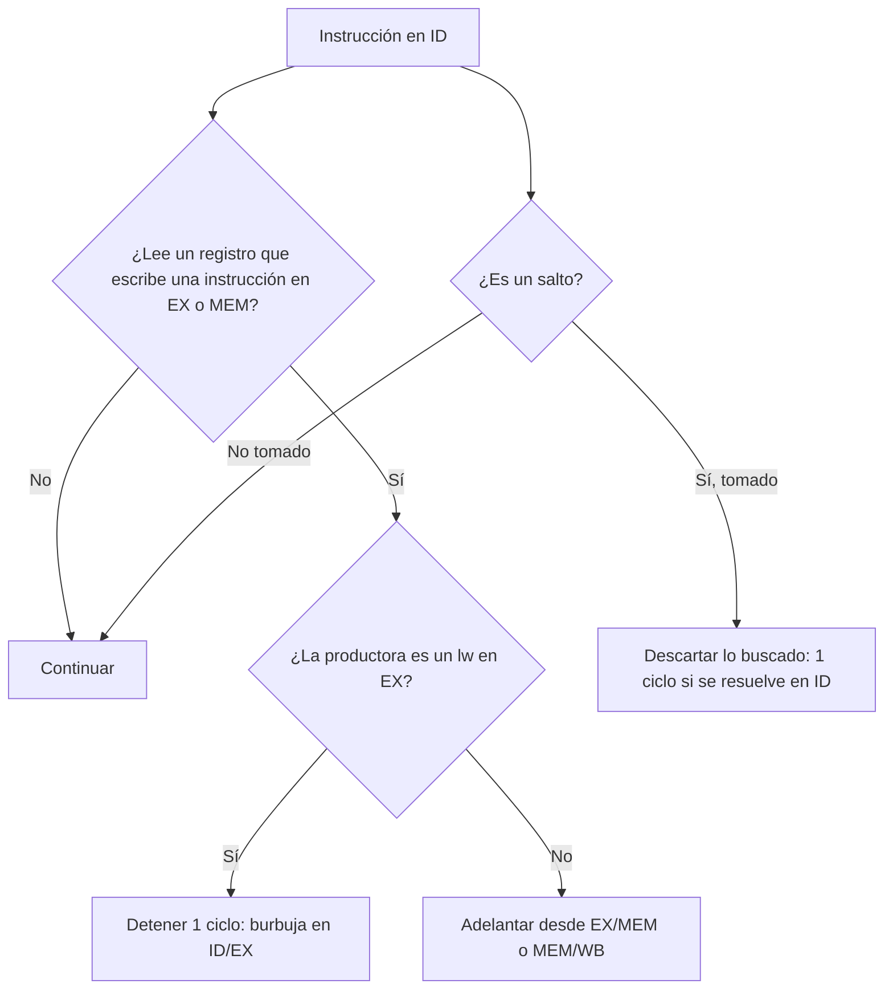

# Organización y Arquitectura de Computadoras - Cause segmentado de ejecución (pipeline)

## 7.3 Conflictos (hazards) de control y de datos

---

Un **conflicto** o **riesgo** (_hazard_) es una situación en la que la siguiente instrucción no puede ejecutarse en el ciclo que le corresponde sin dar un resultado incorrecto. Hay tres clases: **estructurales** (dos instrucciones necesitan el mismo recurso, tema 7.2), **de datos** (una instrucción necesita un resultado que aún no está disponible) y **de control** (no se sabe qué instrucción buscar porque un salto no se ha resuelto). La solución más simple siempre es **detener** (_stall_) la segmentación insertando burbujas, pero cuesta ciclos. Este tema estudia los riesgos de datos y de control en la segmentación de 5 etapas, el **adelantamiento** (_forwarding_), la detección del caso carga-uso, la resolución temprana de los saltos y la planificación de instrucciones por el compilador.

### Riesgos de datos

En la segmentación de MIPS, una instrucción lee sus registros en ID y escribe su resultado en WB, tres ciclos después. Si la instrucción siguiente necesita ese resultado, lo leería antes de que esté escrito: es un riesgo **RAW** (tema 7.1). Las WAR y WAW no causan riesgos aquí, porque todas las instrucciones leen y escriben en las mismas etapas y en orden.

**Sin adelantamiento**, la instrucción dependiente debe esperar en ID hasta el ciclo en que la productora está en WB (el banco de registros escribe en la primera mitad del ciclo y lee en la segunda). Si son consecutivas, son **2 ciclos de detención**.

**Adelantamiento.** El resultado de una operación de la ALU existe al final de la etapa EX, aunque no se escriba hasta WB. Se añaden caminos desde los registros EX/MEM y MEM/WB hasta las entradas de la ALU, con multiplexores controlados por una **unidad de adelantamiento**:

- Adelantar desde EX/MEM al operando `rs` si `EX/MEM.RegWrite` y `EX/MEM.rd ≠ 0` y `EX/MEM.rd = ID/EX.rs` (análogo para `rt`).
- Adelantar desde MEM/WB si `MEM/WB.RegWrite`, `MEM/WB.rd ≠ 0`, `MEM/WB.rd = ID/EX.rs` y **no** se cumple la condición anterior, porque el valor de EX/MEM es más reciente.

La comparación con el registro 0 evita adelantar valores "escritos" en `$zero`, que siempre vale 0. Con adelantamiento, las dependencias entre instrucciones aritméticas no causan detenciones.

**El caso carga-uso.** Un `lw` tiene su dato al final de MEM, un ciclo después de cuando la instrucción siguiente lo necesita en EX. Aun con adelantamiento, hay que detener **1 ciclo**. La **unidad de detección de riesgos**, en ID, lo detecta así: si `ID/EX.MemRead` y `ID/EX.rt` es igual a `IF/ID.rs` o a `IF/ID.rt`, entonces se detiene: no se actualizan el PC ni IF/ID, y se ponen a 0 las señales de control en ID/EX, lo que inserta una burbuja (una instrucción que no hace nada).

**Planificación por el compilador.** El compilador puede reordenar instrucciones independientes para separar la carga de su uso. Es la técnica del tema 8.1, y en el bucle de ejemplo elimina casi todas las detenciones.

### Riesgos de control

Un salto condicional no se resuelve hasta saber si se toma y a dónde va. Mientras tanto, la segmentación ya ha buscado las instrucciones siguientes. Opciones:

- **Detener** hasta resolver el salto: tantos ciclos como etapas haya hasta su resolución.
- **Predecir que no se toma** y seguir buscando secuencialmente; si se toma, se **descartan** (_flush_) las instrucciones buscadas, convirtiéndolas en burbujas. No cuesta nada si el salto no se toma.
- **Resolver antes:** si el salto se compara en MEM, la penalización es de 3 ciclos; moviendo la comparación de igualdad y el sumador del destino a ID, baja a 1 ciclo. El costo es que el salto necesita sus operandos en ID: si dependen de la instrucción anterior hay que detenerlo 1 ciclo (2 si es una carga).
- **Predicción dinámica** y **salto retardado** (tema 7.4).

**Penalización en el CPI:** $\text{CPI} = 1 + f_{\text{salto}} \cdot (\text{fracción mal predicha}) \cdot \text{penalización} + \text{detenciones por datos}.$



### Implementación en Python

El programa usa el simulador de calendario de la segmentación del tema 7.2 sobre un bucle que suma una constante a los elementos de un arreglo, y compara cuatro configuraciones: sin adelantamiento con los saltos resueltos en MEM; con adelantamiento; con los saltos resueltos en ID; y con las instrucciones reordenadas por el compilador. Muestra el diagrama de ciclos de la primera iteración y resuelve el ejercicio 2.

```python
# Simulador de una segmentación de 5 etapas (IF, ID, EX, MEM, WB) a nivel de calendario:
# calcula en qué ciclo entra cada instrucción a cada etapa, con o sin adelantamiento.
# Instrucciones: (op, destino, fuente1, fuente2, inmediato)  con op en add, sub, addi, lw, sw, beq, bne
ETAPAS = ["IF", "ID", "EX", "MEM", "WB"]


def fuentes(ins):
    op, d, s1, s2, _ = ins
    if op in ("add", "sub", "beq", "bne"):
        return [s1, s2]
    if op == "sw":
        return [s1, d]          # sw: d es el registro que se guarda, s1 la base
    return [s1]                 # addi, lw


def destino(ins):
    return None if ins[0] in ("sw", "beq", "bne") else ins[1]


def segmentar(programa, adelantamiento=True, salto_en="ID", R=None, M=None, max_instr=200):
    """Ejecuta el programa y devuelve la lista de (texto, {etapa: ciclo}) y el número de ciclos."""
    R = dict(R or {})
    M = dict(M or {})
    listo = {}              # registro -> primer ciclo en que su valor puede usarse en EX (adelantamiento)
    escrito = {}            # registro -> ciclo de WB (sin adelantamiento se lee en ID desde ese ciclo)
    filas, pc, sig_if, n = [], 0, 1, 0
    while pc < len(programa) and n < max_instr:
        ins = programa[pc]
        op, d, s1, s2, inm = ins
        c_if = sig_if
        c_id = c_if + 1
        if adelantamiento:
            c_ex = max([c_id + 1] + [listo.get(r, 0) for r in fuentes(ins) if r])
            if op in ("beq", "bne") and salto_en == "ID":   # el salto compara en ID: necesita los datos ahí
                c_ex = max([c_id + 1] + [listo.get(r, 0) + 1 for r in fuentes(ins) if r])
            c_id = c_ex - 1
        else:
            c_id = max([c_id] + [escrito.get(r, 0) for r in fuentes(ins) if r])
            c_ex = c_id + 1
        c_mem, c_wb = c_ex + 1, c_ex + 2
        etapas = {"IF": c_if, "ID": c_id, "EX": c_ex, "MEM": c_mem, "WB": c_wb}
        # ejecución funcional
        v = lambda r: R.get(r, 0)
        nuevo_pc = pc + 1
        if op == "add":
            R[d] = v(s1) + v(s2)
        elif op == "sub":
            R[d] = v(s1) - v(s2)
        elif op == "addi":
            R[d] = v(s1) + inm
        elif op == "lw":
            R[d] = M.get(v(s1) + inm, 0)
        elif op == "sw":
            M[v(s1) + inm] = v(d)
        elif op in ("beq", "bne"):
            if (v(s1) == v(s2)) == (op == "beq"):
                nuevo_pc = pc + 1 + inm
        dst = destino(ins)
        if dst:
            listo[dst] = c_mem if op == "lw" else c_ex     # el dato existe al final de esa etapa
            listo[dst] += 1
            escrito[dst] = c_wb
        tomado = op in ("beq", "bne") and nuevo_pc != pc + 1
        # la siguiente búsqueda: tras un salto tomado se pierde lo buscado hasta resolverlo
        sig_if = c_id if not tomado else (etapas[salto_en] + 1)
        sig_if = max(sig_if, c_if + 1)
        filas.append((texto(ins), etapas))
        pc, n = nuevo_pc, n + 1
    return filas, filas[-1][1]["WB"], R, M


def texto(ins):
    op, d, s1, s2, inm = ins
    if op in ("lw", "sw"):
        return f"{op} {d}, {inm}({s1})"
    if op == "addi":
        return f"{op} {d}, {s1}, {inm}"
    if op in ("beq", "bne"):
        return f"{op} {s1}, {s2}, {inm:+d}"
    return f"{op} {d}, {s1}, {s2}"


def diagrama(filas, ancho=None):
    ultimo = filas[-1][1]["WB"]
    ancho = ancho or ultimo
    lineas = []
    for t, e in filas:
        celdas = ["   "] * ancho
        for nombre, c in e.items():
            if c <= ancho:
                celdas[c - 1] = f"{nombre:3s}"[:3]
        for c in range(e["IF"] + 1, e["ID"]):           # ciclos detenido en IF
            celdas[c - 1] = " - "
        lineas.append((f"{t:18s}|" + "|".join(celdas)).rstrip())
    cab = f"{'ciclo':18s}|" + "|".join(f"{c:3d}" for c in range(1, ancho + 1))
    return "\n".join([cab] + lineas)


# Un bucle que suma R3 a cada elemento de un arreglo de 3 palabras, recorrido hacia abajo
original = [("lw", "R1", "R2", None, 0), ("add", "R1", "R1", "R3", 0), ("sw", "R1", "R2", None, 0),
            ("addi", "R2", "R2", None, -4), ("bne", None, "R2", "R0", -5)]
reordenado = [("lw", "R1", "R2", None, 0), ("addi", "R2", "R2", None, -4), ("add", "R1", "R1", "R3", 0),
              ("sw", "R1", "R2", None, 4), ("bne", None, "R2", "R0", -5)]
inicial = dict(R={"R2": 12, "R3": 100}, M={4: 1, 8: 2, 12: 3})
casos = [("sin adelantamiento, salto resuelto en MEM", original, False, "MEM"),
         ("con adelantamiento, salto resuelto en MEM", original, True, "MEM"),
         ("con adelantamiento, salto resuelto en ID", original, True, "ID"),
         ("reordenado, adelantamiento, salto en ID", reordenado, True, "ID")]
for nombre, prog, adel, salto in casos:
    filas, ciclos, R, M = segmentar(prog, adelantamiento=adel, salto_en=salto, **inicial)
    n = len(filas)
    print(f"{nombre:42s}: {n} instrucciones, {ciclos} ciclos, CPI = {(ciclos - 4) / n:.2f};"
          f" M = {[M[a] for a in (4, 8, 12)]}")
filas, _, _, _ = segmentar(original, adelantamiento=True, salto_en="ID", **inicial)
print("primera iteración y comienzo de la segunda (adelantamiento, salto en ID):")
print(diagrama(filas[:7], ancho=15))

# Ejercicio 2: CPI con los datos del enunciado
raw_sin = 0.20 * 0.30 * 2
control = 0.15 * 3
print(f"ejercicio 2: (a) sin adelantamiento CPI = 1 + {raw_sin:.2f} + {control:.2f} = {1 + raw_sin + control:.2f}")
raw_con = 0.20 * 0.30 * 1
print(f"             (b) con adelantamiento (queda 1 ciclo carga-uso) CPI = 1 + {raw_con:.2f} + {control:.2f}"
      f" = {1 + raw_con + control:.2f}; si se supusiera 0: {1 + control:.2f}")
```

Salida:

```text
sin adelantamiento, salto resuelto en MEM : 15 instrucciones, 43 ciclos, CPI = 2.60; M = [101, 102, 103]
con adelantamiento, salto resuelto en MEM : 15 instrucciones, 28 ciclos, CPI = 1.60; M = [101, 102, 103]
con adelantamiento, salto resuelto en ID  : 15 instrucciones, 27 ciclos, CPI = 1.53; M = [101, 102, 103]
reordenado, adelantamiento, salto en ID   : 15 instrucciones, 21 ciclos, CPI = 1.13; M = [101, 102, 103]
primera iteración y comienzo de la segunda (adelantamiento, salto en ID):
ciclo             |  1|  2|  3|  4|  5|  6|  7|  8|  9| 10| 11| 12| 13| 14| 15
lw R1, 0(R2)      |IF |ID |EX |MEM|WB |   |   |   |   |   |   |   |   |   |
add R1, R1, R3    |   |IF | - |ID |EX |MEM|WB |   |   |   |   |   |   |   |
sw R1, 0(R2)      |   |   |   |IF |ID |EX |MEM|WB |   |   |   |   |   |   |
addi R2, R2, -4   |   |   |   |   |IF |ID |EX |MEM|WB |   |   |   |   |   |
bne R2, R0, -5    |   |   |   |   |   |IF | - |ID |EX |MEM|WB |   |   |   |
lw R1, 0(R2)      |   |   |   |   |   |   |   |   |IF |ID |EX |MEM|WB |   |
add R1, R1, R3    |   |   |   |   |   |   |   |   |   |IF | - |ID |EX |MEM|WB
ejercicio 2: (a) sin adelantamiento CPI = 1 + 0.12 + 0.45 = 1.57
             (b) con adelantamiento (queda 1 ciclo carga-uso) CPI = 1 + 0.06 + 0.45 = 1.51; si se supusiera 0: 1.45
```

En el diagrama se ven las dos detenciones que quedan con adelantamiento y salto en ID: la de carga-uso (`add` espera un ciclo al `lw`) y la del salto, que necesita en ID el resultado de `addi`. Tras el salto tomado, la siguiente instrucción se busca en el ciclo 9: la que se buscó en el ciclo 8 se descartó. Al reordenar (subir el `addi` entre el `lw` y el `add`, y corregir el desplazamiento del `sw`), ambas detenciones desaparecen y el CPI baja de 2.60 a 1.13.

### Ejercicios Propuestos

1. **Identificación.** Identifica los riesgos de datos y de control del bucle

   ```asm
   LOOP: LW   R1, 0(R2)
         ADD  R3, R1, R4
         SW   R3, 0(R2)
         ADDI R2, R2, -4
         BNEZ R2, LOOP
         ADD  R5, R6, R7
   ```

   en una segmentación de 5 etapas sin adelantamiento ni predicción.

2. **Penalización.** Sin adelantamiento, una dependencia RAW cuesta 2 ciclos. El 20 % de las instrucciones son cargas y el 30 % de las instrucciones que siguen a una carga dependen de ella; el 15 % son saltos con 3 ciclos de penalización. Calcula el CPI sin y con adelantamiento.

3. **Adelantamiento desde MEM.** Diseña la lógica para que un `ADD` en EX use el resultado de un `LW` que está en MEM. ¿Es posible sin detener?

4. **Burbujas.** ¿Qué valores deben tener las señales de control de una burbuja y por qué basta con poner a 0 `RegWrite` y `MemWrite`?

### Soluciones

**Ejercicio 1.** RAW `R1` entre `LW` y `ADD` (2 ciclos sin adelantamiento); RAW `R3` entre `ADD` y `SW` (2 ciclos); RAW `R2` entre `ADDI` y `BNEZ` (2 ciclos si el salto lee en ID). Control: el salto; sin predicción, la búsqueda se detiene hasta resolverlo, y `ADD R5` solo se ejecuta al salir del bucle. Las WAR de `R2` (de `LW` y `SW` con `ADDI`) no causan riesgo.

**Ejercicio 2.** (a) $1 + 0.2 \cdot 0.3 \cdot 2 + 0.15 \cdot 3 = 1 + 0.12 + 0.45 = 1.57.$ (b) Con adelantamiento, la dependencia carga-uso sigue costando 1 ciclo: $1 + 0.06 + 0.45 = 1.51.$ Si se supusiera que el adelantamiento elimina todas las detenciones, saldría 1.45, pero eso es imposible para las cargas. Los saltos dominan: conviene reducir su penalización (tema 7.4).

**Ejercicio 3.** El dato del `LW` aparece al final de MEM, y el `ADD` lo necesita al principio de EX, en el mismo ciclo: no hay tiempo. Hay que detener el `ADD` un ciclo, y después adelantar desde MEM/WB: la unidad de detección compara `ID/EX.MemRead` e `ID/EX.rt` con los registros fuente de IF/ID, y la unidad de adelantamiento selecciona MEM/WB cuando `MEM/WB.rd = ID/EX.rs`.

**Ejercicio 4.** Una burbuja no debe cambiar el estado visible: basta con que no escriba registros (`RegWrite = 0`) ni memoria (`MemWrite = 0`); el resto de las señales puede tener cualquier valor, porque sus efectos no se guardan. Por eso el hardware pone a 0 todas las señales de control en ID/EX.

### Referencias

1. Patterson, D. A., and Hennessy, J. L., _Computer Organization and Design: The Hardware/Software Interface_. Morgan Kaufmann, 2020. Secciones 4.7 a 4.9.
2. Hennessy, J. L., and Patterson, D. A., _Computer Architecture: A Quantitative Approach_. Morgan Kaufmann, 2019. Apéndice C.
3. Shen, J. P., and Lipasti, M. H., _Modern Processor Design_. McGraw-Hill, 2005. Capítulo 2.
4. Stallings, W., _Organización y arquitectura de computadores_. Pearson, 2006. Capítulo 12.
