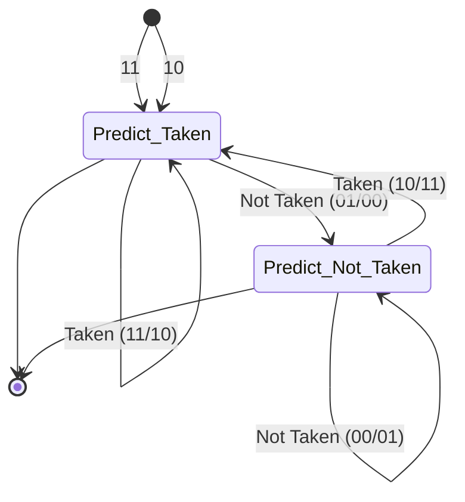
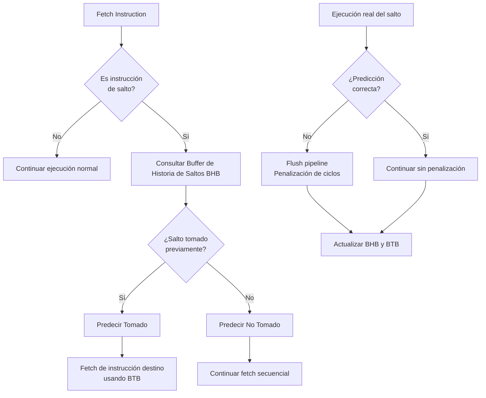

# Organización y Arquitectura de Computadoras - Cause segmentado de ejecución (pipeline)

## 7.4 Esquemas de predicción de salto, salto retardado (delayed branch)

---

### 1. Introducción a los Problemas de Control en Pipeline

Los saltos condicionales (branches) representan uno de los mayores desafíos para el rendimiento en procesadores segmentados. Cuando se encuentra una instrucción de salto, el procesador debe decidir si:

1. **Tomar el salto** (continuar ejecución en la dirección destino)
2. **No tomar el salto** (continuar con la siguiente instrucción secuencial)

La penalización por equivocarse en esta decisión puede ser significativa, ya que requiere descartar las instrucciones ejecutadas incorrectamente (flush del pipeline).

> "La predicción de saltos es crucial para el rendimiento en procesadores segmentados. Incluso una pequeña mejora en la precisión de predicción puede tener un impacto significativo en el rendimiento general." — _Patterson & Hennessy, Computer Organization and Design_.

### 2. Esquemas de Predicción de Salto

#### 2.1 Predicción Estática

Métodos que no dependen del comportamiento en tiempo de ejecución.

| Esquema                          | Descripción                             | Ventajas                             | Desventajas                      |
| -------------------------------- | --------------------------------------- | ------------------------------------ | -------------------------------- |
| **Predictor de salto retardado** | Usa delay slots                         | Simple                               | Depende del compilador           |
| **Predictor siempre tomado**     | Siempre predice que el salto se toma    | Simple, buen rendimiento para ciclos | Malo para saltos de fin de bucle |
| **Predictor nunca tomado**       | Siempre predice que el salto no se toma | Simple, buen rendimiento para bucles | Malo para saltos de condición    |
| **Predictor basado en opcode**   | Decide según el tipo de instrucción     | Mejor que siempre/nunca              | Precisión limitada               |

#### 2.2 Predicción Dinámica

Métodos que utilizan información de ejecución previa para mejorar las predicciones.

##### 2.2.1 Buffer de Historia de Saltos (BHB)

Almacena el resultado de saltos anteriores para predecir el futuro.

**Predictor de 1 bit:**

- 0: No tomado, 1: Tomado
- Cambia de predicción solo después de un error

**Predictor de 2 bits (máquina de estados finitos):**



##### 2.2.2 Buffer de Destino de Saltos (BTB)

Almacena direcciones destino de saltos para acelerar la obtención de la siguiente instrucción.

##### 2.2.3 Predictores Avanzados

- **Predictor por correlación:** Considera el comportamiento de saltos anteriores
- **Predictor híbrido:** Combina múltiples esquemas de predicción
- **Predictor neuronal:** Usa perceptrones para predecir basado en historial

### 3. Salto Retardado (Delayed Branch)

Técnica arquitectónica donde las instrucciones siguientes al salto (slot de delay) se ejecutan **independientemente** de si el salto se toma o no.

```asm
    ADD R1, R2, R3    ; Instrucción antes del salto
    BEQ R4, R5, Label ; Salto condicional
    SUB R6, R7, R8    ; Slot de delay (siempre se ejecuta)
    MULT R9, R10, R11 ; Instrucción después del salto (Label o secuencial)

Label:
    OR R12, R13, R14  ; Destino del salto
```

#### Rellenado de Slots de Delay

Estrategias para aprovechar los slots de delay (ordenadas de mejor a peor):

1. **De antes del salto:** Instrucciones independientes que preceden al salto
2. **De destino del salto:** Instrucciones del destino que no afectan el salto
3. **De continuación del salto:** Instrucciones de la secuencia que no afectan el salto
4. **NOP:** Si no hay instrucciones útiles disponibles

### 4. Fórmulas y Métricas de Rendimiento

#### Tasa de Acierto en Predicción

$$
\text{Tasa de acierto} = \frac{\text{Número de predicciones correctas}}{\text{Número total de predicciones}} \times 100\%
$$

#### Penalización por Error de Predicción

$$
\text{Penalización} = (\text{Etapas pipeline} - 1) \times \text{Ciclos por etapa}
$$

Para un pipeline de 5 etapas: Penalización = 4 ciclos

#### CPI Efectivo con Saltos

$$
CPI_{efectivo} = 1 + (\text{Frecuencia de saltos} \times \text{Tasa de error} \times \text{Penalización})
$$

#### Speedup con Predicción de Saltos

$$
\text{Speedup} = \frac{1}{1 + (\text{Frecuencia de saltos} \times \text{Tasa de error} \times \text{Penalización})}
$$

### 5. Ejemplos y Casos de Estudio

#### Ejemplo 1: Predicción Estática

```asm
loop:
    ADD R1, R1, R2
    SUBI R3, R3, 1
    BNEZ R3, loop   ; Salto que se toma múltiples veces y luego no
    NOP             ; Slot de delay
```

#### Ejemplo 2: Uso de Delay Slot

```asm
    ADDI R1, R0, 10        ; Inicializar contador
    ADD R2, R0, R0         ; Inicializar acumulador
loop:
    LW R3, 0(R4)           ; Cargar dato
    ADDI R4, R4, 4         ; Incrementar puntero (slot de delay útil)
    ADD R2, R2, R3         ; Acumular
    SUBI R1, R1, 1         ; Decrementar contador
    BNEZ R1, loop          ; Salto si contador != 0
    SW R2, result(R0)      ; Almacenar resultado (slot de delay)
```

### 6. Ejercicios Propuestos

1. **Análisis de Predicción:** Para un bucle que se ejecuta 100 veces:
   - Calcular la tasa de acierto de un predictor de 1 bit
   - Calcular la tasa de acierto de un predictor de 2 bits
   - Comparar la penalización total en ciclos para ambos casos

2. **Optimización de Delay Slots:** Dado el siguiente código, reordena las instrucciones para llenar el slot de delay eficientemente:

```asm
    ADD R1, R2, R3
    BEQ R4, R5, target
    NOP
    SUB R6, R7, R8
target:
    MULT R9, R10, R11
```

3. **Cálculo de Rendimiento:** Un programa tiene:
   - 20% de instrucciones son saltos condicionales
   - Predictor con 90% de acierto
   - Penalización por error: 4 ciclos
   - CPI ideal: 1

   Calcula el CPI efectivo y el porcentaje de degradación de rendimiento.

### 7. Diagrama de Arquitectura de Predicción



### 8. Implementación en Hardware

#### Registros de Predicción

- **BHB (Branch History Buffer):** Almacena historial de saltos
- **BTB (Branch Target Buffer):** Almacena direcciones destino
- **PHR (Pattern History Register):** Registro de patrones para predictores correlacionados

#### Lógica de Actualización

```verilog
// Ejemplo simplificado de predictor de 2 bits
module branch_predictor_2bit(
    input clk,
    input reset,
    input branch_taken,
    output predict_taken
);

    reg [1:0] state;

    // Lógica de predicción
    assign predict_taken = state[1];

    // Lógica de actualización
    always @(posedge clk or posedge reset) begin
        if (reset) begin
            state <= 2'b10; // Estado inicial: Predict Taken
        end else begin
            case (state)
                2'b00: state <= branch_taken ? 2'b01 : 2'b00;
                2'b01: state <= branch_taken ? 2'b10 : 2'b00;
                2'b10: state <= branch_taken ? 2'b11 : 2'b01;
                2'b11: state <= branch_taken ? 2'b11 : 2'b10;
            endcase
        end
    end

endmodule
```

### 9. Referencias

- **Bibliografía Básica:**
  1. Patterson, D. A. & Hennessy, J. L. (2008). _Computer Organization and Design: The Hardware/Software Interface_ (4ª ed.). Capítulo 4. Morgan Kaufmann.
  2. Hennessy, J. L. & Patterson, D. A. (2006). _Computer Architecture: A Quantitative Approach_ (4ª ed.). Capítulo 2 y 3. Morgan Kaufmann.

- **Bibliografía Complementaria:**
  1. Stallings, W. (2009). _Computer Organization and Architecture: Designing for Performance_ (8ª ed.). Capítulo 14. Prentice Hall.
  2. Smith, J. E. (1981). "A study of branch prediction strategies". _Proceedings of the 8th annual symposium on Computer Architecture_.

### 10. Consejos para el Estudio

1. **Entender primero los conceptos básicos** de pipeline antes de abordar la predicción de saltos
2. **Practicar con ejemplos numéricos** de tasas de acierto y penalizaciones
3. **Analizar código assembly** para identificar oportunidades de optimización con delayed branches
4. **Comparar diferentes esquemas** de predicción para entender sus ventajas y desventajas
5. **Utilizar herramientas de simulación** como SimpleScalar o gem5 para experimentar con diferentes predictores
