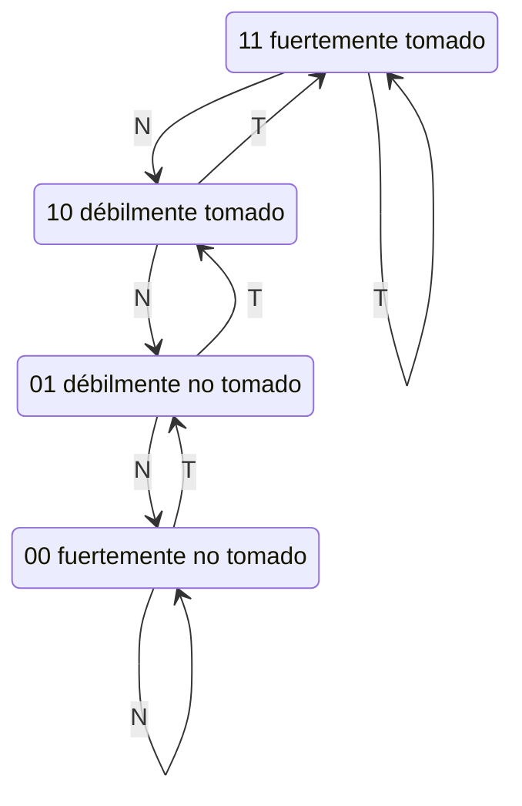

# Organización y Arquitectura de Computadoras - Cause segmentado de ejecución (pipeline)

## 7.4 Esquemas de predicción de salto, salto retardado (delayed branch)

---

Los saltos son entre el 15 % y el 25 % de las instrucciones ejecutadas, y en una segmentación cada salto mal manejado cuesta varios ciclos. En una segmentación de 5 etapas la penalización es de 1 a 3 ciclos; en los procesadores actuales, con 15 a 20 etapas y varias instrucciones por ciclo, un fallo de predicción desperdicia decenas de instrucciones. Este tema estudia las técnicas para reducir ese costo: la predicción **estática**, el **salto retardado** de los primeros RISC, y la predicción **dinámica** con predictores de 1 y 2 bits, predictores correlacionados y el **búfer de destinos de salto**.

### El costo de los saltos

Si una fracción $f$ de las instrucciones son saltos, una fracción $m$ de ellos se predice mal y cada fallo cuesta $p$ ciclos,

$$ \text{CPI} = \text{CPI}_{\text{ideal}} + f \cdot m \cdot p $$

Con $f = 0.2,$ $m = 0.1$ y $p = 4,$ el CPI pasa de 1 a 1.08. El efecto crece con la profundidad de la segmentación, que aumenta $p,$ y con la emisión múltiple (que reduce el CPI ideal, de modo que las penalizaciones pesan más).

### Predicción estática

La predicción no depende de la historia del programa:

- **No tomado:** seguir buscando secuencialmente. Es gratis de implementar, pero falla en los bucles, cuyo salto de cierre casi siempre se toma.
- **Tomado:** necesita conocer el destino pronto (en IF), lo que exige un búfer de destinos.
- **Hacia atrás tomado, hacia adelante no tomado** (BTFN): los saltos hacia atrás suelen cerrar bucles. Acierta en torno al 65 a 70 %.
- **Por el compilador:** con un bit de "probable" en la instrucción, basado en perfiles de ejecución.

### Salto retardado

En los primeros MIPS y SPARC, la instrucción que sigue al salto, en la **ranura de retardo** (_delay slot_), se ejecuta **siempre**, se tome o no el salto. Así la ranura nunca se desperdicia, siempre que el compilador encuentre una instrucción útil para ella:

1. **Una de antes del salto**, independiente de la condición. Es la mejor opción: siempre es útil.
2. **Una del destino**, si el salto suele tomarse (y se copia, porque el destino puede alcanzarse por otro camino). Solo es útil cuando se toma, y no debe hacer daño cuando no.
3. **Una de la ruta secuencial**, si el salto suele no tomarse.
4. Si no hay ninguna, un `nop`.

Los compiladores llenan útilmente alrededor del 50 a 60 % de las ranuras. El salto retardado ha caído en desuso: expone un detalle de la implementación en la ISA, y con segmentaciones profundas y emisión múltiple haría falta una ranura de varias instrucciones. Las ISA posteriores (Alpha, ARM, RISC-V) no lo tienen.

### Predicción dinámica

**Predictor de 1 bit.** Una tabla indexada con bits bajos del PC guarda si el salto se tomó la última vez, y se predice lo mismo. En un bucle de $n$ iteraciones falla **dos veces** por ejecución: en la última iteración (predijo tomado) y en la primera de la siguiente ejecución (predijo no tomado, por la salida anterior).

**Predictor de 2 bits** (contador saturado). Cada entrada es un contador de 0 a 3: tomado incrementa y no tomado decrementa, sin pasar de los extremos; se predice tomado con 2 o 3. Hacen falta **dos fallos seguidos** para cambiar la predicción, así que una salida de bucle aislada no la cambia: un fallo por ejecución del bucle.



**Predictores correlacionados.** El comportamiento de un salto suele depender de los saltos recientes (por ejemplo, `if (a == 2)` seguido de `if (a != 2)`). Un registro de **historia global** con los resultados de los últimos $h$ saltos se combina con el PC para elegir el contador: el predictor **gshare** usa $\text{PC} \oplus \text{historia}$ como índice. Así aprende patrones como "tomado, no tomado, tomado..." o bucles cortos de longitud fija, que un contador de 2 bits no puede capturar. Los procesadores actuales combinan varios predictores (predictores de **torneo**, y los TAGE, con historias de varias longitudes) y aciertan más del 95 % en programas de enteros.

**Búfer de destinos de salto** (BTB). Predecir "tomado" no basta: hay que saber **a dónde** saltar en el ciclo IF, antes de decodificar. El BTB es una pequeña caché indexada por el PC de las instrucciones de salto que guarda la dirección destino predicha. Si el PC actual está en el BTB y se predice tomado, el siguiente PC es el destino guardado, sin ninguna penalización. Para los retornos de subrutina se usa una **pila de direcciones de retorno**.

### Implementación en Python

El programa simula los predictores estáticos, el de 1 bit, el de 2 bits y un gshare con 4 bits de historia sobre cuatro secuencias de resultados de saltos, resuelve los ejercicios 1 y 3 y calcula los ciclos perdidos con salto retardado según la fracción de ranuras útiles.

```python
# Predictores de saltos sobre secuencias de resultados (1 = tomado, 0 = no tomado)
def bucle(iteraciones, veces):
    """Salto de cierre de un bucle: tomado iteraciones - 1 veces y luego no tomado."""
    return [(0x40, int(i < iteraciones - 1)) for _ in range(veces) for i in range(iteraciones)]


class UnBit:
    def __init__(self, inicial=0):
        self.tabla, self.inicial = {}, inicial

    def predecir(self, pc):
        return self.tabla.get(pc, self.inicial)

    def actualizar(self, pc, tomado):
        self.tabla[pc] = tomado


class DosBits:
    """Contador saturado: 0, 1 predicen no tomado; 2, 3 predicen tomado."""

    def __init__(self, inicial=1):
        self.tabla, self.inicial = {}, inicial

    def predecir(self, pc):
        return int(self.tabla.get(pc, self.inicial) >= 2)

    def actualizar(self, pc, tomado):
        c = self.tabla.get(pc, self.inicial)
        self.tabla[pc] = min(3, c + 1) if tomado else max(0, c - 1)


class Gshare:
    """Contadores de 2 bits indexados con PC xor historia global de h bits."""

    def __init__(self, h=4):
        self.h, self.historia, self.tabla = h, 0, {}

    def _i(self, pc):
        return (pc ^ self.historia) & ((1 << self.h) - 1)

    def predecir(self, pc):
        return int(self.tabla.get(self._i(pc), 1) >= 2)

    def actualizar(self, pc, tomado):
        i = self._i(pc)
        c = self.tabla.get(i, 1)
        self.tabla[i] = min(3, c + 1) if tomado else max(0, c - 1)
        self.historia = ((self.historia << 1) | tomado) & ((1 << self.h) - 1)


class Estatico:
    def __init__(self, valor):
        self.valor = valor

    def predecir(self, pc):
        return self.valor

    def actualizar(self, pc, tomado):
        pass


def evaluar(pred, traza):
    fallos = 0
    for pc, t in traza:
        fallos += pred.predecir(pc) != t
        pred.actualizar(pc, t)
    return fallos


trazas = {
    "bucle de 100, una vez": bucle(100, 1),
    "bucle de 100, 10 veces": bucle(100, 10),
    "bucle de 4, 25 veces": bucle(4, 25),
    "alternado T N T N ...": [(0x80, i % 2) for i in range(100)],
}
predictores = {"no tomado": lambda: Estatico(0), "tomado": lambda: Estatico(1), "1 bit": lambda: UnBit(),
               "2 bits": lambda: DosBits(), "gshare": lambda: Gshare()}
print(f"{'traza':24s}" + "".join(f"{p:>11s}" for p in predictores))
for nombre, traza in trazas.items():
    fila = []
    for p in predictores.values():
        f = evaluar(p(), traza)
        fila.append(f"{100 * (1 - f / len(traza)):9.1f} %")
    print(f"{nombre:24s}" + "".join(f"{x:>11s}" for x in fila))

# Ejercicio 1: fallos del bucle de 100 y penalización con 3 ciclos por fallo
for nombre, p in (("1 bit", UnBit()), ("2 bits", DosBits())):
    f = evaluar(p, bucle(100, 10))
    print(f"ejercicio 1, {nombre}: {f} fallos en 10 ejecuciones del bucle = {f / 10:.1f} por ejecución,"
          f" {3 * f} ciclos de penalización")

# Ejercicio 3
cpi = 1 + 0.20 * 0.10 * 4
print(f"ejercicio 3: CPI = {cpi:.2f}; el programa tarda un {cpi - 1:.0%} más;"
      f" el rendimiento baja un {1 - 1 / cpi:.1%}")


# Salto retardado: fracción de ranuras útiles
def ciclos_retardado(n_saltos, llenadas):
    return n_saltos * (1 - llenadas)        # ciclos perdidos (la ranura vacía lleva un nop)


print("salto retardado con 1 ranura y 1000 saltos: ciclos perdidos con 0 %, 60 % y 100 % de ranuras útiles:",
      [ciclos_retardado(1000, x) for x in (0.0, 0.6, 1.0)])
```

Salida:

```text
traza                     no tomado     tomado      1 bit     2 bits     gshare
bucle de 100, una vez         1.0 %     99.0 %     98.0 %     98.0 %     94.0 %
bucle de 100, 10 veces        1.0 %     99.0 %     98.0 %     98.9 %     98.2 %
bucle de 4, 25 veces         25.0 %     75.0 %     50.0 %     74.0 %     94.0 %
alternado T N T N ...        50.0 %     50.0 %      1.0 %     50.0 %     97.0 %
ejercicio 1, 1 bit: 20 fallos en 10 ejecuciones del bucle = 2.0 por ejecución, 60 ciclos de penalización
ejercicio 1, 2 bits: 11 fallos en 10 ejecuciones del bucle = 1.1 por ejecución, 33 ciclos de penalización
ejercicio 3: CPI = 1.08; el programa tarda un 8% más; el rendimiento baja un 7.4%
salto retardado con 1 ranura y 1000 saltos: ciclos perdidos con 0 %, 60 % y 100 % de ranuras útiles: [1000.0, 400.0, 0.0]
```

Con un bucle de solo 4 iteraciones, el predictor de 1 bit falla en la mitad de los casos y el de 2 bits en una de cada cuatro; el gshare, que ve en la historia cuántas veces se ha tomado el salto, aprende cuándo sale el bucle y acierta el 94 %. En la secuencia alternada, el de 1 bit falla siempre (salvo la primera vez), el de 2 bits la mitad, y el gshare aprende el patrón.

### Ejercicios Propuestos

1. **1 y 2 bits.** Un bucle de 100 iteraciones se ejecuta 10 veces. Calcula el porcentaje de aciertos con predictores de 1 y de 2 bits, y los ciclos de penalización si cada fallo cuesta 3.

2. **Ranura de retardo.** Reordena el código para llenar la ranura de retardo:

   ```asm
       ADD  R1, R2, R3
       BEQ  R4, R5, target
       NOP
       SUB  R6, R7, R8
   target:
       MULT R9, R10, R11
   ```

3. **CPI.** El 20 % de las instrucciones son saltos condicionales, el predictor acierta el 90 % y cada fallo cuesta 4 ciclos. Calcula el CPI y la pérdida de rendimiento frente al CPI ideal de 1.

4. **Bucles anidados.** ¿Por qué el predictor de 2 bits es mejor que el de 1 bit para el salto de un bucle interno que se ejecuta muchas veces?

### Soluciones

**Ejercicio 1.** 1 bit: 2 fallos por ejecución del bucle (al salir y al volver a entrar), 20 de 1000: 98 % de aciertos y 60 ciclos de penalización. 2 bits: 1 fallo por ejecución (al salir; el contador baja de 3 a 2 y sigue prediciendo tomado), más uno al principio mientras se calienta el contador: 11 fallos, 98.9 % y 33 ciclos.

**Ejercicio 2.** `ADD R1, R2, R3` no influye en la condición del salto (que usa `R4` y `R5`) y se ejecuta en ambos caminos, así que puede ocupar la ranura:

```asm
    BEQ  R4, R5, target
    ADD  R1, R2, R3        ; ranura de retardo: se ejecuta siempre
    SUB  R6, R7, R8
target:
    MULT R9, R10, R11
```

Se elimina el `NOP` y se ahorra un ciclo por ejecución del salto.

**Ejercicio 3.** $\text{CPI} = 1 + 0.2 \cdot 0.1 \cdot 4 = 1.08:$ el programa tarda un 8 % más, es decir, el rendimiento baja un $1 - 1/1.08 \approx 7.4\,\%.$

**Ejercicio 4.** El salto del bucle interno se toma muchas veces seguidas y falla solo al salir. El predictor de 1 bit cambia a "no tomado" con esa salida y vuelve a fallar en la primera iteración de la siguiente ejecución; el de 2 bits pasa de "fuertemente tomado" a "débilmente tomado" y sigue prediciendo tomado, ahorrando un fallo por cada ejecución del bucle interno.

### Referencias

1. Hennessy, J. L., and Patterson, D. A., _Computer Architecture: A Quantitative Approach_. Morgan Kaufmann, 2019. Sección 3.3 y apéndice C.
2. Patterson, D. A., and Hennessy, J. L., _Computer Organization and Design: The Hardware/Software Interface_. Morgan Kaufmann, 2020. Sección 4.9.
3. Smith, J. E., A study of branch prediction strategies. _ISCA_, 1981.
4. McFarling, S., Combining branch predictors. _DEC WRL Technical Note TN-36_, 1993.
5. Seznec, A., and Michaud, P., A case for (partially) TAgged GEometric history length branch prediction. _Journal of Instruction-Level Parallelism_ 8, 2006.
