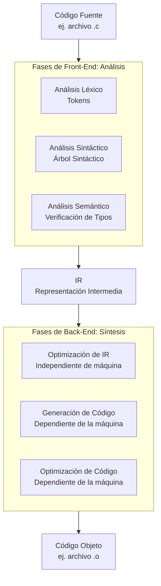

# Organización y Arquitectura de Computadoras - La relación hardware-software

## 8.1 El papel del compilador en el desempeño del sistema

---

### 1. Introducción y Definición

El compilador es un software fundamental que actúa como **traductor** y **optimizador** entre el lenguaje de alto nivel (entendible por el humano) y el lenguaje de máquina (entendible por el hardware). Su diseño y eficacia tienen un impacto directo y profundo en el desempeño del sistema computacional.

> **Definición:** Un compilador es un programa que traduce código escrito en un lenguaje de programación (código fuente) a otro lenguaje (código objeto, típicamente en lenguaje de máquina). Su objetivo no es solo la traducción correcta, sino también la generación de código eficiente que explote al máximo las características del hardware subyacente (Patterson & Hennessy, 2008).

### 2. El Proceso de Compilación: De Alto Nivel a Máquina

El compilador no es un programa monolítico; realiza su trabajo en varias fases. Comprender este proceso es clave para ver dónde se aplican las optimizaciones.



- **Front-End (Análisis):** Es independiente de la máquina objetivo. Se encarga del análisis léxico, sintáctico y semántico, generando una **Representación Intermedia (IR)** del código fuente.
- **Back-End (Síntesis):** Es dependiente de la arquitectura objetivo (CPU, conjunto de instrucciones). Toma la IR y la transforma en código de máquina, aplicando las optimizaciones más críticas para el desempeño.

### 3. Funciones del Compilador que Afectan el Desempeño

El compilador mejora el desempeño mediante optimizaciones que reducen la cantidad de instrucciones ejecutadas, mejoran la localidad de los datos y aprovechan características específicas del hardware.

#### 3.1. Optimizaciones Clásicas (Nivel de Máquina)

- **Asignación de Registros:** La CPU accede a los registros muchísimo más rápido que a la memoria principal. Un buen compilador asigna variables frecuentemente usadas a registros para minimizar costosas accesos a memoria (`LOAD` y `STORE`).
  - **Ejemplo:** `a = b + c; d = a + e;` Un compilador óptimo mantendría el valor de `a` en un registro para la segunda operación.
- **Eliminación de Código Muerto (Dead Code Elimination):** Remueve código cuyo resultado nunca se usa.
- **Propagación de Constantes (Constant Propagation):** Reemplaza variables con valores constantes conocidos en tiempo de compilación.
- **Eliminación de Subexpresiones Comunes (Common Subexpression Elimination):** Evita recalcular la misma expresión múltiples veces.
  - **Ejemplo:** `x = a + b * c; y = d + b * c;` -> `temp = b * c; x = a + temp; y = d + temp;`
- **Optimización de Bucles (Loop Optimization):** Quizás la más importante para el desempeño.
  - **Movimiento de Código Invariante (Loop-Invariant Code Motion):** Saca fuera del bucle cálculos que son constantes en cada iteración.
  - **Enrollamiento de Bucles (Loop Unrolling):** Reduce la sobrecarga de la instrucción de salto (branch) replicando el cuerpo del bucle.
    ```c
    // Original
    for (int i = 0; i < 100; i++) {
        a[i] = b[i] + c;
    }

    // Unrolled (factor 4)
    for (int i = 0; i < 100; i += 4) {
        a[i]   = b[i]   + c;
        a[i+1] = b[i+1] + c;
        a[i+2] = b[i+2] + c;
        a[i+3] = b[i+3] + c;
    }
    ```

#### 3.2. Aprovechamiento de la Arquitectura del Procesador

Un compilador moderno y avanzado (como GCC, Clang, ICC) está diseñado para conocer profundamente la microarquitectura de CPUs específicas (e.g., Intel Ice Lake, AMD Zen 3).

- **Planificación de Instrucciones (Instruction Scheduling):** Reordena las instrucciones generadas para evitar **atascos (pipeline stalls)** y mantener el pipeline de la CPU lo más lleno posible. Reordena instrucciones independientes para llenar "huecos".
- **Uso de Instrucciones Especializadas:** Utiliza instrucciones de la ISA que son más eficientes, como instrucciones **SIMD** (Single Instruction, Multiple Data) como SSE, AVX para paralelismo a nivel de dato.
  - **Ejemplo:** Un compilador puede vectorizar un bucle que suma dos arrays, usando una instrucción AVX que suma 8 números de punto flotante de 32 bits a la vez, en lugar de 8 instrucciones escalares.
- **Predicción de Saltos:** Aunque la predicción de saltos es un mecanismo hardware, el compilador puede ayudar reordenando el código para que el camino más probable (e.g., el `if` más frecuente) sea el que no requiere un salto, mejorando la efectividad del predictor.

### 4. La Interacción Crítica: Compilador - Sistema Operativo - Hardware

El desempeño final es el resultado de esta tríada. El compilador genera el código, pero este se ejecuta en un entorno gestionado por el SO sobre el hardware físico.

- **Sistema Operativo:** El SO maneja la memoria virtual, la caché de disco y la planificación de procesos. Un código generado por el compilador con buena **localidad espacial y temporal** (ej. acceder a arrays de forma secuencial) interactúa mucho mejor con los algoritmos de caché y paginación del SO, reduciendo los _page faults_.
- **Hardware (CPU, Memoria, I/O):** El compilador debe generar código que se adapte a las características específicas del hardware: tamaño de las líneas de caché, número y latencia de los registros, profundidad del pipeline, etc. Esta es la razón por la que compilar un programa _en la misma máquina_ donde se ejecutará (`-march=native` en GCC) a menudo da un mejor rendimiento.

### 5. Ejercicios Propuestos

1.  **Análisis de Bucle:** Dado el siguiente fragmento de código en C, identifica al menos tres optimizaciones que un compilador podría aplicar. Reescribe el código de manera "óptima" como lo haría el compilador después de las optimizaciones.

    ```c
    int i, j;
    int array[100][100];
    int constant = 10;
    for (i = 0; i < 100; i++) {
        for (j = 0; j < 100; j++) {
            array[i][j] = constant * 5 + i * j;
        }
    }
    ```

    _Posibles optimizaciones: Propagación de constantes, movimiento de código invariante, optimización de acceso a memoria (localidad)._

2.  **Debate:** ¿Por qué es imposible o muy difícil para un compilador predecir con total exactitud el desempeño de un programa en una arquitectura moderna con ejecución fuera de orden y predicción especulativa?

3.  **Investigación:** Investiga qué flags de optimización usa tu compilador favorito (e.g., `-O1`, `-O2`, `-O3` en GCC). ¿Qué tipo de optimizaciones se habilitan en cada nivel? ¿Por qué la opción `-O3` no siempre es la mejor?

### 6. Referencias

- **Patterson, David A. y John L. Hennessy** (2008). _Computer Organization and Design: The Hardware/Software Interface_ (4a Ed.). Capítulos 2 (Instrucciones) y 3 (Aritmética para Computadoras) discuten cómo la ISA influye en las decisiones del compilador.
- **Hennessy, John L. y David A. Patterson** (2006). _Computer Architecture: A Quantitative Approach_ (4a Ed.). Capítulo 2 ("Instruction-Level Parallelism and Its Exploitation") profundiza en cómo los compiladores aprovechan el paralelismo para CPUs modernas.
- **Stallings, William** (2009). _Computer Organization and Architecture: Designing for Performance_. Ofrece una muy buena descripción general de la organización de la computadora y el papel del software.
- **Tanenbaum, Andrew S.** (2005). _Structured Computer Organization_ (5a Ed.). Explica la estructura de capas de un sistema computacional, ubicando perfectamente al compilador en esta jerarquía.
