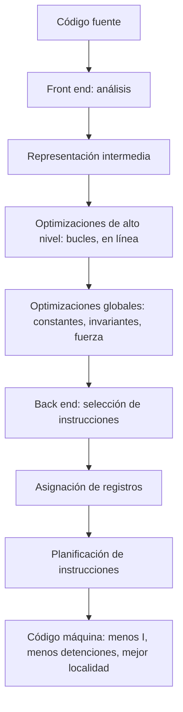

# Organización y Arquitectura de Computadoras - La relación hardware-software

## 8.1 El papel del compilador en el desempeño del sistema

---

En la ecuación $T = I \times \text{CPI} \times t_c$ (tema 1.2), el compilador influye directamente en los dos primeros factores: decide **cuántas** instrucciones se ejecutan y en **qué orden**, lo que determina cuántas detenciones sufre la segmentación y cómo se aprovechan las cachés. El mismo programa, en el mismo procesador, puede ser varias veces más rápido según cómo se compile. Además, desde los años ochenta las ISA se diseñan pensando en lo que un compilador puede aprovechar. Este tema describe la estructura de un compilador, las principales optimizaciones, su efecto medido sobre un ejemplo real y la relación entre el compilador y la arquitectura.

### Estructura de un compilador

| Fase | Entrada → salida | Qué hace |
| --- | --- | --- |
| análisis léxico, sintáctico y semántico (_front end_) | texto → árbol sintáctico | depende del lenguaje |
| generación de código intermedio | árbol → representación intermedia (RI) | independiente del lenguaje y de la máquina |
| optimizaciones de alto nivel | RI → RI | sobre bucles y procedimientos: desenrollado, intercambio de bucles, expansión en línea |
| optimizaciones globales | RI → RI | sobre el grafo de flujo de control: subexpresiones comunes, código invariante, reducción de fuerza |
| generación de código (_back end_) | RI → ensamblador | selección de instrucciones, **asignación de registros**, **planificación de instrucciones** |

Esta organización permite reutilizar las fases: GCC y LLVM tienen *front ends* para C, C++, Fortran, Rust y otros lenguajes, y *back ends* para x86, ARM, RISC-V y muchas ISA más, todos sobre la misma RI.

### Optimizaciones principales

| Optimización | Qué hace | Ejemplo |
| --- | --- | --- |
| propagación y plegado de constantes | calcula en compilación lo que es constante | `constante * 5` con `constante = 10` → `50` |
| eliminación de subexpresiones comunes | calcula una vez lo que se repite | `a[i] = b*c + d; e = b*c;` |
| movimiento de código invariante | saca de los bucles lo que no cambia en ellos | `5 * constante` antes del bucle |
| reducción de fuerza | sustituye operaciones caras por baratas | `i * j` en un bucle sobre `j` → sumar `i` en cada iteración; `x * 8` → `x << 3` |
| eliminación de código muerto | quita lo que no afecta al resultado | asignaciones nunca leídas |
| asignación de registros | mantiene variables en registros | por coloreado de grafos |
| planificación de instrucciones | reordena para evitar detenciones | separar una carga de su uso (tema 7.3) |
| desenrollado de bucles | repite el cuerpo $k$ veces | menos saltos y más instrucciones para planificar |
| intercambio y bloqueo de bucles | cambia el orden de recorrido | recorrer matrices en el orden en que están en memoria |
| vectorización | usa instrucciones SIMD | procesar 4 u 8 elementos por instrucción |
| expansión en línea | sustituye una llamada por el cuerpo | elimina el costo de la llamada |

**Asignación de registros.** Es probablemente la optimización más importante en una arquitectura load-store: cada variable que vive en un registro ahorra cargas y almacenamientos. Se modela como el **coloreado de un grafo** en el que los nodos son variables y hay una arista entre dos variables que están vivas a la vez; los colores son los registros. Si no alcanzan los registros, algunas variables se **derraman** (_spill_) a memoria. Por eso conviene que la ISA tenga muchos registros de propósito general.

**Lo que el compilador no puede hacer.** Debe garantizar que el programa optimizado produce el mismo resultado en **todos** los casos. Si no puede demostrar que dos punteros no apuntan a la misma memoria (**alias**), no puede reordenar sus accesos ni mantener sus valores en registros. En C, la palabra clave `restrict` permite al programador prometer que no hay alias.

**Por qué el compilador no puede predecir el desempeño exacto.** En un procesador moderno el tiempo depende de los fallos de caché, que dependen de los datos y de otros programas; de los aciertos del predictor de saltos, que dependen de la historia de ejecución; y de la ejecución fuera de orden y especulativa (tema 12), que reordena dinámicamente las instrucciones. El compilador trabaja con modelos aproximados, y la **optimización guiada por perfiles** (compilar, ejecutar con datos representativos y recompilar con las mediciones) mejora sus decisiones.

### Un ejemplo medido

El bucle del ejercicio 1 compilado con GCC para x86-64:

```c
int array[100][100];

void llenar(int constante) {
    for (int i = 0; i < 100; i++)
        for (int j = 0; j < 100; j++)
            array[i][j] = constante * 5 + i * j;
}
```

Con `-O0` (sin optimizar) cada variable vive en la pila y se carga y almacena en cada uso, y el cálculo de la dirección `array[i][j]` se repite completo. Con `-O1` el bucle interno queda en cinco instrucciones: `5 * constante` se calcula una sola vez fuera de los bucles (`leal (%rdi,%rdi,4)`), `i * j` se sustituye por una suma acumulada (`addl %esi, %edx`) y la dirección se recorre con un puntero que avanza 4 bytes:

```text
llenar:
	leaq	400+array(%rip), %rcx
	leal	(%rdi,%rdi,4), %r8d
	movl	$0, %edi
.L2:
	movl	%edi, %esi
	leaq	-400(%rcx), %rax
	movl	%r8d, %edx
.L3:
	movl	%edx, (%rax)
	addl	%esi, %edx
	addq	$4, %rax
	cmpq	%rcx, %rax
	jne	.L3
	addl	$1, %edi
	addq	$400, %rcx
	cmpl	$100, %edi
	jne	.L2
	ret
```

Con `-O2` GCC además **vectoriza**: calcula cuatro elementos por iteración con instrucciones SSE. El número de instrucciones ejecutadas, medido con `valgrind --tool=callgrind` (`gcc` versión 13.3):

```bash
#!/bin/bash
# Instrucciones ejecutadas por llenar() en cada nivel de optimizacion (valgrind --tool=callgrind)
cd "$(dirname "$0")"
for o in -O0 -O1 -O2 -O3; do
    gcc $o -fno-inline -o prueba main.c opt.c
    ./prueba && ok="correcto" || ok="INCORRECTO"
    valgrind --tool=callgrind --toggle-collect=llenar --callgrind-out-file=cg.out ./prueba 2>/dev/null
    n=$(grep '^summary:' cg.out | awk '{print $2}')
    echo "$o: $n instrucciones ejecutadas en llenar(), resultado $ok"
done
rm -f prueba cg.out
```

```text
-O0: 240712 instrucciones ejecutadas en llenar(), resultado correcto
-O1: 50705 instrucciones ejecutadas en llenar(), resultado correcto
-O2: 38710 instrucciones ejecutadas en llenar(), resultado correcto
-O3: 38710 instrucciones ejecutadas en llenar(), resultado correcto
```

El código optimizado ejecuta más de seis veces menos instrucciones que el no optimizado.



### Implementación en Python

El programa aplica a mano las optimizaciones del ejercicio 1 y comprueba que el resultado no cambia, simula una caché de correspondencia directa de 1 KiB para comparar el recorrido de una matriz por filas y por columnas (lo que justifica el intercambio de bucles), y cuenta el efecto del desenrollado sobre el número de instrucciones.

```python
# 1. Optimizaciones del ejercicio 1 escritas a mano y comprobadas contra el original
N, constante = 100, 10
original = [[constante * 5 + i * j for j in range(N)] for i in range(N)]

optimizado = []
base = 50                       # propagación y plegado de constantes: constante * 5 = 50
for i in range(N):
    fila, valor = [], base      # i * j se calcula sumando i en cada paso (reducción de fuerza)
    for j in range(N):
        fila.append(valor)
        valor += i
    optimizado.append(fila)
print("ejercicio 1: el código optimizado da el mismo arreglo:", optimizado == original)
print("   multiplicaciones: original", 2 * N * N, "| optimizado", 0)


# 2. Localidad: recorrido por filas o por columnas de int a[100][100] (por filas en memoria)
def fallos_cache(direcciones, tam_cache=1024, linea=64):
    """Caché de correspondencia directa: número de fallos."""
    n_lineas = tam_cache // linea
    etiquetas = [None] * n_lineas
    fallos = 0
    for d in direcciones:
        bloque = d // linea
        i = bloque % n_lineas
        if etiquetas[i] != bloque:
            etiquetas[i] = bloque
            fallos += 1
    return fallos


por_filas = [4 * (i * N + j) for i in range(N) for j in range(N)]
por_columnas = [4 * (i * N + j) for j in range(N) for i in range(N)]
for nombre, tr in (("por filas", por_filas), ("por columnas", por_columnas)):
    f = fallos_cache(tr)
    print(f"recorrido {nombre:12s}: {f:5d} fallos de {len(tr)} accesos ({f / len(tr):.1%})")


# 3. Desenrollado: instrucciones de control por elemento
def instrucciones(n, k, cuerpo=2, control=3):
    """Bucle de n elementos desenrollado k veces: cuerpo por elemento y control por iteración."""
    return n * cuerpo + (n // k) * control


for k in (1, 2, 4, 8):
    print(f"desenrollado x{k}: {instrucciones(10_000, k)} instrucciones")
```

Salida:

```text
ejercicio 1: el código optimizado da el mismo arreglo: True
   multiplicaciones: original 20000 | optimizado 0
recorrido por filas   :   625 fallos de 10000 accesos (6.2%)
recorrido por columnas: 10000 fallos de 10000 accesos (100.0%)
desenrollado x1: 50000 instrucciones
desenrollado x2: 35000 instrucciones
desenrollado x4: 27500 instrucciones
desenrollado x8: 23750 instrucciones
```

Recorriendo por filas, cada línea de caché de 64 bytes trae 16 enteros consecutivos y solo falla el primero; por columnas, cada acceso está 400 bytes más allá del anterior, y en una caché tan pequeña todos fallan.

### Ejercicios Propuestos

1. **Optimizaciones de un bucle.** Identifica al menos tres optimizaciones aplicables al bucle del ejemplo y reescríbelo como lo dejaría el compilador.

2. **Predicción del desempeño.** ¿Por qué es muy difícil que un compilador prediga exactamente el desempeño de un programa en un procesador con ejecución fuera de orden y especulativa?

3. **Niveles de optimización.** ¿Qué habilitan `-O1`, `-O2` y `-O3` en GCC? ¿Por qué `-O3` no siempre es la mejor opción?

4. **Alias.** En `void f(int *a, int *b) { for (int i = 0; i < n; i++) a[i] += *b; }`, ¿puede el compilador cargar `*b` una sola vez fuera del bucle? ¿Qué cambia con `restrict`?

### Soluciones

**Ejercicio 1.** Plegado de constantes (`constante * 5 = 50`), movimiento de código invariante (sacar ese cálculo de los bucles), reducción de fuerza (`i * j` como suma acumulada) y recorrido de la dirección con un puntero; con `-O2`, también vectorización. En C:

```c
int base = 50;
for (int i = 0; i < 100; i++) {
    int valor = base, *p = array[i];
    for (int j = 0; j < 100; j++) { *p++ = valor; valor += i; }
}
```

El recorrido ya es por filas, el orden de C; si se escribiera `array[j][i]`, el intercambio de bucles sería otra optimización importante.

**Ejercicio 2.** Ver el tema: el tiempo depende de fallos de caché y de predicción que dependen de los datos y de la historia, y el hardware reordena dinámicamente las instrucciones.

**Ejercicio 3.** `-O1` activa optimizaciones baratas (asignación de registros, propagación de constantes, eliminación de código muerto); `-O2` añade casi todas las que no aumentan mucho el tamaño (planificación, subexpresiones comunes globales, expansión en línea de funciones pequeñas y, desde GCC 12, vectorización con un modelo de costo conservador); `-O3` añade vectorización más agresiva, desenrollado y más expansión en línea. `-O3` puede **empeorar** el desempeño porque el código crece y deja de caber en la caché de instrucciones, y porque sus heurísticas no siempre aciertan; además alarga la compilación. Por eso se mide, y se usa `-Os` cuando importa el tamaño.

**Ejercicio 4.** No, en general: si `b` apunta a algún `a[i]`, el valor de `*b` cambia dentro del bucle, y sacarlo daría otro resultado. Con `int *restrict a, int *restrict b` el programador garantiza que no se solapan, y el compilador puede cargar `*b` una vez y vectorizar.

### Referencias

1. Hennessy, J. L., and Patterson, D. A., _Computer Architecture: A Quantitative Approach_. Morgan Kaufmann, 2019. Apéndice A, sección A.8.
2. Aho, A. V., Lam, M. S., Sethi, R., and Ullman, J. D., _Compiladores: principios, técnicas y herramientas_. Pearson, 2008. Capítulos 8 a 11.
3. Cooper, K. D., and Torczon, L., _Engineering a Compiler_. Morgan Kaufmann, 2011. Capítulos 8 a 13.
4. Free Software Foundation, _Using the GNU Compiler Collection: Options That Control Optimization_. 2024.
