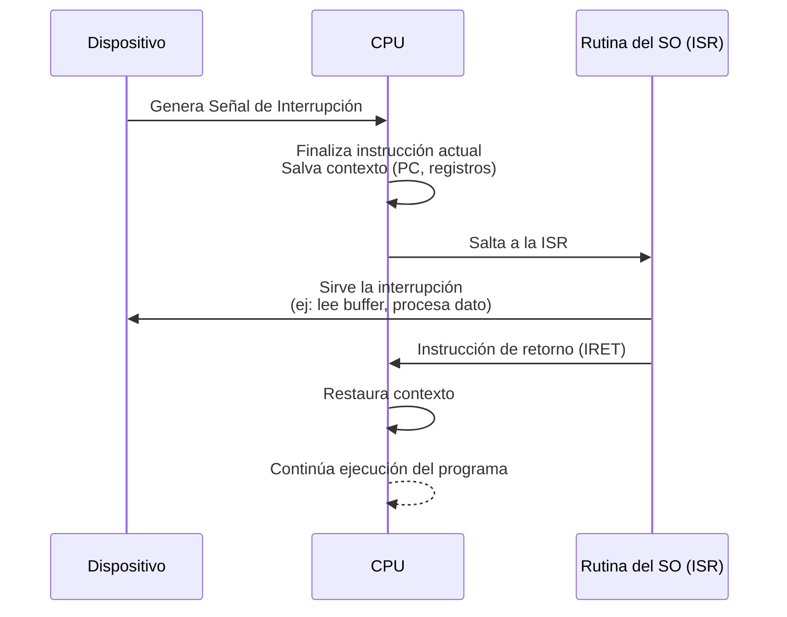

# Organización y Arquitectura de Computadoras - La relación hardware-software

## 8.2 La relación entre el sistema operativo y el hardware

---

### **1. Introducción y Definición**

El Sistema Operativo (SO) es el software fundamental que actúa como **intermediario** entre el usuario (y sus aplicaciones) y el hardware del computador. Su propósito principal es gestionar los recursos hardware y proporcionar un entorno para la ejecución de programas de manera eficiente y protegida.

> **Definición:** Un Sistema Operativo es un programa que controla la ejecución de programas de aplicación y actúa como una interfaz entre el usuario de un computador y el hardware del mismo. Su objetivo clave es **gestionar los recursos** del sistema (CPU, memoria, dispositivos de E/S) y **facilitar su uso** (Silberschatz, Galvin, y Gagne, 2008).

La relación SO-Hardware es sinérgica: el hardware proporciona las capacidades brutas, y el SO las gestiona, abstrae y virtualiza para que sean usables de forma segura y eficiente.

### **2. Funciones Principales del SO en la Gestión del Hardware**

El SO interactúa directamente con el hardware a través de un conjunto de funciones críticas:

#### **2.1. Abstracción del Hardware**

El SO oculta la complejidad del hardware mediante **drivers** (controladores) y proporciona una interfaz uniforme y simple para los programas de aplicación. Por ejemplo, una aplicación puede escribir en un archivo usando `fwrite()` sin saber si el disco es SSD, HDD o está en una red.

#### **2.2. Gestión de Procesos y Planificación de la CPU**

La CPU es un recurso escaso que debe ser compartido entre múltiples procesos. El SO es responsable de:

- **Crear y destruir procesos.**
- **Suspender y reanudar procesos.**
- **Planificar la CPU (CPU Scheduler):** Decide qué proceso se ejecuta en la CPU y por cuánto tiempo, utilizando algoritmos como Round Robin, Colas Multinivel, etc. Esto es crucial para el rendimiento del sistema y la multitarea.

#### **2.3. Gestión de Memoria Principal (RAM)**

La memoria es otro recurso crítico que debe asignarse a varios procesos. El SO se encarga de:

- **Llevar el registro** de las partes de memoria en uso y por quién.
- **Asignar y liberar** espacio de memoria según se necesite.
- **Implementar Memoria Virtual:** Extiende la memoria física usando el almacenamiento secundario (disco), dando la ilusión de más memoria RAM de la que físicamente existe. Esto permite ejecutar programas más grandes que la memoria física.
  - **Fórmula del Tiempo de Acceso Efectivo (EAT):**
    $$ EAT = (1 - p) \times ma + p \times page\_fault\_time $$
    donde:
    - $p$ = probabilidad de un page fault (fallo de página)
    - $ma$ = tiempo de acceso a memoria (~100 ns)
    - $page\_fault\_time$ = tiempo para servicio del page fault (~10 ms, incluye guardar página, cargar nueva, reiniciar proceso)

#### **2.4. Gestión del Sistema de Archivos**

El SO proporciona una visión lógica y estructurada del almacenamiento secundario (disco).

- **Crea y borra** archivos y directorios.
- **Proporciona primitivas** para manipular archivos (`read`, `write`, `seek`).
- **Gestiona el espacio libre** en el disco.
- **Realiza el mounting** (montaje) de sistemas de archivos.

#### **2.5. Gestión de Dispositivos de Entrada/Salida (E/S)**

El SO controla todos los dispositivos a través de sus drivers.

- **Proporciona un interfaz uniforme** a los dispositivos (buffer, spooling, caching).
- **Gestiona las peticiones de E/S** de los procesos.
- **Gestiona interrupciones** provocadas por los dispositivos.

### **3. Mecanismos de Comunicación e Interacción**

La interacción SO-Hardware se basa en mecanismos hardware específicos:

#### **3.1. Interrupciones**

Mecanismo por el cual un dispositivo hardware (teclado, disco, tarjeta de red) **notifica a la CPU** que ha ocurrido un evento que requiere su atención. La CPU, al recibir una interrupción, detiene su trabajo actual, salva su contexto y ejecuta una **rutina de servicio de interrupción (ISR)** específica para ese dispositivo, que pertenece al SO o a un driver.

#### **3.2. Modos de Ejecución de la CPU**

Para proteger los recursos del sistema, las arquitecturas modernas ofrecen al menos dos modos de operación:

- **Modo Kernel (Modo Supervisor, Ring 0):** El SO se ejecuta en este modo, con **acceso completo** a todas las instrucciones y recursos hardware.
- **Modo Usuario (Ring 3):** Las aplicaciones se ejecutan en este modo. Las instrucciones privilegiadas (como acceder directamente a un dispositivo) están **bloqueadas**. Si una aplicación intenta ejecutarlas, se genera una **trap** (interrupción por software) y el SO toma el control, usualmente terminando el programa para proteger al sistema.

#### **3.3. Llamadas al Sistema (System Calls)**

Son la **interfaz programática** entre una aplicación (en modo usuario) y los servicios del SO (en modo kernel). Son la única forma segura y controlada de que una aplicación solicite un servicio del hardware.

- **Ejemplo:** Un programa en C llama a `printf()`. La librería estándar de C traduce esto a una llamada al sistema `write()`. La ejecución cambia de modo usuario a modo kernel, el SO ejecuta el código necesario para escribir en la pantalla (interactuando con el hardware de vídeo) y luego devuelve el control al programa.

### **4. Ejercicios Propuestos**

1.  **Análisis de Rendimiento:** Supón un sistema con un tiempo de acceso a memoria (ma) de 100 ns, un tiempo de servicio de page fault de 10 ms y una tasa de fallos de página (p) de 0.01%. Calcula el Tiempo de Acceso Efectivo (EAT). ¿Qué pasaría con el EAT si la tasa de fallos (p) se incrementa al 1%? Comenta los resultados.

2.  **Identificación de Modos:** Para cada una de las siguientes acciones, indica si se ejecutaría en **Modo Usuario** o debe ser manejada por el SO en **Modo Kernel**:
    a) Una aplicación calcula la raíz cuadrada de un número.
    b) Un videojuego quiere dibujar píxeles en la pantalla.
    c) Un procesador de textos intenta guardar un archivo en el disco.
    d) Un programa intenta deshabilitar todas las interrupciones del sistema.

3.  **Diagrama de Secuencia:** Dibuja un diagrama de secuencia (similar al de interrupciones) que describa los pasos que ocurren cuando un programa realiza una llamada al sistema `read()` para leer datos de un archivo en disco. Incluye: la aplicación, la llamada al sistema, el SO, el driver del disco, y el hardware del disco.

### **5. Referencias**

- **Silberschatz, A., Galvin, P. B., y Gagne, G.** (2008). _Operating System Concepts_ (8a Ed.). **Texto fundamental para entender las funciones de un SO.**
- **Stallings, William** (2009). _Computer Organization and Architecture: Designing for Performance_. **Excelente para entender la arquitectura hardware que soporta al SO (interrupciones, modos de ejecución, memoria virtual hardware-assist).**
- **Tanenbaum, Andrew S.** (2005). _Structured Computer Organization_ (5a Ed.). **Explica de manera brillante la estructura por capas, desde el hardware hasta el SO.**
- **Patterson, D. A. y Hennessy, J. L.** (2008). _Computer Organization and Design: The Hardware/Software Interface_. **Detalla cómo la ISA (Instruction Set Architecture) define la interfaz entre el hardware y el software de bajo nivel (como el SO).**
