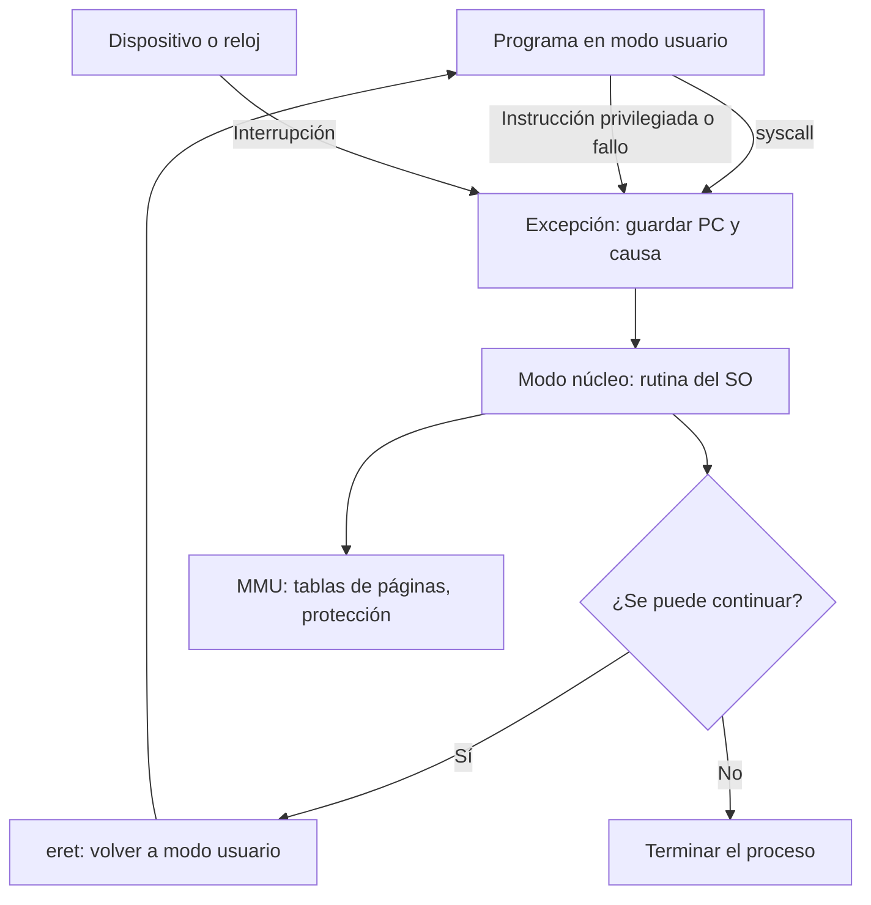

# Organización y Arquitectura de Computadoras - La relación hardware-software

## 8.2 La relación entre el sistema operativo y el hardware

---

El sistema operativo (SO) administra los recursos de la computadora y los comparte entre programas que no confían unos en otros. Para hacerlo necesita **apoyo del hardware**: si cualquier programa pudiera deshabilitar las interrupciones, escribir en la memoria de otro o hablar directamente con el disco, ningún SO podría garantizar la protección ni el reparto justo del procesador. Este tema describe los mecanismos que la arquitectura ofrece al SO (los modos de privilegio, las excepciones e interrupciones, las llamadas al sistema, la traducción de direcciones y la E/S) y cuantifica algunos de sus costos.

### Modos de ejecución

El procesador tiene al menos dos **modos**, indicados por un bit en un registro de estado:

- **Modo usuario:** los programas de aplicación. Solo pueden ejecutar instrucciones no privilegiadas y acceder a su propia memoria.
- **Modo núcleo** (supervisor, _kernel_): el SO. Puede ejecutar **instrucciones privilegiadas**: deshabilitar interrupciones, cambiar las tablas de traducción de direcciones, acceder a los dispositivos, cambiar de modo.

Si un programa en modo usuario intenta una instrucción privilegiada, el hardware no la ejecuta: genera una **excepción** y transfiere el control al SO, que normalmente termina el programa. x86 tiene cuatro anillos de privilegio (se usan dos), ARMv8 cuatro niveles de excepción (aplicación, SO, hipervisor y monitor seguro) y RISC-V tres modos (usuario, supervisor y máquina).

### Excepciones, interrupciones y llamadas al sistema

| Evento | Origen | Síncrono | Ejemplos |
| --- | --- | --- | --- |
| **excepción** (fallo, _trap_) | la instrucción en ejecución | sí | división entre cero, desbordamiento, instrucción inválida o privilegiada, fallo de página |
| **llamada al sistema** | instrucción especial (`syscall`, `ecall`, `svc`) | sí | abrir o escribir un archivo, crear un proceso |
| **interrupción** | un dispositivo externo | no | fin de una transferencia de disco, llegada de un paquete, **reloj** |

En los tres casos el hardware hace lo mismo: guarda la dirección de la instrucción afectada (en MIPS, en el registro `EPC`) y la causa (registro `Cause`), pasa a modo núcleo y salta a una dirección fija o a una **tabla de vectores**. El SO atiende el evento y, con una instrucción especial de retorno (`eret`, `sret`, `iret`), restaura el modo usuario y continúa el programa. En una segmentación, las excepciones deben ser **precisas**: todas las instrucciones anteriores deben haber terminado y ninguna posterior debe haber modificado el estado.

**El reloj.** Una interrupción periódica del temporizador (cada pocos milisegundos) devuelve el control al SO aunque un programa no lo ceda nunca: así el SO puede repartir el procesador entre procesos (**planificación** con desalojo).

**Llamadas al sistema.** Son la única puerta de entrada de los programas al SO. El programa pone en registros el número de servicio y los argumentos y ejecuta `syscall`; el SO comprueba los permisos y los argumentos, hace el trabajo en modo núcleo y devuelve el resultado. Cuestan del orden de cientos de ciclos (cambio de modo, guardar y restaurar estado, efectos sobre cachés y TLB), por eso las bibliotecas agrupan operaciones: `printf` acumula texto en un búfer y hace un solo `write`.

### Memoria virtual

Cada proceso ve un **espacio de direcciones virtuales** propio. La **unidad de manejo de memoria** (MMU) traduce cada dirección virtual a física usando **tablas de páginas** que el SO mantiene y que solo se pueden modificar en modo núcleo (tema 9.6). Eso da:

- **Protección:** un proceso no puede acceder a la memoria de otro ni a la del SO; cada página tiene permisos de lectura, escritura y ejecución.
- **Ilusión de memoria grande:** las páginas que no están en memoria principal se traen del disco cuando se usan, mediante una excepción de **fallo de página**.

El costo de un fallo de página es enorme comparado con un acceso a memoria. Con tasa de fallos $p,$ tiempo de acceso $t_m$ y tiempo de atención $t_f,$ el **tiempo efectivo de acceso** es

$$ t_{\text{ef}} = (1 - p)\, t_m + p\, t_f $$

### Entrada y salida

El SO controla los dispositivos con tres técnicas (tema 10.1):

- **Sondeo** (_polling_): el procesador consulta repetidamente el registro de estado del dispositivo. Sencillo, pero desperdicia ciclos cuando el dispositivo es lento o rápido y frecuente.
- **Interrupciones:** el dispositivo avisa cuando está listo; el procesador solo trabaja cuando hay algo que hacer.
- **Acceso directo a memoria** (DMA): un controlador transfiere bloques completos entre el dispositivo y la memoria sin el procesador, y solo interrumpe al terminar.

Los registros de los dispositivos se acceden con instrucciones especiales de E/S (x86 `in` y `out`) o, más comúnmente, **mapeados en memoria**: ocupan direcciones físicas que la MMU solo permite usar al SO.

**Virtualización.** Los procesadores actuales añaden un nivel más de privilegio y de traducción de direcciones para que un **hipervisor** ejecute varios sistemas operativos completos, cada uno creyendo que controla el hardware.



### Implementación en Python

El programa calcula el tiempo efectivo de acceso del ejercicio 1, la tasa de fallos máxima para no degradar más del 10 %, la fracción del procesador que consume el sondeo de varios dispositivos frente a interrupciones y DMA, y clasifica las acciones del ejercicio 2.

```python
miles = lambda x: f"{x:,.0f}".replace(",", " ")

# Ejercicio 1: tiempo efectivo de acceso con fallos de página
ma = 100e-9          # acceso a memoria: 100 ns
servicio = 10e-3     # atención de un fallo de página: 10 ms
for p in (0.0001, 0.01):
    eat = (1 - p) * ma + p * servicio
    print(f"p = {p:.2%}: EAT = {miles(eat * 1e9)} ns, {miles(eat / ma)} veces más lento que la memoria")
# Para que la degradación sea menor del 10 %:
p_max = (1.1 * ma - ma) / (servicio - ma)
print(f"para degradar menos del 10 %: p < {p_max:.2e} (un fallo cada {miles(1 / p_max)} accesos)")

# Sondeo frente a interrupciones (procesador de 1 GHz, 400 ciclos por consulta o por interrupción)
f = 1e9
dispositivos = {"ratón (30 consultas/s)": 30,
                "disco de 4 MB/s en bloques de 16 bytes": 4e6 / 16,
                "red de 100 MB/s en bloques de 64 bytes": 100e6 / 64}
for nombre, eventos in dispositivos.items():
    print(f"sondeo de {nombre:40s}: {eventos * 400 / f:7.3%} del procesador")
# Con interrupciones solo se paga cuando hay datos; el disco activo un 10 % del tiempo:
print(f"disco con interrupciones activo el 10 % del tiempo: {0.10 * 4e6 / 16 * 400 / f:.2%}")
# Con DMA: una interrupción por bloque de 8 KiB más 1000 ciclos de preparación
print(f"disco con DMA en bloques de 8 KiB: {4e6 / 8192 * (400 + 1000) / f:.3%}")

# Ejercicio 2: modo de cada acción
acciones = {"calcular una raíz cuadrada": "usuario",
            "dibujar píxeles en la pantalla": "núcleo (a través del controlador de video)",
            "guardar un archivo en el disco": "núcleo (llamada al sistema)",
            "deshabilitar las interrupciones": "solo núcleo: en modo usuario provoca una excepción"}
for a, m in acciones.items():
    print(f"ejercicio 2: {a:32s} -> {m}")
```

Salida:

```text
p = 0.01%: EAT = 1 100 ns, 11 veces más lento que la memoria
p = 1.00%: EAT = 100 099 ns, 1 001 veces más lento que la memoria
para degradar menos del 10 %: p < 1.00e-06 (un fallo cada 999 990 accesos)
sondeo de ratón (30 consultas/s)                  :  0.001% del procesador
sondeo de disco de 4 MB/s en bloques de 16 bytes  : 10.000% del procesador
sondeo de red de 100 MB/s en bloques de 64 bytes  : 62.500% del procesador
disco con interrupciones activo el 10 % del tiempo: 1.00%
disco con DMA en bloques de 8 KiB: 0.068%
ejercicio 2: calcular una raíz cuadrada       -> usuario
ejercicio 2: dibujar píxeles en la pantalla   -> núcleo (a través del controlador de video)
ejercicio 2: guardar un archivo en el disco   -> núcleo (llamada al sistema)
ejercicio 2: deshabilitar las interrupciones  -> solo núcleo: en modo usuario provoca una excepción
```

### Los mecanismos en acción

Dos programas en C muestran el apoyo del hardware en una computadora real (x86-64 con Linux). El primero ejecuta la instrucción privilegiada `cli` (deshabilitar interrupciones) en modo usuario; el procesador genera una excepción de protección y el SO la convierte en la señal `SIGSEGV`. El segundo guarda un archivo, y `strace` muestra las tres llamadas al sistema que hace:

```c
#include <signal.h>
#include <stdio.h>
#include <string.h>
#include <unistd.h>

static void manejador(int sig) {
    (void)sig;
    const char *m = "el sistema operativo envió SIGSEGV: instrucción privilegiada en modo usuario\n";
    write(1, m, strlen(m));          /* write es segura dentro de un manejador de señales */
    _exit(0);
}

int main(void) {
    signal(SIGSEGV, manejador);
    printf("modo usuario: 2 + 2 = %d\n", 2 + 2);   /* instrucción ordinaria */
    fflush(stdout);
    __asm__ volatile("cli");                        /* deshabilitar interrupciones: privilegiada */
    printf("esta línea nunca se imprime\n");
    return 0;
}
```

```c
#include <fcntl.h>
#include <unistd.h>

int main(void) {
    int fd = open("/tmp/nota.txt", O_WRONLY | O_CREAT | O_TRUNC, 0644);   /* llamada al sistema */
    if (write(fd, "hola\n", 5) != 5) return 1;                            /* llamada al sistema */
    close(fd);                                                            /* llamada al sistema */
    return 0;
}
```

```text
modo usuario: 2 + 2 = 4
el sistema operativo envió SIGSEGV: instrucción privilegiada en modo usuario
openat(AT_FDCWD, "/tmp/nota.txt", O_WRONLY|O_CREAT|O_TRUNC, 0644) = 3
write(3, "hola\n", 5)                   = 5
close(3)                                = 0
```

### Ejercicios Propuestos

1. **Tiempo efectivo de acceso.** Con un acceso a memoria de 100 ns, una atención de fallo de página de 10 ms y una tasa de fallos de 0.01 %, calcula el tiempo efectivo de acceso. ¿Qué pasa si la tasa sube al 1 %?

2. **Modos.** Indica si cada acción se ejecuta en modo usuario o requiere el modo núcleo: (a) calcular una raíz cuadrada; (b) dibujar píxeles en la pantalla; (c) guardar un archivo; (d) deshabilitar todas las interrupciones.

3. **Reloj.** ¿Qué pasaría en un sistema multitarea sin interrupción de reloj si un programa entra en un bucle infinito?

4. **Sondeo.** Un disco transfiere 4 MB/s en bloques de 16 bytes y cada consulta cuesta 400 ciclos a 1 GHz. ¿Qué fracción del procesador consume el sondeo? ¿Y con DMA en bloques de 8 KiB?

### Soluciones

**Ejercicio 1.** Con $p = 10^{-4},$ $t_{\text{ef}} = 0.9999 \cdot 100 + 10^{-4} \cdot 10^7 \approx 1100$ ns: la memoria parece 11 veces más lenta. Con $p = 10^{-2},$ $t_{\text{ef}} \approx 100\,099$ ns, unas mil veces más lenta: el sistema pasa casi todo el tiempo esperando al disco (**hiperpaginación**, _thrashing_). Para degradar menos del 10 % haría falta menos de un fallo por millón de accesos.

**Ejercicio 2.** (a) Usuario: es aritmética ordinaria. (b) Requiere el núcleo, a través del controlador gráfico, aunque el SO puede mapear un búfer de video en la memoria del proceso para que dibuje directamente. (c) Núcleo, mediante llamadas al sistema (`openat`, `write`, `close`, como muestra `strace`). (d) Solo el núcleo; en modo usuario la instrucción provoca una excepción, como muestra el primer programa.

**Ejercicio 3.** El SO no recuperaría nunca el control: el procesador seguiría ejecutando el bucle y ningún otro programa avanzaría. La interrupción del reloj garantiza que el SO se ejecute periódicamente y pueda desalojar al programa.

**Ejercicio 4.** $\frac{4 \times 10^6}{16} \cdot 400 = 10^8$ ciclos por segundo, el 10 % de un procesador de 1 GHz, aunque el disco esté inactivo si se sondea continuamente. Con DMA hay una interrupción por cada 8 KiB, unas 490 por segundo, y con unos 1400 ciclos cada una se consume menos del 0.1 %.

### Referencias

1. Patterson, D. A., and Hennessy, J. L., _Computer Organization and Design: The Hardware/Software Interface_. Morgan Kaufmann, 2020. Secciones 4.10, 5.7 y 6.
2. Silberschatz, A., Galvin, P. B., and Gagne, G., _Fundamentos de sistemas operativos_. McGraw-Hill, 2006. Capítulos 1, 2 y 9.
3. Bryant, R. E., and O'Hallaron, D. R., _Computer Systems: A Programmer's Perspective_. Pearson, 2016. Capítulo 8.
4. Arpaci-Dusseau, R. H., and Arpaci-Dusseau, A. C., _Operating Systems: Three Easy Pieces_. Arpaci-Dusseau Books, 2018. Capítulos 6 y 36.
