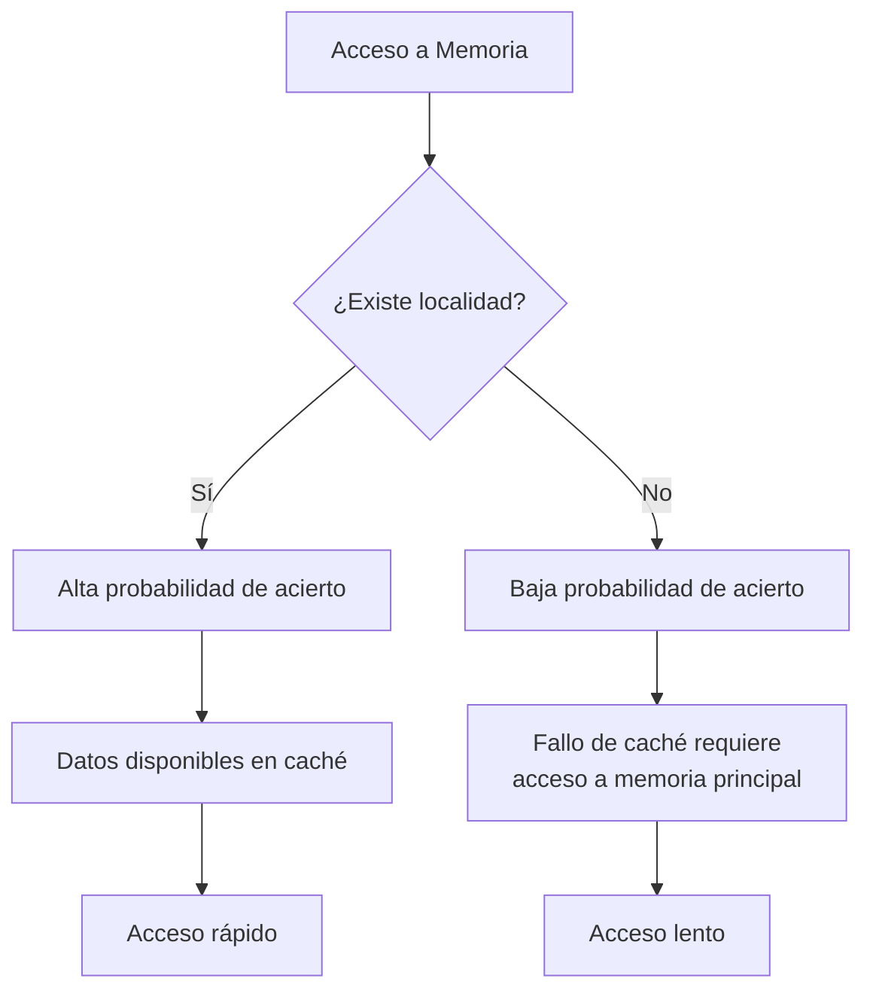
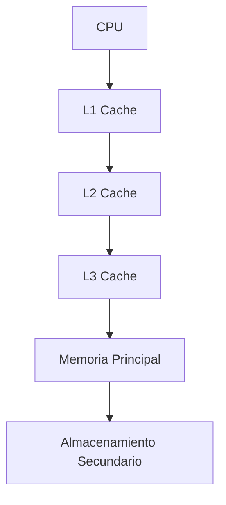

# Organización y Arquitectura de Computadoras - La jerarquía de memoria

## 9.1 Principio de localidad espacial y temporal

---

El principio de localidad es un concepto fundamental en el diseño de jerarquías de memoria que explica por qué las memorias caché son efectivas. Este principio establece que los programas tienden a acceder a un conjunto limitado de direcciones de memoria de manera predecible.

### Definición del Principio de Localidad

#### Localidad Temporal

Se refiere a la tendencia de un programa a reutilizar los mismos datos o instrucciones que ha accedido recientemente. Si una dirección de memoria es referenciada, es probable que sea referenciada nuevamente en el futuro cercano.

**Ejemplo:** Las instrucciones dentro de un bucle se acceden repetidamente durante la ejecución del mismo.

#### Localidad Espacial

Se refiere a la tendencia de un programa a acceder a direcciones de memoria cercanas a las que ha accedido recientemente. Si una dirección de memoria es referenciada, es probable que las direcciones adyacentes sean referenciadas en el futuro cercano.

**Ejemplo:** El acceso a elementos consecutivos de un array o la ejecución secuencial de instrucciones.

### Base Matemática y Fórmulas

#### Tasa de Aciertos (Hit Rate)

La efectividad de la memoria caché se mide mediante la tasa de aciertos:

$$
\text{Hit Rate} = \frac{\text{Número de aciertos}}{\text{Número total de accesos}} \times 100\%
$$

#### Tasa de Fallos (Miss Rate)

$$
\text{Miss Rate} = 1 - \text{Hit Rate} = \frac{\text{Número de fallos}}{\text{Número total de accesos}} \times 100\%
$$

#### Tiempo de Acceso Efectivo

$$
T_{\text{eff}} = (H \times T_c) + ((1 - H) \times T_m)
$$

Donde:

- $T_{\text{eff}}$ = Tiempo de acceso efectivo
- $H$ = Tasa de aciertos
- $T_c$ = Tiempo de acceso a caché
- $T_m$ = Tiempo de acceso a memoria principal

### Diagrama de Flujo de Localidad



### Ejemplos de Código

#### Ejemplo 1: Localidad Temporal en un Bucle

```c
// Buena localidad temporal
for (int i = 0; i < 1000; i++) {
    sum += array[i];  // La variable 'sum' se reutiliza frecuentemente
}
```

#### Ejemplo 2: Localidad Espacial en Arrays

```c
// Buena localidad espacial (acceso secuencial)
int array[1000];
for (int i = 0; i < 1000; i++) {
    array[i] = i;  // Acceso a posiciones contiguas de memoria
}

// Mala localidad espacial (acceso aleatorio)
int matrix[100][100];
for (int i = 0; i < 100; i++) {
    for (int j = 0; j < 100; j++) {
        result += matrix[j][i];  // Acceso no contiguo
    }
}
```

#### Ejemplo 3: Mejorando la Localidad

```c
// Versión optimizada con mejor localidad espacial
int matrix[100][100];
for (int i = 0; i < 100; i++) {
    for (int j = 0; j < 100; j++) {
        result += matrix[i][j];  // Acceso contiguo a memoria
    }
}
```

### Ejercicios Propuestos

#### Ejercicio 1: Análisis de Localidad

Analice el siguiente código y determine qué tipo de localidad presenta:

```c
float dot_product(float a[], float b[], int n) {
    float result = 0.0;
    for (int i = 0; i < n; i++) {
        result += a[i] * b[i];
    }
    return result;
}
```

#### Ejercicio 2: Cálculo de Tasa de Aciertos

Un sistema tiene los siguientes parámetros:

- Tiempo de acceso a caché: 2 ns
- Tiempo de acceso a memoria principal: 60 ns
- Tasa de aciertos: 95%

Calcule:

1. El tiempo de acceso efectivo
2. El porcentaje de mejora respecto al acceso directo a memoria principal

#### Ejercicio 3: Optimización de Código

Reescriba el siguiente código para mejorar su localidad:

```c
int process_matrix(int matrix[][1000], int n) {
    int sum = 0;
    for (int j = 0; j < 1000; j++) {
        for (int i = 0; i < n; i++) {
            sum += matrix[i][j];
        }
    }
    return sum;
}
```

### Aplicaciones en Diseño de Hardware

#### Políticas de Reemplazo

Las políticas como LRU (Least Recently Used) se basan en el principio de localidad temporal para decidir qué bloques mantener en caché.

#### Prefetching

Las técnicas de prefetching anticipan accesos futuros basándose en la localidad espacial, cargando datos adyacentes antes de que sean solicitados.

#### Tamaño de Bloques

El tamaño óptimo de los bloques de caché se determina considerando el balance entre la localidad espacial y el costo de transferencia.

### Diagrama de Jerarquía de Memoria



### Referencias

#### Bibliografía Básica

1. Hennessy, John L. y David A. Patterson. _Computer Architecture: A Quantitative Approach_, 4a Ed. Morgan Kaufmann, 2006. (Capítulo 5: Memory Hierarchy Design)
2. Patterson, David A. y John L. Hennessy. _Computer Organization and Design: The Hardware/Software Interface_, 4a Ed. Morgan Kaufmann, 2008. (Capítulo 7: Large and Fast: Exploiting Memory Hierarchy)

#### Bibliografía Complementaria

1. Stallings, William. _Computer Organization and Architecture: Designing for Performance_, Prentice Hall - Pearson, 2009. (Capítulo 4: Cache Memory)
2. Tanenbaum, Andrew S. _Structured Computer Organization_, 5a Ed. Prentice Hall, 2005. (Capítulo 4: The Microarchitecture Level)

### Conclusión

El principio de localidad es la base fundamental que hace viable la jerarquía de memoria. La localidad temporal justifica mantener datos recientemente usados cerca del CPU, mientras que la localidad espacial justifica transferir bloques de datos en lugar de palabras individuales. La comprensión de estos principios es esencial para el diseño eficiente de sistemas computacionales y para la escritura de código optimizado.
