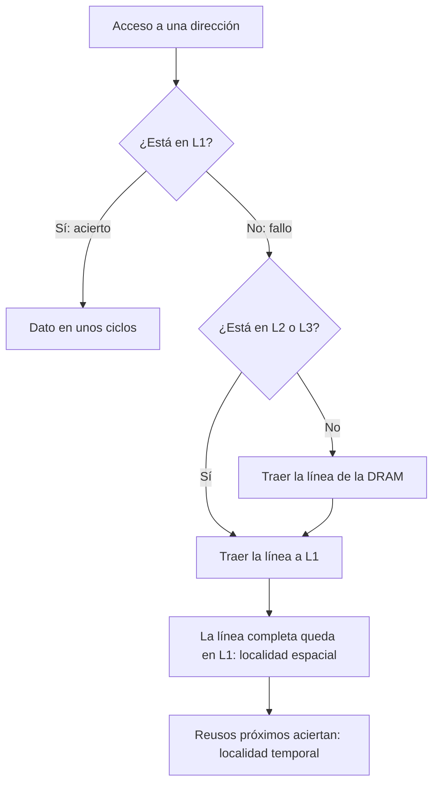

# Organización y Arquitectura de Computadoras - La jerarquía de memoria

## 9.1 Principio de localidad espacial y temporal

---

Un procesador moderno puede pedir varios datos por nanosegundo, pero un acceso a la memoria DRAM tarda del orden de 50 a 100 ns: la memoria rápida es pequeña y cara, y la grande es lenta. La **jerarquía de memoria** resuelve el dilema con varios niveles, de los registros a las cachés, la memoria principal y el disco, cada uno más grande y lento que el anterior, y funciona gracias a una propiedad empírica de los programas: el **principio de localidad**. Este tema define la localidad temporal y espacial, la cuantifica con el tiempo medio de acceso a memoria, clasifica los fallos y muestra cómo escribir programas que la aprovechen.

### El principio de localidad

Los programas no acceden a la memoria de manera uniforme:

- **Localidad temporal:** un dato o instrucción que se acaba de usar probablemente se volverá a usar pronto. Ejemplos: las variables de un bucle, las instrucciones del cuerpo de un bucle, la cima de la pila.
- **Localidad espacial:** si se usa una dirección, probablemente pronto se usarán las cercanas. Ejemplos: recorrer un arreglo, ejecutar instrucciones consecutivas, los campos de una estructura.

La regla empírica es que un programa pasa el 90 % del tiempo en el 10 % de su código. La jerarquía explota la localidad temporal **guardando** en los niveles rápidos los datos usados recientemente, y la espacial **trayendo bloques** de varias palabras consecutivas (una **línea** de caché, típicamente de 64 bytes) cada vez que falta un dato.

### La jerarquía de memoria

| Nivel | Tamaño típico | Tiempo de acceso | Gestionado por |
| --- | --- | --- | --- |
| registros | cientos de bytes | menos de 1 ns | compilador |
| caché L1 | 32 a 64 KiB por núcleo | 1 ns (unos 4 ciclos) | hardware |
| caché L2 | 256 KiB a 2 MiB | 3 a 5 ns | hardware |
| caché L3 | 8 a 64 MiB, compartida | 10 a 20 ns | hardware |
| memoria principal (DRAM) | 8 a 512 GiB | 50 a 100 ns | sistema operativo |
| almacenamiento (SSD, disco) | terabytes | 10 a 100 µs (SSD), 5 a 10 ms (disco) | sistema operativo |

Cada nivel contiene un subconjunto del siguiente (en general). Cuando el dato buscado está en un nivel es un **acierto**; si no, un **fallo**, y hay que traer el bloque del nivel inferior.

### Medidas

- **Tasa de aciertos** $h$ y **tasa de fallos** $m = 1 - h.$
- **Tiempo de acierto** $t_h:$ tiempo de acceder al nivel, incluido determinar si es acierto.
- **Penalización por fallo** $t_p:$ tiempo adicional para traer el bloque del nivel inferior.

El **tiempo medio de acceso a memoria** es

$$ \text{AMAT} = t_h + m \cdot t_p $$

y para dos niveles de caché, $\text{AMAT} = t_{h1} + m_1 (t_{h2} + m_2\, t_{p2}).$ Con $t_h = 2$ ns, $m = 0.05$ y $t_p = 60$ ns, $\text{AMAT} = 5$ ns: doce veces mejor que acceder siempre a la memoria. Pero con $m = 0.10$ sube a 8 ns: una pequeña variación de la tasa de fallos tiene un gran efecto.

**Efecto sobre el CPI.** Si una fracción $f_m$ de las instrucciones accede a datos, $\text{CPI} = \text{CPI}_{\text{base}} + (1 + f_m) \cdot m \cdot t_p$ (en ciclos), contando también las búsquedas de instrucciones.

### Las tres C de los fallos

- **Obligatorios** (_compulsory_): el primer acceso a un bloque, que nunca ha estado en la caché. Se reducen con bloques más grandes o con **precarga** (_prefetching_).
- **De capacidad:** el programa usa más datos de los que caben. Se reducen con cachés más grandes o mejorando la localidad del programa.
- **De conflicto:** el bloque fue expulsado porque otros competían por el mismo conjunto, aunque hubiera espacio en otras partes. Se reducen con más **asociatividad** (tema 9.2).

### Programar para la localidad

- **Recorrer los arreglos en el orden en que están en memoria.** C guarda las matrices por filas: el bucle interno debe recorrer el último índice.
- **Bloqueo** (_tiling_): dividir el cálculo en bloques que quepan en la caché y terminar todo el trabajo con un bloque antes de pasar al siguiente. En la multiplicación de matrices, reduce los fallos a una fracción.
- **Estructuras de arreglos** frente a arreglos de estructuras: si un bucle solo usa un campo, conviene que los valores de ese campo estén contiguos.



### Implementación en Python

El programa usa un simulador de caché asociativa por conjuntos (que se reutiliza en los temas 9.2 a 9.4) para medir la tasa de aciertos del producto punto, comparar la suma de una matriz por columnas y por filas, comparar la multiplicación de matrices ingenua y por bloques, y calcular distancias de reuso; además resuelve el ejercicio 2.

```python
# Simulador de caché asociativa por conjuntos con políticas de reemplazo y de escritura
from collections import OrderedDict


class Cache:
    def __init__(self, tam, linea, vias, reemplazo="LRU", escritura="WB", asignar_en_escritura=True):
        self.linea, self.vias = linea, vias
        self.conjuntos = tam // (linea * vias)
        self.reemplazo, self.escritura, self.asignar = reemplazo, escritura, asignar_en_escritura
        self.sets = [OrderedDict() for _ in range(self.conjuntos)]   # etiqueta -> [sucio, usos]
        self.aciertos = self.fallos = self.escrituras_mem = self.lecturas_mem = 0

    def partir(self, dir_):
        bloque = dir_ // self.linea
        return bloque // self.conjuntos, bloque % self.conjuntos, dir_ % self.linea   # etiqueta, índice, desplazamiento

    def _victima(self, s):
        if self.reemplazo == "LFU":
            return min(s, key=lambda e: s[e][1])        # el menos usado (empate: el más antiguo)
        return next(iter(s))                            # LRU y FIFO: el primero del orden

    def acceso(self, dir_, escribir=False):
        etiqueta, i, _ = self.partir(dir_)
        s = self.sets[i]
        if etiqueta in s:
            self.aciertos += 1
            s[etiqueta][1] += 1
            if self.reemplazo == "LRU":
                s.move_to_end(etiqueta)
            if escribir:
                if self.escritura == "WT":
                    self.escrituras_mem += 1
                else:
                    s[etiqueta][0] = True
            return True
        self.fallos += 1
        if escribir and not self.asignar:               # sin asignación: se escribe directo en memoria
            self.escrituras_mem += 1
            return False
        if len(s) >= self.vias:
            v = self._victima(s)
            if s[v][0]:
                self.escrituras_mem += 1                # reescritura del bloque sucio
            del s[v]
        self.lecturas_mem += 1
        s[etiqueta] = [False, 1]
        if escribir:
            if self.escritura == "WT":
                self.escrituras_mem += 1
            else:
                s[etiqueta][0] = True
        return False

    def tasa(self):
        return self.aciertos / (self.aciertos + self.fallos)


# Ejercicio 2: tiempo medio de acceso
t_cache, t_mem, h = 2, 60, 0.95
amat = t_cache + (1 - h) * t_mem
print(f"ejercicio 2: AMAT = {t_cache} + {1 - h:.2f} x {t_mem} = {amat:.1f} ns; {t_mem / amat:.0f} veces mejor que sin caché")

# Ejercicio 1: producto punto de dos arreglos de 1000 floats (a en 0, b en 8192), caché de 4 KiB, línea 32 B
c = Cache(4096, 32, 2)
for i in range(1000):
    c.acceso(4 * i)
    c.acceso(8192 + 4 * i)
print(f"ejercicio 1: producto punto, tasa de aciertos {c.tasa():.1%} (cada línea trae 8 floats: 7 de cada 8 aciertan)")

# Ejercicio 3: suma de una matriz de 1000 x 1000 int por columnas y por filas (caché de 32 KiB, línea 64 B)
n = 1000
for nombre, orden in (("por columnas (original)", lambda: ((i, j) for j in range(n) for i in range(n))),
                      ("por filas (mejorado)", lambda: ((i, j) for i in range(n) for j in range(n)))):
    c = Cache(32 * 1024, 64, 8)
    for i, j in orden():
        c.acceso(4 * (i * n + j))
    print(f"ejercicio 3, {nombre:24s}: {c.fallos:7d} fallos, tasa de aciertos {c.tasa():.1%}")

# Multiplicación de matrices N x N de doubles: ingenua frente a bloques (caché de 8 KiB, línea 64 B)
N, B = 64, 16
A0, B0, C0 = 0, 8 * N * N, 16 * N * N
for nombre in ("ijk ingenua", f"por bloques de {B}"):
    c = Cache(8 * 1024, 64, 4)
    if nombre.startswith("ijk"):
        for i in range(N):
            for j in range(N):
                for k in range(N):
                    c.acceso(A0 + 8 * (i * N + k)); c.acceso(B0 + 8 * (k * N + j))
                c.acceso(C0 + 8 * (i * N + j), escribir=True)
    else:
        for ii in range(0, N, B):
            for jj in range(0, N, B):
                for kk in range(0, N, B):
                    for i in range(ii, ii + B):
                        for j in range(jj, jj + B):
                            for k in range(kk, kk + B):
                                c.acceso(A0 + 8 * (i * N + k)); c.acceso(B0 + 8 * (k * N + j))
                            c.acceso(C0 + 8 * (i * N + j), escribir=True)
    print(f"matriz {N}x{N}, {nombre:18s}: {c.fallos:6d} fallos de {c.aciertos + c.fallos} accesos ({1 - c.tasa():.2%})")


# Distancia de reuso: cuántos bloques distintos se tocan entre dos usos del mismo bloque
def distancias(traza, linea=64):
    ultimo, res = {}, []
    for t, d in enumerate(traza):
        b = d // linea
        if b in ultimo:
            res.append(len({x // linea for x in traza[ultimo[b] + 1:t]}))
        ultimo[b] = t
    return res


tr = [4 * i for i in range(64)] * 2         # recorrer dos veces un arreglo de 256 bytes
d = distancias(tr)
print(f"arreglo de 256 B recorrido dos veces: {len(d)} reusos, distancia máxima {max(d)} bloques"
      " -> basta una caché de 4 líneas")
```

Salida:

```text
ejercicio 2: AMAT = 2 + 0.05 x 60 = 5.0 ns; 12 veces mejor que sin caché
ejercicio 1: producto punto, tasa de aciertos 87.5% (cada línea trae 8 floats: 7 de cada 8 aciertan)
ejercicio 3, por columnas (original) : 1000000 fallos, tasa de aciertos 0.0%
ejercicio 3, por filas (mejorado)    :   62500 fallos, tasa de aciertos 93.8%
matriz 64x64, ijk ingenua       : 271120 fallos de 528384 accesos (51.31%)
matriz 64x64, por bloques de 16 :  87616 fallos de 540672 accesos (16.21%)
arreglo de 256 B recorrido dos veces: 124 reusos, distancia máxima 3 bloques -> basta una caché de 4 líneas
```

Recorrer la matriz de $1000 \times 1000$ por columnas da un fallo en **cada** acceso: entre dos accesos a la misma línea se tocan otras 999 filas, que expulsan a la primera. Por filas, solo falla el primer entero de cada línea de 64 bytes, uno de cada 16. El bloqueo reduce los fallos de la multiplicación de matrices de un 51 % a un 16 % de los accesos.

### Ejercicios Propuestos

1. **Producto punto.** ¿Qué tipos de localidad tiene esta función?

   ```c
   float producto_punto(float a[], float b[], int n) {
       float resultado = 0.0;
       for (int i = 0; i < n; i++)
           resultado += a[i] * b[i];
       return resultado;
   }
   ```

2. **Tiempo medio de acceso.** Con caché de 2 ns, memoria de 60 ns y tasa de aciertos del 95 %, calcula el tiempo medio de acceso y la mejora frente a acceder siempre a la memoria.

3. **Reescritura.** Mejora la localidad de

   ```c
   int procesar(int m[][1000], int n) {
       int suma = 0;
       for (int j = 0; j < 1000; j++)
           for (int i = 0; i < n; i++)
               suma += m[i][j];
       return suma;
   }
   ```

4. **CPI.** Un procesador con CPI base 1 tiene 2 % de fallos en instrucciones y 5 % en datos, con penalización de 100 ciclos, y el 30 % de las instrucciones accede a datos. ¿Cuál es el CPI real?

### Soluciones

**Ejercicio 1.** Espacial en `a` y `b` (elementos consecutivos), temporal en `resultado`, `i` y `n` (usados en cada iteración, en registros) y en las instrucciones del bucle. No hay reuso temporal de `a[i]` ni `b[i]`. En la simulación, con líneas de 32 bytes, 7 de cada 8 accesos aciertan.

**Ejercicio 2.** $\text{AMAT} = 2 + 0.05 \cdot 60 = 5$ ns, 12 veces más rápido que 60 ns. Si se usara la otra convención, $h \cdot t_c + m \cdot (t_c + t_m) = 0.95 \cdot 2 + 0.05 \cdot 62 = 5$ ns, es lo mismo.

**Ejercicio 3.** Intercambiar los bucles para que el interno recorra `j`:

```c
for (int i = 0; i < n; i++)
    for (int j = 0; j < 1000; j++)
        suma += m[i][j];
```

El resultado es el mismo (la suma es conmutativa en enteros) y los fallos bajan de uno por acceso a uno cada 16 accesos.

**Ejercicio 4.** $\text{CPI} = 1 + 0.02 \cdot 100 + 0.3 \cdot 0.05 \cdot 100 = 1 + 2 + 1.5 = 4.5:$ el procesador pasa más tiempo esperando a la memoria que ejecutando.

### Referencias

1. Hennessy, J. L., and Patterson, D. A., _Computer Architecture: A Quantitative Approach_. Morgan Kaufmann, 2019. Capítulo 2 y apéndice B.
2. Patterson, D. A., and Hennessy, J. L., _Computer Organization and Design: The Hardware/Software Interface_. Morgan Kaufmann, 2020. Secciones 5.1 a 5.4.
3. Bryant, R. E., and O'Hallaron, D. R., _Computer Systems: A Programmer's Perspective_. Pearson, 2016. Capítulo 6.
4. Denning, P. J., The locality principle. _Communications of the ACM_ 48(7), 2005.
