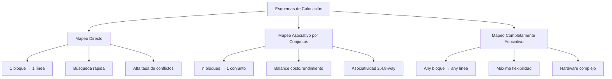
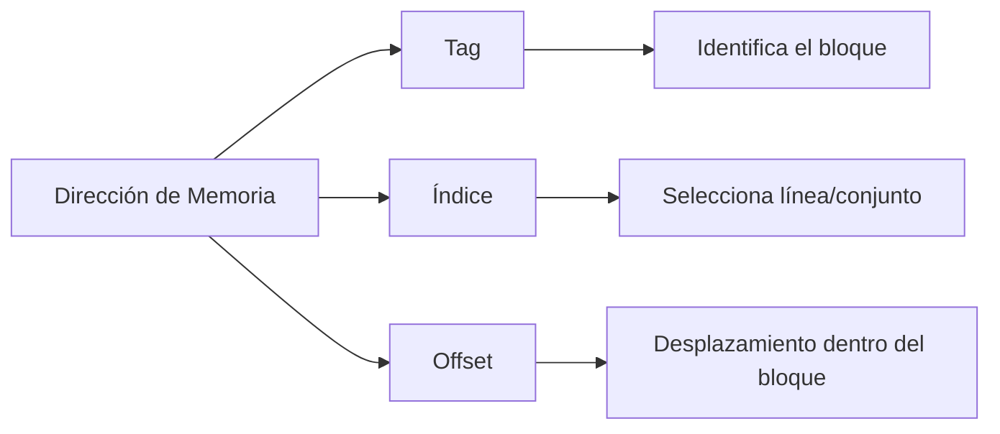

# Organización y Arquitectura de Computadoras - La jerarquía de memoria

## 9.2 Esquemas de colocación de bloques en un cache

---

Los esquemas de colocación de bloques determinan cómo se asignan los bloques de memoria principal a las líneas de la memoria caché. Esta decisión de diseño afecta directamente el rendimiento del sistema de memoria y la complejidad del hardware de control.

### Conceptos Fundamentales

#### Bloques y Líneas de Caché

- **Bloque**: Unidad de transferencia entre memoria principal y caché
- **Línea**: Espacio en caché que almacena un bloque más bits de control
- **Tag**: Identificador que determina qué bloque está almacenado en una línea

#### Fórmulas Básicas

Número de líneas en caché:

$$
\text{Número de líneas} = \frac{\text{Tamaño de caché}}{\text{Tamaño de línea}}
$$

Dirección física descompuesta:

$$
\text{Address} = \{\text{Tag}, \text{Index}, \text{Offset}\}
$$

### Esquemas de Colocación Principales

#### 1. Mapeo Directo

Cada bloque de memoria se asigna a exactamente una línea de caché.

**Fórmula de mapeo:**

$$
\text{Línea} = \frac{\text{Dirección de memoria}}{\text{Tamaño de bloque}} \mod \text{Número de líneas}
$$

**Ventajas:**

- Hardware simple y económico
- Búsqueda rápida

**Desventajas:**

- Alta tasa de conflicto
- Baja utilización de caché

#### 2. Mapeo Asociativo por Conjuntos

La caché se divide en conjuntos, cada conjunto contiene varias líneas.

**Fórmula de mapeo:**

$$
\text{Conjunto} = \frac{\text{Dirección de memoria}}{\text{Tamaño de bloque}} \mod \text{Número de conjuntos}
$$

**Grado de asociatividad:**

$$
\text{Número de conjuntos} = \frac{\text{Número de líneas}}{\text{Grado de asociatividad}}
$$

#### 3. Mapeo Completamente Asociativo

Cualquier bloque puede colocarse en cualquier línea de caché.

**Ventajas:**

- Máxima flexibilidad
- Mínimos conflictos

**Desventajas:**

- Hardware complejo y costoso
- Búsqueda más lenta

### Diagrama de Esquemas de Colocación



### Comparación de Esquemas

| Característica       | Directo    | Asociativo por Conjuntos | Completamente Asociativo |
| -------------------- | ---------- | ------------------------ | ------------------------ |
| **Complejidad**      | Baja       | Media                    | Alta                     |
| **Velocidad**        | Más rápida | Media                    | Más lenta                |
| **Tasa de aciertos** | Más baja   | Media                    | Más alta                 |
| **Costo**            | Más bajo   | Medio                    | Más alto                 |

### Ejemplos de Implementación

#### Ejemplo 1: Caché con Mapeo Directo

```python
class DirectMappedCache:
    def __init__(self, size, block_size):
        self.size = size
        self.block_size = block_size
        self.num_lines = size // block_size
        self.cache = [None] * self.num_lines
        self.tags = [-1] * self.num_lines

    def access(self, address):
        # Calcular índice y tag
        index = (address // self.block_size) % self.num_lines
        tag = address // (self.block_size * self.num_lines)

        # Verificar si hay acierto
        if self.tags[index] == tag:
            return True  # Hit
        else:
            # Miss: actualizar caché
            self.tags[index] = tag
            return False
```

#### Ejemplo 2: Caché Asociativo por Conjuntos

```python
class SetAssociativeCache:
    def __init__(self, size, block_size, associativity):
        self.size = size
        self.block_size = block_size
        self.associativity = associativity
        self.num_sets = size // (block_size * associativity)

        # Inicializar caché: lista de conjuntos, cada conjunto es una lista de líneas
        self.cache = [[None] * associativity for _ in range(self.num_sets)]
        self.tags = [[-1] * associativity for _ in range(self.num_sets)]
        self.lru = [[0] * associativity for _ in range(self.num_sets)]

    def access(self, address):
        # Calcular conjunto y tag
        set_index = (address // self.block_size) % self.num_sets
        tag = address // (self.block_size * self.num_sets)

        # Buscar en el conjunto
        for i in range(self.associativity):
            if self.tags[set_index][i] == tag:
                # Actualizar política LRU
                self.update_lru(set_index, i)
                return True  # Hit

        # Miss: reemplazar según política LRU
        lru_index = self.get_lru_index(set_index)
        self.tags[set_index][lru_index] = tag
        self.update_lru(set_index, lru_index)
        return False

    def update_lru(self, set_index, used_index):
        # Implementación simplificada de política LRU
        for i in range(self.associativity):
            if self.lru[set_index][i] < self.lru[set_index][used_index]:
                self.lru[set_index][i] += 1
        self.lru[set_index][used_index] = 0

    def get_lru_index(self, set_index):
        # Encontrar el índice LRU en el conjunto
        max_value = max(self.lru[set_index])
        return self.lru[set_index].index(max_value)
```

### Ejercicios Propuestos

#### Ejercicio 1: Cálculo de Parámetros

Dada una caché de 64 KB con bloques de 32 bytes:

1. Calcule el número de líneas para mapeo directo
2. Para una dirección de memoria 0xABCD1234, calcule:
   - Offset dentro del bloque
   - Índice de línea (para mapeo directo)
   - Tag

#### Ejercicio 2: Análisis de Direcciones

Un sistema tiene una caché de 128 KB con bloques de 64 bytes y mapeo directo. La memoria principal es de 4 GB.

1. ¿Cuántos bits se necesitan para el offset?
2. ¿Cuántos bits se necesitan para el índice?
3. ¿Cuántos bits se necesitan para el tag?

#### Ejercicio 3: Diseño de Caché

Diseñe una caché asociativa por conjuntos (4-way) de 256 KB con bloques de 128 bytes:

1. Calcule el número de conjuntos
2. Determine la división de bits para offset, índice y tag
3. Compare con un diseño de mapeo directo del mismo tamaño

#### Ejercicio 4: Simulación de Accesos

Simule los accesos a las siguientes direcciones en una caché con mapeo directo de 8 líneas y bloques de 4 bytes:
[0x100, 0x104, 0x108, 0x10C, 0x110, 0x114, 0x118, 0x11C, 0x120, 0x100]

1. Calcule la tasa de aciertos
2. Identifique los conflictos

### Diagrama de Descomposición de Direcciones



### Políticas de Reemplazo

Para cachés asociativas, cuando ocurre un fallo y todas las líneas están ocupadas, se debe seleccionar una víctima para reemplazar:

- **LRU (Least Recently Used)**: Reemplaza el bloque usado hace más tiempo
- **FIFO (First-In First-Out)**: Reemplaza el bloque que lleva más tiempo en caché
- **Aleatorio**: Selección aleatoria de bloque a reemplazar
- **LFU (Least Frequently Used)**: Reemplaza el bloque menos frecuentemente accedido

### Impacto en el Rendimiento

La elección del esquema de colocación afecta:

- **Tasa de aciertos**: Los esquemas más flexibles generalmente tienen mejores tasas de aciertos
- **Tiempo de acceso**: Los esquemas más simples son más rápidos
- **Complexidad hardware**: Los esquemas más flexibles requieren hardware más complejo

### Referencias

#### Bibliografía Básica

1. Hennessy, John L. y David A. Patterson. _Computer Architecture: A Quantitative Approach_, 4a Ed. Morgan Kaufmann, 2006. (Capítulo 5: Memory Hierarchy Design)
2. Patterson, David A. y John L. Hennessy. _Computer Organization and Design: The Hardware/Software Interface_, 4a Ed. Morgan Kaufmann, 2008. (Capítulo 7: Large and Fast: Exploiting Memory Hierarchy)

#### Bibliografía Complementaria

1. Stallings, William. _Computer Organization and Architecture: Designing for Performance_, Prentice Hall - Pearson, 2009. (Capítulo 4: Cache Memory)
2. Tanenbaum, Andrew S. _Structured Computer Organization_, 5a Ed. Prentice Hall, 2005. (Capítulo 4: The Microarchitecture Level)

### Conclusión

La selección del esquema de colocación de bloques en una caché es una decisión de diseño crucial que representa un equilibrio entre complejidad hardware, costo y rendimiento. El mapeo directo ofrece simplicidad pero puede sufrir de altas tasas de conflicto. El mapeo completamente asociativo maximiza la flexibilidad pero a un costo hardware significativo. El mapeo asociativo por conjuntos proporciona un punto intermedio balanceado que es ampliamente utilizado en diseños modernos de procesadores.
