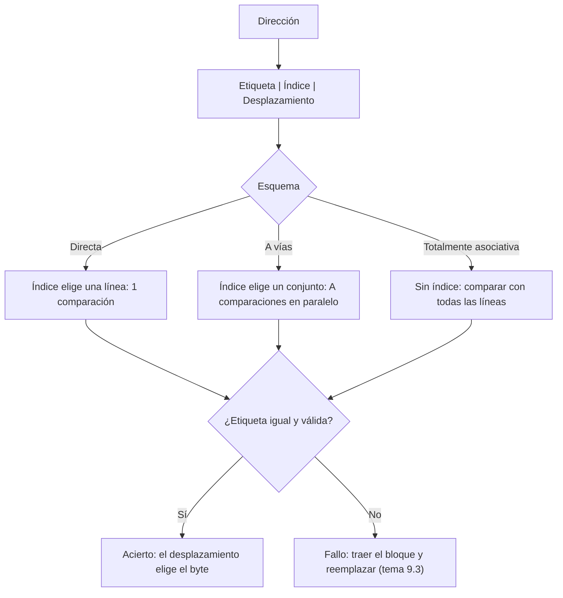

# Organización y Arquitectura de Computadoras - La jerarquía de memoria

## 9.2 Esquemas de colocación de bloques en un cache

---

Una caché guarda copias de bloques de la memoria, pero es mucho más pequeña: hay que decidir **dónde** puede colocarse cada bloque y cómo encontrarlo después. Las tres respuestas clásicas son la correspondencia **directa** (un solo lugar posible), la **totalmente asociativa** (cualquier lugar) y la **asociativa por conjuntos** (un lugar dentro de un pequeño grupo). Este tema describe cómo se divide una dirección en etiqueta, índice y desplazamiento en cada esquema, cuánto hardware requiere cada uno y cómo afecta a la tasa de fallos.

### La dirección vista por la caché

Una caché de $C$ bytes con líneas de $L$ bytes tiene $C / L$ líneas. Con asociatividad de $A$ vías, las líneas se agrupan en $S = C / (L \cdot A)$ **conjuntos**. Una dirección de $n$ bits se divide en:

| Campo | Bits | Función |
| --- | --- | --- |
| etiqueta (_tag_) | $n - \log_2 S - \log_2 L$ | identifica qué bloque de memoria ocupa la línea |
| índice | $\log_2 S$ | elige el conjunto |
| desplazamiento (_offset_) | $\log_2 L$ | elige el byte dentro de la línea |

El número de bloque es $\lfloor \text{dirección} / L \rfloor,$ el conjunto es $\text{bloque} \bmod S$ y la etiqueta es $\lfloor \text{bloque} / S \rfloor.$ Cada línea guarda, además de los datos, su etiqueta, un **bit de validez** (si contiene algo) y, con escritura diferida, un **bit de modificado** (tema 9.4).

### Los tres esquemas

**Correspondencia directa,** con $A = 1:$ cada bloque tiene un único lugar posible, la línea $\text{bloque} \bmod (C/L).$ Para buscar basta leer esa línea y comparar **una** etiqueta. Es la más rápida y barata, pero dos bloques que se usan alternadamente y caen en la misma línea se expulsan mutuamente aunque el resto de la caché esté vacío: **fallos de conflicto**.

**Totalmente asociativa,** con $S = 1:$ un bloque puede ir en cualquier línea. No hay índice, y hay que comparar la etiqueta con **todas** las líneas a la vez, con un comparador por línea (una memoria direccionable por contenido). Elimina los conflictos, pero solo es práctica para estructuras pequeñas, como las TLB (tema 9.6).

**Asociativa por conjuntos de $A$ vías:** el bloque va en un conjunto fijo, pero dentro de él en cualquiera de las $A$ líneas. Se comparan $A$ etiquetas en paralelo y un multiplexor elige el dato. Es el compromiso usado en casi todas las cachés: L1 de 8 a 12 vías, L2 y L3 de 8 a 16.



### Comparación

| Aspecto | Directa | $A$ vías | Totalmente asociativa |
| --- | --- | --- | --- |
| lugares para un bloque | 1 | $A$ | todos |
| comparadores | 1 | $A$ | uno por línea |
| fallos de conflicto | muchos | pocos | ninguno |
| tiempo de acierto | mínimo | algo mayor (comparación y multiplexor) | mayor |
| política de reemplazo | innecesaria | necesaria | necesaria |

**Regla empírica 2:1.** Una caché de correspondencia directa de tamaño $C$ tiene aproximadamente la misma tasa de fallos que una de 2 vías de tamaño $C/2.$ Más allá de 8 vías la mejora es pequeña.

**Al aumentar la asociatividad** con tamaño fijo, el índice pierde un bit por cada duplicación y la etiqueta lo gana: el almacenamiento de etiquetas crece ligeramente.

### Implementación en Python

El programa calcula la división de las direcciones de los ejercicios 1 a 3, simula el ejercicio 4 en una caché directa y en una totalmente asociativa, muestra un caso de conflicto patológico (dos arreglos separados exactamente por el tamaño de la caché) con distintas asociatividades, y calcula el tamaño de las etiquetas.

```python
# Simulador de caché asociativa por conjuntos con políticas de reemplazo y de escritura
from collections import OrderedDict


class Cache:
    def __init__(self, tam, linea, vias, reemplazo="LRU", escritura="WB", asignar_en_escritura=True):
        self.linea, self.vias = linea, vias
        self.conjuntos = tam // (linea * vias)
        self.reemplazo, self.escritura, self.asignar = reemplazo, escritura, asignar_en_escritura
        self.sets = [OrderedDict() for _ in range(self.conjuntos)]   # etiqueta -> [sucio, usos]
        self.aciertos = self.fallos = self.escrituras_mem = self.lecturas_mem = 0

    def partir(self, dir_):
        bloque = dir_ // self.linea
        return bloque // self.conjuntos, bloque % self.conjuntos, dir_ % self.linea   # etiqueta, índice, desplazamiento

    def _victima(self, s):
        if self.reemplazo == "LFU":
            return min(s, key=lambda e: s[e][1])        # el menos usado (empate: el más antiguo)
        return next(iter(s))                            # LRU y FIFO: el primero del orden

    def acceso(self, dir_, escribir=False):
        etiqueta, i, _ = self.partir(dir_)
        s = self.sets[i]
        if etiqueta in s:
            self.aciertos += 1
            s[etiqueta][1] += 1
            if self.reemplazo == "LRU":
                s.move_to_end(etiqueta)
            if escribir:
                if self.escritura == "WT":
                    self.escrituras_mem += 1
                else:
                    s[etiqueta][0] = True
            return True
        self.fallos += 1
        if escribir and not self.asignar:               # sin asignación: se escribe directo en memoria
            self.escrituras_mem += 1
            return False
        if len(s) >= self.vias:
            v = self._victima(s)
            if s[v][0]:
                self.escrituras_mem += 1                # reescritura del bloque sucio
            del s[v]
        self.lecturas_mem += 1
        s[etiqueta] = [False, 1]
        if escribir:
            if self.escritura == "WT":
                self.escrituras_mem += 1
            else:
                s[etiqueta][0] = True
        return False

    def tasa(self):
        return self.aciertos / (self.aciertos + self.fallos)
from math import log2


def campos(tam, linea, vias, bits_dir=32):
    conjuntos = tam // (linea * vias)
    d, i = int(log2(linea)), int(log2(conjuntos))
    return conjuntos, d, i, bits_dir - i - d


def descomponer(dir_, tam, linea, vias, bits_dir=32):
    conjuntos, d, i, t = campos(tam, linea, vias, bits_dir)
    return dir_ >> (d + i), (dir_ >> d) & (conjuntos - 1), dir_ & (linea - 1)


# Ejercicio 1
conj, d, i, t = campos(64 * 1024, 32, 1)
et, ind, des = descomponer(0xABCD1234, 64 * 1024, 32, 1)
print(f"ejercicio 1: {conj} líneas; 0xABCD1234 -> etiqueta 0x{et:X} ({t} bits), índice 0x{ind:X} = {ind} ({i} bits),"
      f" desplazamiento 0x{des:X} = {des} ({d} bits)")
# Ejercicio 2
conj, d, i, t = campos(128 * 1024, 64, 1)
print(f"ejercicio 2: desplazamiento {d} bits, índice {i} bits, etiqueta {t} bits")
# Ejercicio 3
for vias in (4, 1):
    conj, d, i, t = campos(256 * 1024, 128, vias)
    print(f"ejercicio 3, {vias} vía{'s' if vias > 1 else ''}: {conj} conjuntos; desplazamiento {d}, índice {i}, etiqueta {t} bits;"
          f" comparadores de etiqueta: {vias}")

# Ejercicio 4: correspondencia directa, 8 líneas de 4 bytes
c = Cache(32, 4, 1)
traza = [0x100, 0x104, 0x108, 0x10C, 0x110, 0x114, 0x118, 0x11C, 0x120, 0x100]
res = []
for a in traza:
    et, ind, _ = c.partir(a)
    res.append(f"0x{a:X}:{'A' if c.acceso(a) else 'F'}(línea {ind})")
print("ejercicio 4:", " ".join(res))
print(f"   aciertos {c.aciertos} de {len(traza)}")
c2 = Cache(32, 4, 8)
for a in traza:
    c2.acceso(a)
print(f"   totalmente asociativa de 8 líneas con LRU: aciertos {c2.aciertos} (9 bloques distintos no caben en 8)")

# Conflictos: dos arreglos cuya distancia es múltiplo del tamaño de la caché
for vias in (1, 2, 4, 8):
    c = Cache(8 * 1024, 64, vias)
    for _ in range(4):
        for k in range(0, 4096, 4):
            c.acceso(k)                 # a[k]
            c.acceso(8192 + k)          # b[k], a 8 KiB de distancia
    print(f"a[i] + b[i] con arreglos a 8 KiB, caché de 8 KiB y {vias} vía{'s' if vias > 1 else ''}: tasa de fallos {1 - c.tasa():.1%}")

# Costo de almacenamiento de las etiquetas (bit de validez + bit sucio + etiqueta) para 32 KiB y líneas de 64 B
for vias in (1, 4, 8, 512):
    conj, d, i, t = campos(32 * 1024, 64, vias)
    bits_extra = (32 * 1024 // 64) * (t + 2)
    print(f"{vias:3d} vía{'s' if vias > 1 else ' '}: etiqueta de {t} bits, {bits_extra / 8:.0f} bytes de etiquetas ({bits_extra / (32 * 1024 * 8):.1%})")
```

Salida:

```text
ejercicio 1: 2048 líneas; 0xABCD1234 -> etiqueta 0xABCD (16 bits), índice 0x91 = 145 (11 bits), desplazamiento 0x14 = 20 (5 bits)
ejercicio 2: desplazamiento 6 bits, índice 11 bits, etiqueta 15 bits
ejercicio 3, 4 vías: 512 conjuntos; desplazamiento 7, índice 9, etiqueta 16 bits; comparadores de etiqueta: 4
ejercicio 3, 1 vía: 2048 conjuntos; desplazamiento 7, índice 11, etiqueta 14 bits; comparadores de etiqueta: 1
ejercicio 4: 0x100:F(línea 0) 0x104:F(línea 1) 0x108:F(línea 2) 0x10C:F(línea 3) 0x110:F(línea 4) 0x114:F(línea 5) 0x118:F(línea 6) 0x11C:F(línea 7) 0x120:F(línea 0) 0x100:F(línea 0)
   aciertos 0 de 10
   totalmente asociativa de 8 líneas con LRU: aciertos 0 (9 bloques distintos no caben en 8)
a[i] + b[i] con arreglos a 8 KiB, caché de 8 KiB y 1 vía: tasa de fallos 100.0%
a[i] + b[i] con arreglos a 8 KiB, caché de 8 KiB y 2 vías: tasa de fallos 1.6%
a[i] + b[i] con arreglos a 8 KiB, caché de 8 KiB y 4 vías: tasa de fallos 1.6%
a[i] + b[i] con arreglos a 8 KiB, caché de 8 KiB y 8 vías: tasa de fallos 1.6%
  1 vía : etiqueta de 17 bits, 1216 bytes de etiquetas (3.7%)
  4 vías: etiqueta de 19 bits, 1344 bytes de etiquetas (4.1%)
  8 vías: etiqueta de 20 bits, 1408 bytes de etiquetas (4.3%)
512 vías: etiqueta de 26 bits, 1792 bytes de etiquetas (5.5%)
```

Con correspondencia directa, `a[i]` y `b[i]` caen siempre en la misma línea y se expulsan en cada acceso: 100 % de fallos. Con solo 2 vías caben los dos y solo quedan los fallos obligatorios, uno por línea.

### Ejercicios Propuestos

1. **Parámetros.** Una caché de correspondencia directa de 64 KiB tiene líneas de 32 bytes. ¿Cuántas líneas tiene? Para la dirección `0xABCD1234`, calcula el desplazamiento, el índice y la etiqueta.

2. **Bits.** Una caché directa de 128 KiB con líneas de 64 bytes, para una memoria de 4 GiB. ¿Cuántos bits tienen el desplazamiento, el índice y la etiqueta?

3. **Diseño.** Diseña una caché asociativa de 4 vías de 256 KiB con líneas de 128 bytes (direcciones de 32 bits) y compárala con una directa del mismo tamaño.

4. **Simulación.** Simula los accesos `0x100, 0x104, ..., 0x11C, 0x120, 0x100` en una caché directa de 8 líneas de 4 bytes. ¿Cuál es la tasa de aciertos y qué conflictos hay?

### Soluciones

**Ejercicio 1.** $64\,\text{KiB} / 32 = 2048$ líneas: 5 bits de desplazamiento, 11 de índice y $32 - 16 = 16$ de etiqueta. `0xABCD1234` $= 1010\,1011\,1100\,1101\,0001\,0010\,0011\,0100_2:$ etiqueta `0xABCD`, índice `0x091` $= 145$ y desplazamiento `0x14` $= 20.$

**Ejercicio 2.** 4 GiB requieren 32 bits de dirección. Desplazamiento $\log_2 64 = 6,$ índice $\log_2 (128\,\text{KiB} / 64) = \log_2 2048 = 11,$ etiqueta $32 - 17 = 15.$

**Ejercicio 3.** $256\,\text{KiB} / 128 = 2048$ líneas en $512$ conjuntos de 4: desplazamiento 7, índice 9 y etiqueta 16 bits, con 4 comparadores. La directa tiene 2048 conjuntos de una línea: índice 11 y etiqueta 14, con un comparador. La de 4 vías tiene menos fallos de conflicto a cambio de más comparadores y un tiempo de acierto algo mayor.

**Ejercicio 4.** Los bloques de `0x100` a `0x11C` ocupan las líneas 0 a 7 y todos fallan (fallos obligatorios). `0x120` es el bloque `0x48`, que cae en la línea 0 y expulsa a `0x100`; el último acceso a `0x100` falla por **conflicto**. Tasa de aciertos: 0 %. Incluso una caché totalmente asociativa con LRU fallaría, porque hay 9 bloques distintos para 8 líneas: ese último fallo sería entonces de **capacidad**.

### Referencias

1. Patterson, D. A., and Hennessy, J. L., _Computer Organization and Design: The Hardware/Software Interface_. Morgan Kaufmann, 2020. Secciones 5.3 y 5.4.
2. Hennessy, J. L., and Patterson, D. A., _Computer Architecture: A Quantitative Approach_. Morgan Kaufmann, 2019. Apéndice B.
3. Hill, M. D., and Smith, A. J., Evaluating associativity in CPU caches. _IEEE Transactions on Computers_ 38(12), 1989.
4. Stallings, W., _Organización y arquitectura de computadores_. Pearson, 2006. Capítulo 4.
