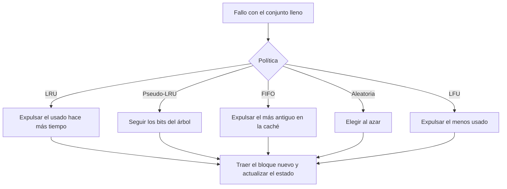

# Organización y Arquitectura de Computadoras - La jerarquía de memoria

## 9.3 Políticas de reemplazo de bloque en los caches

---

Cuando ocurre un fallo y el conjunto donde debe ir el nuevo bloque está lleno, hay que **expulsar** uno de los bloques presentes. En una caché de correspondencia directa no hay elección; con asociatividad, la **política de reemplazo** decide cuál sale. Una buena política mantiene los bloques que se volverán a usar pronto, pero el hardware no conoce el futuro: debe adivinarlo a partir del pasado, con poco estado y en muy poco tiempo. Este tema presenta la política óptima teórica, las políticas prácticas (LRU, FIFO, aleatoria, LFU y pseudo-LRU), su costo en hardware y su comportamiento con distintos patrones de acceso.

### La política óptima

**OPT** (Belady, 1966) expulsa el bloque que se usará **más tarde** en el futuro (o nunca). Es imposible de implementar, porque requiere conocer los accesos futuros, pero da el mínimo número de fallos posible y sirve como referencia.

**Por qué es óptima (idea de la demostración).** Supóngase una política cualquiera que en algún momento expulsa un bloque $x$ en lugar del bloque $y$ que OPT expulsaría (el que se usa más tarde). Intercambiando las decisiones a partir de ese momento, el próximo uso de $x,$ anterior al de $y,$ acierta en la nueva secuencia donde antes podía fallar, y se puede argumentar que el número de fallos no aumenta. Repitiendo el intercambio se transforma cualquier política en OPT sin aumentar los fallos.

### Políticas prácticas

| Política | Expulsa | Estado por conjunto de $A$ vías | Comentario |
| --- | --- | --- | --- |
| LRU (menos recientemente usado) | el bloque usado hace más tiempo | $\lceil \log_2 A! \rceil$ bits (orden completo) | aproxima OPT usando el pasado como predictor del futuro |
| pseudo-LRU en árbol | el que señalan los bits del árbol | $A - 1$ bits | aproximación barata de LRU; la usan muchas L1 y L2 |
| FIFO (primero en entrar) | el que lleva más tiempo en la caché | $\log_2 A$ bits (un puntero) | ignora los usos; sufre la anomalía de Belady en memoria virtual |
| aleatoria | uno al azar | ninguno (un generador global) | sencilla, sin casos patológicos |
| LFU (menos frecuentemente usado) | el usado menos veces | un contador por línea | conserva bloques viejos muy usados aunque ya no sirvan |

**LRU exacto** con 2 vías es un solo bit por conjunto. Con 4 vías hay $4! = 24$ órdenes posibles, que necesitan 5 bits, y la lógica de actualización crece rápido con $A;$ por eso se usan aproximaciones. En el **pseudo-LRU en árbol** de 4 vías, un bit indica qué mitad se usó menos recientemente y otro bit en cada mitad indica qué vía de ella: en cada acceso los bits del camino se ponen apuntando **lejos** de la vía usada, y para reemplazar se siguen los bits.



### Patrones de acceso

- **Bucles que caben en la caché:** todas las políticas aciertan después de la primera vuelta.
- **Bucles un poco más grandes que la caché:** caso **patológico** de LRU y FIFO: el bloque que se expulsa siempre es justo el que se necesitará después, y fallan **todos** los accesos. La aleatoria conserva por azar parte del bucle y acierta una fracción importante.
- **Barridos secuenciales sin reuso** (copiar un arreglo grande): ninguna política ayuda, y además el barrido expulsa datos útiles. Las cachés modernas detectan estos patrones e insertan los bloques en posición de "pronto expulsable" (políticas adaptativas como DIP o RRIP).
- **Accesos aleatorios uniformes:** todas las políticas dan resultados parecidos, cercanos a la fracción de los datos que cabe en la caché.

En cachés grandes y con mucha asociatividad las diferencias entre LRU y aleatoria son pequeñas; en cachés pequeñas LRU suele ser algo mejor.

### Implementación en Python

El programa simula una caché totalmente asociativa con las políticas LRU, FIFO, LFU, aleatoria y OPT sobre la traza del ejercicio 1 y sobre los patrones del ejercicio 4, calcula el estado necesario para cada política en el ejercicio 2 e implementa el pseudo-LRU en árbol de 4 vías.

```python
import random
from math import ceil, factorial, log2


def simular(traza, lineas, politica, semilla=1):
    """Caché totalmente asociativa de `lineas` líneas; devuelve (fallos, detalle por acceso)."""
    rng = random.Random(semilla)
    cache, orden, usos, fallos, detalle = [], [], {}, 0, []
    for t, x in enumerate(traza):
        if x in cache:
            detalle.append("A")
            usos[x] += 1
            if politica == "LRU":
                orden.remove(x); orden.append(x)
            continue
        fallos += 1
        detalle.append("F")
        if len(cache) == lineas:
            if politica in ("LRU", "FIFO"):
                v = orden.pop(0)
            elif politica == "LFU":
                v = min(cache, key=lambda b: (usos[b], orden.index(b)))   # empate: el más antiguo
                orden.remove(v)
            elif politica == "aleatoria":
                v = rng.choice(cache)
                orden.remove(v)
            else:  # OPT de Belady: el que se usará más tarde (o nunca)
                futuro = traza[t + 1:]
                v = max(cache, key=lambda b: futuro.index(b) if b in futuro else len(futuro) + 1)
                orden.remove(v)
            cache.remove(v)
        cache.append(x); orden.append(x); usos[x] = 1
    return fallos, "".join(detalle)


traza = list("ABCDAEBADFCG")
print("ejercicio 1, caché de 4 líneas, traza", " ".join(traza))
for p in ("LRU", "FIFO", "LFU", "OPT"):
    f, d = simular(traza, 4, p)
    print(f"   {p:5s}: {d}  fallos {f}, aciertos {len(traza) - f} ({(len(traza) - f) / len(traza):.0%})")

# Ejercicio 4: patrones
gen = random.Random(3)
patrones = {
    "barrido secuencial de 100 bloques (2 veces)": list(range(100)) * 2,
    "bucle de 5 bloques con 4 líneas (20 vueltas)": list(range(5)) * 20,
    "bucle de 3 bloques con 4 líneas (20 vueltas)": list(range(3)) * 20,
    "aleatorio uniforme sobre 8 bloques": [gen.randrange(8) for _ in range(400)],
}
print(f"{'patrón (4 líneas)':46s} {'LRU':>6s} {'FIFO':>6s} {'aleat.':>7s} {'OPT':>6s}  (tasa de aciertos)")
for nombre, tr in patrones.items():
    fila = [1 - simular(tr, 4, p)[0] / len(tr) for p in ("LRU", "FIFO", "aleatoria", "OPT")]
    print(f"{nombre:46s} " + " ".join(f"{x:6.1%}" for x in fila))

# Ejercicio 2: bits de estado por conjunto para 64 KiB, 4 vías, líneas de 64 B
lineas = 64 * 1024 // 64
conjuntos = lineas // 4
bits = {"LRU exacto (permutación)": ceil(log2(factorial(4))), "LRU con contadores de edad": 4 * 2,
        "pseudo-LRU en árbol": 4 - 1, "FIFO (puntero circular)": 2, "aleatoria": 0}
datos = 64 * 1024 * 8
for nombre, b in bits.items():
    print(f"ejercicio 2, {nombre:28s}: {b} bits por conjunto, {b * conjuntos} bits en total"
          f" ({b * conjuntos / datos:.3%} de los datos)")


# Pseudo-LRU en árbol para 4 vías: 3 bits apuntan hacia la mitad menos usada
class PLRU4:
    def __init__(self):
        self.b = [0, 0, 0]          # raíz, izquierda, derecha
        self.vias = [None] * 4

    def victima(self):
        if self.b[0] == 0:
            return 0 if self.b[1] == 0 else 1
        return 2 if self.b[2] == 0 else 3

    def tocar(self, v):             # los bits apuntan lejos de la vía usada
        self.b[0] = 1 if v < 2 else 0
        if v < 2:
            self.b[1] = 1 if v == 0 else 0
        else:
            self.b[2] = 1 if v == 2 else 0

    def acceso(self, x):
        if x in self.vias:
            self.tocar(self.vias.index(x))
            return True
        v = self.vias.index(None) if None in self.vias else self.victima()
        self.vias[v] = x
        self.tocar(v)
        return False


p = PLRU4()
d = "".join("A" if p.acceso(x) else "F" for x in traza)
print(f"pseudo-LRU (árbol) en la traza del ejercicio 1: {d}  fallos {d.count('F')}")
```

Salida:

```text
ejercicio 1, caché de 4 líneas, traza A B C D A E B A D F C G
   LRU  : FFFFAFFAAFFF  fallos 9, aciertos 3 (25%)
   FIFO : FFFFAFAFAFFF  fallos 9, aciertos 3 (25%)
   LFU  : FFFFAFFAAFFF  fallos 9, aciertos 3 (25%)
   OPT  : FFFFAFAAAFFF  fallos 8, aciertos 4 (33%)
patrón (4 líneas)                                 LRU   FIFO  aleat.    OPT  (tasa de aciertos)
barrido secuencial de 100 bloques (2 veces)      0.0%   0.0%   0.0%   2.0%
bucle de 5 bloques con 4 líneas (20 vueltas)     0.0%   0.0%  59.0%  72.0%
bucle de 3 bloques con 4 líneas (20 vueltas)    95.0%  95.0%  95.0%  95.0%
aleatorio uniforme sobre 8 bloques              50.8%  49.5%  45.8%  70.8%
ejercicio 2, LRU exacto (permutación)    : 5 bits por conjunto, 1280 bits en total (0.244% de los datos)
ejercicio 2, LRU con contadores de edad  : 8 bits por conjunto, 2048 bits en total (0.391% de los datos)
ejercicio 2, pseudo-LRU en árbol         : 3 bits por conjunto, 768 bits en total (0.146% de los datos)
ejercicio 2, FIFO (puntero circular)     : 2 bits por conjunto, 512 bits en total (0.098% de los datos)
ejercicio 2, aleatoria                   : 0 bits por conjunto, 0 bits en total (0.000% de los datos)
pseudo-LRU (árbol) en la traza del ejercicio 1: FFFFAFAAAFFF  fallos 8
```

En el bucle de 5 bloques con 4 líneas, LRU y FIFO no aciertan nunca, mientras que la aleatoria acierta el 59 % y OPT el 72 %. En la traza del ejercicio 1, el pseudo-LRU coincide por casualidad con OPT.

### Ejercicios Propuestos

1. **Simulación.** Simula la traza `A, B, C, D, A, E, B, A, D, F, C, G` en una caché de 4 líneas con LRU, FIFO y LFU. Calcula los fallos y la tasa de aciertos de cada una.

2. **Costo.** Para una caché de 4 vías de 64 KiB con líneas de 64 bytes, ¿cuántos bits hacen falta para LRU exacto? Compáralo con FIFO y con pseudo-LRU. ¿Qué fracción del almacenamiento de datos representan?

3. **Política híbrida.** Propón una política que combine LRU y LFU y describe su implementación.

4. **Patrones.** ¿Qué política conviene para: (a) un barrido secuencial de un arreglo grande; (b) accesos aleatorios uniformes; (c) bucles anidados pequeños; (d) reusos con períodos largos?

### Soluciones

**Ejercicio 1.** Los primeros cuatro accesos fallan (obligatorios) y el quinto, `A`, acierta. LRU: `E` expulsa a `B` (el menos reciente), luego `B` falla, `A` acierta, `D` acierta, y `F`, `C`, `G` fallan: 9 fallos, 25 % de aciertos. FIFO: `E` expulsa a `A` (el más antiguo); `B` acierta, `A` falla, `D` acierta: también 9 fallos. LFU: `E` expulsa a `B` (usado una vez, y el más antiguo entre los empatados): 9 fallos. OPT logra 8.

**Ejercicio 2.** Hay $1024$ líneas en $256$ conjuntos. LRU exacto: $\lceil \log_2 24 \rceil = 5$ bits por conjunto, 1280 bits (con contadores de edad de 2 bits por vía, 2048). FIFO: 2 bits por conjunto, 512 bits. Pseudo-LRU: 3 bits, 768 bits. Frente a los $2^{19}$ bits de datos, todos son menos del 0.4 %: el costo real de LRU exacto no es el almacenamiento, sino la lógica de actualización en cada acceso.

**Ejercicio 3.** Por ejemplo, dividir cada conjunto en una parte "reciente" gestionada por LRU y otra "frecuente": un bloque que se reutiliza varias veces se promueve a la segunda, y se expulsa primero de la parte reciente. Así un barrido no expulsa los bloques muy usados. Requiere un contador o un bit de promoción por línea y lógica para elegir de qué parte expulsar. Es la idea de políticas como ARC o 2Q en cachés de software.

**Ejercicio 4.** (a) Ninguna acierta; conviene no guardar el barrido (insertarlo como expulsable o evitar la caché). (b) Cualquiera: la aleatoria es la más barata. (c) LRU, que conserva el conjunto de trabajo del bucle si cabe. (d) LFU o políticas que protegen los bloques reutilizados frente a los de un solo uso; si el período supera la capacidad, la aleatoria evita el caso patológico de LRU.

### Referencias

1. Hennessy, J. L., and Patterson, D. A., _Computer Architecture: A Quantitative Approach_. Morgan Kaufmann, 2019. Apéndice B.
2. Belady, L. A., A study of replacement algorithms for a virtual-storage computer. _IBM Systems Journal_ 5(2), 1966.
3. Jaleel, A., Theobald, K. B., Steely, S. C., and Emer, J., High performance cache replacement using re-reference interval prediction (RRIP). _ISCA_, 2010.
4. Patterson, D. A., and Hennessy, J. L., _Computer Organization and Design: The Hardware/Software Interface_. Morgan Kaufmann, 2020. Sección 5.4.
